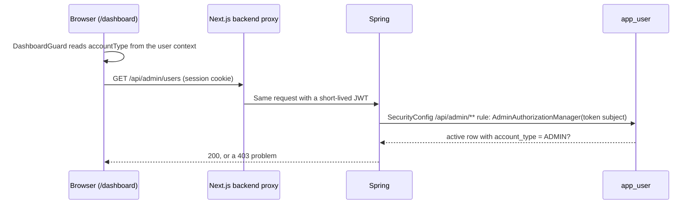

# Disscount: Admin dashboard

A reference for the admin dashboard (`/dashboard`) and the `/api/admin/**` endpoints behind it: who can open it, what each tab does, which tables it reads and writes, and where the security boundary really is. Written for someone still learning the codebase.

> **Mental model in one sentence:** `/dashboard` is a client page whose guard is only a convenience; the real boundary is the `/api/admin/**` rule in Spring's `SecurityConfig`, and a test walks every admin route to prove it.

How admin is granted, why there is no `@PreAuthorize`, and the guard against demoting yourself or the last admin are documented once in [AUTH.md section 7.1](AUTH.md#71-admin-access). The photo review queue has its own doc, [PRODUCT-IMAGES.md](PRODUCT-IMAGES.md). This doc covers the dashboard as a whole and links there.

---

## 1. Quick reference

| Thing               | Value                                                                                                                               |
| ------------------- | ----------------------------------------------------------------------------------------------------------------------------------- |
| Page                | `/dashboard` (`app/[locale]/dashboard/`), a client page behind `DashboardGuard`                                                     |
| Nav link            | Header and sidebar, shown when `canAccessDashboard(accountType)` is true                                                            |
| Tabs (admins)       | Korisnici (users), Kontakt (contact inbox), Slike proizvoda (product photo queue)                                                   |
| Account types       | `ADMIN`, `CONSUMER` (default), `ENTERPRISE`, `PUBLIC_SECTOR` (`AccountType.java`)                                                   |
| Backend check       | `/api/admin/**` rule in `SecurityConfig`, through `AdminAuthorizationManager`; a `403` problem response otherwise                   |
| Endpoints           | `/api/admin/users`, `/api/admin/contact`, `/api/admin/product-images`                                                               |
| Other admin-only UI | The photo gallery's admin controls on the product page, and a "new post" button on `/updates` that only shows a "coming soon" toast |
| Copy                | `frontend/src/i18n/messages/<locale>/dashboard.json`                                                                                |

---

## 2. Who sees what

| Account type    | Nav link | `/dashboard` shows                 | Admin API |
| --------------- | -------- | ---------------------------------- | --------- |
| Signed out      | No       | Spinner, then a redirect to `/`    | 401       |
| `CONSUMER`      | No       | Spinner, then a redirect to `/`    | 403       |
| `ENTERPRISE`    | Yes      | The title and a "coming soon" line | 403       |
| `PUBLIC_SECTOR` | Yes      | The title and a "coming soon" line | 403       |
| `ADMIN`         | Yes      | The three tabs                     | 2xx       |

`ENTERPRISE` and `PUBLIC_SECTOR` are placeholders for retail partners and public bodies; they have no features yet. Nothing in the app sets them except an admin choosing them on the Users tab.

---

## 3. How a request is checked

- **The guard is cosmetic.** `DashboardGuard` redirects in the browser, after the page's JavaScript has loaded. Anyone can read the dashboard's code; the data is what is protected.
- **The admin rule is one URL rule in the security chain.** `SecurityConfig` sends everything under `/api/admin/**` through `AdminAuthorizationManager`, before any controller runs, so no handler or service checks for itself and a new route under that path is gated from its first line. The refusal is a 403 `application/problem+json` body (`urn:disscount:forbidden`, translated title and detail), the same shape as every other error; the dashboard branches on the status only and shows its own message.
- **The role is read from the database on every call.** The JWT carries no role, so a promotion or demotion applies on the next request.

The proxy that turns the session into a backend token is in [BACKEND-PROXY.md](BACKEND-PROXY.md).

---

## 4. Users tab

**Stats.** Two cards, weekly and monthly active users ("WAU", "MAU"), each with a window picker of 1, 7, 14, 30 or 90 days. `countActiveUsers` (`app/[locale]/dashboard/utils/user-activity.ts`) counts users whose `lastActiveAt` falls inside the trailing window, allowing up to one hour in the future for clock skew. It runs in the browser over the same cached user list as the table, so there is no extra request. Only the latest activity per user is stored, so the window can only end at "now".

**Table** (`admin-users-table.tsx`, `admin-user-row.tsx`): username (with a "you" badge on your own row), email, last sign-in, account type select, and a delete button.

| Column       | Comes from                                                                                            |
| ------------ | ----------------------------------------------------------------------------------------------------- |
| Username     | `app_user.username`                                                                                   |
| Email        | better-auth's `user` table, joined in `UserService.findAllActive` through `AuthIdentityDao`           |
| Last sign-in | The later of `user.last_login_at` and the newest surviving session's `created_at`                     |
| Last active  | The later of `app_user.last_active_at` and the newest session's `updated_at` (feeds the stats)        |
| Photos       | `GET /api/admin/product-images/contributors`: photos the user uploaded, and how many an admin deleted |
| Account type | `app_user.account_type`                                                                               |

`lastLoginAt` and `lastActiveAt` are sent as `Instant`s with an offset, so the browser's date maths is not shifted by each admin's time zone ([AUTH.md](AUTH.md#13-gotchas-and-lessons)).

**Changing an account type** (`PATCH /api/admin/users/{userId}`): the select updates the cached list optimistically, rolls back only that row on error, and refetches once the last pending change settles, so a refetch never shows another row's old value. Your own row's select is disabled in the browser, and the backend also refuses demoting yourself or the last admin with 409. A change that grants or removes `ADMIN` writes an `admin_audit` row ([8](#8-tables-the-dashboard-touches)); a change between the other types, or to the type the user already has, writes none.

**Deleting a user** (`DELETE /api/admin/users/{userId}`): a confirm dialog, then the Next.js route at that path forwards to `UserService.deleteUserAsAdmin`, which refuses your own id (`error.user.cannotDeleteSelf`) and answers 409 `error.user.lastAdminDelete` when the target is the last live admin, both before anything is deleted. It then runs the same `deleteAccount` as a self-service deletion: anonymised profile, cards and favourite stores removed, tombstone written. Once Spring answers 2xx, the route deletes the better-auth identity (and with it every session and linked account). The order and its failure cases are in [AUTH.md](AUTH.md#74-who-deletes-a-login). What is kept is listed in [SETTINGS.md](SETTINGS.md#8-deleting-the-account). The same transaction writes an `admin_audit` row, so a delete that rolls back leaves none.

---

## 5. Contact tab

Every message from the public contact form (`POST /api/contact`, the `?modal=contact` modal) lands here.

- **Storage.** Table `contact_message`: an optional link to the sender's `app_user` (set when the sender was signed in), `email`, `full_name`, `subject`, `message` (up to 5000 characters), `source_path` (the page it was sent from), `read_at`, plus created and deleted times.
- **Spam defence.** A hidden honeypot field: a submission that fills it is silently dropped. `ContactRateLimiter` allows 5 messages an hour and 20 a day per client IP, in memory ([AUTH.md section 8.3](AUTH.md#83-rate-limits-and-the-visitors-address)).
- **List.** Newest first, at most 500 (`MAX_ADMIN_MESSAGES`); there is no pagination. Filters: all or unread, a "show deleted" switch (a separate query key, `includeDeleted`), and a search over name, email, subject and message.
- **Actions.** Mark read or unread, soft delete, restore, copy the sender's email, open the full message, and reply, a `mailto:` link that opens the admin's mail client. Each action shows a toast.
- **No notification.** Nothing emails or pings the admin when a message arrives; the inbox has to be checked.

---

## 6. Photos tab

The product photo review queue: candidates from Open Food Facts and user uploads, with filters for to-do, pending and reported, and an editor to set the main photo, verify, hide, crop and rotate. It is documented in full in [PRODUCT-IMAGES.md](PRODUCT-IMAGES.md), including its eight endpoints under `/api/admin/product-images`.

---

## 7. Endpoints

| Method and path                                 | Handler                       | What it does                                                                                                                      |
| ----------------------------------------------- | ----------------------------- | --------------------------------------------------------------------------------------------------------------------------------- |
| `GET /api/admin/users`                          | `AdminController`             | Every active user with email and activity; unbounded                                                                              |
| `PATCH /api/admin/users/{userId}`               | `AdminController`             | Set `accountType`; 409 for self-demotion or the last admin                                                                        |
| `DELETE /api/admin/users/{userId}`              | `AdminController`             | Erase a user's app data, then the Next.js route deletes the login; refuses yourself, and the last admin with 409                  |
| `GET /api/admin/contact?includeDeleted=`        | `AdminContactController`      | Up to 500 messages, newest first                                                                                                  |
| `GET /api/admin/contact/{id}`                   | `AdminContactController`      | One message                                                                                                                       |
| `PATCH /api/admin/contact/{id}/read`, `/unread` | `AdminContactController`      | Set or clear `read_at`                                                                                                            |
| `DELETE /api/admin/contact/{id}`                | `AdminContactController`      | Soft delete                                                                                                                       |
| `PATCH /api/admin/contact/{id}/restore`         | `AdminContactController`      | Undo the soft delete; deleted messages load through native queries ([AUTH.md 7.3](AUTH.md#73-soft-delete-and-the-erasure-ledger)) |
| `/api/admin/product-images/**`                  | `AdminProductImageController` | See [PRODUCT-IMAGES.md](PRODUCT-IMAGES.md)                                                                                        |

Swagger lists them all at `/api-docs`.

---

## 8. Tables the dashboard touches

| Table                                                                                                       | Read                       | Written                                          |
| ----------------------------------------------------------------------------------------------------------- | -------------------------- | ------------------------------------------------ |
| `app_user`                                                                                                  | Yes                        | `account_type`; erasure fields on delete         |
| better-auth `user`, `session`                                                                               | Yes (email, sign-in times) | Deleted on an admin delete, by the Next.js route |
| `erasure_ledger`                                                                                            | No                         | A tombstone on delete                            |
| `admin_audit`                                                                                               | No                         | One row per admin action, list or message read   |
| `wallet_card`, `wallet_card_photo` (photos queued in `photo_cleanup`), `favorite_store`, `store_name_usage` | No                         | Deleted on an admin delete                       |
| `contact_message`                                                                                           | Yes                        | `read_at`, `deleted_at`                          |
| Product image tables                                                                                        | Yes                        | See [PRODUCT-IMAGES.md](PRODUCT-IMAGES.md)       |

**The admin audit** (`app.admin_audit`, migrations `V5` and `V7`). Every admin action that succeeds writes one row inside the transaction of the action itself, through `AdminAuditLog`: the acting admin's id (`actor_user_id`), the user it touched (`target_user_id`) or the contact message (`object_id`), the action (under the check `ck_admin_audit_action`) and `occurred_at`, stamped with `Timestamps.nowUtc()`. It holds no email, name or free text. Because the row shares the action's transaction, a failed insert fails the action, so an action without its record cannot happen. A refused action (403, the 400s for your own id or an unknown one, the 404 of an unknown message, the 409s of the admin guards) writes nothing, because the refusal comes before the insert or rolls it back. A repeated delete of an already erased account succeeds again and writes another `DELETE_USER` row, because each row is one admin request that succeeded.

| Action                                                                                                          | Written by                                      | `target_user_id` | `object_id` |
| --------------------------------------------------------------------------------------------------------------- | ----------------------------------------------- | ---------------- | ----------- |
| `DELETE_USER`, `PROMOTE_TO_ADMIN`, `DEMOTE_FROM_ADMIN`                                                          | `UserService`, every time                       | The user         | Null        |
| `READ_USER_LIST`                                                                                                | `GET /api/admin/users`, once per window         | Null             | Null        |
| `READ_CONTACT_LIST`                                                                                             | `GET /api/admin/contact`, once per window       | Null             | Null        |
| `READ_CONTACT_MESSAGE`                                                                                          | `GET /api/admin/contact/{id}`, once per window  | Null             | The message |
| `MARK_CONTACT_MESSAGE_READ`, `MARK_CONTACT_MESSAGE_UNREAD`, `DELETE_CONTACT_MESSAGE`, `RESTORE_CONTACT_MESSAGE` | `ContactMessageService`, every time             | Null             | The message |
| `READ_AUDIT`                                                                                                    | Reserved for the audit view, which is not built | Null             | Null        |

- **Reads are deduplicated per admin per 10 minutes** (`AdminAuditLog.READ_DEDUP_WINDOW`). The dashboard refetches its lists on focus and after every change, so one row per read would bury the changes. Ten minutes still says which admin looked and roughly when; a read of a different message is a new row. The dedup is a lookup before the insert, so two reads at the same instant can both write a row, which is harmless.
- **Append only.** `AdminAuditRepository` can only insert and read, every column but the generated id is `updatable = false`, and since #429 R11 the backend's database login has only `INSERT` and `SELECT` on it, so an `UPDATE`, `DELETE` or `TRUNCATE` from Spring is refused (`BackendLoginTest`, `DatabaseRolesTest`). Only the database owner and the migrator can still change rows: the migrator owns the table, and an owner can always grant itself rights back. That is the honest limit of a grant-based append-only table.
- **Kept 12 months.** `AuditRetentionJob` (Spring, hourly at minute 47 UTC) calls `app.purge_admin_audit()`, a `SECURITY DEFINER` function owned by the migrator that deletes rows older than 12 months and nothing younger. The backend login holds `EXECUTE` on it and no `DELETE`, so a stolen backend login can remove only rows already past retention. 12 months follows the CNIL recommendation of six months to a year for security logs and closes the retention question #687 left for #217; the privacy policy states it in the section "Sigurnosni zapisnik". The same job purges the Next.js sign-in events ([AUTH.md 8.6](AUTH.md#86-security-event-log)).
- **No foreign keys.** An admin may delete an id that only `erasure_ledger` knows (a login that never got a profile, [AUTH.md 7.3](AUTH.md#73-soft-delete-and-the-erasure-ledger)), so a key on `target_user_id` would make that delete fail. A key on either id would also block a later hard purge of erased `app_user` rows, or with a cascade delete the record of what an admin did.
- **Account erasure keeps the rows.** No `AccountErased` listener touches the table, so erasing the target or the admin, by themselves, by another admin or through the erasure replay, leaves every row (`AdminAuditTest`). The rows hold ids only, like `erasure_ledger`, and are the record of who did what until the 12 months end.
- **A backup restore loses newer rows and brings back purged ones.** Restoring a dump drops the rows written after it and returns rows the purge removed since; the next hourly purge removes those again. The erasure replay brings back the erasures, not the audit.
- **Nothing reads it yet.** There is no dashboard view; read it with SQL on the server, for example `SELECT * FROM app.admin_audit ORDER BY occurred_at DESC LIMIT 50`.

---

## 9. What is automatic vs manual

| Task                                  | Automatic or manual      | Notes                                                                                  |
| ------------------------------------- | ------------------------ | -------------------------------------------------------------------------------------- |
| First admin                           | Automatic                | The first profile ever created becomes `ADMIN` ([AUTH.md](AUTH.md#71-admin-access))    |
| Promoting or demoting                 | Manual, on the Users tab | Not yourself, and never the last admin (409)                                           |
| Recovering when no admin is left      | Manual, on the server    | Only after deleting admins; `UPDATE app.app_user SET account_type = 'ADMIN' WHERE ...` |
| Reading contact messages              | Manual                   | No alert on arrival                                                                    |
| Purging soft-deleted contact messages | Not built                | They stay until deleted in the database                                                |
| Purging the admin audit               | Automatic, hourly        | `AuditRetentionJob` deletes rows older than 12 months                                  |
| Reviewing product photos              | Manual                   | [PRODUCT-IMAGES.md](PRODUCT-IMAGES.md)                                                 |

---

## 10. Key files

| Path                                                                      | Role                                                                           |
| ------------------------------------------------------------------------- | ------------------------------------------------------------------------------ |
| `frontend/src/lib/api/schemas/auth-user.ts`                               | `canAccessDashboard`, `isAdmin`                                                |
| `backend/src/main/java/disscount/user/UserService.java`                   | `findAllActiveAsAdmin`, `updateAccountType` and its guard, `deleteUserAsAdmin` |
| `backend/src/main/java/disscount/user/AdminAuditEntry.java`               | One `admin_audit` row; `AdminAction` lists the actions                         |
| `backend/src/main/java/disscount/user/AdminAuditLog.java`                 | Writes the rows in the action's transaction, deduplicates reads                |
| `backend/src/main/java/disscount/user/AuditRetentionJob.java`             | The hourly purge of both audit tables through their definer functions          |
| `backend/src/main/java/disscount/security/AdminAuthorizationManager.java` | The `/api/admin/**` rule: an ordinary session token of a live `ADMIN`          |
| `backend/src/main/java/disscount/user/AuthIdentityDao.java`               | Reads better-auth rows from Spring                                             |

---

## 11. Config, env vars and libraries

No admin-specific environment variables or feature flags. The page uses the shadcn `Tabs`, `Table` and dialog primitives, `sonner` (`^2.0.7`) for toasts and `@tanstack/react-query` (`^5.90.12`) for data; the backend is `spring-boot-starter-parent` `4.1.2`.

---

## 13. Gotchas and lessons learned

| Gotcha                                             | Why it bites                                                                                                                                                                                                                                                                                       | What to do                                                                                             |
| -------------------------------------------------- | -------------------------------------------------------------------------------------------------------------------------------------------------------------------------------------------------------------------------------------------------------------------------------------------------- | ------------------------------------------------------------------------------------------------------ |
| **An admin route outside `/api/admin/**` is open** | The rule matches that path only; anything else gets the catch-all that admits every signed-in token                                                                                                                                                                                                | Keep admin routes under `/api/admin/**`, and add each to `AdminGatingTest`, which fails until you do   |
| **Recovering when no admin is left**               | `updateAccountType`, `deleteUserAsAdmin` and deleting your own account all refuse removing the last live admin with 409 (an admin targeting their own id through the admin delete gets 400 `error.user.cannotDeleteSelf` first); only the erasure replay after a backup restore can still erase it | Recovery is a manual SQL update ([AUTH.md](AUTH.md#71-admin-access))                                   |
| **`GET /api/admin/users` returns everyone**        | No pagination, and WAU and MAU are counted over the full list in the browser, so paginating would break the stats                                                                                                                                                                                  | Move the counts to the server before paginating ([SEARCH.md](SEARCH.md#11-future-improvements--todos)) |
| **A drifted user fails the whole list**            | `lib/api/admin/index.ts` parses every user with `userDtoSchema`, so one user missing a key the backend always sends shows the load error instead of a half-filled row                                                                                                                              | Change `UserDto` and `userDtoSchema` in the same PR                                                    |
| **Contact list stops at 500**                      | Older messages silently fall off the list                                                                                                                                                                                                                                                          | Add paging when the inbox grows                                                                        |
| **Contact messages outlive the sender's account**  | Deleting an account leaves the email and name typed into the form                                                                                                                                                                                                                                  | See the open question in [SETTINGS.md](SETTINGS.md#14-future-improvements-and-todos)                   |

---

## 14. Future improvements and TODOs

- [ ] A dashboard view of `admin_audit` and `web.security_event`, after a few weeks of reading them with SQL (owner decision on #211). It needs an endpoint under `/api/admin/**`, added to `AdminGatingTest`, a view without IP address, user agent and subject hash, and it writes `READ_AUDIT` when opened.
- [ ] Denied admin requests (403 from `AdminAuthorizationManager`) are not recorded; any signed-in person can trigger them, so a row per attempt would let anyone fill the table. A structured log line is the cheaper first step if attempts show up.
- [ ] Admin hardening still open: a smaller user list. The demotion guards shipped in #429 R5 and the last-admin delete guard in R6 (AUTH.md section 7.1).
