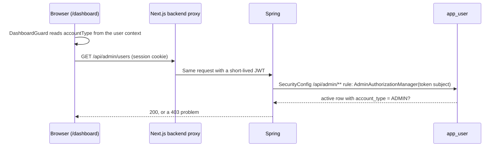

# Disscount: Admin dashboard

A reference for the admin dashboard (`/dashboard`) and the `/api/admin/**` endpoints behind it: who can open it, what each tab does, which tables it reads and writes, and where the security boundary really is. Written for someone still learning the codebase.

> **Mental model in one sentence:** `/dashboard` is a client page whose guard is only a convenience; the real boundary is the `/api/admin/**` rule in Spring's `SecurityConfig`, and a test walks every admin route to prove it.

How admin is granted, why there is no `@PreAuthorize`, and the guard that keeps at least one admin are documented once in [AUTH.md section 7.1](AUTH.md#71-admin-access). The photo review queue has its own doc, [PRODUCT-IMAGES.md](PRODUCT-IMAGES.md). This doc covers the dashboard as a whole and links there.

---

## 1. Quick reference

| Thing               | Value                                                                                                                               |
| ------------------- | ----------------------------------------------------------------------------------------------------------------------------------- |
| Page                | `/dashboard` (`app/[locale]/dashboard/`), a client page behind `DashboardGuard`                                                     |
| Nav link            | Header and sidebar, shown when `canAccessDashboard(accountType)` is true                                                            |
| Tabs (admins)       | Korisnici (users), Kontakt (contact inbox), Slike proizvoda (product photo queue)                                                   |
| Account types       | `ADMIN`, `CONSUMER` (default), `ENTERPRISE`, `PUBLIC_SECTOR` (`AccountType.java`)                                                   |
| Backend check       | `/api/admin/**` rule in `SecurityConfig`, through `AdminAuthorizationManager`; a `403` problem response otherwise                   |
| Endpoints           | `/api/admin/users`, `/api/admin/contact`, `/api/admin/product-images`                                                               |
| Other admin-only UI | The photo gallery's admin controls on the product page, and a "new post" button on `/updates` that only shows a "coming soon" toast |
| Copy                | `frontend/src/i18n/messages/<locale>/dashboard.json`                                                                                |

---

## 2. Who sees what

| Account type    | Nav link | `/dashboard` shows                 | Admin API |
| --------------- | -------- | ---------------------------------- | --------- |
| Signed out      | No       | Spinner, then a redirect to `/`    | 401       |
| `CONSUMER`      | No       | Spinner, then a redirect to `/`    | 403       |
| `ENTERPRISE`    | Yes      | The title and a "coming soon" line | 403       |
| `PUBLIC_SECTOR` | Yes      | The title and a "coming soon" line | 403       |
| `ADMIN`         | Yes      | The three tabs                     | 2xx       |

`ENTERPRISE` and `PUBLIC_SECTOR` are placeholders for retail partners and public bodies; they have no features yet. Nothing in the app sets them except an admin choosing them on the Users tab.

---

## 3. How a request is checked

- **The guard is cosmetic.** `DashboardGuard` redirects in the browser, after the page's JavaScript has loaded. Anyone can read the dashboard's code; the data is what is protected.
- **The admin rule is one URL rule in the security chain.** `SecurityConfig` sends everything under `/api/admin/**` through `AdminAuthorizationManager`, before any controller runs, so no handler or service checks for itself and a new route under that path is gated from its first line. The refusal is a 403 `application/problem+json` body (`urn:disscount:forbidden`, translated title and detail), the same shape as every other error; the dashboard branches on the status only and shows its own message.
- **The role is read from the database on every call.** The JWT carries no role, so a promotion or demotion applies on the next request.

The proxy that turns the session into a backend token is in [BACKEND-PROXY.md](BACKEND-PROXY.md).

---

## 4. Users tab

**Stats.** Two cards, weekly and monthly active users ("WAU", "MAU"), each with a window picker of 1, 7, 14, 30 or 90 days. `countActiveUsers` (`app/[locale]/dashboard/utils/user-activity.ts`) counts users whose `lastActiveAt` falls inside the trailing window, allowing up to one hour in the future for clock skew. It runs in the browser over the same cached user list as the table, so there is no extra request. Only the latest activity per user is stored, so the window can only end at "now".

**Table** (`admin-users-table.tsx`, `admin-user-row.tsx`): username (with a "you" badge on your own row), email, last sign-in, account type select, and a delete button.

| Column       | Comes from                                                                                            |
| ------------ | ----------------------------------------------------------------------------------------------------- |
| Username     | `app_user.username`                                                                                   |
| Email        | better-auth's `user` table, joined in `UserService.findAllActive` through `AuthIdentityDao`           |
| Last sign-in | The later of `user.last_login_at` and the newest surviving session's `created_at`                     |
| Last active  | The later of `app_user.last_active_at` and the newest session's `updated_at` (feeds the stats)        |
| Photos       | `GET /api/admin/product-images/contributors`: photos the user uploaded, and how many an admin deleted |
| Account type | `app_user.account_type`                                                                               |

`lastLoginAt` and `lastActiveAt` are sent as `Instant`s with an offset, so the browser's date maths is not shifted by each admin's time zone ([AUTH.md](AUTH.md#13-gotchas-and-lessons)).

**Changing an account type** (`PATCH /api/admin/users/{userId}`): the select updates the cached list optimistically, rolls back only that row on error, and refetches once the last pending change settles, so a refetch never shows another row's old value. Your own row's select is disabled in the browser only.

**Deleting a user** (`DELETE /api/admin/users/{userId}`): a confirm dialog, then `UserService.deleteUserAsAdmin`, which refuses your own id (`error.user.cannotDeleteSelf`), deletes the better-auth identity (and with it every session and linked account), then runs the same `deleteAccount` as a self-service deletion: anonymised profile, cards and favourite stores removed, tombstone written. What is kept is listed in [SETTINGS.md](SETTINGS.md#8-deleting-the-account).

---

## 5. Contact tab

Every message from the public contact form (`POST /api/contact`, the `?modal=contact` modal) lands here.

- **Storage.** Table `contact_message`: an optional link to the sender's `app_user` (set when the sender was signed in), `email`, `full_name`, `subject`, `message` (up to 5000 characters), `source_path` (the page it was sent from), `read_at`, plus created and deleted times.
- **Spam defence.** A hidden honeypot field: a submission that fills it is silently dropped. `ContactRateLimiter` allows 5 messages an hour and 20 a day per client IP, in memory ([AUTH.md section 8.3](AUTH.md#83-rate-limits-and-the-visitors-address)).
- **List.** Newest first, at most 500 (`MAX_ADMIN_MESSAGES`); there is no pagination. Filters: all or unread, a "show deleted" switch (a separate query key, `includeDeleted`), and a search over name, email, subject and message.
- **Actions.** Mark read or unread, soft delete, restore, copy the sender's email, open the full message, and reply, a `mailto:` link that opens the admin's mail client. Each action shows a toast.
- **No notification.** Nothing emails or pings the admin when a message arrives; the inbox has to be checked.

---

## 6. Photos tab

The product photo review queue: candidates from Open Food Facts and user uploads, with filters for to-do, pending and reported, and an editor to set the main photo, verify, hide, crop and rotate. It is documented in full in [PRODUCT-IMAGES.md](PRODUCT-IMAGES.md), including its eight endpoints under `/api/admin/product-images`.

---

## 7. Endpoints

| Method and path                                 | Handler                       | What it does                                                    |
| ----------------------------------------------- | ----------------------------- | --------------------------------------------------------------- |
| `GET /api/admin/users`                          | `AdminController`             | Every active user with email and activity; unbounded            |
| `PATCH /api/admin/users/{userId}`               | `AdminController`             | Set `accountType`; any active user, no self or last-admin check |
| `DELETE /api/admin/users/{userId}`              | `AdminController`             | Delete and erase a user; refuses yourself                       |
| `GET /api/admin/contact?includeDeleted=`        | `AdminContactController`      | Up to 500 messages, newest first                                |
| `GET /api/admin/contact/{id}`                   | `AdminContactController`      | One message                                                     |
| `PATCH /api/admin/contact/{id}/read`, `/unread` | `AdminContactController`      | Set or clear `read_at`                                          |
| `DELETE /api/admin/contact/{id}`                | `AdminContactController`      | Soft delete                                                     |
| `PATCH /api/admin/contact/{id}/restore`         | `AdminContactController`      | Undo the soft delete                                            |
| `/api/admin/product-images/**`                  | `AdminProductImageController` | See [PRODUCT-IMAGES.md](PRODUCT-IMAGES.md)                      |

Swagger lists them all at `/api-docs`.

---

## 8. Tables the dashboard touches

| Table                                                                                                       | Read                       | Written                                                   |
| ----------------------------------------------------------------------------------------------------------- | -------------------------- | --------------------------------------------------------- |
| `app_user`                                                                                                  | Yes                        | `account_type`; erasure fields on delete                  |
| better-auth `user`, `session`                                                                               | Yes (email, sign-in times) | Deleted on an admin delete (`AuthIdentityDao.deleteById`) |
| `erasure_ledger`                                                                                            | No                         | A tombstone on delete                                     |
| `wallet_card`, `wallet_card_photo` (photos queued in `photo_cleanup`), `favorite_store`, `store_name_usage` | No                         | Deleted on an admin delete                                |
| `contact_message`                                                                                           | Yes                        | `read_at`, `deleted_at`                                   |
| Product image tables                                                                                        | Yes                        | See [PRODUCT-IMAGES.md](PRODUCT-IMAGES.md)                |

---

## 9. What is automatic vs manual

| Task                                  | Automatic or manual      | Notes                                                                               |
| ------------------------------------- | ------------------------ | ----------------------------------------------------------------------------------- |
| First admin                           | Automatic                | The first profile ever created becomes `ADMIN` ([AUTH.md](AUTH.md#71-admin-access)) |
| Promoting or demoting                 | Manual, on the Users tab | Not yourself, and never the last admin (409)                                        |
| Recovering when no admin is left      | Manual, on the server    | Only after deleting admins; `UPDATE app_user SET account_type = 'ADMIN' WHERE ...`  |
| Reading contact messages              | Manual                   | No alert on arrival                                                                 |
| Purging soft-deleted contact messages | Not built                | They stay until deleted in the database                                             |
| Reviewing product photos              | Manual                   | [PRODUCT-IMAGES.md](PRODUCT-IMAGES.md)                                              |

---

## 10. Key files

| Path                                                                      | Role                                                                    |
| ------------------------------------------------------------------------- | ----------------------------------------------------------------------- |
| `frontend/src/lib/api/schemas/auth-user.ts`                               | `canAccessDashboard`, `isAdmin`                                         |
| `backend/src/main/java/disscount/user/UserService.java`                   | `findAllActive`, `updateAccountType` and its guard, `deleteUserAsAdmin` |
| `backend/src/main/java/disscount/security/AdminAuthorizationManager.java` | The `/api/admin/**` rule: an ordinary session token of a live `ADMIN`   |
| `backend/src/main/java/disscount/user/AuthIdentityDao.java`               | Reads and deletes better-auth rows from Spring                          |

---

## 11. Config, env vars and libraries

No admin-specific environment variables or feature flags. The page uses the shadcn `Tabs`, `Table` and dialog primitives, `sonner` (`^2.0.7`) for toasts and `@tanstack/react-query` (`^5.90.12`) for data; the backend is `spring-boot-starter-parent` `4.1.2`.

---

## 13. Gotchas and lessons learned

| Gotcha                                             | Why it bites                                                                                                                                                          | What to do                                                                                             |
| -------------------------------------------------- | --------------------------------------------------------------------------------------------------------------------------------------------------------------------- | ------------------------------------------------------------------------------------------------------ |
| **An admin route outside `/api/admin/**` is open** | The rule matches that path only; anything else gets the catch-all that admits every signed-in token                                                                   | Keep admin routes under `/api/admin/**`, and add each to `AdminGatingTest`, which fails until you do   |
| **Deleting admins can still leave none**           | `updateAccountType` refuses demoting yourself and the last admin with 409, but `deleteUserAsAdmin` only refuses deleting yourself                                     | Demote before deleting; recovery is a manual SQL update ([AUTH.md](AUTH.md#71-admin-access))           |
| **`GET /api/admin/users` returns everyone**        | No pagination, and WAU and MAU are counted over the full list in the browser, so paginating would break the stats                                                     | Move the counts to the server before paginating ([SEARCH.md](SEARCH.md#11-future-improvements--todos)) |
| **A drifted user fails the whole list**            | `lib/api/admin/index.ts` parses every user with `userDtoSchema`, so one user missing a key the backend always sends shows the load error instead of a half-filled row | Change `UserDto` and `userDtoSchema` in the same PR                                                    |
| **Contact list stops at 500**                      | Older messages silently fall off the list                                                                                                                             | Add paging when the inbox grows                                                                        |
| **Contact messages outlive the sender's account**  | Deleting an account leaves the email and name typed into the form                                                                                                     | See the open question in [SETTINGS.md](SETTINGS.md#14-future-improvements-and-todos)                   |

---

## 14. Future improvements and TODOs

- [ ] Admin hardening (method security, last-admin and self-change guards, a smaller user list): proposed in #214, which is closed, while AUTH.md records the current manual checks as an accepted decision. Reopen or file a new issue if the decision changes.
