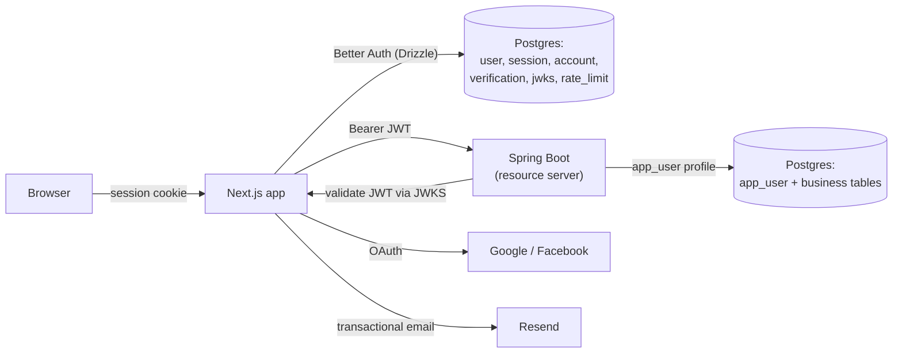
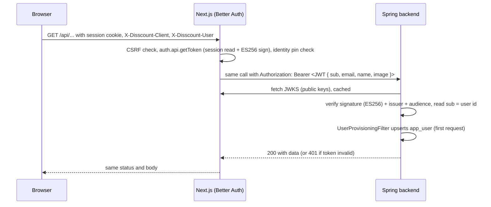
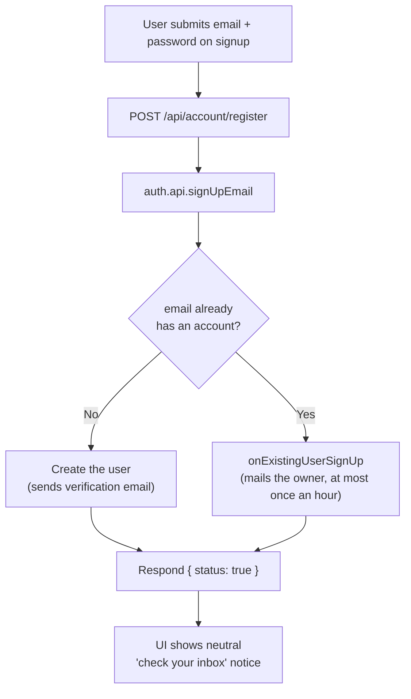
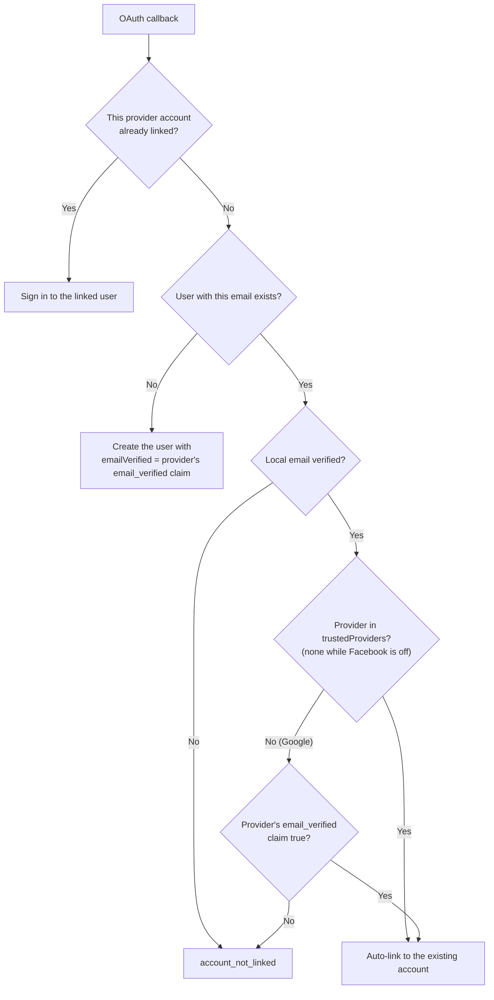

# Authentication

This document describes how login, sessions, and account security work in Disscount, end to end. It is meant to be readable if you are still learning the concepts, so it explains the ideas as it goes and leans on tables and diagrams.

The one sentence to remember: **Better Auth runs inside the Next.js app and is the identity provider; the Spring backend never logs anyone in, it only trusts a signed token.** Email is the unique key that ties a person to exactly one account, and all sign-in methods (Google, Facebook, email and password) converge on that one account.

## 1. The big picture

Authentication is split across two services that share one PostgreSQL database but own different tables.

- **Identity lives in the frontend.** Better Auth (a TypeScript auth library) runs inside Next.js. It owns the `user`, `session`, `account`, `verification`, `jwks` and `rate_limit` tables (via Drizzle ORM). It handles passwords, OAuth, email verification, and it mints signed JWT access tokens.
- **Business profile lives in the backend.** Spring Boot keeps a slim `app_user` row (same UUID primary key as the Better Auth `user`) with the username, avatar (a sanitised WebP or JPEG data URI, see [IMAGE-UPLOADS.md](IMAGE-UPLOADS.md)), notification preferences, and account type. Spring is a pure "resource server": it validates the JWT and reads the user id from it, but it has no login logic of its own.

The two halves are bridged by a signed token, not a shared session. The browser sends its backend calls to a Next.js route handler with only its session cookie; the server signs a short JWT for that session on each call and forwards the call to Spring with it as a `Bearer` token, so the browser never holds one ([BACKEND-PROXY.md](BACKEND-PROXY.md)). The backend verifies the token's signature against Better Auth's public keys (JWKS) and trusts the `sub` claim as the user id.



**Why this split?** Better Auth is TypeScript only, so it has to live with the frontend. Keeping Spring as a resource server let the existing Java business entities (which foreign-key to `app_user`) stay untouched. See the identity-vs-profile split in more detail in [Section 7](#7-the-spring-side-resource-server-and-profile-provisioning).

## 2. How a backend request gets authenticated

Better Auth issues an **ES256 JWT** (an elliptic-curve signed token). The signing keys live in the `jwks` table and are published at `GET /api/auth/jwks`. Spring fetches those public keys and verifies every incoming token.



Key facts:

- The token payload is deliberately small: `definePayload` returns only `{ email, name, image }`, and Better Auth adds the standard `sub` (the user UUID), `iss` (issuer) and `aud` (audience, the same base URL as `iss`) claims. The token lives 10 minutes (`jwt.expirationTime`): Spring verifies it locally and never asks whether the session behind it still exists, so a signed-out session, a password reset or a deletion leaves an already minted token working until it expires, plus Spring's default 60 second clock skew allowance. The web app no longer keeps a token: the proxy mints one per call, so its next call after a sign-out goes anonymous. `GET /api/auth/token` still answers browsers until P3 of #430 (token proxy) closes it. `sub` is what the backend uses everywhere via `SecurityUtils.getCurrentUserId()`.
- The proxy (`app/api/[...path]/route.ts`, `lib/backend-proxy/`) mints the token with `auth.api.getToken` on the server. `api-base.ts` (an Axios client) holds no token: it sends `X-Disscount-Client: web` (the CSRF header), `X-Disscount-User` (the tab's cache identity, the identity pin) and `Accept-Language`. The jwt plugin's `set-auth-jwt` header is off (`disableSettingJwtHeader`), so session polls no longer hand the browser a token either. [BACKEND-PROXY.md](BACKEND-PROXY.md) covers the checks, headers and errors.
- The backend only exposes Next.js to the public internet. Browsers talk to Next.js, which forwards data calls inward to Spring over the Docker network. This is why cross-origin auth is a non-issue.

## 3. Sign-in methods

| Method               | Status                 | Notes                                                                                                                                                                       |
| -------------------- | ---------------------- | --------------------------------------------------------------------------------------------------------------------------------------------------------------------------- |
| **Google**           | Live                   | Email arrives already verified from Google.                                                                                                                                 |
| **Facebook**         | Wired but **disabled** | Fully implemented, but hidden as "uskoro" behind the `FACEBOOK_COMING_SOON` flag pending Meta Business Verification. See [Section 9](#9-config-env-vars-and-feature-flags). |
| **Email + password** | Live                   | 12 to 128 characters and not in a known breach (see [Section 4.1](#41-password-policy-and-breached-passwords)); login blocked until the email is verified.                  |

**Email is a hard invariant.** Better Auth requires an email to create a user, and the whole model keys off a unique verified email. A Facebook login that returns no email is rejected and surfaced to the user as a toast (`?error=email_not_found`). No-email or profile-less users are intentionally not supported.

The login and registration UI is a single modal, `auth-modal.tsx`, with three modes: `login`, `signup`, and `forgot`. The social buttons sit below the email form so one GDPR consent notice and one set of provider buttons cover every path.

## 4. Email and password: signup and verification

Registration POSTs to a custom endpoint, `POST /api/account/register`, which checks the password and then always calls `auth.api.signUpEmail`. It never reveals whether an email already has an account (anti-enumeration): with `requireEmailVerification` on, Better Auth answers a registered address with the same `200` and a synthetic user, hashes the password anyway to even out the timing, and calls `emailAndPassword.onExistingUserSignUp` instead of creating anything.



- **New email:** a normal Better Auth sign-up runs, which (because `sendOnSignUp` is on) sends a verification email. No session is created yet.
- **Existing, verified email:** the owner gets an "account exists" email (`accountExists`) with a sign-in button and a pointer to "Zaboravljena lozinka". An OAuth-only owner who wants a password uses that forgot-password flow, which sends the "set your password" wording.
- **Existing, unverified email:** the owner gets a 30 minute set-password link (`completeSignUp`). It is an ordinary `reset-password:<token>` row, so the stock `/reset-password` consumes it. Setting the password replaces whatever password is on file, which may be a squatter's, removes any Google link (which may be a squatter's too, since Google lets anyone sign in with an address they have not confirmed) and verifies the address (see below). The owner can link Google again from the Security tab. No link is sent while an earlier reset link is still live, since that link does the same job.
- **Throttle:** these emails are unrequested, so `existing-account-notice.ts` claims a `sign-up-notice:<userId>` marker (one hour) through `email-link-marker.ts` before sending, and releases it if nothing was sent. The send runs fire-and-forget, so a registered address answers no slower than the scrypt hash already makes it.
- Every case returns the exact same `{ status: true }`, and the UI always shows the same neutral `InboxNotice`. This is why we cannot detect existence on the client.

**Verification is a hard gate.** `emailAndPassword.requireEmailVerification: true` blocks email/password login until the address is verified. An unverified login attempt with the right password returns `403` and, because `emailVerification.sendOnSignIn` is on, re-sends the verification link (at most one live link, see the email limits below); the login form says so. That link carries Better Auth's default `/` callback, because a `callbackURL` on `signIn.email` would also redirect every successful sign-in, so `dispatchVerificationEmail` rewrites `/` to the localized `?modal=email-verified`, the same landing as the sign-up link. Once the user clicks the verification link, `autoSignInAfterVerification` logs them in automatically. OAuth logins are not affected by this gate; an OAuth user's `emailVerified` comes from the provider's own claim (see next section).

The register endpoint passes `callbackURL: "/?modal=email-verified"` to `signUpEmail`, so after verifying the user lands on the homepage with a small "Email potvrđen" success modal (they are already signed in by then). A link that fails lands on the same callback with better-auth's `&error=<CODE>` appended (`TOKEN_EXPIRED`, `INVALID_TOKEN`, `USER_NOT_FOUND` or `INVALID_USER` in 1.7.15). The parser carries that code on the target as `linkError`, and `auth-status-modal.tsx` then shows a failure state instead: the sign-up landing offers sign-in (which re-sends the link), the change-email landing opens security settings to start again. A reused sign-up link is no failure: better-auth treats an already verified address as success. See [Section 8](#8-password-reset-set-password-and-change-email) for how the whole reset/verify/change flow lives in the URL-modal system.

### 4.1 Password policy and breached passwords

The rule is length only, following NIST SP 800-63B-4: 12 to 128 characters, counted as code points after NFKC (the form the password is hashed in), so an emoji counts once. There are no composition rules. Instead every new password is checked against Have I Been Pwned's Pwned Passwords range API through the `hibp` package, with padding on, so only the first five hex characters of the SHA-1 leave the server.

- **Where it runs:** one `hooks.before` in `lib/auth/index.ts` covers `/sign-up/email`, `/reset-password` and `/change-password`. `/set-password` is server-only with no HTTP path, so `POST /api/account/set-password` calls the same check itself. `POST /api/account/register` also calls it before sign-up, so the verdict depends on the password alone and cannot reveal whether the address is registered.
- **Why a before hook:** `/reset-password` consumes its token before hashing. A refusal any later would burn the link; this way a refused reset leaves the same link usable.
- **Sign-in with a correct but breached password:** `databaseHooks.session.create.before` runs after the password and the email-verified gate, before any session or cookie exists. It answers `403 PASSWORD_BREACHED` and emails a 30-minute reset link (`refuse-breached-sign-in.ts`). A `breach-recovery:<userId>` verification row limits that email to one per reset window. It is claimed before the send (behind an in-process per-user lock, since the identifier is not unique) and released if the send fails, so overlapping attempts send once and a failed send is retried. Sessions are not revoked here: setting the new password does that through `revokeSessionsOnPasswordReset`. The login modal swaps the form for `BreachedPasswordNotice`, which explains the refusal and offers a rate-limited resend of the ordinary reset email.
- **Fails open:** if HIBP errors or times out (3 s when setting a password, 1.5 s at sign-in), the password is accepted and Sentry gets a warning carrying only the error name.
- **Client mapping:** the server answers with `PASSWORD_BREACHED` or `PASSWORD_LENGTH_INVALID`, and the forms check that code before any status mapping, because the sign-in refusal is a `403` like the unverified-email one.

## 5. Account linking (one email, one account)

If someone signs in with Google, then later with Facebook (or registers a password) using the same email, they must land on the **same** account rather than a duplicate.

Better Auth links automatically when the existing local account's email is already verified **and** either the provider is in `trustedProviders` or the provider reports the incoming email as verified. For a trusted provider the incoming claim is not checked at all, so being in `trustedProviders` means "we accept this provider's email as proof of ownership". Whether a newly created OAuth user counts as verified is the provider's call, not ours:



Why this shape:

- Better Auth stores the provider's `email_verified` claim on the new user, and marks the user verified on a later sign-in through an already linked provider that now reports the email as verified. We add no hook on top.
- An earlier `databaseHooks.account.create.after` hook marked every OAuth email verified. It was removed because it overrode the provider: a Google account with an unverified email would have been stored as verified, and the real owner of that address could then be auto-linked into it.
- Facebook sends no `email_verified` claim, so a new Facebook user is stored unverified and an existing account cannot auto-link to it. The other direction is the risk: while `facebook` is in `trustedProviders`, any Facebook login whose email matches a verified account links into that account. Facebook stays disabled until #43 settles this.
- Google is deliberately not in `trustedProviders`. Google sends `email_verified`, so a Google login whose email Google has verified still links into the matching account, and one whose email Google has not verified is refused instead of being trusted blindly. The same check applies when a signed-in user links Google from the Security tab: Better Auth refuses an untrusted provider whose email is unverified.
- Email/password sign-ups still have to verify via the emailed link.

Linking failures are surfaced to the user by a global toast (see [Section 6](#6-the-oauth-error-toast)).

## 6. The OAuth error toast

OAuth and linking failures come back as a full-page redirect with a `?error=<code>` query parameter. `OAuthErrorToast` reads that code and shows a localized message.

Two non-obvious design choices, both learned the hard way:

- It is mounted **app-wide** in `app/[locale]/layout.tsx` (inside a `Suspense`), not in the auth modal. Account-linking happens while logged in, and a logged-in user does not render the login modal, so a toast living there would never fire.
- It reads the code with **`useSearchParams()`** (Next's router snapshot), not `window.location`. During session load something rewrites the URL, and reading `window.location` loses that race; the router snapshot survives it.
- It **skips** an `?error=` that rides on `?modal=email-verified` or `?modal=email-changed`: that is a failed verification link, and its status modal shows it. Toasting would show a wrong OAuth message and strip the code the modal reads.

Mapped codes: `email_not_found`, `email_does_not_match` (`email_doesn't_match` before 1.7), `account_already_linked_to_different_user`, `account_not_linked`, `please_restart_the_process`, plus a generic fallback.

## 7. The Spring side: resource server and profile provisioning

`SecurityConfig.java` makes the backend a stateless OAuth2 resource server:

- A `NimbusJwtDecoder` is built with the JWKS URI and pinned to `ES256`, and it validates the token issuer and audience, both against `better.auth.issuer` (better-auth sets `aud` to the same base URL as `iss`).
- The session policy is `STATELESS` (no server session; the JWT is the whole story) and CSRF is disabled (there is no cookie-based auth to protect).
- Public endpoints: `/actuator/health`, Swagger, the OpenAPI docs, `POST /api/contact`, and the by-id shopping list routes. Everything else requires a valid token.
- `DELETE /api/users/me` (erase the caller's app data) requires more than a valid token: its `purpose` claim must be `account-erasure`. Only the `deleteUser` hook in `lib/auth/erase-backend-account.ts` mints such a token (see [Section 13](#13-gotchas-and-lessons)), so an ordinary session token gets 403. The reverse holds too (RFC 8725 section 3.12): every other route, public ones included, refuses a token that carries any `purpose` claim with 403, `UserProvisioningFilter` skips such a token, and the optional bearer filter on the shared list routes treats one as anonymous (`TokenPurpose.java`).
- The by-id shopping list routes have their own `@Order(1)` filter chain. They are the one place where a bearer token is **optional**: a list is shared at its own URL, so the caller may legitimately be anonymous, and authorization is done in application code against `link_access` via `ShoppingListAccessService`. `permitAll` on the main chain would not be enough, because `BearerTokenAuthenticationFilter` answers 401 for an expired or malformed token before authorization is consulted, so a stale cached token would lock a visitor out of a link that works. An `OptionalBearerAuthenticationFilter` decodes the token when it can and falls through to anonymous when it cannot.
- **That chain's own rule is `permitAll`, so the service-layer checks are the authentication boundary.** `UuidScopedRequestMatcher` keeps the chain to seven routes (eight matcher entries, since `GET` and the `HEAD` link unfurlers send are listed separately), matched by method plus a UUID-shaped id: `/api/shopping-lists/me` and `/api/shopping-lists/items` stay authenticated because they are not UUIDs, not because they are listed as exceptions. See `docs/SHARING.md` §4.
- A `UserProvisioningFilter` runs after the bearer-token filter. On the first authenticated request it lazily upserts the `app_user` profile row (same UUID as the Better Auth user) via `UserService.ensureActiveProfile`, seeding the username from the provider name (falling back to the email local-part, and suffixing a digit on a collision). `app_user.username` is **unique** as of August 2026, so version 2 can invite somebody by name and mean one person. It stays nullable, because deleting an account nulls it to free the name and Postgres lets a unique index hold any number of nulls. Presence is the frontend's rule.
  - The seeding insert goes through `UserProfileCreator`, a separate bean, so `REQUIRES_NEW` takes effect through the proxy. A unique violation aborts the database transaction, and retrying inside the same one could never commit, so the insert needs a transaction the caller can outlive. On a collision the retry first re-reads by id, since the usual cause is a concurrent first login that already created the row.
  - A collision that reaches the database surfaces as `DataIntegrityViolationException`, not `DuplicateKeyException`: Hibernate only raises the latter for a session-level id clash. `GlobalExceptionHandler` therefore catches the general type and narrows on SQLState `23505`, which is `unique_violation` in both PostgreSQL and the H2 the tests run on. Anything else falls through to the 500.

### 7.1 Admin access

Admin is the `ADMIN` value of `app_user.account_type`, read from the database on every check. The JWT carries no role (see [Section 2](#2-how-a-backend-request-gets-authenticated)), so a promotion or demotion applies on the person's next request, with no new token needed.

- **How admin is granted.** `UserService.ensureActiveProfile` creates the profile on a user's first authenticated request. If `app_user` has no rows at all at that moment (`userRepository.count() == 0`), the new profile is `ADMIN`; every later one starts as `CONSUMER`. Nothing serialises that count with the insert, so two different first logins racing on an empty table can both become `ADMIN`. The count includes soft-deleted rows, so an admin deleting their account does not hand admin to the next signup. After that first profile, the only ways to become admin are another admin choosing `ADMIN` for you on `/dashboard` (`PATCH /api/admin/users/{userId}`) or a manual database update.
- **How admin endpoints check it.** One URL rule: `SecurityConfig` matches `/api/admin/**` ahead of its catch-all and sends those routes through `isActiveAdmin`, which needs an ordinary session token (not purpose scoped) and `UserService.isActiveAdmin`, true only for an existing, not soft-deleted `ADMIN` profile. Everyone else signed in gets the chain's plain `403`, before any controller runs. There is no method security: no `@EnableMethodSecurity`, no `@PreAuthorize`. Spring's own docs advise against MVC interceptors for this, since their path matching can drift from the controllers'. `AdminGatingTest` walks every mapped `/api/admin/**` route (401 anonymous, 403 consumer, 2xx admin) and fails when a route is missing from its table.
- **A token whose account is gone answers 401.** A signed token outlives its account by minutes, so services load the caller through `UserRepository.requireActive` or, for writes that must not land after a deletion, `requireActiveForUpdate`; both answer `401 error.user.notFound`. A token with an email claim normally stops earlier, at the `410 account_erased` from `UserProvisioningFilter`. An admin naming a missing target still gets 400 from `UserService`, because the admin's own session is fine. The browser answers any 401 from Spring by refetching the session (at most once per 30 seconds, [BACKEND-PROXY.md section 3](BACKEND-PROXY.md#3-the-two-headers-the-browser-sends)), so a tab whose session really ended signs out at once; if better-auth still reports the session valid, the tab stays signed in and that call shows its error.
- **Admins can demote any admin.** `updateAccountType` sets any account type on any active user, with no self or last-admin check, so an admin can demote another admin, themselves, or the last admin. The dashboard disables the select and the delete button on your own row, but only in the browser; a direct `PATCH` on your own id goes through. With no admin left, the first-signup rule does not come back (the table is not empty), so recovery is a manual `UPDATE app_user SET account_type = 'ADMIN'` on the server. Deleting is similar: `deleteUserAsAdmin` refuses only deleting yourself (`error.user.cannotDeleteSelf`), so an admin can delete another admin. The deleted row keeps `account_type = 'ADMIN'`, but the admin delete writes an `erasure_ledger` tombstone, so a token the deleted admin still holds gets 410 `account_erased` from `UserProvisioningFilter` on every request instead of reviving the row.
- **This is an accepted decision.** The owner knows admin rights rest on manual checks rather than `@PreAuthorize`, and that admins can demote each other down to none, and has accepted both. Issue #214 holds the hardening proposal.
- **The dashboard gate is cosmetic.** `/dashboard` is gated only in the browser by `DashboardGuard`, which redirects anyone whose `accountType` is not `ADMIN`, `ENTERPRISE` or `PUBLIC_SECTOR`. That is a convenience, not a boundary: the data comes from the Spring endpoints above, which check again. The dashboard itself is described in [ADMIN.md](ADMIN.md).

### 7.2 The profile in the browser

`UserProvider` (`context/user-context.tsx`) joins the two halves on the client: `useSession` says who is signed in, and `useProfileLoader` loads that account's `GET /api/users/me` into React state. Three rules keep them apart:

- **A profile is only shown under its own session.** When another tab signs in a different account without a sign-out here, the session moves first and the previous profile stays in state until the new one answers. `isProfileOfAnotherAccount` compares the two ids on every render and withholds the old profile: `user` and `accountUser` are null, while `isAuthenticated` and `canShowAccountData` stay true and `isLoading` and `isInitializing` turn true. The session really is signed in, so login gates, the header's login button and `LoginRequired` stay away, the header shows its skeleton and `ModalRouter` mounts its signed-in modals only once the new profile exists. A consumer that needs profile fields therefore has to handle `isAuthenticated` with a null `user`. If the new profile fails to load, the tab reads as signed out, like any failed load.
- **The newest load wins.** Each load takes a number, and an answer or failure from an older one is dropped, so a slow answer for the previous account cannot replace the current one or leave the tab loading.
- **The response is parsed.** `userService.getCurrentUser` parses it with `userDtoSchema`, the schema the admin list uses. A drifted response counts as a load error: the tab reads as signed out, and the `ZodError` goes to Sentry, because this load is not a React Query query and the query cache's reporting never sees it.

Going from signed out to an account in another tab is different: there is no old profile to hide, so the login button stays until the profile arrives.

## 8. Password reset, set password, and change email

All three reuse Better Auth's token machinery but are worded and gated for their case.

| Flow                              | Trigger                                                              | Endpoint / hook                                                                                                  | Notes                                                                                                                                                                                                                                                                                                                                                                                                                                                                                                                                                                                                                        |
| --------------------------------- | -------------------------------------------------------------------- | ---------------------------------------------------------------------------------------------------------------- | ---------------------------------------------------------------------------------------------------------------------------------------------------------------------------------------------------------------------------------------------------------------------------------------------------------------------------------------------------------------------------------------------------------------------------------------------------------------------------------------------------------------------------------------------------------------------------------------------------------------------------- |
| Forgot password                   | "Zaboravljena lozinka?" in the login modal                           | `authClient.requestPasswordReset` then `emailAndPassword.sendResetPassword`                                      | `redirectTo` is `/reset-password` (no query, so Better Auth can append `?token=` cleanly). Same neutral notice whether or not the account exists. Token lives 30 minutes; all sessions are revoked on reset. When the account was unverified, `onPasswordReset` (`claimUnverifiedAccountOnReset`) deletes its non-credential account links and marks the email verified in one transaction, since the link proved the inbox; Better Auth's `unlinkAccount` needs a session, which a reset has none of. The callback never throws (a failure goes to Sentry), because Better Auth revokes the sessions only after it returns. |
| Set vs reset wording              | Any reset email                                                      | `dispatchResetPasswordEmail` in `lib/auth/callbacks.ts`                                                          | Checks for an existing `credential` account: none means "set your password" (OAuth-only user), otherwise "reset your password".                                                                                                                                                                                                                                                                                                                                                                                                                                                                                              |
| Reset / set password (from email) | Clicking the email link                                              | `/reset-password` route handler redirects to `?modal=reset-password&token=...`, rendered by `ResetPasswordModal` | Modal over the homepage. Sets the password and sends the user to log in. **No auto-login and no email in the URL** (PII avoidance).                                                                                                                                                                                                                                                                                                                                                                                                                                                                                          |
| Set password (logged in)          | Security settings, OAuth-only account                                | `POST /api/account/set-password` then `auth.api.setPassword`                                                     | Adds a `credential` to an account that only had social login. Needs a session under 15 minutes old, otherwise `403 REAUTH_REQUIRED` and the re-auth dialog (see [Section 8.4](#84-re-authentication-active-sign-ins-and-security-emails)).                                                                                                                                                                                                                                                                                                                                                                                   |
| Forgot password (logged in)       | "Zaboravljena lozinka?" on the Security tab's current-password field | `usePasswordRecovery` then the same `authClient.requestPasswordReset`                                            | Sends to the session's own address. Unlike the login modal it inspects the returned `{ error }` and toasts on failure, because an authenticated caller who owns the address is no enumeration oracle. Completing the reset still signs the user out everywhere.                                                                                                                                                                                                                                                                                                                                                              |
| Change email                      | Security settings                                                    | `POST /api/account/change-email` then `user.changeEmail.sendChangeEmailConfirmation`                             | `callbackURL: "/?modal=email-changed"`. The form always asks for the current password and proves it through `POST /api/auth/reauth/verify-password` first, which renews the session; the route then relies on the auth hook's 15 minute rule (see [Section 8.4](#84-re-authentication-active-sign-ins-and-security-emails)). Confirmation is sent to the **current** address; the change applies only after it is clicked.                                                                                                                                                                                                   |

**The single-email invariant.** You cannot change your account email while any social provider is linked, because a provider login would then carry an email different from the account. This is enforced three ways: the Security tab disables the email field when a social account is linked, `POST /api/account/change-email` returns `409 social_linked` if one exists, and `databaseHooks.user.update.before` re-checks at confirmation time to close the race where a provider is linked between the request and the click.

**The Security tab is not a dead end.** Changing a password there requires the current one, which a user who signed in with Google and later set a password may not remember. Its current-password field therefore carries the same "Zaboravljena lozinka?" link as the login modal, sharing one `ForgotPasswordLink` component so both read as the same affordance. Recovery never requires logging out first, which matters because logging out is exactly what a user with a forgotten password is afraid to do.

### 8.1 The whole auth flow lives in URL modals

Every auth surface is a modal addressed by a `?modal=` query param over the homepage, not a dedicated page. A single `ModalRouter` (mounted once in `app/[locale]/layout.tsx` under `Suspense`) reads the param and renders the matching modal. Login, signup, and forgot-password were already modals; reset-password and the two email-confirmation screens now join them.

| `?modal=` value                      | Modal                                     | Who can open it                                                              |
| ------------------------------------ | ----------------------------------------- | ---------------------------------------------------------------------------- |
| `login`, `signup`, `forgot-password` | `auth-modal.tsx` (one modal, three modes) | Anyone; also shown as a gate when a logged-out user opens a protected modal. |
| `reset-password&token=...`           | `reset-password-modal.tsx`                | Anyone (public). Reached from the reset/set-password email link.             |
| `email-verified`                     | `auth-status-modal.tsx`                   | Anyone (public). Reached from the verification link.                         |
| `email-changed`                      | `auth-status-modal.tsx`                   | Anyone (public). Reached from the change-email confirmation link.            |

Two implementation points that matter for safety and correctness:

- **The reset token is stripped from the URL on arrival.** Email links land on `/reset-password?token=...`; a route handler answers with a 307 to `/?modal=reset-password&token=...` (a page redirect would stream under `[locale]/loading.tsx` as a client navigation, so `instrumentation-client.ts` would never run on the modal URL), and `instrumentation-client.ts` moves the token into the `disscount-reset-token` session storage key and `history.replaceState`s it out of the address bar before `Sentry.init` runs (`lib/auth/reset-token-storage.ts`). Replay records the page URL of each DOM snapshot without passing it through any hook, so the strip has to come first. `ResetPasswordModal` then reads the token from storage on its first open; if storage is blocked the token stays in the URL and the modal reads and strips it there instead, and `moveResetTokenOutOfUrl()` reports that so `instrumentation-client.ts` leaves Replay out of `Sentry.init` for that page load. This also keeps the token out of browser history and the Referer header. The email link URL itself is unchanged, so no Better Auth email construction had to move. As a second net, `lib/sentry/scrub-sensitive-data.ts` filters `token`, `code`, `state`, `access_token` and `id_token` query values, the `/api/auth/reset-password/<token>` path segment, and `token`, `password`, `newPassword`, `currentPassword`, `cookie`, `cookies`, `set-cookie` and `authorization` fields (as object keys, JSON fields or form-encoded pairs), every `better-auth.` cookie value (also with the `__Secure-` prefix) and `Bearer` tokens wherever they appear in text from Sentry events, breadcrumbs, spans, server request bodies (the sign-in breached password timeout attaches one), replay events and Replay's network and breadcrumb records, on the client, server and edge.
- **Public modals are never auth-gated.** `PUBLIC_MODAL_NAMES` (in `modal-registry.ts`) lists `reset-password`, `email-verified`, and `email-changed`; `ModalRouter` renders these regardless of session and excludes them from the "log in first" gate. A logged-out user resetting a password must not be bounced to the login modal.

### 8.2 Mandatory onboarding after sign-in

`OnboardingGate` mounts inside the branch of `ModalRouter` that needs a loaded profile. Once the user profile is available, it treats only `onboardingOutcome === "completed"` as finished. A missing outcome and every historical `skipped:<step>` outcome open the required wizard at `?modal=onboarding`; `onboardingCompletedAt` is retained for backend history but does not satisfy this client gate.

| Mode     | URL                        | Entry                                                                | Dismissal                                                                                        | Starting step                                      |
| -------- | -------------------------- | -------------------------------------------------------------------- | ------------------------------------------------------------------------------------------------ | -------------------------------------------------- |
| Required | `?modal=onboarding`        | Automatically enforced for every authenticated, incomplete user      | Blocked through the X, Escape, outside interaction, URL replacement and every other modal target | Welcome, or the stored historical `skipped:<step>` |
| Replay   | `?modal=onboarding/replay` | "Pokreni vodič ponovno" from Settings after onboarding was completed | Allowed through the normal modal controls                                                        | Welcome                                            |

The two modes intentionally share one wizard and the permanently mounted Settings form. The middle steps are the existing Profile, Notifications and Preferences components, so onboarding and later Settings edits cannot drift into separate validation or API behavior.

Completion is transactional from the user's point of view:

- Each form step validates its own fields before advancing.
- "Završi" saves every changed Settings section first.
- Only after those saves succeed does a final user update write `onboardingOutcome: "completed"`.
- A failed field save keeps the wizard open and returns to the first invalid step. A completion-stamp failure also keeps it open and shows the shared root error.
- Only full success clears the Settings draft, resets the form baseline, updates cached state and closes the required wizard.

Replay is deliberately non-destructive. Closing it does not change the existing `completed` outcome, and completing it writes `completed` again while the backend preserves the original `onboardingCompletedAt` timestamp. This prevents an optional refresher from turning a completed account back into an incomplete one.

### 8.3 Rate limits and the visitor's address

Every request reaches Next.js through Cloudflare and Traefik, so the TCP peer is never the visitor. `lib/client-ip/client-ip.ts` takes the last `x-forwarded-for` hop, which Traefik always writes as the address it accepted the connection from, and trusts `cf-connecting-ip` only when that hop is a Cloudflare edge (`cloudflare-ip-ranges.ts`). A caller that reaches the origin directly is keyed on its own address, whatever it puts in the header. The auth route handler rewrites `cf-connecting-ip` with the result before Better Auth sees it, and `advanced.ipAddress.ipAddressHeaders` points at that header, so session rows and the limiter both get the real visitor.

- **Better Auth's built-in limiter** is on in every environment with `storage: "database"` (the `rate_limit` table, migration `0006_rate_limit`), so counters survive a deploy. It uses Better Auth's default rules per IP and path: 100 requests per 10 seconds, with stricter caps on sign-in, sign-up, password reset and verification emails. A refusal is a `429` with `X-Retry-After`. It only sees requests to `/api/auth/*`: the sign-up form posts to `/api/account/register`, which calls Better Auth in process, so that route and the other `/api/account/*` routes have no per-IP limit. The per-recipient cap still covers the emails they send. The re-auth proof endpoints (`/reauth/verify-password`, `/reauth/send-code`, `/reauth/verify-code`) and `/delete-user` have a stricter `customRules` entry: 5 requests per 15 minutes per address. Better Auth sweeps stored counters older than its longest configured window, so these rows, and the address in their key, stay up to 15 minutes; before 1.7 the sweep used 60 seconds whatever a custom rule said, which reset this cap after about a minute (#445). `rate-limit-window.test.ts` pins that.
- **Per-recipient email cap.** `EmailService` refuses a send once an address has had 3 emails in the last hour or 10 in the last day, however many IPs asked for them (`recipient-send-cap.ts`). Plus tags, letter case and Gmail's ignored dots (with `googlemail.com` as `gmail.com`) count as one inbox, and a send the provider rejects gives its slot back. Repeat requests mostly cost nothing (next bullet), but anyone who knows an address can still spend its budget once the links expire, which then holds back that inbox's reset and verification mail for up to a day; this is the price of stopping the flood. Sends are logged in `email_send` (migration `0007_email_send`) under an HMAC-SHA-256 of the address keyed with a sub-key of `BETTER_AUTH_SECRET` (`recipient-hash.ts`), so a leaked table cannot be reversed by hashing known addresses, and pruned after a day. Rotating the secret starts every address's count from zero, as the switch from plain SHA-256 did once on deploy. A refused send throws like a provider failure, so the fire-and-forget callers stay silent and nothing reveals whether the account exists.
- **One live link per purpose.** While a reset link for an account is still valid (30 minutes), another reset or set-password request sends nothing and costs no cap; the same goes for a sign-up verification link (1 hour). The visitor still sees the same "check your inbox" answer, so nothing reveals that a link is pending, and the first email's link keeps working (the Auth0 and Supabase behaviour). `email-link-marker.ts` keeps one marker row per user and purpose in `verification`, claimed behind a Postgres advisory lock so of two overlapping requests exactly one sends. `reset-email:<userId>` holds the token last mailed and counts only while that token's `reset-password:<token>` row lives, so using the link frees the next request; this assumes Better Auth's default plain `verification.storeIdentifier`. Verification links are signed JWTs with no row, so `verification-email:<userId>` holds the address and the token's expiry. A send that fails releases its marker, so the next request retries. The breached sign-in email sets no marker, so the notice's first resend still sends. Change-email links get a `change-email:<userId>:<inbox>` marker per target inbox (value the current address): Better Auth's confirmation link needs no session and mails the new address on every reload, so without it anyone could aim their own account's change at a stranger's inbox, and keying by inbox stops plus-tag variants of one address from taking turns. Storing the current address lets a new link go out once that address changes, since the old link stops working then.
- **The contact form** is limited on the backend: `ClientIp.java` applies the same rule (the backend proxy forwards `X-Forwarded-For` and `CF-Connecting-IP` verbatim), and `ContactRateLimiter` allows 5 messages an hour and 20 a day per IP (per /64 for IPv6, as Better Auth does), in memory like the photo upload limiter.
- **The Cloudflare ranges live in three places**: `cloudflare-ip-ranges.ts`, `ClientIp.java` and, if it is set, Traefik's `trustedIPs` (see [INFRASTRUCTURE.md](INFRASTRUCTURE.md#client-ip-and-rate-limiting)). Cloudflare changes them rarely; update all three together from https://www.cloudflare.com/ips/.

### 8.4 Re-authentication, active sign-ins and security emails

**The rule.** `lib/auth/security-policy.ts` is the one table of sensitive better-auth paths, and `guardSensitiveAction` enforces it in `hooks.before`, for HTTP requests and in-process `auth.api` calls alike:

| Path                               | Requirement                                                                                                                                              |
| ---------------------------------- | -------------------------------------------------------------------------------------------------------------------------------------------------------- |
| `/delete-user`                     | A proof in this very request: a non-empty `password` (better-auth checks it) or a six digit `code`. An account Spring already erased passes without one. |
| `/change-email`, `/unlink-account` | A session created, or renewed by a proof, in the last 15 minutes.                                                                                        |
| `/list-sessions`                   | Refused over HTTP, because it answers with every session's bearer token.                                                                                 |

`setPassword` is server-only with no path, so `POST /api/account/set-password` applies the 15 minute rule itself. better-auth's own `session.freshAge` is set to 0: in 1.7.15 only these three paths read it, the table guards each more strictly, and its one day default would refuse a code-proven delete from an older session. A refusal answers `403` with code `REAUTH_REQUIRED`.

**The proof.** A local plugin (`lib/auth/reauth/reauth-plugin.ts`) adds three endpoints under `/api/auth/reauth/`: `verify-password`, `send-code` and `verify-code`. A correct proof rotates this device's session (new id and cookie, old row deleted), which restarts the session's `createdAt`, the clock the rule reads, and follows OWASP's advice to renew the session after re-authentication. Codes are for accounts without a password only: `send-code` refuses an account that has one (`USE_PASSWORD`). A code is stored in `verification` as `reauth-code:<userId>`, an HMAC of the code keyed with `BETTER_AUTH_SECRET`, and lives 10 minutes with 3 tries (`INVALID_CODE` carries `attemptsLeft`, then `CODE_EXPIRED`); a new one can be sent after 60 seconds (`CODE_RESEND_TOO_SOON`). The row is consumed atomically before each check, so parallel guesses cannot share a try.

**The dialog.** `ReauthDialog` holds the warning and the proof together: the current password, or the emailed code, which is sent the moment the dialog opens. `useReauth().withFreshSession` runs an action first and opens the dialog only when the server answers `REAUTH_REQUIRED`, then retries once (unlink, set password). Delete always opens it and sends the proof inside the delete request. Email change always asks for the current password in the form and proves it before the change. Enter in the field never submits the destructive delete.

**Active sign-ins.** The "Aktivne prijave" section lists the user's sessions through `GET /api/account/sessions` (by user id, never tokens or IP addresses) and signs one device out through `DELETE /api/account/sessions/[id]`, which deletes only a row the user owns and refuses the current one. Device names come from `bowser` on the server; last active is by day, because better-auth rewrites `updatedAt` at most once a day. The country is Cloudflare's `CF-IPCountry`, stored on the `session.country` column (migration `0008_session_country`) when a session is created, and trusted only from a Cloudflare edge, like the client address. "Sign out other devices" stays behind its confirm dialog without a proof, since it only removes access. In the web app a signed-out device loses backend access at its next call, since the proxy mints a token per call. A token already minted through `/api/auth/token` (still open to browsers until P3 of #430) keeps working until it expires (`BACKEND_TOKEN_TTL_MINUTES`, 10, the same constant the JWT plugin reads), and the section says so.

**Security emails.** `security-notifications.ts` sends two notices, fire-and-forget so a failed send never undoes the change: "password changed" after `/change-password` (`hooks.after`) and after a completed reset (`onPasswordReset`), and "email changed" to the old address once the new one is confirmed (`user.update.after` on `/verify-email`, which reads the old address from the token better-auth just verified). Setting a first password sends nothing. Both count against the per-recipient email cap.

### 8.5 Session retention and the stored address

Better Auth stores the visitor's address (`session.ip_address`) and browser (`session.user_agent`) on every session row at sign-in, and never updates them: a sliding refresh rewrites only `expiresAt` and `updatedAt`. It deletes an expired session only when that token comes back, or on sign-out, revoke, password reset and account erasure. A device that never returns would leave its row behind forever, so the backend sweeps the table itself. The owner's rule is that no stored session address is older than 30 days; it is kept for reviewing suspicious sign-ins, and nothing in the app reads it today (the "Aktivne prijave" list shows the country and device).

`SessionRetentionJob` (backend, `user/service`) runs every hour at minute 17 UTC through `AuthIdentityDao`, one transaction per step, address first so a failed delete never holds it back:

1. Clears `ip_address` on rows created more than 29 days ago (`IP_ADDRESS_RETENTION`), a day under the promise so a missed sweep or a backend outage still clears it in time. The user agent stays, because the sign-ins list names the device from it, and the row keeps working.
2. Deletes sessions whose `expires_at` passed more than an hour ago (`EXPIRED_GRACE`), so a request that loaded a session just before it lapsed still finishes against its row.

It is a cron rather than a fixed delay because `dev` redeploys several times a day, and a delay that restarts on every boot could postpone the sweep. It lives in Spring rather than Next.js because every scheduled job already runs there, Next.js has no scheduler (one would need a new dependency, or an external trigger plus a secret), and `AuthIdentityDao` already reads `session` and deletes `user` rows. When the least-privilege roles of #429 (R11) land, the Spring role needs `DELETE` and `UPDATE (ip_address)` on `session` for this job. Tests: `SessionRetentionJobTest` builds the touched columns on H2, since the auth tables have no JPA entities there. Backups still hold rows the job removed for up to 60 days ([INFRASTRUCTURE.md](INFRASTRUCTURE.md#8-backups--restore)). The privacy policy's "IP adrese" section (`privacyPolicy.ipAddresses` in every locale) promises these limits, so a change to the job, the rate limits or the contact limiter updates that copy too.

## 9. Config, env vars, and feature flags

### Feature flag

`frontend/src/constants/auth.ts`:

```ts
export const FACEBOOK_COMING_SOON = true;
```

While `true`, Facebook is shown as "uskoro" and disabled in the login modal and the linked-accounts list, and the server refuses it too: the provider is registered with `enabled: false` and left out of `trustedProviders`, so a direct `POST /api/auth/sign-in/social` or `/link-social` with `provider: "facebook"` gets `PROVIDER_NOT_FOUND`. `lib/auth/index.test.ts` checks this. Flip it to `false` (one place) once Meta Business Verification is complete and the Meta app is Live to enable Facebook everywhere at once. Google and email cover login until then.

### Environment variables

Frontend (`frontend/.env.local`, mirrored in `.env.local.example`). They are validated by the zod schema in `lib/server-env.ts`, read at module load and checked as a whole when the server starts, so a missing value fails the boot rather than a request:

| Variable                                                | Purpose                                                                                         |
| ------------------------------------------------------- | ----------------------------------------------------------------------------------------------- |
| `BETTER_AUTH_URL`                                       | Base URL Better Auth builds links and callbacks from.                                           |
| `BETTER_AUTH_SECRET`                                    | Signs Better Auth internals and keys the stored OAuth token encryption. Keep secret; 32+ chars. |
| `NEXT_PUBLIC_APP_URL`                                   | Public app origin, used for email links and trusted origins.                                    |
| `DATABASE_URL`                                          | Shared Postgres, used by Better Auth via Drizzle.                                               |
| `NEXT_PUBLIC_GOOGLE_CLIENT_ID` / `GOOGLE_CLIENT_SECRET` | Google OAuth app.                                                                               |
| `FACEBOOK_CLIENT_ID` / `FACEBOOK_CLIENT_SECRET`         | Meta app (server only, no `NEXT_PUBLIC_`).                                                      |
| `RESEND_API_KEY`                                        | Resend API key for sending email.                                                               |
| `EMAIL_FROM`                                            | Sender, must exactly match a verified Resend domain, e.g. `Disscount <noreply@disscount.me>`.   |

Backend (`backend/.env`, referenced in `application.properties`):

| Variable                                                                              | Purpose                                                                                                                   |
| ------------------------------------------------------------------------------------- | ------------------------------------------------------------------------------------------------------------------------- |
| `BETTER_AUTH_JWKS_URI`                                                                | Where Spring fetches Better Auth's public keys, e.g. `http://localhost:3000/api/auth/jwks` (internal Docker URL in prod). |
| `BETTER_AUTH_ISSUER`                                                                  | Expected `iss` claim the decoder validates, and the expected `aud`.                                                       |
| `SPRING_DATASOURCE_URL` / `SPRING_DATASOURCE_USERNAME` / `SPRING_DATASOURCE_PASSWORD` | The shared Postgres.                                                                                                      |

## 10. Automatic vs manual

| Concern                                                                          | Automatic                                                    | Needs manual work                                                                                                                                          |
| -------------------------------------------------------------------------------- | ------------------------------------------------------------ | ---------------------------------------------------------------------------------------------------------------------------------------------------------- |
| Auth schema (`user`, `session`, `account`, `verification`, `jwks`, `rate_limit`) | Managed by Drizzle                                           | Regenerate/migrate when Better Auth config that changes tables is added                                                                                    |
| Real visitor address for rate limits                                             | Resolved per request (`lib/client-ip`, `ClientIp.java`)      | Restrict the Hetzner firewall to Cloudflare and add the Cloudflare rate limiting rule ([INFRASTRUCTURE.md](INFRASTRUCTURE.md#client-ip-and-rate-limiting)) |
| JWT signing keys                                                                 | Better Auth generates and rotates into `jwks`                | None                                                                                                                                                       |
| OAuth email verified for linking                                                 | The provider's `email_verified` claim, stored by Better Auth | None                                                                                                                                                       |
| Expired sessions and old session addresses                                       | `SessionRetentionJob`, hourly (Section 8.5)                  | None                                                                                                                                                       |
| Last login for the admin list                                                    | `databaseHooks.session.create.after`                         | None                                                                                                                                                       |
| Email verification on signup                                                     | Sent automatically (`sendOnSignUp`)                          | None                                                                                                                                                       |
| Sending real email                                                               | Resend, once `RESEND_API_KEY` + `EMAIL_FROM` are set         | Verify the sending domain in Resend (done for `disscount.me`)                                                                                              |
| Facebook availability                                                            | Gated by a constant                                          | Flip `FACEBOOK_COMING_SOON` after Meta verification                                                                                                        |
| `app_user.username` uniqueness                                                   | Entity + all databases                                       | Applied by hand, because `ddl-auto=update` will not add a unique index to a populated table and logs the failure rather than refusing to start             |
| New auth config taking effect                                                    | Not automatic in dev                                         | **Restart the dev server after editing `lib/auth/index.ts`** (see gotchas)                                                                                 |

## 11. Key files

| Path                                                                                                      | Role                                                                                                                                                                                                                                        |
| --------------------------------------------------------------------------------------------------------- | ------------------------------------------------------------------------------------------------------------------------------------------------------------------------------------------------------------------------------------------- |
| `frontend/src/lib/auth/index.ts`                                                                          | The Better Auth server config: providers, verification gate, reset/change-email hooks, the `databaseHooks`, JWT plugin. The heart of auth.                                                                                                  |
| `frontend/src/lib/auth/callbacks.ts`                                                                      | `dispatchResetPasswordEmail` (set vs reset wording) and `dispatchVerificationEmail`, both sending only when no earlier link is live (`email-link-marker.ts`), `claimUnverifiedAccountOnReset`, `hasLinkedSocialAccount`, `logEmailFailure`. |
| `frontend/src/lib/auth/breached-password.ts`                                                              | `server-only` HIBP check (`checkBreached`, fail open) and `assertPasswordAcceptable`, which the hook and routes call.                                                                                                                       |
| `frontend/src/lib/auth/security-policy.ts`                                                                | The rule table: which better-auth path needs a proof in the request, a session under 15 minutes old, or is refused over HTTP.                                                                                                               |
| `frontend/src/lib/auth/token.ts`                                                                          | `fetchAuthToken`: no longer called by the app. Kept with `/api/auth/token` until P3 of #430, so reverting the proxy alone restores the browser token.                                                                                       |
| `frontend/src/app/api/[...path]/route.ts`, `frontend/src/lib/backend-proxy/*`                             | The backend proxy: CSRF and identity pin checks, per call token, header allow-lists, problem answers. See [BACKEND-PROXY.md](BACKEND-PROXY.md).                                                                                             |
| `frontend/src/lib/auth/reset-token-storage.ts`                                                            | Moves the reset token from the URL to session storage before Sentry starts, and is where the reset modal reads it.                                                                                                                          |
| `frontend/src/lib/sentry/scrub-sensitive-data.ts`                                                         | Filters reset, verification and OAuth secrets, passwords, cookies and the `Authorization` header out of what the Sentry SDK sends.                                                                                                          |
| `frontend/src/app/api/auth/[...all]/route.ts`                                                             | Catch-all that mounts Better Auth's HTTP handlers (`toNextJsHandler`), after rewriting the client IP header.                                                                                                                                |
| `frontend/src/app/api/account/register/route.ts`                                                          | Anti-enumeration registration: password check, then `signUpEmail` for every address, identical response.                                                                                                                                    |
| `frontend/src/lib/auth/existing-account-notice.ts`                                                        | `onExistingUserSignUp` body: "account exists" email for a verified owner, set-password link for an unverified one, at most one an hour.                                                                                                     |
| `frontend/src/app/api/account/change-email/route.ts`                                                      | Change-email with the single-email `409 social_linked` guard; the freshness rule comes from the auth hook.                                                                                                                                  |
| `frontend/src/app/[locale]/reset-password/route.ts`                                                       | Route handler that 307s the email link to `/?modal=reset-password&token=...`, so the modal page loads in full.                                                                                                                              |
| `frontend/src/components/custom/common/inbox-notice.tsx`                                                  | The neutral "Provjeri svoj inbox" panel. Shared by signup, forgot-password, and the Security tab, which is why it sits in `common` rather than under `auth`.                                                                                |
| `backend/src/main/java/disscount/config/UserProvisioningFilter.java`                                      | Lazily upserts the `app_user` profile from the JWT.                                                                                                                                                                                         |
| `backend/src/main/java/disscount/user/service/UserService.java`                                           | `ensureActiveProfile` + `seedUsername`. Stamps `app_user` timestamps in UTC via `nowUtc()`, so they stay comparable with Better Auth's session rows.                                                                                        |
| `backend/src/main/java/disscount/user/dao/AuthIdentityDao.java`                                           | Native reads and deletes against Better Auth's `user` / `session` tables, which share the database but have no JPA entities. Supplies the admin list's email and sign-in history, and the session sweep's two statements.                   |
| `backend/src/main/java/disscount/user/service/SessionRetentionJob.java`                                   | Hourly sweep: deletes expired sessions, clears the address on sessions older than 30 days (Section 8.5).                                                                                                                                    |
| `backend/src/main/java/disscount/util/ClientIp.java` and `contactMessage/service/ContactRateLimiter.java` | The visitor address behind the proxies and the contact form's per-IP limit.                                                                                                                                                                 |

## 12. Libraries

Frontend (versions from `frontend/package.json`):

| Library                       | Version               | Role                                                        |
| ----------------------------- | --------------------- | ----------------------------------------------------------- |
| `better-auth`                 | `1.7.15`              | Identity provider (auth logic, OAuth, JWT).                 |
| `drizzle-orm` / `drizzle-kit` | `0.45.2` / `^0.31.10` | Owns the auth tables.                                       |
| `pg`                          | `8.22.0`              | Postgres driver.                                            |
| `resend`                      | `^6.14.0`             | Transactional email API.                                    |
| `hibp`                        | `^15.2.1`             | Pwned Passwords range lookup (k-anonymity, padded).         |
| `react-email`                 | `^6.6.3`              | Email templates (v6 imports everything from `react-email`). |
| `server-only`                 | `^0.0.1`              | Build-time guard so the Resend key cannot reach the client. |
| `zod`                         | `^4.1.13`             | Request/schema validation.                                  |

Backend: Spring Boot `4.1.2` on Java `21`, using `spring-boot-starter-security-oauth2-resource-server` (which brings in the Nimbus JOSE JWT library).

## 13. Gotchas and lessons

- **Better Auth is a module singleton; Next.js HMR does not recreate it.** After editing `lib/auth/index.ts` you must restart the dev server, or the new config silently does not apply. This was the single biggest time sink during development ("verification email not sent", "linking not working" were all stale config).
- **A backend call never runs as another account than the tab believes.** The browser pins every call with `X-Disscount-User`, its cache identity (`getCacheIdentity()`). The proxy answers 401 `session_changed` and forwards nothing when the session cookie names a different account, or names one while the pin says `anon` (another tab signed in). The interceptor then refetches the session, and `UserProvider` switches the identity and purges, after which calls carry the new pin; nothing is retried, so a queued write of the previous account is purged rather than sent as the new one. A pin naming an account whose session has ended goes on anonymously, as with the old browser token. `handleUserLogin` moves the pin to the new account (from a fresh `getSession`) before the profile load, because `useSession` may not have seen the sign-in yet. A failed session lookup (offline, a 5xx) leaves the pin as it was.
- **A missing env var fails the boot, not the request.** If any auth env var is missing (including `RESEND_API_KEY`, `EMAIL_FROM`, and the `FACEBOOK_*` pair), `validateServerEnv()` in `instrumentation.ts` throws when the server starts, and `serverEnv` throws at module load. Every environment that builds or runs the app needs all of them set or it will not start: Dokploy for `dev` and production.
- **The correct change-email key is `sendChangeEmailConfirmation`, not `...Verification`.** Better Auth silently ignores unknown option keys, so a typo fails quietly; rely on `tsc` to catch it.
- **React Email 6 changed imports.** Import components, `render`, and `pixelBasedPreset` from the single `react-email` package, not `@react-email/components`.
- **The Resend SDK returns `{ data, error }` and does not throw for API errors, but it can still throw on transport failures.** `resend-provider.ts` normalizes both into an `EmailResult`, and `EmailService` then throws when `result.error` is set, so the fire-and-forget `.catch(logEmailFailure)` handlers actually log a failed send instead of it resolving as if it succeeded.
- **Every Resend send gives up after 10 seconds.** `resend-provider.ts` passes `AbortSignal.timeout(10_000)` next to the idempotency key, and a stalled call resolves as an ordinary `{ error }`. This matters for the breached sign-in email, the one send awaited inside a request: without it a hung Resend call held the sign-in open. If Resend accepts that email but answers after the cutoff, the marker is released and the next sign-in can send a second one, a rare duplicate traded for never hanging.
- **Account deletion is one server request, with the backend erase inside it.** `security-actions.ts` only posts to better-auth's `/delete-user`, with the password or emailed code in the body. The auth hook refuses it without one (Section 8.4); better-auth then checks the password itself, runs the `beforeDelete` hook, and deletes the identity and every session only after the hook returns. The hook (`erase-backend-account.ts`) signs a 60 second JWT with `auth.api.signJWT` (the same JWKS keys the backend already trusts, so no shared secret) carrying `sub` and `purpose: "account-erasure"` but no email, so `UserProvisioningFilter` never creates a profile just to erase it. It calls `DELETE /api/users/me`, and a non 2xx answer, a network error or a 15 second timeout is reported to Sentry (tag `flow: account-erasure`, user id only) and throws an `APIError`, which aborts the deletion with the identity untouched. Spring erases the app data and writes an `erasure_ledger` tombstone (user id and time only) in one transaction; the erase is idempotent and accepts an identity that never got a profile, so a retry after any failure is safe. Such an identity has no row to lock, so two deletions at once can both write the tombstone; `AccountErasureService` catches the second one's unique violation outside the transaction (PostgreSQL aborts a transaction after one, and H2 has no `INSERT ... ON CONFLICT`) and reports success once the tombstone exists. The user is derived from the session inside that one request, so a sign-in to another account in a second tab can no longer aim the two halves at different users. The one gap left is Spring committing while the deletion still fails: better-auth's own identity delete fails, or the hook gives up (timeout, dropped connection) after Spring has already committed. The user then keeps a working login with an erased profile and a tombstone and sees the error. Their next request does not revive the profile: `ensureActiveProfile` throws `AccountErasedException` when the profile is soft deleted (profiles deleted before the ledger existed have no tombstone, so the row itself counts), or when it is missing and `erasure_ledger` has the id, which `UserProvisioningFilter` answers with 410 `{"code":"account_erased","userId":"<id>"}`. When the profile load in `user-context.tsx` gets that answer, `finishErasedAccountDeletion` (`lib/auth/finish-erased-account.ts`) first checks the session cookie still names that `userId` (a tab can hold a token for an account the shared cookie no longer names, and that other account must never be deleted), then runs `deleteUser` again; the auth hook lets this one through without a proof because `erasure_ledger` holds the id (it reads that table, read only, for this case alone). `session.freshAge` is 0, so no session age blocks it (its `SESSION_EXPIRED` sign-out branch would only matter if freshAge came back); on any other failure the user stays signed in and the next profile load tries again. While the login survives, every backend call, shared lists and public routes included, answers 410. Apart from that one read, each side keeps to its own data. So a tombstone next to a live identity means "finish the deletion", not "refuse this user". The erasure token is accepted for its 60 seconds plus Spring's default 60 second clock skew allowance. The deleting tab still drops its cached token after `deleteUser`, so its own later requests carry none. Tokens already issued (up to 10 minutes plus the 60 second skew, for example in another tab or on another device) still reach the backend until they expire, but get `account_erased` instead of reviving the profile. The services behind authenticated routes also look users up with `findByIdAndDeletedAtIsNull`, so a request that passed the filter just before the deletion committed finds no user. A live session check (a `sid` claim checked on sensitive routes) is not built; #203 tracks it.
- **The public app origin fails closed in production.** `appUrl()` in `lib/env` returns `NEXT_PUBLIC_APP_URL` and throws in production when it is unset, so a misconfigured deploy never leaks `localhost` into the auth trusted origins, canonical URLs, sitemaps, or JSON-LD. It falls back to localhost only in development. The value is also parsed as a URL and normalized to its origin, rejecting a non-http(s) scheme or embedded credentials before it reaches `trustedOrigins`. Because it is read while collecting page data, any build environment (CI, a preview host) must define it or the build fails.
- **A gated modal target survives authentication.** When a logged-out user opens a protected modal, the target stays in the URL while the login modal is shown over it. `AuthModal` reports success through its own `onSuccess` rather than by closing itself, and the social callback URL strips only auth-modal params, so the original action reopens after both credential login and the OAuth round-trip. Treating "modal closed" as "user dismissed" is what silently dropped the pending action before.
- **Resend only delivers from a verified domain.** The sandbox sender only reaches your own Resend account address; `disscount.me` is verified so real sends work. The `EMAIL_FROM` domain must match a verified domain exactly.
- **Read OAuth `?error=` via `useSearchParams`, and mount the toast globally.** See [Section 6](#6-the-oauth-error-toast) for why both matter.
- **Email hooks are fire-and-forget (`void`) on purpose.** Awaiting them would make the response time reveal whether an email exists (a timing oracle). Each has a non-PII `.catch` so a failed send is logged, not lost. The breached sign-in email is the one exception: the caller has already proved the password, so timing leaks nothing, and awaiting it is what lets a failed send skip the marker.
- **`auth.api.*` calls skip Better Auth's rate limiter, but not its hooks.** The limiter lives in the HTTP router, so a password check made from our own route would need its own limit; that is why the settings prove the password over HTTP through `/reauth/verify-password`. `hooks.before` runs for in-process calls too (`reauth.test.ts` proves it), so our routes cannot skip the re-auth rule.
- **better-auth's freshness clock counts from `session.createdAt` only.** Typing a password does not make a session fresh by itself, so every proof rotates the session (`rotate-session.ts`: new row and cookie, old row deleted).
- **Keep the reset `redirectTo` query-free.** Better Auth appends `?token=...` to `redirectTo`, so it must not already contain a query. This is why the reset link points at `/reset-password` (which then forwards to `/?modal=reset-password&token=...`) rather than at `/?modal=reset-password` directly, which would produce a broken double-`?` URL. The verification and change-email `callbackURL`s are fine with a query because Better Auth passes them through its redirect handling, not naive string concatenation.
- **The reset token leaves the URL before Sentry starts.** `instrumentation-client.ts` calls `moveResetTokenOutOfUrl()` above `Sentry.init`, because Replay's snapshot page URL reaches no scrubbing hook. Keep that call first, and keep the modal's own URL strip: it is the fallback when session storage is blocked, and the page load on which Replay stays off.
- **`ddl-auto=update` will not add a unique index to a populated table**, and it logs the failure rather than refusing to start, so the app runs happily without the constraint it thinks it has. `app_user.username`'s index was created by hand after de-duplicating. Any future uniqueness needs the same treatment, and needs verifying afterwards rather than assuming.
- **The stack stores naive timestamps, so a zone has to be chosen explicitly on both sides.** `app_user` and Better Auth's drizzle `session` / `user` tables are all `timestamp` without a time zone, and Drizzle writes UTC. Spring must match: `UserService.nowUtc()` stamps in UTC rather than the JVM default zone, otherwise the same column carries a different clock base per environment and comparisons against `MAX(session.updated_at)` silently favour whichever side is ahead.
- **`UserDto.lastLoginAt` and `lastActiveAt` are `Instant`, not `LocalDateTime`, and that is deliberate.** Jackson serialises a `LocalDateTime` with no offset, and `new Date("2026-07-24T13:05:11.123")` in the browser reads that as **local** time. The admin dashboard does date maths on both fields, so an offset-less value made a just-signed-in user render as "prije 2 sata" and shifted the WAU/MAU window by each admin's UTC offset. Any future field the frontend compares against `Date.now()` needs the same treatment.
- **`lastLoginAt` is stored on the better-auth `user` row, not derived from sessions.** Signing out and session expiry delete `session` rows, so `databaseHooks.session.create.after` (`record-last-login.ts`) stamps `user.last_login_at` with each new session's `created_at` (migration `0005_user_last_login`). A failed write is logged, never thrown, because the sign-in has already succeeded. `AuthIdentityDao` reads it for the admin list and takes the later of it and `MAX(session.created_at)`, so users not signed in since the column was added, and a stamp that failed to write, still show their latest surviving session. `lastActiveAt` is the stamped `app_user` column.

- **A better-auth upgrade can need a migration with no config change.** Since 1.7 the Drizzle adapter compares `db/auth-schema.ts` with the fields better-auth expects and refuses auth requests with `SCHEMA_MISMATCH` when one is missing, so add new columns to the schema and generate a Drizzle migration with the bump. 1.7's JWT plugin added `jwks.alg` and `jwks.crv` (migration `0009_jwks_alg_crv`); without it applied, every read of `jwks` fails in Postgres, which takes down `/get-session` and `/token`. Rows from before keep `alg` empty and sign as the configured ES256 under the same key id, so the backend's cached JWKS keeps validating. 1.7 also unlinks by the local `account.id` that `listAccounts` returns, not the provider's `accountId`.
- **Stored OAuth tokens are encrypted, and the key is `BETTER_AUTH_SECRET`.** `account.encryptOAuthTokens` is on, so better-auth 1.7.15 encrypts the `access_token` and `refresh_token` columns (XChaCha20-Poly1305 under a SHA-256 of the secret, stored as hex) whenever it writes them: on sign-up, on every sign-in (`updateAccountOnSignIn` defaults to true), on linking and on a token refresh. The `id_token` column is never encrypted by this option. The app itself never reads the stored tokens. Rows written before the switch stay plaintext until that user signs in again, and keep working meanwhile: better-auth decrypts only a value that is all hex or starts with its `$ba$` envelope prefix and passes anything else through, and Google and Facebook tokens are neither. Changing `BETTER_AUTH_SECRET` outright makes every encrypted token undecryptable: better-auth's `/get-access-token` and `/refresh-token` then fail, while sign-in still works and overwrites the tokens. To keep them readable, rotate through better-auth's versioned secrets instead: keep the old value in `BETTER_AUTH_SECRET` and set `BETTER_AUTH_SECRETS=2:<new>` (newest first), which better-auth reads from the environment itself. New writes then carry a `$ba$2$` envelope, and old bare hex values still decrypt with the old secret ([options](https://www.better-auth.com/docs/reference/options#secrets), [security](https://www.better-auth.com/docs/reference/security#secret-rotation)). Session cookies are signed with the newest secret, so either way a rotation signs everyone out. `BETTER_AUTH_SECRETS` is not in `server-env.ts` or the example env files yet; adding it is a new environment variable.

## 14. Future improvements and TODOs

- **Revoked sessions (#203):** the backend proxy closed the web half, since a revoked session stops at its next proxied call. P3 of #430 closes `/api/auth/token` to browsers and shortens the token to 2 minutes; direct API callers would still need a session check (a `sid` claim) on the Spring side.

- **Enable Facebook (re-audit account linking first):** complete Meta Business Verification (needs a registered entity, for example a Croatian obrt), then set `FACEBOOK_COMING_SOON = false`. Before flipping it, decide whether `facebook` belongs in `trustedProviders`: as a trusted provider its logins auto-link into any verified account with the same email, even though Facebook sends no verified-email claim (new Facebook users are stored unverified). Facebook does not guarantee a verified email and phone-only users have none; the better-auth core auto-link CVE was patched in `1.6.14` and the pin has moved on since, and the flow stays gated behind `FACEBOOK_COMING_SOON`, on the server as well as in the UI, until then. Issue #43 tracks the audit.
- **Deliverability hardening before any marketing mail:** SPF, DKIM and DMARC are in place, with DMARC now at `p=quarantine; np=reject` (see [INFRASTRUCTURE.md](INFRASTRUCTURE.md#6-domains-dns--https)). Still open: a dedicated sending subdomain, one-click unsubscribe, and moving DMARC to `p=reject`. Templates go out in the language stored on the account (see [I18N.md](I18N.md#emails)).
- **Known gaps in the breached-password check:** a session that is already live is only checked at the next password entry; a Spring JWT keeps working for up to its 10 minutes plus the 60 second skew; an HIBP outage lets passwords through; `/api/account/register` and `/api/account/set-password` are not throttled yet (#206).
- **Harden the logged-out change-email confirmation edge:** the `user.update.before` guard relies on an active session at confirmation time; a logged-out click skips that layer (the request-time POST guard and UI gate still cover the normal path).
- **USKORO email features need backend work:** newsletter (Resend Broadcasts/Topics), watchlist-discount alerts (a Spring scheduled price-check job, since discount detection is client-only today), and a feedback-contact flag. Keep the database as the source of truth for preferences.
