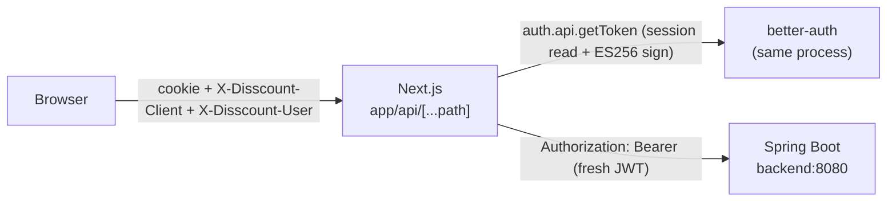

# Disscount: Backend Proxy

How the browser reaches the Spring backend: every `/api/*` call that belongs to Spring goes to one Next.js route handler, which checks the request, signs a short backend JWT on the server for the session the cookie names, and forwards the call to Spring over the Docker network. The browser never holds a backend token. Written for someone new to the code; keep it up to date as the proxy changes. The design and its history live in issue #430 (token proxy).

> **Mental model in one sentence:** the session cookie is the browser's only credential; the Next.js server turns it into a fresh bearer token for each call, and two small headers (one against CSRF, one naming the account the tab thinks it is) stop that cookie from being abused or from acting as the wrong account.

---

## Table of contents

1. [What it replaced and why](#1-what-it-replaced-and-why)
2. [One request, step by step](#2-one-request-step-by-step)
3. [The two headers the browser sends](#3-the-two-headers-the-browser-sends)
4. [Headers, bodies and status codes](#4-headers-bodies-and-status-codes)
5. [Errors](#5-errors)
6. [What's automatic vs manual](#6-whats-automatic-vs-manual)
7. [Key files](#7-key-files)
8. [Config, env vars and libraries](#8-config-env-vars-and-libraries)
9. [Measuring it](#9-measuring-it)
10. [Testing](#10-testing)
11. [Gotchas & lessons learned](#11-gotchas--lessons-learned)
12. [Future improvements & TODOs](#12-future-improvements--todos)

---

## 1. What it replaced and why

Before, `next.config.ts` had a `rewrites()` rule that sent `/api/*` (except `cijene`, `auth` and `account`) to Spring, and the browser attached a bearer token itself. `lib/api/api-base.ts` fetched that token from better-auth's `/api/auth/token`, cached it, tracked which account it belonged to and retried a 401 with a fresh one: about fifteen module level variables, and the source of about ten race fixes in one day (#355, #356, #374).

Two security problems came with it:

- Any script in the page could mint a token and send it off the device, where it worked against Spring for its whole life (10 minutes).
- A token outlived the session that produced it, so signing a device out only took effect once its token expired.

A rewrite cannot add a header, so moving the token to the server needed a real route handler. The proxy adds no network hop: a self hosted Next server already proxied every rewrite through its own Node process.



---

## 2. One request, step by step

`app/api/[...path]/route.ts` exports `GET`, `HEAD`, `POST`, `PUT`, `PATCH` and `DELETE`, all calling `proxyToBackend(request, segments)` in `lib/backend-proxy/proxy-to-backend.ts`.

| Step            | What happens                                                                                                                                                                                                                                 | Refusal                                          |
| --------------- | -------------------------------------------------------------------------------------------------------------------------------------------------------------------------------------------------------------------------------------------- | ------------------------------------------------ |
| 1. Path guard   | The first segment must be a Spring root (`BACKEND_ROOTS` in `backend-path.ts`), and no segment may be empty, `.`, `..`, or contain `/` or `\` after decoding. The URL is rebuilt on the fixed `BACKEND_ORIGIN` and its origin checked again. | 404 `not_found`                                  |
| 2. CSRF         | `X-Disscount-Client: web` must be present; `Sec-Fetch-Site`, when sent, must be `same-origin`; for anything but GET and HEAD, `Origin`, when sent, must equal `appUrl()`.                                                                    | 403 `csrf_rejected`                              |
| 3. Token        | `auth.api.getToken({ headers })` reads the session and signs a JWT. A missing or expired session is not an error, just no token.                                                                                                             | 503 `auth_unavailable` if the read itself fails  |
| 4. Identity pin | `X-Disscount-User` is compared with the session's user id (see below).                                                                                                                                                                       | 401 `session_changed`                            |
| 5. Forward      | `fetch` to Spring with an allow-listed copy of the headers, the streamed body, `redirect: "manual"`, `cache: "no-store"`, and an abort signal that fires when the browser goes away or after 30 seconds.                                     | 502 `backend_unavailable`, 504 `backend_timeout` |
| 6. Answer       | Spring's status and body pass through untouched, with an allow-listed copy of its headers and a `Server-Timing` header.                                                                                                                      | none                                             |

The identity decision (`decideIdentity` in `request-guards.ts`):

| Pin (`X-Disscount-User`) | Session cookie names                  | Result                                   |
| ------------------------ | ------------------------------------- | ---------------------------------------- |
| account A                | A                                     | forward as A, with A's token             |
| account A                | B                                     | 401 `session_changed`, nothing forwarded |
| `anon`                   | A                                     | 401 `session_changed`, nothing forwarded |
| `anon`                   | nobody                                | forward anonymously                      |
| account A                | nobody (signed out, expired, revoked) | forward anonymously                      |

The last row is an owner decision made while building it: there is no account to cross into, and public routes and shared lists keep loading after a session expires, exactly as they did with a browser token. Spring still answers 401 on routes that need an account, which keeps queued offline writes queued.

---

## 3. The two headers the browser sends

`lib/backend-proxy/client-headers.ts` builds them, and `api-base.ts` adds them to every axios request (with `Accept-Language` from `<html lang>`). The one bare `fetch` to Spring, the `keepalive` flush in `postCardsUsed` (`lib/api/digital-cards/queries.ts`), spreads the same helper, and throws `httpStatusError` on failure so the retry and Sentry rules read its status like an axios one.

- **`X-Disscount-Client: web`** is the CSRF defence. The session cookie now rides along on any request to our origin, and `SameSite=Lax` lets a sibling subdomain of `disscount.me` through, because it counts as the same site. A custom header forces a CORS preflight on any other origin, and the proxy answers no CORS, so only our own pages can send it. This is the rule Duende BFF (`X-CSRF: 1`) and the IETF browser-based apps draft use. It is required on GET too, so a top-level navigation to an API URL never runs as the signed-in account.
- **`X-Disscount-User`** is the identity pin: the tab's cache identity (`getCacheIdentity()`, an account id or `anon`), a value that already existed for the persisted offline cache. It replaces the old token's `sub` check. A tab that still believes it is account A can never have a call run as B, even right after another tab signed in as B.

When the proxy answers `session_changed`, the axios response interceptor (`lib/api/session-changed.ts`) calls `authClient.$store.notify("$sessionSignal")`, which makes better-auth refetch the session. `UserProvider` then switches the cache identity and purges the old account's offline data, after which calls carry the new pin. Nothing is retried automatically: `shouldRetryCardWrite` (`lib/offline/card-retry.ts`) stops on `isSessionChanged` (`lib/api/problem-details.ts`), and the card toasts show the refusal's own title (the account changed, the data refreshes) instead of the generic failure. A queued photo refused this way stays in the outbox and is purged with the account it belonged to.

After an email sign-in, `handleUserLogin` (`context/user-context.tsx`) reads the new session with `authClient.getSession()` and moves the cache identity to it before loading the profile, because `useSession` may not have seen the sign-in yet and the profile call would otherwise still be pinned to `anon`.

---

## 4. Headers, bodies and status codes

Both directions use an allow-list (`forwarded-headers.ts`), never a deny-list.

| Direction         | Passed                                                                                                                               | Why                                                                                                                                                            |
| ----------------- | ------------------------------------------------------------------------------------------------------------------------------------ | -------------------------------------------------------------------------------------------------------------------------------------------------------------- |
| Browser to Spring | `accept`, `accept-language`, `content-type`, `if-none-match`, `if-modified-since`                                                    | Spring localises problem messages from `accept-language`; `content-type` carries the multipart boundary; the `if-*` headers let card photos revalidate to 304. |
| Browser to Spring | `x-forwarded-for`, `cf-connecting-ip`, verbatim                                                                                      | `ClientIp.java` and the contact and photo upload limiters key on them. Changing them would key every visitor on the frontend container.                        |
| Browser to Spring | `authorization: Bearer <minted>`                                                                                                     | Set by the proxy. The browser's own `Authorization` and `Cookie` never pass.                                                                                   |
| Spring to browser | `content-type`, `cache-control`, `etag`, `last-modified`, `location`, `content-disposition`, `retry-after`, `x-content-type-options` | Everything the app reads.                                                                                                                                      |
| Spring to browser | dropped: `content-encoding`, `content-length`, `transfer-encoding`, `set-cookie`, `www-authenticate`                                 | Node's `fetch` decodes gzip but keeps `content-encoding`, and forwarding both breaks the browser.                                                              |

When Spring sets no `cache-control`, the proxy sets `private, no-store`, so neither Cloudflare nor the browser HTTP cache keeps an account's JSON. Card photos come from Spring as `no-store, private`, and `fetchCardPhotoBlob` also asks with the fetch cache mode `no-store`, so the browser HTTP cache never stores or serves them; the account-scoped photo blob store is their only cache.

Bodies stream both ways (`duplex: "half"` on the request), so photo uploads are not buffered. 204, 304 and HEAD answers carry no body, and the unread upstream body is cancelled so its pooled connection is freed.

If `getToken` refreshes the session (at most once a day, better-auth's `updateAge`), the `nextCookies` plugin writes the new cookie and Next merges it onto the proxy's response, so the session keeps sliding.

---

## 5. Errors

All of the proxy's own answers are `application/problem+json` with `status`, `title` and `code` (`proxy-problem.ts`), the shape `lib/api/problem-details.ts` already parses. The `title` is translated from the `errors.proxy` keys in the language of the request's `Accept-Language` (Croatian when it names none of the five), the same header Spring localises its own titles from, so `problemMessage` and `applyProblemToForm` show it as is on every screen. The catalogs are imported statically so `proxyProblem` stays synchronous; `src/test/backend-identity.ts` throws it from MSW handlers.

| Status | `code`                | When                                                                             | Sentry |
| ------ | --------------------- | -------------------------------------------------------------------------------- | ------ |
| 404    | `not_found`           | The path is not one of Spring's.                                                 | no     |
| 403    | `csrf_rejected`       | Missing client header, cross-site `Sec-Fetch-Site`, foreign `Origin` on a write. | no     |
| 401    | `session_changed`     | The cookie names another account than the pin.                                   | no     |
| 503    | `auth_unavailable`    | Reading the session failed (database down).                                      | yes    |
| 502    | `backend_unavailable` | Spring could not be reached.                                                     | yes    |
| 504    | `backend_timeout`     | Spring took longer than 30 seconds.                                              | yes    |
| 499    | none, empty body      | The browser went away; the Spring call is cancelled too.                         | no     |

The price data routes under `/api/cijene/` build their 502 with the same helper, code `upstream_unavailable`, with no Sentry event (see `docs/PRODUCTS.md` §3).

Sentry events carry only the tags `flow: backend-proxy`, `proxyFailure` and `pathRoot` (the first segment). Deeper segments hold list and card ids, and headers carry the session, so neither goes in.

`lib/offline/failure-policy.ts` treats 401 and every 5xx as "keep", so a queued offline write survives every proxy failure.

---

## 6. What's automatic vs manual

| Thing                                                                                                               | Automatic                                                         | Manual                                                                                                                                |
| ------------------------------------------------------------------------------------------------------------------- | ----------------------------------------------------------------- | ------------------------------------------------------------------------------------------------------------------------------------- |
| A new Spring controller root (`/api/<new-root>`)                                                                    |                                                                   | Add it to `BACKEND_ROOTS` in `backend-path.ts`, or the proxy answers 404.                                                             |
| A new Next route under `app/api/`                                                                                   | Ranked above the catch-all by Next.                               | Do not name it like a Spring root: `backend-path.test.ts` fails if you do, because the Next route would silently take Spring's calls. |
| A new request or response header the app needs                                                                      |                                                                   | Add it to the allow-list in `forwarded-headers.ts`.                                                                                   |
| A new bare `fetch` to Spring from the browser                                                                       |                                                                   | Spread `backendProxyHeaders()` into its headers, or it gets 403.                                                                      |
| Revoked, signed-out or deleted sessions                                                                             | Stop at the next call, because the token is minted per request.   |                                                                                                                                       |
| Server code calling Spring (`lib/api/product-images/server.ts`, the OG image, sitemaps, `erase-backend-account.ts`) | Calls `BACKEND_ORIGIN` directly and never goes through the proxy. |                                                                                                                                       |

---

## 7. Key files

| Path (under `frontend/src/` unless noted)            | Role                                                                                                           |
| ---------------------------------------------------- | -------------------------------------------------------------------------------------------------------------- |
| `app/api/[...path]/route.ts`                         | The catch-all route; every method calls `proxyToBackend`.                                                      |
| `lib/backend-proxy/proxy-to-backend.ts`              | The six steps above, `Server-Timing`, Sentry. `server-only`.                                                   |
| `lib/backend-proxy/backend-path.ts`                  | `BACKEND_ROOTS` and the URL builder (the SSRF guard).                                                          |
| `lib/backend-proxy/request-guards.ts`                | `isCsrfSafe`, `identityPin`, `decideIdentity`. Pure, so the jsdom test harness reuses them.                    |
| `lib/backend-proxy/session-token.ts`                 | `mintSessionToken`: `auth.api.getToken` plus the token's `sub`. `server-only`.                                 |
| `lib/backend-proxy/forwarded-headers.ts`             | Both header allow-lists and the default `cache-control`.                                                       |
| `lib/backend-proxy/proxy-problem.ts`                 | The problem responses.                                                                                         |
| `lib/backend-proxy/proxy-contract.ts`                | The two header names and `session_changed`, shared by browser and server.                                      |
| `lib/backend-proxy/client-headers.ts`                | `backendProxyHeaders()`, what the browser sends.                                                               |
| `lib/api/api-base.ts`                                | The axios client: proxy headers, `Accept-Language`, the `session_changed` hook.                                |
| `lib/api/session-changed.ts`                         | Refetches the session on a `session_changed` 401.                                                              |
| `context/user-context.tsx`                           | `handleUserLogin` moves the pin before the profile load.                                                       |
| `lib/auth/index.ts`                                  | jwt plugin: `disableSettingJwtHeader: true`, token life `BACKEND_TOKEN_TTL_MINUTES`.                           |
| `test/backend-identity.ts`                           | `actingAs(request)` for jsdom tests: decides the account as the proxy would, from the pin and `serverSession`. |
| `test/proxy-call.ts`                                 | Node test helpers that call `proxyToBackend` with the client's headers.                                        |
| `backend/src/main/java/disscount/util/ClientIp.java` | Trusts the forwarded IP headers the proxy passes verbatim.                                                     |

---

## 8. Config, env vars and libraries

No environment variable of its own. The proxy reads `NEXT_PUBLIC_API_URL` through `BACKEND_ORIGIN` (`lib/api/backend-origin.ts`), the same value the rewrite used, and `NEXT_PUBLIC_APP_URL` through `appUrl()` for the `Origin` check (localhost in development).

| Setting               | Where                                              | Value                                                    |
| --------------------- | -------------------------------------------------- | -------------------------------------------------------- |
| Upstream timeout      | `UPSTREAM_TIMEOUT_MS` in `proxy-to-backend.ts`     | 30 seconds, the cap the rewrite had                      |
| Backend token life    | `BACKEND_TOKEN_TTL_MINUTES` in `constants/auth.ts` | 10 minutes (P3 of #430 shortens it)                      |
| `set-auth-jwt` header | `disableSettingJwtHeader` in `lib/auth/index.ts`   | off, so session polls no longer hand the browser a token |

Libraries (from `frontend/package.json`): `next` 16.4.3 (route handlers), `better-auth` 1.6.25 (`auth.api.getToken`, the jwt plugin), `axios` ^1.13.2 (the client), `@sentry/nextjs` ^10.62.0, `@serwist/next` ^9.5.11 (the service worker). No new dependency.

The service worker (`app/sw.ts`) needs no change: its `NetworkOnly` rule for every same-origin `/api/` path sits above Serwist's default cache, and Serwist ignores `Cache-Control`, so that rule, not the proxy's `no-store`, is what keeps account data out of Cache Storage. Only `/api/cijene/*` is cached, and `cijene` is not a backend root.

---

## 9. Measuring it

Every proxied response carries `Server-Timing: auth;dur=X, upstream;dur=Y` (milliseconds), readable in the browser's network panel under Timing. `auth` is the session read and the signature; `upstream` is the Spring call until its headers arrive.

To compare with a public route, which also pays for the session read when a cookie is sent:

```bash
# 200 sequential calls; replace the cookie with a real session cookie from DevTools
for i in $(seq 200); do
  curl -s -o /dev/null -w '%{time_total}\n' \
    -H 'X-Disscount-Client: web' -H 'X-Disscount-User: <your-user-id>' \
    -H 'Cookie: <session cookie>' https://dev.disscount.me/api/users/me
done | sort -n | awk '{a[NR]=$1} END {print "p50", a[int(NR*0.5)], "p95", a[int(NR*0.95)]}'
```

The decision in #430 is to add a short per-session token memo only if `auth` exceeds a few milliseconds at p95.

---

## 10. Testing

| Test                                                                                                                                         | What it pins                                                                                                                        |
| -------------------------------------------------------------------------------------------------------------------------------------------- | ----------------------------------------------------------------------------------------------------------------------------------- |
| `lib/backend-proxy/proxy-to-backend.test.ts`                                                                                                 | Path guard, CSRF per method, every identity row.                                                                                    |
| `lib/backend-proxy/proxy-forwarding.test.ts`                                                                                                 | Header allow-lists both ways, client IP headers verbatim, multipart and binary bodies, 204, 304 and HEAD, problem bodies untouched. |
| `lib/backend-proxy/proxy-failures.test.ts`                                                                                                   | 502, 503, 504, abort propagation, no token, cookie or list id in a Sentry event.                                                    |
| `lib/backend-proxy/backend-path.test.ts`                                                                                                     | URL building, and that no `app/api/*` folder or `cijene` collides with a backend root.                                              |
| `lib/backend-proxy/proxy-problem.test.ts`                                                                                                    | Problem titles follow `Accept-Language`, match a regional tag on its language, and fall back to Croatian.                           |
| `lib/api/api-base.test.tsx`                                                                                                                  | The client sends both headers and no token, and refetches the session only on `session_changed`.                                    |
| `context/user-context-session-changes.test.tsx`, `lib/offline/offline-replay.test.tsx`, `lib/api/shopping-lists/shared-list-access.test.tsx` | The account switch, sign-out, revoke, deletion, offline replay and shared list behaviour from #437, through `actingAs`.             |

In jsdom tests, an MSW handler calls `actingAs(request)` to learn which account Spring would act as. It runs the real `isCsrfSafe` and `decideIdentity` against `serverSession.userId` (the account the test's session cookie names) and throws the proxy's refusal as the response, so a refused call never reaches the handler body. `test/setup-dom.ts` resets `serverSession` and the cache identity after each test.

---

## 11. Gotchas & lessons learned

- **The rewrite and the catch-all cannot coexist.** Array rewrites run after static files but before dynamic routes, so the old rule would have shadowed `app/api/[...path]`. It was deleted in the same change.
- **A URL resolves dot segments before Next sees them.** `/api/users/%2E%2E/admin` arrives as `/api/admin`, which is a backend root, and Spring's own security then applies. The path guard catches what survives decoding (an encoded slash or backslash inside one segment). Tests pass decoded segments directly for that reason.
- **`authClient.$store` is a proxy.** better-auth's client resolves `authClient.$store.notify` to the real function only when read through the full path, so `vi.spyOn(authClient.$store, "notify")` fails. Tests listen to `authClient.$store.atoms.$sessionSignal` instead.
- **A new browser call that bypasses axios gets 403.** An `` cannot send the client header; card photos and admin originals are fetched as blobs through `apiClient` for that reason.
- **`session_changed` is not retried.** Retrying a write under the new pin would send account A's queued write as account B. The session refetch and purge are the recovery.

---

## 12. Future improvements & TODOs

- P3 of #430: close `GET /api/auth/token` to browsers, shorten the backend token to 2 minutes and change the sessions note. Until then a script in the page can still mint a portable token through that endpoint.
- P4 of #430: load the user profile as a React Query query, now that the pin guarantees a profile response belongs to the tab's account.
- A short per-session token memo, only if the `auth` timing says it is needed (section 9).
- Check the drizzle `pg` pool size against concurrent API calls, since each proxied call now holds a frontend pool connection for the session read.
