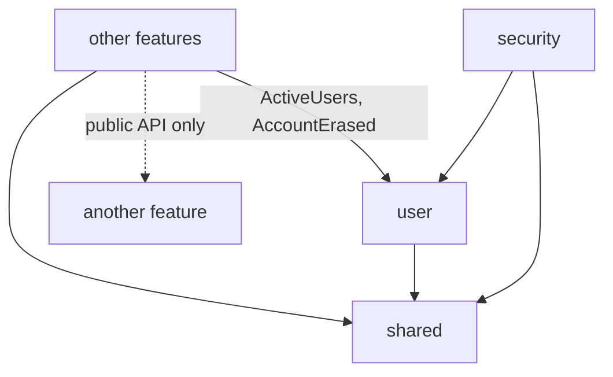

# Disscount: Spring Backend Guide

A reference for how the Spring Boot backend is laid out and which rules hold it together, written for someone new to Spring. It covers the package layout, the rules between packages, transactions, security, soft delete, errors and tests. Feature behaviour (cards, lists, photos) lives in each feature's own doc; this file is about the frame they share.

> **Mental model in one sentence:** the backend is one flat Java package per feature, each hiding its internals behind package-private classes, talking to other features only through a few public classes and user ids, with security checked twice (a URL rule for admin routes and a guard bean in front of every owner-scoped service method) and every error answered as the same translated problem response.

The layout and its rules come from #429 (Spring backend restructure), built in steps R1 to R13. This doc describes the state after R11.

---

## 1. Quick reference

| Thing        | Value                                                                                                                                                        |
| ------------ | ------------------------------------------------------------------------------------------------------------------------------------------------------------ |
| Source       | `backend/src/main/java/disscount/`                                                                                                                           |
| Framework    | Spring Boot 4.1 on Java 21, Hibernate 7.4, Spring Security 7 as an OAuth2 resource server                                                                    |
| Database     | PostgreSQL 17 in every environment, H2 in most tests                                                                                                         |
| Schema       | The `app` schema; Flyway SQL files in `src/main/resources/db/migration`, run by the one-shot `flyway` job as the migrator; Hibernate only validates          |
| Checks       | `mvn -B verify` in `backend/` (needs Docker for the PostgreSQL tests)                                                                                        |
| Who calls it | Only the Next.js proxy, which turns the session cookie into a per-request token ([BACKEND-PROXY.md](BACKEND-PROXY.md))                                       |
| Auth         | better-auth in Next.js signs the tokens, Spring only verifies them ([AUTH.md section 7](AUTH.md#7-the-spring-side-resource-server-and-profile-provisioning)) |
| Settings     | `@ConfigurationProperties` records, one per concern ([section 9.1](#91-settings))                                                                            |
| API docs     | Swagger UI at `/api-docs` and `/v3/api-docs` only under the `local` profile and in tests                                                                     |

---

## 2. Packages

One flat package per feature, so Java's package-private visibility can hide repositories, entities and helpers from every other feature. Sub-packages would force those classes to be `public`, because package-private does not reach into a sub-package.

| Package        | What it holds                                                                                                               |
| -------------- | --------------------------------------------------------------------------------------------------------------------------- |
| `user`         | Profiles, the admin user endpoints, account erasure, the erasure ledger and replay, `ActiveUsers`, `AccountErased`          |
| `contact`      | Contact form messages and the admin contact tab                                                                             |
| `preferences`  | Pinned stores, pinned places and favourite stores                                                                           |
| `watchlist`    | Watchlist rules                                                                                                             |
| `storename`    | Store name suggestions for custom cards                                                                                     |
| `shoppinglist` | Lists and their items, one aggregate, plus sharing and copying                                                              |
| `digitalcard`  | The card wallet and card photos                                                                                             |
| `productimage` | Product photos, with three self-contained helper sub-packages: `catalog`, `openfoodfacts`, `render`                         |
| `security`     | Filter chains, token purpose rules, the admin `AuthorizationManager`, method security                                       |
| `shared`       | Errors, time, `@CurrentUser`, client IP, rate limiting, photo storage and sanitising, validation constraints, `AfterCommit` |
| `config`       | Framework wiring with no business meaning (JSON, JPA, OpenAPI, scheduling, Sentry, upload limits, user foreign keys)        |

Inside a feature, a class is package-private unless another package needs it, such as `security`, another feature's public API, or a test in another package.

---

## 3. Dependency rules



1. A feature imports only `shared` and another feature's public classes.
2. Features refer to another feature's rows by id (`UUID userId`), never by a `@ManyToOne` to its entity. The database foreign keys stay: the migrations hold the eight that point at `app_user`, and `SchemaDriftTest` fails if one goes missing.
3. `user` depends on no other feature. Features that hold per-user data react to the `AccountErased` event instead of `user` calling them.
4. `shared` imports no feature.

`DependencyRulesTest` reads the main sources (the owner chose no ArchUnit and no Spring Modulith) and checks rules 3 and 4, plus that other features use only `ActiveUsers` and `AccountErased` from `user`. Rules 1 and 2 are mostly held by visibility: a package-private class from another feature does not compile.

### What other features know about users

`ActiveUsers` is the one door into `user`:

| Method                  | Use                                                                                                                                                                      |
| ----------------------- | ------------------------------------------------------------------------------------------------------------------------------------------------------------------------ |
| `isActive(userId)`      | Is this account live                                                                                                                                                     |
| `requireActive(userId)` | The caller's own account; answers `401 error.user.notFound` once it is gone, because a token outlives its account by minutes                                             |
| `lockActive(userId)`    | The same under a row lock held until commit, so a write racing account deletion lands first or is refused. Digital cards use it as their per-user mutex (`CardUserLock`) |
| `lockIfActive(userId)`  | The lock for work that should quietly do nothing once the account is gone                                                                                                |
| `isActiveAdmin(userId)` | The admin URL rule                                                                                                                                                       |

### Account erasure as an event

`UserService.deleteAccount` soft-deletes the profile, publishes `AccountErased(userId, loginEmail)` (the address read from better-auth, null once the login is gone) and writes an `erasure_ledger` tombstone, all in one transaction. The listeners are plain synchronous `@EventListener`s, so they run inside that transaction and a listener that throws rolls the whole erasure back:

| Order | Listener                                | Erases                                                                                                  |
| ----- | --------------------------------------- | ------------------------------------------------------------------------------------------------------- |
| 10    | `DigitalCardService.onAccountErased`    | Cards (deleted ones too), their photo rows, and queues the photo files                                  |
| 20    | `StoreNameService.onAccountErased`      | Store name usages                                                                                       |
| 30    | `FavoriteStoreService.onAccountErased`  | Favourite stores                                                                                        |
| 40    | `ProductImageErasure.onAccountErased`   | The user's unconfirmed product photos and private originals; confirmed photos stay without their author |
| 50    | `ShoppingListService.onAccountErased`   | Switches off the share link of every list the user owns; the lists stay                                 |
| 60    | `ContactMessageService.onAccountErased` | Nulls name and email on the user's contact messages and on signed-out ones sent from the login address  |

The order is explicit because the bulk deletes clear the persistence context; `AccountErasedListenersTest` pins it. Every path that sets a share link (create, update, a copy with sharing) takes the owner's row lock first, the lock the erasure holds, so a share change either lands before the erasure and is switched off by it, or waits and gets 401. A signed-in contact message takes the same lock, so one that waits on an erasure is saved as a signed-out message with no sender (`AccountErasurePostgresTest`).

### Work after the commit

`shared/AfterCommit.run` runs a task once the current transaction commits, or at once when there is none. It is for work outside the database, such as object storage or the store name counter, and it logs a failure instead of throwing, because the commit already happened. The rule it serves: no remote I/O inside a write transaction. The card photo upload is the template, where the files are stored first, only the row write is transactional, and the stored files are removed again if that write fails.

---

## 4. Layers, records and transactions

| Layer      | Does                                                                   | Does not                                         |
| ---------- | ---------------------------------------------------------------------- | ------------------------------------------------ |
| Controller | Maps HTTP to one service call; reads the caller through `@CurrentUser` | Hold logic, open transactions, call repositories |
| Service    | Owns the transaction, takes ids and request records, checks rules      | Return entities to controllers                   |
| Repository | Package-private Spring Data interface                                  | Get called from another feature                  |
| Entity     | Row invariants only (`@PrePersist`, column rules)                      | Business rules                                   |

**Records and `from()`.** Requests and responses are Java records. A response with one source has a static `from(entity)` (for example `UserDto.from`, `WatchlistItemDto.from`). Three responses depend on who is asking or on several rows, and have a mapper instead: `ShoppingListMapper` (the caller's access level), `DigitalCardMapper` (the card with its photos) and `ProductImageViews` (public and admin views of a photo). There is no MapStruct.

**Transaction defaults.** Every service has `@Transactional(readOnly = true)` on the class and `@Transactional` on each write method. A write method that forgets its annotation then fails loudly instead of committing by accident. `ReadOnlyDefaultTest` proves it on PostgreSQL, because H2 ignores a read-only connection: a flushed write is refused by the database, and an unflushed one is never sent.

**`@CurrentUser`.** A controller parameter `@CurrentUser UUID userId` is the bearer token's subject, resolved by `CurrentUserArgumentResolver`. It is required by default. `@CurrentUser(required = false)` is null for an anonymous caller and appears only on the by-id shopping list routes and `POST /api/contact`. It carries `@Parameter(hidden = true)`, so the OpenAPI document does not grow a query parameter.

**Paged lists** answer the shared `PageDto` record, `{ items, page: { number, size, totalItems, totalPages } }`, with the page size capped at 100. A client `sort` is ignored (`Paging.withoutClientSort`), because each query fixes its own order and a client sort could order by a field the caller may not read.

**Open session in view** is off (`spring.jpa.open-in-view=false`, #429 R8). Each transaction gets its own persistence context, and nothing is loaded lazily after a service method returns, so a service maps its entities to records before the controller sees them.

---

## 5. Security

Authentication (which token, which purpose, profile provisioning) is in [AUTH.md section 7](AUTH.md#7-the-spring-side-resource-server-and-profile-provisioning). This section covers the two authorization layers.

### 5.1 Admin routes: one URL rule

`SecurityConfig` sends every `/api/admin/**` request through `AdminAuthorizationManager`, which needs an ordinary session token whose subject is a live `ADMIN` profile. No admin controller checks again. `AdminGatingTest` walks every mapped admin route (401 anonymous, 403 for each non-admin account type, 2xx for an admin) and fails when a mapped route is missing from its table. Demoting or deleting the last admin is refused with 409 ([AUTH.md 7.1](AUTH.md#71-admin-access)).

### 5.2 Owner-scoped methods: guard beans

`@EnableMethodSecurity` on `SecurityConfig` turns on Spring's `@PreAuthorize`. Each owner-scoped feature has one guard bean, and every public service method of that feature that takes a resource id names it:

```java
@PreAuthorize("@digitalCardGuard.ownsCard(#userId, #id)")
@Transactional
public DigitalCardDto setPinned(UUID userId, UUID id, boolean pinned) { ... }
```

| Guard               | Methods                                                                          | Checks                                                                                                                                |
| ------------------- | -------------------------------------------------------------------------------- | ------------------------------------------------------------------------------------------------------------------------------------- |
| `DigitalCardGuard`  | 9 in `DigitalCardService` and `DigitalCardPhotoService`                          | `ownsCard`: a live card of this user. `mayWriteCard` (the create-or-replace PUT): no live card of someone else under this id          |
| `WatchlistGuard`    | 1 in `WatchlistItemService`                                                      | `ownsItem`: an item of this user, deleted ones included, so a repeat delete stays 204                                                 |
| `ShoppingListGuard` | 8 in `ShoppingListService`, `ShoppingListItemService`, `ShoppingListCopyService` | `canView`, `canWrite`, `canCheckItems`, `canEditItems`, from the caller's access level ([SHARING.md section 4](SHARING.md#4-backend)) |

The other features have no by-id methods a user owns: preferences are replaced as a whole list, the profile is always "me", and contact messages and photo moderation sit behind the admin URL rule.

How a guard answers:

- **Someone else's id looks unknown.** A guard never returns false for a foreign id. A false becomes a 403, which would confirm the id exists, so the guard throws the feature's own 404 (`error.card.notFound`, `error.watchlistItem.notFound`, `error.shoppingList.notFound`) with the same body an unknown id gets.
- **Shopping lists keep three outcomes:** 404 for a list the caller cannot see, 401 `error.shoppingList.signInToChange` for an anonymous write, 403 `error.shoppingList.insufficientAccess` for a link level too low. Every write, the owner-only ones included, asks for a signed-in caller first, so an anonymous rename with `linkAccess` or an anonymous delete of a shared list is a 401 (owner decision on #679). Owner-only refusals for signed-in callers keep their own message in the services (`ownerOnlyDelete`, `ownerOnlyAddItems`, `ownerOnlyAccess`, `ownerOnlyCopySharing`).
- **A guard reads a count or two columns, never an entity.** The check needs nothing more, and a guard runs outside the service's transaction, so an entity it loaded would be detached at once and of no use to the service, which reads its own copy after `CardUserLock`.
- **A real denial is still a 403 problem.** If a future guard does return false, `GlobalExceptionHandler` answers Spring's `AuthorizationDeniedException` with the same 403 body the filter chain uses, instead of the logged 500 the catch-all would give.

**Both layers stay.** The scoped repository queries (`findActiveByIdAndUserId` and friends) are still there behind the guards (owner decision in #429: both). The guard makes a forgotten owner condition fail closed; the query keeps a bug in a guard from exposing another user's rows.

**What the guard runs before.** Method security wraps the service outside its transaction, so the guard runs before anything in the method body. A card photo route with someone else's card id answers 404 even when the slot is unknown, photos are switched off or the upload limit is reached; your own card gets those answers as before.

**Adding a by-id method.** Put `@PreAuthorize` with the feature's guard on it. `OwnershipGuardsTest` scans the owner-scoped features (`digitalcard`, `shoppinglist`, `watchlist`) and fails when a public service method with a `UUID` parameter other than `userId` or `ownerId` lacks the guard, and when a service with such a method is not wrapped by the `@PreAuthorize` interceptor. A new owner-scoped feature needs a guard bean and an entry in that test's table. A `@WebMvcTest` slice that imports `SecurityConfig` and a real service must import the guard too, or the expression fails to find the bean and the call answers 500.

---

## 6. Soft delete, the ledger and `IncludingDeleted`

Six entities (`User`, `ShoppingList`, `ShoppingListItem`, `WatchlistItem`, `DigitalCard`, `ContactMessage`) carry `@SQLRestriction("deleted_at is null")`, so Hibernate adds the condition to every JPA lookup, JPQL query, collection and bulk statement. Native SQL is the only way to see a deleted row, and the five flows that need one use explicit native queries named `...IncludingDeleted...` or `isDeleted`. The details and the table of flows are in [AUTH.md 7.3](AUTH.md#73-soft-delete-and-the-erasure-ledger).

**The erasure ledger.** `erasure_ledger` gets a row for every erased account and answers the account lifecycle reads a hidden profile no longer can: the 410 on sign-in after an erasure, the first-admin count (`countIncludingDeleted` plus ledger rows), the admin delete of an already erased account, and the erasure replay after a backup restore ([BACKUPS.md](BACKUPS.md)). The one-shot `erasure-backfill` profile adds tombstones for profiles deleted before the ledger existed.

**In tests**, read a deleted row with `support/IncludingDeleted.find(entityManager, Entity.class, id)`, never `findById`, and clean tables with `JdbcTestUtils.deleteFromTables`, because `deleteAll()` skips hidden rows.

---

## 7. Errors as problem responses

Every error is `application/problem+json` (RFC 9457), shaped in one place, `shared/GlobalExceptionHandler`, which extends Spring's `ResponseEntityExceptionHandler` so framework errors (405, 415, unreadable body) get the same shape:

```json
{
  "type": "urn:disscount:conflict",
  "title": "Spremanje nije uspjelo",
  "status": 409,
  "detail": "Ovo je jedini administratorski račun, pa ga ne možeš obrisati.",
  "instance": "/api/users/me",
  "timestamp": "2026-11-11T12:00:00.000Z",
  "code": "error.user.lastAdminDelete"
}
```

- Services throw one of the `shared` exceptions with a message key: `BadRequestException` (400), `UnauthorizedException` (401), `ForbiddenException` (403), `NotFoundException` (404), `ConflictException` (409), `TooManyRequestsException` (429, with `Retry-After`), `ServiceUnavailableException` (503).
- `title` and `detail` are translated from `messages*.properties` by `Accept-Language` (hr, en, it, sl, de). A key missing from the bundle shows as written.
- 409 and 503 also carry the key as `code`, because the detail is translated and a client that branches on the error needs a stable value.
- Validation errors carry `fieldErrors`. A unique violation answers 409 without logging the driver text, which holds the value.
- The filter chain's 401 and 403 go through the same handler (`ProblemAuthenticationEntryPoint`, `ProblemAccessDeniedHandler`), and so does a method security denial.
- Anything unexpected is a 500 with a generic detail, logged as an error, which Sentry's log appender reports (`GlobalExceptionHandlerSentryTest`).

### 7.1 Per-user limits

Each person may have at most 50 shopping lists, 50 items on one list, 50 watchlist entries and 50 cards (issue #213, the owner's numbers). All four are constants in one enum, `shared/UserLimit`, so changing one is a code change. Only live rows count: a soft deleted list, item, entry or card frees its place. Archived cards still count.

A create that would pass a limit throws `LimitReachedException`, a `ConflictException`, and answers 409 with two extra fields next to `code`:

```json
{
  "status": 409,
  "code": "error.limit.shoppingLists",
  "limit": "SHOPPING_LISTS",
  "max": 50,
  "detail": "Možeš imati najviše 50 popisa za kupnju."
}
```

| Limit                 | Code                            | Counted in                                       |
| --------------------- | ------------------------------- | ------------------------------------------------ |
| `SHOPPING_LISTS`      | `error.limit.shoppingLists`     | `ShoppingListQuota`, on create and on copy       |
| `SHOPPING_LIST_ITEMS` | `error.limit.shoppingListItems` | `ShoppingListQuota`, on a new item and on a copy |
| `WATCHLIST_ITEMS`     | `error.limit.watchlist`         | `WatchlistItemService.addOrUpdateWatchlist`      |
| `DIGITAL_CARDS`       | `error.limit.digitalCards`      | `DigitalCardService.upsert`                      |

Only a new row counts: an item that merges into an existing row, a watchlist threshold change and a card edit pass at the limit. Every check runs after `ActiveUsers.lockActive` has locked the owner's `app_user` row, so two creates at once cannot both see room; only an owner creates lists or adds items, so the owner's lock also covers the items on a list. The enum reaches `contracts/backend-api.json` as `UserLimit`, and the frontend mirrors it in `userLimitSchema`. The frontend shows one dialog for all four ([SHOPPING-LISTS.md, the limit dialog](SHOPPING-LISTS.md#the-limit-dialog)).

---

## 8. Testing

| Kind                           | Runs on                                    | Used for                                                                                                       |
| ------------------------------ | ------------------------------------------ | -------------------------------------------------------------------------------------------------------------- |
| Unit and `@DataJpaTest` slices | H2                                         | Most service and repository tests                                                                              |
| `FullStackTest` subclasses     | H2, one cached Spring context with MockMvc | Ownership tests per feature, `AdminGatingTest`, wire-format snapshots, account erasure end to end              |
| `@MigratedPostgres`            | `postgres:17-alpine` migrated by Flyway    | `SchemaDriftTest`, `EnumColumnsTest`, `ReadOnlyDefaultTest`, `SoftDeletePostgresTest`, `LastAdminDeletionTest` |
| Testcontainers, no Spring      | `postgres:17-alpine`                       | `MigrationPathsTest` (new database, production and dev baselines, the watchlist cleanup)                       |

PostgreSQL is used where H2 behaves differently: read-only transactions, native SQL on deleted rows, checks and partial indexes, and row locks. The `@MigratedPostgres` classes share one container and one Spring context. `LastAdminDeletionTest` stays off H2, because the shared H2 context keeps every other test's admins, so no admin there is ever the last one; on Postgres it demotes every admin before each test. Its race tests hold the first deletion's locks open, check that the second one waits, then commit the first and expect the second to get the 409.

The ownership tests are the guard's evidence: for each owner-scoped feature, user A against user B's id answers 404 on every by-id route (except a shopping list B shares by link, which A may see at its link level), the list routes never return B's rows, and the guard bean itself throws the 404 (and, for lists, the 401 and 403). `ApiContractTest` keeps `contracts/backend-api.json` in step with the DTOs ([API-CONTRACT.md](API-CONTRACT.md)). [TESTING.md](TESTING.md) has the rest.

---

## 9. What's automatic vs manual

| Automatic                                                  | Manual                                                                              |
| ---------------------------------------------------------- | ----------------------------------------------------------------------------------- |
| The soft delete condition on every JPA query               | Choosing a native query when a flow must see deleted rows                           |
| The admin URL rule on every `/api/admin/**` route          | Adding a new admin route to `AdminGatingTest`'s table (the test fails until you do) |
| `OwnershipGuardsTest` failing on an unguarded by-id method | Writing the guard check and the `@PreAuthorize`                                     |
| Read-only transactions on every service method             | `@Transactional` on each write method                                               |
| Translated problem bodies for every thrown exception       | A message key in all five bundles for every new error                               |
| Erasure of per-user data through `AccountErased`           | A listener with an explicit `@Order` for any new per-user table                     |

---

### 9.1 Settings

The app's own keys are read through `@ConfigurationProperties` records, never `@Value`:

| Record                                               | Keys                                                                                                 | Read by                                              |
| ---------------------------------------------------- | ---------------------------------------------------------------------------------------------------- | ---------------------------------------------------- |
| `shared/PhotoProperties`                             | `photos.private-dir`, `photos.public-dir`, `photos.public-url` (blank by default)                    | `PhotoStoreConfig`                                   |
| `security/BetterAuthProperties`                      | `better.auth.issuer` (required)                                                                      | `SecurityConfig`                                     |
| `security/JwkSetProperties`                          | `spring.security.oauth2.resourceserver.jwt.jwk-set-uri` (required)                                   | `SecurityConfig`                                     |
| `user/ErasureReplayProperties`                       | `erasure-replay.markers`, `erasure-replay.key-file` (required), `erasure-replay.allow-empty` (false) | `ErasureReplayRunner`, `erasure-replay` profile only |
| `productimage/ProductImageJobProperties`             | `product-images.jobs.enabled` (true)                                                                 | `ProductImageJobs`                                   |
| `productimage/catalog/CatalogProperties`             | `product-images.catalog.list-url`                                                                    | `CatalogImportService`                               |
| `productimage/openfoodfacts/OpenFoodFactsProperties` | `product-images.off.api-base`, `product-images.off.export-url`                                       | `OpenFoodFactsClient`                                |

The class that reads a record registers it with `@EnableConfigurationProperties`, so a slice test that imports that class gets its settings, and the erasure record is bound only under its profile. The one `@Value` left is `GIT_SHA` in `SentryReleaseConfig`: it is a build variable, and tests set it under that exact name.

The required keys come from environment placeholders with no default. Spring leaves an unset placeholder as its own text when binding a record, so the URLs are typed `URI` and `@Validated`: the `${...}` text cannot become a URI, and startup fails as it did with `@Value` (`AuthPropertiesStartupTest`). An empty value fails too.

## 10. Gotchas

- **Name the schema in native SQL.** The tables are in `app` and better-auth's in `auth` ([INFRASTRUCTURE.md, Database roles](INFRASTRUCTURE.md#database-roles)). Hibernate adds `app` to entity queries through `hibernate.default_schema`, but native SQL and test helpers write `app.<table>` or `auth."user"` themselves; the runtime login's search path still finds a bare name, so a missing prefix only shows on a login without that path.
- **The runtime login is not the owner.** Spring runs as `disscount_backend`, which may read and write `app` but cannot change a table, update or delete `admin_audit`, or read better-auth columns beyond `id`, `email` and `last_login_at` of `auth."user"` and the session columns of the retention job. A new cross-schema read needs a line in `db/database-roles.sql`; the `@MigratedPostgres` tests run as this login, so they fail first.

- **The test `application.properties` replaces main's** instead of adding to it, so a key main needs in every test goes in both files. Springdoc is the exception on purpose: main turns it off and the test file leaves it on for `ApiContractTest`.
- **A guard that returns false leaks.** It answers 403, which tells a stranger the id is real. Throw the feature's 404 instead.
- **A guard's check is a snapshot taken before the service's lock.** A card deleted between the guard and `CardUserLock` is caught by the service's own scoped read under the lock, which is one reason both layers stay.
- **JPQL never sees deleted rows**, including bulk updates and deletes. A cleanup written in JPQL silently skips them.
- **`deleteAll()` in a test leaves hidden rows behind**, and their foreign keys then fail the next test's cleanup.
- **The last admin cannot be removed through the app**: demoting the last admin, an admin deleting the last admin, and the last admin deleting their own account all answer 409. An admin targeting their own id through `DELETE /api/admin/users/{userId}` gets 400 `error.user.cannotDeleteSelf` first, whatever the admin count. Every role change and every erasure, a consumer's too, takes the admin row locks before it reads a role, which is what keeps a promotion racing an erasure from slipping past the check. The erasure replay is the exception, because a restored backup must forget every account it is told to. With no admin left, recovery is a manual `UPDATE app.app_user SET account_type = 'ADMIN'` on the server.
- **The account deletion flow shows a generic failure for that 409.** `lib/auth/erase-backend-account.ts` turns any non-2xx into "Account erasure failed; nothing was deleted" and reports it to Sentry, so the last admin trying to delete their account sees a generic error and the account stays whole.

---

## 11. Future improvements & TODOs

Open:

- Nothing serialises the first-admin count with the first profile insert, so two first logins racing on an empty database can both become admin ([AUTH.md 7.1](AUTH.md#71-admin-access)).
