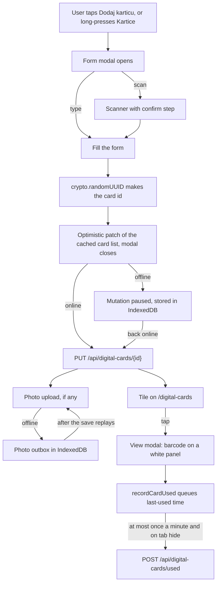

# Disscount: Digital Cards (Kartice)

A reference for how the digital wallet works: how a card is created, stored, shown at the till, kept offline, and deleted. Written for someone new to the code, so the concepts are explained as they come up. Keep it up to date as the feature changes.

_Written against the `feat/digital-cards-rebuild` branch. This is the rebuild; the earlier `digital_card` feature is replaced and not described here._

> **Mental model in one sentence:** a card is a small row of text (name, store, the number or barcode payload, a colour) that the browser can draw as a scannable barcode on a white panel, optionally with up to three photos kept in a Cloudflare R2 bucket, and every write works offline because the card id is made on the phone and the write is replayed later.

---

## Table of contents

1. [Quick reference](#1-quick-reference)
2. [How a card flows](#2-how-a-card-flows)
3. [Data model](#3-data-model)
4. [API](#4-api)
5. [Photos and R2](#5-photos-and-r2)
6. [Offline](#6-offline)
7. [Scanner hardening](#7-scanner-hardening)
8. [Barcode rendering](#8-barcode-rendering)
9. [Colour palette](#9-colour-palette)
10. [Privacy](#10-privacy)
11. [Screens](#11-screens)
12. [Key files](#12-key-files)
13. [Config and env vars](#13-config-and-env-vars)
14. [Libraries](#14-libraries)
15. [What is automatic vs manual](#15-whats-automatic-vs-manual)
16. [Tests](#16-tests)
17. [Gotchas and lessons learned](#17-gotchas--lessons-learned)
18. [Future improvements and TODOs](#18-future-improvements--todos)

---

## 1. Quick reference

| Thing           | Value                                                                                                |
| --------------- | ---------------------------------------------------------------------------------------------------- |
| Route           | `/digital-cards` (login required), plus the modals `?modal=digital-card/new`, `edit&id=`, `view&id=` |
| Backend package | `disscount.digitalCard` (cards, photos), `disscount.storeName` (community store-name list)           |
| Tables          | `wallet_card`, `wallet_card_photo`, `store_name_suggestion`, `photo_cleanup`                         |
| Limits          | 300 active cards per user, 60 characters for names, 500 for a note, 4096 for a code                  |
| Photos          | up to 3 per card (`front`, `back`, `icon`), WebP or JPEG, 512 KB per part, stored in Cloudflare R2   |
| Photo bucket    | jurisdiction **EU**, endpoint `https://<ACCOUNT_ID>.eu.r2.cloudflarestorage.com`                     |
| Env vars        | `R2_ENDPOINT`, `R2_BUCKET`, `R2_ACCESS_KEY_ID`, `R2_SECRET_ACCESS_KEY` (backend, optional)           |
| No env vars set | the wallet still works; only photos are off (uploads answer 503, the form hides the photo fields)    |
| Offline         | cards are cached on the device; create, edit, pin, archive and delete queue and replay               |
| Frontend tests  | `pnpm test` (Vitest)                                                                                 |
| Backend tests   | `mvn -B test` (H2, no network)                                                                       |

**Daily workflow:** nothing to configure for cards themselves. Photos need the four `R2_*` variables in Dokploy; see [§13](#13-config-and-env-vars).

---

## 2. How a card flows



Step by step:

1. **Create.** The form (`?modal=digital-card/new`) mints the card id in the browser with `crypto.randomUUID()`. Because the id exists before the server has seen the card, an offline create and a later edit of the same card replay in order with no temporary ids to rewrite.
2. **Save.** `PUT /api/digital-cards/{id}` is an idempotent upsert: the same request sent twice gives one card. The modal closes immediately on an optimistic patch of the cached list, and if the server later refuses the write the modal reopens with the error (the card number is kept in memory for that, see [§10](#10-privacy)).
3. **Photos.** Photos are separate requests after the card exists, so a slow upload never blocks saving the card.
4. **Show.** Tapping a tile opens the view modal, which draws the barcode as an SVG on a white panel and keeps the screen awake.
5. **Use.** Opening a card records a "last used" time locally. It is sent in batches, never on the critical path.

---

## 3. Data model

Backend entities live in `backend/src/main/java/disscount/digitalCard/domain/` and `.../storeName/domain/`. The tables are new names on purpose: the old `digital_card` table cannot merge into the new shape (see [§17](#17-gotchas--lessons-learned)).

### `wallet_card` (entity `DigitalCard`)

| Column                                     | Type                      | Notes                                                                                                             |
| ------------------------------------------ | ------------------------- | ----------------------------------------------------------------------------------------------------------------- |
| `id`                                       | UUID, primary key         | Generated by the client, no `@GeneratedValue`                                                                     |
| `user_id`                                  | UUID, FK `app_user`       | Not null, lazy, indexed (`idx_wallet_card_user`)                                                                  |
| `card_name`                                | varchar(60)               | Not null                                                                                                          |
| `card_type`                                | varchar(16)               | `loyalty`, `gift`, `membership`, `other`. A String, never a Java enum                                             |
| `store_name`                               | varchar(60)               | Always set, also for official chains                                                                              |
| `chain_code`                               | varchar(40), nullable     | Only set when an official chain was picked; pattern `^[a-z0-9_-]+$`                                               |
| `code_value`                               | varchar(4096)             | The printed card number or text                                                                                   |
| `barcode_value`                            | varchar(4096), null       | The barcode payload, only when it differs from `code_value`                                                       |
| `code_type`                                | varchar(32)               | A BarcodeDetector format name (`ean_13`, `qr_code`, `code_128`, and so on) or `unknown` for a number with no bars |
| `card_color`                               | varchar(7)                | `#RRGGBB`                                                                                                         |
| `note`                                     | varchar(500), null        |                                                                                                                   |
| `valid_from`, `expires_on`                 | date, null                | `expires_on` may not be before `valid_from`                                                                       |
| `balance`, `balance_unit`                  | numeric(19,4), varchar(8) | Unit is an ISO 4217 code like `EUR`; null unit means points                                                       |
| `pinned_at`, `last_used_at`, `archived_at` | timestamp, null           | Null means "not pinned / never used / not archived"                                                               |
| `created_at`, `updated_at`                 | timestamp                 | Stamped through `Timestamps.nowUtc()`, never `LocalDateTime.now()`                                                |
| `deleted_at`                               | timestamp, null           | Soft delete marker                                                                                                |

Deliberately **not stored**: a gift card PIN (it is a credential), the header text colour (derived from the card colour), and card groups.

### `wallet_card_photo` (entity `DigitalCardPhoto`)

One row per photo. Columns: `id` (generated UUID), `card_id` (FK), `slot` (`front`, `back`, `icon`), `sha256` (char 64), `full_key`, `thumb_key` (null for the icon), `content_type`, `byte_size`, `created_at`. The pair `(card_id, slot)` is unique (`uq_wallet_card_photo_slot`), so a slot holds one photo and a new upload replaces it.

### `photo_cleanup` (entity `PhotoCleanup`)

A queue of R2 deletes that still have to happen. Columns: `id`, `key_or_prefix` (an object key, or a `cards/...` prefix when `is_prefix` is true), `is_prefix`, `created_at`.

- The row is written in the same transaction as the database delete it belongs to (card delete, photo replace or remove, account deletion, the 30-day purge), so the two commit or roll back together.
- After the commit `PhotoCleanupService` tries the delete and removes the row on success. On failure the row stays.
- Keys are content-addressed, so re-uploading a replaced photo reuses its old key. Writing a photo row therefore cancels any queued delete for its keys in the same transaction, and every delete attempt first skips (and drops) a key that a live photo row still uses.
- `DigitalCardCleanupJob.retryPhotoCleanup` retries the oldest 200 rows every 15 minutes. With photos disabled (no R2 config) nothing is deleted and the rows stay queued until storage is configured.

### `store_name_suggestion` (entity `StoreNameSuggestion`)

The shared, anonymous list of store names that people typed when their store is not an official chain. Columns: `id`, `name`, `normalized_name` (unique), `use_count`, `hidden`, `created_at`, `updated_at`. There is **no user column**: the list is public and carries no link back to who typed a name.

- `StoreNameNormalizer.normalize` lowercases, strips diacritics and maps `đ` to `d`, so "Žabac" and "zabac" are one entry.
- `StoreNameService.record` runs in its own transaction (`REQUIRES_NEW`) so a concurrent duplicate insert can never roll back the card save, and `DigitalCardService` catches and logs a failure there instead of failing the card.
- A name is recorded after the card commits, and only when the card has no `chainCode` and is new, has a changed store name, or was a chain card that became custom. Plain edits and replays do not count.
- A name is shown (in search and in the top list) only once `use_count >= 2`, so one person's custom store never leaks on a single save. The residual: one person with two cards of the same store name also reaches 2.
- `hidden` exists for moderation; nothing sets it yet (see [§18](#18-future-improvements--todos)).

---

## 4. API

All card endpoints need a valid JWT. Errors are RFC 9457 `ProblemDetail` bodies with Croatian messages. Swagger UI at `/api-docs` lists them.

| Method and path                                | What it does                                                                                                                                                                                                 |
| ---------------------------------------------- | ------------------------------------------------------------------------------------------------------------------------------------------------------------------------------------------------------------ |
| `GET /api/digital-cards/me`                    | Every non-deleted card of the caller, archived ones included, each with `photos: [{slot, sha256}]`                                                                                                           |
| `GET /api/digital-cards/{id}`                  | One card                                                                                                                                                                                                     |
| `PUT /api/digital-cards/{id}`                  | Create or update (idempotent upsert). Another user's id, or a soft-deleted id, answers 404, so a replayed create cannot resurrect a deleted card                                                             |
| `PUT /api/digital-cards/{id}/pin`              | Body `{pinned}`. A small write so an offline pin toggle never overwrites a full edit                                                                                                                         |
| `PUT /api/digital-cards/{id}/archive`          | Body `{archived}`, same reason                                                                                                                                                                               |
| `DELETE /api/digital-cards/{id}`               | Soft delete. The photo rows go at once and the R2 deletes are queued in `photo_cleanup`, because photos are personal data. 204; unknown id 404                                                               |
| `POST /api/digital-cards/used`                 | Body `[{id, usedAt}]`, 1 to 50 entries (otherwise 400). `usedAt` is clamped to between 400 days ago and now. Sets `last_used_at` to the later of the stored and sent time, without bumping `updated_at`. 204 |
| `GET /api/digital-cards/config`                | `{photosEnabled}`. The form uses it to hide the photo fields when R2 is not configured                                                                                                                       |
| `PUT /api/digital-cards/{id}/photos/{slot}`    | Multipart: `full` (required) and `thumb` (required for `front` and `back`, absent for `icon`). Returns `{slot, sha256}`                                                                                      |
| `GET /api/digital-cards/{id}/photos/{slot}`    | Streams bytes. Query `size=full                                                                                                                                                                              | thumb`and`v={sha256}`. `Cache-Control: private, max-age=31536000, immutable`, an `ETag`, and `nosniff`. Conditional GET goes through `WebRequest.checkNotModified`, so weak and multi-value `If-None-Match` work |
| `DELETE /api/digital-cards/{id}/photos/{slot}` | Removes one photo; the R2 delete is queued in `photo_cleanup`. 204                                                                                                                                           |
| `GET /api/store-names?q=`                      | Up to 50 visible community names, most used first, matched on the normalized name                                                                                                                            |

**Validation** (`DigitalCardRequest`): `cardName` and `storeName` 2 to 60 characters after trimming (`@TrimmedLength`, reported as field errors), `cardType` and `codeType` from an allowlist, `codeValue` 1 to 4096, `barcodeValue` up to 4096, `cardColor` a hex colour, `note` up to 500, `balance` 0 to 1,000,000 with two decimals, `balanceUnit` three capital letters, `expiresOn` not before `validFrom`. `cardName`, `storeName`, `codeValue`, `barcodeValue` and `note` may not contain a NUL character (`@NoNul`), and `GET /api/store-names?q=` with a NUL answers 400. The `POST /used` size and entry checks run through `@Validated` on the controller, and `GlobalExceptionHandler` turns the `ConstraintViolationException` into a 400.

**Limits:** 300 active cards per user (409 "Dosegnut je najveći broj kartica"), exact even under concurrent requests because every card write first locks the user's `app_user` row (see [§5](#5-photos-and-r2)); `POST /used` accepts 1 to 50 entries; photo uploads are limited to 20 per minute per user (429 with a `Retry-After` header, in memory per instance, `PhotoUploadRateLimiter`). When R2 is not configured the upload answers 503 "Slike trenutno nisu dostupne".

---

## 5. Photos and R2

Photos are optional and sit behind a `PhotoStore` interface (`put`, `get`, `delete`, `deletePrefix`). Two implementations exist: `R2PhotoStore` and `DisabledPhotoStore`, chosen in `PhotoStoreConfig`. If any of the four `R2_*` values is blank, the disabled store is used and the wallet works without photos.

### What the browser does

`utils/browser/card-image.ts` prepares every image before upload:

- Decode with `createImageBitmap(file, { imageOrientation: "from-image" })` so phone photos are rotated correctly.
- `front` and `back`: 1280 px on the long edge plus a 320 px thumbnail. `icon`: a centred 128 px square. Small images are never upscaled.
- Encode WebP at quality 0.75. If the browser returns anything that is not `image/webp`, encode JPEG at 0.78 instead. This matters on Safari, see [§17](#17-gotchas--lessons-learned). PNG is never sent. The JPEG fallback paints a white background first, so transparency does not turn black.
- If the full image is over 480 KB after encoding, it is retried at quality 0.65, then 0.55, then at a 1024 px long edge. If it still does not fit, the error "Slika je prevelika. Odaberi drugu." is shown.

### What the server does

`PhotoValidator` accepts only WebP and JPEG, decided by the first bytes of the file and never by the client's `Content-Type` or file name. It uses no image library for WebP.

| Check      | Rule                                                                                                                                                                                            |
| ---------- | ----------------------------------------------------------------------------------------------------------------------------------------------------------------------------------------------- |
| Size       | 512 KB per part. Spring is set to `max-file-size=512KB` and `max-request-size=1100KB`                                                                                                           |
| Type       | JPEG (`FF D8 FF`) or WebP (`RIFF`, correct size, `WEBP`, first chunk `VP8 `, `VP8L` or `VP8X`). PNG, SVG and anything else answer 400                                                           |
| Dimensions | Read from the header, at most 2048 px per side, before anything is decoded                                                                                                                      |
| Animation  | `ANIM` and `ANMF` chunks are rejected                                                                                                                                                           |
| Alpha      | An `ALPH` chunk is allowed only after `VP8X`, only once, and before the `VP8 ` frame, and never together with `VP8L` (which carries its own alpha). Anything else answers 400                   |
| Metadata   | WebP is rewritten keeping only `VP8X` (flags cleared except alpha), `VP8 `, `VP8L` and `ALPH`, which drops EXIF, XMP and ICC. JPEG is decoded with ImageIO and re-encoded, which drops metadata |

The stored bytes are the sanitized ones. For `icon` the `sha256` is the hash of those bytes. For `front` and `back` it is a hash of the full and the thumbnail hashes together, so replacing only the thumbnail still changes the key, the `ETag` and the `?v=` value.

### Write order and the per-user lock

Upload validates both parts, puts them to R2 **outside any transaction** (so no database connection is held during the network call), and only then writes the row in a short transaction (`CardPhotoWriter`). That transaction re-checks that the card is still active, so a delete that committed during the upload wins. If the row write fails, the objects just stored are deleted, unless the live row already references the same keys (the same bytes uploaded twice).

Every card write (upsert, delete, pin, archive, photo replace and remove, account deletion) first takes `UserRepository.findByIdForUpdate` (`PESSIMISTIC_WRITE`), wrapped by `CardUserLock`, which also rejects a deleted user. That serializes one user's writes, which is what makes the 300-card limit exact and turns a concurrent replay of the same id into a plain update. Account deletion takes the lock and flushes the anonymization before the card purge, so it persists.

Object deletes (replaced or removed photos, a deleted card, account deletion, the 30-day purge) are queued in `photo_cleanup` in the same transaction, so a crash or an R2 outage cannot orphan an object for good ([§3](#3-data-model)).

### Key layout

```
cards/{userId}/{cardId}/{slot}-{sha256}.{webp|jpg}
cards/{userId}/{cardId}/{slot}-{sha256}-thumb.{webp|jpg}
```

The hash in the key means a replaced photo gets a new key, so a cached copy can never be stale: the client asks for `?v={sha256}`, and a changed photo is a different URL. The `cards/{userId}/` prefix is what lets account deletion remove everything with one prefix sweep.

### The R2 client

`PhotoStoreConfig` builds an AWS SDK v2 `S3Client` pointed at R2: `endpointOverride`, region `auto`, path-style access, chunked encoding off, request and response checksums set to `WHEN_REQUIRED`, and `UrlConnectionHttpClient` (the Netty and Apache clients are excluded in `pom.xml` to keep the image small). The client has an `apiCallTimeout` of 20 seconds and an `apiCallAttemptTimeout` of 10 seconds, so a stalled R2 call cannot hold a request thread for the SDK default of minutes. R2 deletes are queued with the database change and attempted **after** the commit (`AfterCommit`), so a rolled-back transaction never loses a photo.

`R2PhotoStore.deletePrefix` lists the prefix and issues one `DeleteObject` per key, not the batch `DeleteObjects` call, because the batch call needs a checksum header that R2 handles differently from S3.

### Bucket setup (owner, once)

1. In Cloudflare, create a bucket with **jurisdiction EU**. The jurisdiction is chosen at creation and cannot be changed later.
2. Create an API token scoped to that bucket with object read and write.
3. Set the four `R2_*` variables in Dokploy for each environment (see [§13](#13-config-and-env-vars)).

Use a separate bucket from the backup bucket in [`DEPLOYMENT.md`](DEPLOYMENT.md), and a separate token, so a leaked photo token cannot touch database backups.

---

## 6. Offline

Cards have to work in a shop with no signal, so the whole wallet is offline-first. It builds on the offline machinery described in [`PWA.md`](PWA.md).

| Piece                 | What it does                                                                                                                                                                                                                                                                                                                                                                                                                                                                                                | Where                                                        |
| --------------------- | ----------------------------------------------------------------------------------------------------------------------------------------------------------------------------------------------------------------------------------------------------------------------------------------------------------------------------------------------------------------------------------------------------------------------------------------------------------------------------------------------------------- | ------------------------------------------------------------ |
| Persisted query cache | The `digitalCards` query keys are saved to IndexedDB (metadata only, never image bytes), so the list opens with no network. The keys are versioned (`["digitalCards", "v2", "me"]` and `["digitalCards", "v2", "config"]`) and `shouldPersistQuery` refuses any other `digitalCards` shape, so an older build's snapshot ages out instead of crashing the new reader. `CACHE_BUSTER` is unchanged                                                                                                           | `lib/offline/cached-query-keys.ts`, `persister.ts`           |
| Paused mutations      | `digitalCardSave`, `digitalCardDelete`, `digitalCardPin`, `digitalCardArchive` are on the offline allowlist; offline they pause and are stored, then replay on reconnect. All share the mutation scope `{ id: "digitalCards" }`, so they replay one at a time in the order they were made                                                                                                                                                                                                                   | `offline-mutation-keys.ts`, `offline-mutations.ts`           |
| Client UUIDs          | The card id is made in the browser, so create and later edits replay in order                                                                                                                                                                                                                                                                                                                                                                                                                               | `forms/digital-card-modal.tsx`                               |
| Optimistic patches    | The cached list is patched at once, so the UI never waits                                                                                                                                                                                                                                                                                                                                                                                                                                                   | `lib/api/digital-cards/optimistic-cards.ts`                  |
| Photo blob store      | Downloaded photo bytes live in IndexedDB (`disscount-card-photos`), keyed `{identity}:{cardId}:{slot}:{size}:{sha256}`, fetched with a bearer token on a miss                                                                                                                                                                                                                                                                                                                                               | `lib/offline/card-photo-store.ts`, `hooks/use-card-photo.ts` |
| Photo outbox          | A photo chosen offline, or a photo removal made offline, is saved in IndexedDB (`disscount-card-photo-outbox`), one entry per slot (a newer intent replaces an older one), and the slot shows "Čeka slanje". Each entry carries a nonce, so a finished send never deletes a newer entry                                                                                                                                                                                                                     | `lib/offline/card-photo-outbox.ts`                           |
| Last-used queue       | Opening a card writes a time into IndexedDB (`disscount-card-used`); it is flushed to `POST /used` at most once a minute and when the tab is hidden. A flush deletes only entries whose `usedAt` is unchanged, so a card opened again mid-request stays queued. The hidden-tab flush is a `keepalive` fetch with the cached token (`peekFreshAuthToken` in `api-base.ts`), falling back to axios when there is no fresh token. It is not a paused mutation, because a lost write only costs a sort position | `lib/api/digital-cards/last-used.ts`                         |
| Persistent storage    | `navigator.storage.persist()` is requested once, after the first saved card, so the browser does not evict cards and photos under storage pressure                                                                                                                                                                                                                                                                                                                                                          | `lib/offline/request-persistent-storage.ts`                  |
| Purge on logout       | Any identity change clears user-specific queries, the persisted snapshot, the photo blobs, the photo outbox, the last-used queue (`deleteUsedQueueForIdentity`) and the scoped service-worker caches. `purge-gate.ts` registers a purge synchronously, and the persister, photo writes, outbox enqueues and last-used writes wait for it, so a fast re-login is not wiped by the previous account's purge                                                                                                   | `lib/offline/purge.ts`, `purge-gate.ts`                      |

**Replay order matters.** On reconnect the provider first resumes the paused card saves and only then replays the photo outbox. An upload for a card the server has not seen yet would answer 404 and be dropped. A replay requested while one is running triggers another run afterwards, and the outbox re-reads each entry before sending it.

**Which failures keep or drop** is decided in one place, `lib/offline/failure-policy.ts` (`failureAction`). A network failure, 401, 408, 429, any 5xx (503 included) and any status not listed below **keep** the entry: it stays queued and the replay stops, so the next run retries in order. 400, 404, 409, 413 and 422 **drop** it, because resending can never succeed. A dropped photo shows a toast, except for a 404 (the card is already gone). Direct photo uploads and removals made while online use the same rule: on keep (or a 404 for an upload) they go to the outbox. A 404 when replaying a queued removal counts as done. Rollback of an optimistic card patch is per card, so a failure never undoes other cards. Card mutations (save, delete, pin, archive) also use this rule for retries (`lib/offline/card-retry.ts`): a keep failure is retried up to 3 times with backoff from 1 s to 8 s, and a mutation that fails because the device is offline pauses and retries once it reconnects. Every photo choice, online or offline, is written to the outbox first, so a reload never loses it. Only the sends are serialized per slot (`lib/offline/slot-lock.ts`): each send re-reads the newest entry inside the lock, and a send that finishes after a newer choice was queued leaves the cache alone, so an older upload cannot undo a newer choice. While the card save is paused, photo removals are queued in the outbox together with uploads, so a reload does not lose them.

**Photo blobs are pruned** when a card is deleted and whenever the card list refetches: a blob whose `sha256` no longer matches the card's current photo is removed.

**Writes that fail on replay** show a toast (`card-write-failed.ts`), because the `onError` passed when the mutation was started is lost on a page reload. A 404 is silent (the card was deleted elsewhere), and a 409 toasts only for the card-limit message.

---

## 7. Scanner hardening

Card numbers are long and a misread is worse than no read, so the shared scanner (`components/scanner/`, `context/scanner-context.tsx`) has a stricter mode for cards. Cards call `openScanner({ preset: "all", confirm: true, onScan })`. Products keep `preset: "product"` with no confirm step.

- **Consensus.** A code counts only after 3 identical reads within 1.5 seconds, or 4 for the weaker formats (`code_39`, `code_93`, `codabar`, `itf`). Products need 2. Logic: `scan-consensus.ts`, wired by `hooks/use-scan-consensus.ts`.
- **Check digits.** `utils/barcode/check-digits.ts` validates EAN-13, EAN-8, UPC-A, UPC-E (expanded) and ITF-14. A read that fails its check digit is dropped. After 5 seconds of nothing but rejects, a hint offers manual entry.
- **Normalization.** `utils/barcode/normalize-code.ts` turns UPC-A into `ean_13` with a leading 0, and a six- or seven-digit UPC-E into its eight-digit form (`upc-e.ts`), so the same card does not get two spellings. The renderer applies the same UPC-E step, so values saved before this rule still draw. Product scans keep the scanned value.
- **Confirm step.** In the same dialog the user sees the drawn barcode, the value in monospace and the format name, with "Koristi kod", "Skeniraj ponovno" and "Upiši ručno". When two different codes were seen within 800 ms, a radio list lets the user pick.
- **Feedback.** One vibration and one short beep (Web Audio, `scan-beep.ts`) per stable code, and a polite live region announces it. A still-image scan returns every code found, so the confirm step can offer them all.

---

## 8. Barcode rendering

`app/(user)/digital-cards/utils/generate-code-svg.ts` draws the code with `@bwip-js/browser`.

- It imports only the encoders it needs (EAN, UPC, Code 128, 39, 93, Codabar, ITF, QR, Aztec, Data Matrix, PDF417), not the whole library, to keep the bundle small.
- It is synchronous and returns `{ ok: true, svg }` or `{ ok: false }`. On `ok: false` the view falls back to the number in large text.
- The SVG uses `shape-rendering="crispEdges"`, keeps the quiet zone, and is always black on white. A white `rect` sits behind the bars so the quiet zone stays white on a dark page.
- Digit-only symbologies check the exact length first (`accepts`), because bwip would otherwise append a check digit and the drawn code would no longer match the stored number.
- Module widths are sized to the container's device pixels (`use-device-pixel-width.ts`) so scanners see whole pixels per bar.
- 2D codes (QR, Aztec, Data Matrix) are sized by `fit-code-size.ts` so they fit the tile in both directions with a whole number of device pixels per module.

**"Ne skenira se? Probaj drugi tip."** `code-alternatives.ts` lists other valid encodings of the same value (for digits: EAN-13 if the check digit holds, Code 128, Code 39, QR). The switcher previews them without touching the saved card; "Spremi kao zadano" saves the choice.

---

## 9. Colour palette

`utils/card-palette.ts` holds 19 colours taken from Google Calendar, shown as a hexagon in the form: Grafit in the centre, six lighter colours in the inner ring, twelve in the outer ring, ordered like a rainbow wheel with red at the top. Three near-twins were left out so no two cells look alike, and Ametist is darkened so it passes the contrast rule.

- **Text colour** on a card is white or `#111827`, whichever has the higher WCAG contrast (`utils/color-contrast.ts`).
- **A contrast test** (`card-palette.test.ts`) fails CI if any palette colour is below 4.5:1 against its text colour. Add a colour and the test tells you if it is readable.
- **Screen readers** hear the name plus the hue, for example "Borovnica, tamnoplava", because a name alone says nothing.
- **Keyboard.** The hexagon is one radiogroup with one Tab stop; arrow keys move in 2D (`hex-grid.ts`, tested) and select. The hover scale only applies under `motion-safe`.
- **Chains.** `chain-default-colors.ts` maps an official chain to the closest palette colour. It applies only until the user picks a colour.
- There is no custom colour picker yet.

---

## 10. Privacy

A loyalty card number is personal data, and a photo of a card more so.

| Rule                                       | How it is enforced                                                                                                                                                                                        |
| ------------------------------------------ | --------------------------------------------------------------------------------------------------------------------------------------------------------------------------------------------------------- |
| Card numbers never reach `localStorage`    | The form draft excludes `codeValue` and `barcodeValue` (`exclude` in `use-digital-card-form.ts`)                                                                                                          |
| Card numbers never reach URLs or search    | Search reads name, store and note only (`filterCards`); the modal URL carries a card id, never a number                                                                                                   |
| A failed save can still restore the number | `pending-card-stash.ts` keeps the number in memory for 5 minutes so the reopened form is not empty. Memory only, gone on reload                                                                           |
| Account deletion purges cards              | `UserService.deleteAccount` locks the user, then calls `digitalCardService.deleteAllForUser`, which hard-deletes the user's cards and photo rows and queues removal of the `cards/{userId}/` prefix in R2 |
| Deleted cards do not linger                | A delete is soft first; the daily `DigitalCardCleanupJob` (03:30 UTC) hard-deletes cards soft-deleted more than 30 days ago                                                                               |
| Photos are removed immediately on delete   | The photo rows and R2 objects go at once, even though the card row stays for the 30 days                                                                                                                  |
| Photo metadata is stripped                 | EXIF, XMP and ICC are removed server side, so a location in a photo never lands in R2                                                                                                                     |
| The photo URL is private                   | `Cache-Control: private`, authenticated, and the owner is checked on every request                                                                                                                        |
| Logout wipes the device                    | `purgeOfflineCache` removes the cached list, photo blobs, the photo outbox and the last-used queue of that account                                                                                        |
| The store-name list is anonymous           | No user reference in `store_name_suggestion`, and a name is shown only after two uses                                                                                                                     |
| The EU jurisdiction bucket                 | Photos stay in the EU                                                                                                                                                                                     |

---

## 11. Screens

- **`/digital-cards`.** Search (name, store, note), a sort select (Nedavno korišteno by default, then Naziv, Trgovina, Tip, Nedavno uređeno, Nedavno dodano, Boja; the choice is kept in `localStorage`), pinned cards first, a divider, the rest, then a collapsible "Arhivirane" section. Two columns on mobile, three on desktop, tiles at a 1.5:1 ratio. If the user has exactly one active card it opens straight away, only on the first loaded render, so saving a first card from this page does not bounce into it (`use-auto-open-single-card.ts`). Changes such as a pin or a save are announced through a live region (`card-announcer.tsx`).
- **Tile.** The card colour, a round icon (photo icon, chain logo, initials or a generic icon), store name, card name, a date, and a pin button (labelled "Prikvači karticu <name>", with `aria-pressed`) that never triggers the tile. On desktop hover the tile flips to show the code, except under reduced motion.
- **View modal** (`?modal=digital-card/view&id=`). A white panel with the code at full width, the number in large monospace text, a Screen Wake Lock while open (re-requested when the tab returns; a refusal is silent with a hint), a dismissible brightness hint, a rotate button for 1D codes, the "Ne skenira se?" switcher, a chain note for Lidl Plus, Kaufland, dm and a MultiPlus terms note, the photos, details, and the actions (uredi, prikvači, arhiviraj, obriši with a confirm).
- **Form modal** (`?modal=digital-card/new|edit`). Name, type, store (an Autocomplete with "Službene trgovine" and logos, "Ostalo" for community names, and free text), the code with a scanner button and a live preview, a toggle for a barcode payload that differs from the printed number, the colour hexagon, photos with camera capture, a note, and "Više detalja" for dates and balance.
- **Navigation.** Kartice is no longer a teaser. The bottom-nav long press opens a new card, the PWA shortcut list includes Kartice, and the landing page card links to `/digital-cards`.

---

## 12. Key files

| Path                                                                                           | Role                                                                              |
| ---------------------------------------------------------------------------------------------- | --------------------------------------------------------------------------------- |
| `backend/.../digitalCard/domain/`                                                              | `DigitalCard`, `DigitalCardPhoto` entities                                        |
| `backend/.../digitalCard/rest/`                                                                | `DigitalCardController`, `DigitalCardPhotoController`                             |
| `backend/.../digitalCard/service/DigitalCardService.java`                                      | Upsert, ownership checks, soft delete, used-at, account purge                     |
| `backend/.../digitalCard/service/DigitalCardPhotoService.java`                                 | Upload (validate, put to R2), download, delete; calls the validator and store     |
| `backend/.../digitalCard/service/CardPhotoWriter.java`, `CardUserLock.java`                    | The short row-write transaction; the per-user lock                                |
| `backend/.../digitalCard/service/PhotoCleanupService.java`                                     | Queues R2 deletes in `photo_cleanup`, attempts them, retries                      |
| `backend/.../digitalCard/service/DigitalCardCleanupJob.java`                                   | Daily 30-day hard delete; sweeps the rate limiter; retries photo cleanup          |
| `backend/.../digitalCard/service/PhotoUploadRateLimiter.java`                                  | 20 uploads per minute per user                                                    |
| `backend/.../digitalCard/photo/`                                                               | `PhotoValidator`, `WebpSanitizer`, `JpegSanitizer`                                |
| `backend/.../digitalCard/storage/`                                                             | `PhotoStore`, `R2PhotoStore`, `DisabledPhotoStore`, `PhotoStoreConfig`            |
| `backend/.../storeName/`                                                                       | Community store-name list, normalizer and controller                              |
| `backend/.../config/SchedulingConfig.java`                                                     | `@EnableScheduling` (the first scheduled job in the app)                          |
| `frontend/src/lib/api/digital-cards/`                                                          | Query keys, queries, hooks, optimistic patches, last-used queue, photo queries    |
| `frontend/src/lib/api/schemas/digital-card.ts`, `store-name.ts`                                | Zod request and response schemas                                                  |
| `frontend/src/lib/offline/card-photo-store.ts`, `card-photo-outbox.ts`, `purge.ts`             | Photo blobs, upload outbox, logout purge                                          |
| `frontend/src/lib/offline/failure-policy.ts`, `card-retry.ts`, `slot-lock.ts`, `purge-gate.ts` | Keep or drop rules and card retries; per-slot photo ordering; purge ordering gate |
| `frontend/src/constants/card-codes.ts`                                                         | Code types, card types, photo slots and their labels                              |
| `frontend/src/app/(user)/digital-cards/`                                                       | The page, tiles, view and form modals, hooks and utils                            |
| `frontend/src/app/(user)/digital-cards/utils/generate-code-svg.ts`                             | bwip-js rendering                                                                 |
| `frontend/src/app/(user)/digital-cards/utils/card-palette.ts`                                  | The 19 colours                                                                    |
| `frontend/src/components/scanner/`                                                             | Shared scanner: consensus, confirm step, manual entry                             |
| `frontend/src/utils/barcode/`                                                                  | Check digits and normalization                                                    |
| `frontend/src/utils/browser/card-image.ts`                                                     | Photo resize and WebP or JPEG encoding                                            |
| `frontend/src/components/reui/autocomplete.tsx`                                                | The store field's Autocomplete (reui, built on `@base-ui/react`)                  |
| `frontend/src/hooks/use-wake-lock.ts`                                                          | Keeps the screen on in the view modal                                             |
| `backend/src/test/`                                                                            | The backend suite (H2)                                                            |

---

## 13. Config and env vars

Four backend variables, all **optional, runtime, secret** (never `NEXT_PUBLIC_`). Leaving any one blank turns photos off.

| Var                    | What it controls                                  | Example placeholder                                |
| ---------------------- | ------------------------------------------------- | -------------------------------------------------- |
| `R2_ENDPOINT`          | The R2 S3 endpoint of the EU-jurisdiction account | `https://<ACCOUNT_ID>.eu.r2.cloudflarestorage.com` |
| `R2_BUCKET`            | The bucket name for card photos                   | `<card-photos-bucket>`                             |
| `R2_ACCESS_KEY_ID`     | Access key of a token scoped to that bucket       | `<access-key-id>`                                  |
| `R2_SECRET_ACCESS_KEY` | Secret of the same token                          | `<secret-access-key>`                              |

They are read in `backend/src/main/resources/application.properties` as `r2.endpoint`, `r2.bucket`, `r2.access-key-id` and `r2.secret-access-key`, and listed in `backend/.env.example`. Set them in **Dokploy, service, Environment**, per environment; a change needs a restart of the backend, not a rebuild.

Other settings that matter: `spring.servlet.multipart.max-file-size=512KB` and `max-request-size=1100KB` in `application.properties`. The test profile (`backend/src/test/resources/application.properties`) leaves all four R2 values blank, so tests never reach out.

---

## 14. Libraries

Versions read from `frontend/package.json` and `backend/pom.xml`.

| Library                                        | Version            | Role here                                                                                   |
| ---------------------------------------------- | ------------------ | ------------------------------------------------------------------------------------------- |
| `@bwip-js/browser`                             | `^4.11.4`          | Draws barcodes and QR codes as SVG, in the browser, with no server round trip               |
| `@base-ui/react`                               | `^1.9.0`           | The headless Autocomplete primitive behind the store field, via the reui registry component |
| `vitest`                                       | `^5.0.3` (dev)     | Frontend unit tests, `pnpm test`                                                            |
| `idb-keyval`                                   | `^6.2.5`           | IndexedDB stores for photo blobs, the photo outbox and the last-used queue                  |
| `@tanstack/react-query` and persist client     | see `package.json` | The persisted cache and paused mutations                                                    |
| `software.amazon.awssdk:bom`                   | `2.55.14` (import) | Pins the AWS SDK v2 versions                                                                |
| `software.amazon.awssdk:s3`                    | from the BOM       | The S3 client used against R2 (Netty and Apache clients excluded)                           |
| `software.amazon.awssdk:url-connection-client` | from the BOM       | The small HTTP client the S3 client uses                                                    |

The store field's Autocomplete came from the reui registry (`@reui` in `frontend/components.json`) into `components/reui/autocomplete.tsx`. `components/ui/scroll-area.tsx` was added the same way.

---

## 15. What is automatic vs manual

| Thing                                                | Auto or manual | How                                                                      |
| ---------------------------------------------------- | -------------- | ------------------------------------------------------------------------ |
| Creating the new tables                              | Auto           | Hibernate `ddl-auto=update` on deploy (additive only)                    |
| Replaying offline writes                             | Auto           | `resumePausedMutations` on reconnect and on cache restore                |
| Replaying queued photos                              | Auto           | After the card saves, via `replayCardPhotoOutbox`                        |
| Sending last-used times                              | Auto           | At most once a minute, and when the tab hides                            |
| Retrying failed R2 deletes                           | Auto           | `DigitalCardCleanupJob.retryPhotoCleanup`, every 15 minutes              |
| Purging data on logout                               | Auto           | `purgeOfflineCache` on any identity change                               |
| Hard-deleting cards soft-deleted 30 days ago         | Auto           | `DigitalCardCleanupJob`, daily at 03:30 UTC                              |
| Removing a user's cards and photos on account delete | Auto           | `UserService.deleteAccount`                                              |
| Shortcut icons for the PWA                           | Auto           | `scripts/generate-shortcut-icons.mjs` (the icon files are committed)     |
| **Creating the R2 bucket (EU) and token**            | Manual         | Cloudflare dashboard, once                                               |
| **Setting the four `R2_*` variables**                | Manual         | Dokploy, per environment; both compose files forward them to the backend |
| **Dropping the old `digital_card` table**            | Manual         | After deploy, once nothing reads it                                      |
| **Moderating community store names**                 | Manual         | No admin screen yet; set `hidden = true` in the database by hand         |
| **Till test with real cards**                        | Manual         | Lidl Plus QR, and the code types Konzum, Spar, Tommy and Studenac print  |

---

## 16. Tests

| Suite             | Command                       | What it covers                                                                                                                                                                                                                                                                                                                                                                                     |
| ----------------- | ----------------------------- | -------------------------------------------------------------------------------------------------------------------------------------------------------------------------------------------------------------------------------------------------------------------------------------------------------------------------------------------------------------------------------------------------- |
| Backend (H2)      | `mvn -B test` from `backend/` | `PhotoValidatorTest` (good WebP and JPEG, PNG, SVG, truncated, oversized, animated, wrong RIFF size, metadata stripped), `DigitalCardServiceTest` (idempotent PUT, ownership 404, soft-deleted 404, delete removes photos, used-at maximum, account purge), `DigitalCardPhotoServiceTest`, `DigitalCardControllerTest` (401, 400 messages, 404), `StoreNameServiceTest`, `StoreNameNormalizerTest` |
| Frontend (Vitest) | `pnpm test` from `frontend/`  | Palette contrast, check digits, normalization, code alternatives, hex-grid keyboard navigation, sorting, the scan consensus rules, the code SVG generator, the photo type fallback                                                                                                                                                                                                                 |

At the time of writing `mvn -B verify` runs 81 backend tests and `pnpm test` runs 120 frontend tests. CI runs `pnpm test` after the typecheck, and `mvn -B verify` runs the backend suite. These tests cover digital cards and store names only; the rest of the backend still has no tests, so a green `verify` says nothing about other features.

---

## 17. Gotchas & lessons learned

| Gotcha                                              | What happens / fix                                                                                                                                                                                                                                                                     |
| --------------------------------------------------- | -------------------------------------------------------------------------------------------------------------------------------------------------------------------------------------------------------------------------------------------------------------------------------------- |
| **The old `digital_card` table stays**              | `ddl-auto=update` never drops anything, and the rebuild uses new table names (`wallet_card`) so the stale table cannot merge into the new shape. It sits unused until you drop it by hand, after deploy, once nothing reads it. This is a one-way step, so check a backup exists first |
| **`ddl-auto=update` and enum columns**              | `card_type` and `code_type` are Strings, not Java enums, so adding a type later is an allowlist change, not a stale `CHECK` constraint that 500s on write                                                                                                                              |
| **Safari returns PNG for a WebP request**           | `canvas.toBlob("image/webp")` silently gives PNG on Safari, and the server rejects PNG. `card-image.ts` checks `blob.type` and falls back to JPEG. Never remove that check                                                                                                             |
| **bwip-js is large**                                | Import only the named encoders from `@bwip-js/browser` (as `generate-code-svg.ts` does) rather than pulling in every symbology, or the bundle carries code for barcode types no card uses. This is a size concern I did not measure here                                               |
| **R2 and the AWS SDK checksums**                    | Since SDK 2.30 the default adds checksum trailers that R2 rejects. `PhotoStoreConfig` sets request and response checksums to `WHEN_REQUIRED` and turns chunked encoding off. Upgrading the SDK means re-testing a real upload                                                          |
| **R2 batch delete**                                 | `DeleteObjects` needs a checksum header R2 treats differently from S3, so `deletePrefix` deletes key by key                                                                                                                                                                            |
| **The EU jurisdiction is fixed at bucket creation** | A bucket made without it cannot be moved. The endpoint also differs (`.eu.` in the host), and the default endpoint will not find an EU bucket                                                                                                                                          |
| **Photos are not a paused mutation**                | Bytes in a persisted mutation would bloat the single cache blob, so photos use their own outbox. Keep new photo work out of the mutation cache                                                                                                                                         |
| **Replay order**                                    | Card saves must replay before photo uploads, or the upload 404s and is dropped                                                                                                                                                                                                         |
| **Bump the query key version with the DTO**         | `DIGITAL_CARD_KEY_VERSION` in `lib/api/digital-cards/keys.ts` retires cached card data when its shape changes. Bump it instead of the persister `buster`                                                                                                                               |
| **No R2 call inside a transaction**                 | A photo is put to R2 first and the row written after, in a short transaction. Holding a transaction open across the upload would pin a database connection on a slow network                                                                                                           |
| **Last-used is not a mutation**                     | Opening a card must never wait on the network. A lost write only changes sort order                                                                                                                                                                                                    |
| **The persister `buster`**                          | Bumping it discards every queued offline write for every user (see [`PWA.md`](PWA.md)). The cards rebuild did not change it; do not bump it for a small field change                                                                                                                   |
| **Store names must not fail a card save**           | `record` runs in `REQUIRES_NEW` and its failure is logged, not thrown                                                                                                                                                                                                                  |
| **`navigator.vibrate` moved**                       | The scanner context no longer vibrates on every scan; `scanner-content.tsx` does it once per stable code. Do not add it back to the context                                                                                                                                            |
| **Gift card PINs are never stored**                 | A PIN is a credential. If a future feature asks for one, treat it as a separate security design, not another text field                                                                                                                                                                |
| **Draft keys**                                      | The form drafts live under `digital-card.new` and `digital-card.edit.<id>` and never hold a card number                                                                                                                                                                                |

---

## 18. Future improvements & TODOs

**Release 2 (planned next)**

- [ ] **Catima zip import and export**, so people can move cards in and out of Catima, the wallet app many of them use today.
- [ ] **Shopping-list card prompt**: when a list is for a store where the user has a card, prompt to open it.
- [ ] **"Imaš karticu" badge** on store chains the user has a card for.

**Later**

- [ ] **Guest mode**: let a visitor keep a few cards without an account and import them on login. The wallet is login-only for now.
- [ ] **Custom card colour** beyond the 19-colour palette (needs the contrast rule to keep holding).
- [ ] **Admin moderation of community store names**: a screen to set `hidden`, merge duplicates and fix spellings.
- [ ] **Google Wallet export** of a card.
- [ ] **Native `BarcodeDetector`** as a fast path where available (see [`PWA.md`](PWA.md) TODOs).
