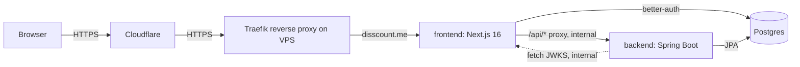
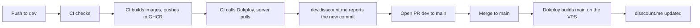

# Disscount: Infrastructure & Deployment Guide

A complete reference for how Disscount is hosted, deployed, secured, backed up, and monitored, written to be understandable even if you're new to this. Keep it up to date as the setup changes.

_Last verified end-to-end on 2026-06-28: prod + dev healthy, redirects and certs valid, backups in place._

> **Mental model in one sentence:** a single Hetzner server runs **Dokploy** (a self-hosted Heroku/Vercel alternative), which builds our app from GitHub into Docker containers and exposes them to the internet through **Traefik** (a reverse proxy that also gets free HTTPS certificates), while **Cloudflare** sits in front for DNS, CDN, and DDoS protection.

---

## 1. Quick reference

| Thing            | Value                                                                                 |
| ---------------- | ------------------------------------------------------------------------------------- |
| Production site  | `https://disscount.me` (aliases `www.` / `app.` 301-redirect to it)                   |
| Dev/staging site | `https://dev.disscount.me`                                                            |
| Dokploy panel    | `https://dokploy.disscount.me`                                                        |
| Status page      | `https://stats.uptimerobot.com/ej4ROz2eMo` (public, no account needed)                |
| VPS              | Hetzner **CX33** (4 vCPU / 8 GB / 80 GB), Ubuntu, Helsinki, IP **YOUR_VPS_IP**        |
| SSH              | `ssh YOUR_USER@YOUR_VPS_IP` (key-only; root + password login disabled)                |
| Repo             | `OffCrazyFreak/Disscount` (**public**), prod from `main`, dev from `dev`              |
| Cost             | ~**€10.61/mo** VPS (fixed) + free tiers (Cloudflare, R2, Sentry, UptimeRobot, Resend) |

**Daily workflow:** push to `dev`, test on `dev.disscount.me`, open PR `dev` to `main`, merge, production auto-deploys.

> 🔒 _This doc lives in a **public** repo, so the server IP and SSH user are shown as `YOUR_VPS_IP` / `YOUR_USER` placeholders. Keep the real values in your password manager, never commit them here._

---

## 2. Architecture

Three containers per environment, on a private Docker network. **Only the frontend is exposed:** the browser talks to the frontend, which proxies API calls to the backend internally. The backend and database are never reachable from the internet.



| Service    | Tech                                                  | Internal address | Public?               | Role                                                                                                |
| ---------- | ----------------------------------------------------- | ---------------- | --------------------- | --------------------------------------------------------------------------------------------------- |
| `frontend` | Next.js 16 (standalone)                               | `frontend:3000`  | **yes** (via Traefik) | UI + **better-auth** identity provider; proxies `/api/*` to backend                                 |
| `backend`  | Spring Boot 4.1 / Java 21                             | `backend:8080`   | no                    | REST API; validates better-auth JWTs (resource server)                                              |
| `db`       | Postgres 17                                           | `db:5432`        | no                    | one shared database, used by both                                                                   |
| `migrate`  | (frontend build image; `disscount-migrator` on `dev`) | n/a              | no                    | one-shot: runs drizzle migrations (auth tables, store locations, store hours) on deploy, then exits |

**Why the backend isn't public:** the browser only ever calls `https://disscount.me/api/...` (relative URLs). A Next.js route handler (`app/api/[...path]`, see [BACKEND-PROXY.md](BACKEND-PROXY.md)) forwards those to `backend:8080` _server-side_, inside the Docker network. This means no CORS config is needed and the backend/DB have no internet-facing attack surface.

**Auth flow:** better-auth (in the frontend) mints **ES256 JWTs**, on the server, once per proxied call; the browser holds only its session cookie. The backend trusts them by fetching the public keys (**JWKS**) from `frontend:3000/api/auth/jwks` and checking the token issuer equals `https://disscount.me`.

**Compose files:**

- `docker-compose.yml`: **local development** (publishes ports to localhost, named container names).
- `docker-compose.prod.yml`: **Dokploy** (no host ports, joins the external `dokploy-network`, no `container_name`, and Traefik handles routing). This is the file Dokploy deploys for `main`, which still builds on the server.
- `docker-compose.images.yml`: the same stack, pulling the CI-built GHCR images by `IMAGE_TAG` instead of building. This is the file Dokploy deploys for `dev` ([§4](#4-how-a-deploy-works-git-to-live)).
- Both Dokploy files also mount the `photos-private` and `photos-public` volumes on the backend, run a one-shot `photo-folders` service that creates the photo folders, and serve public product photos from an `images` nginx service ([PRODUCT-IMAGES.md](PRODUCT-IMAGES.md#storage-on-the-servers-disk)). Its inline `configs` need Docker Compose 2.23 or newer; the server runs v5.6.1.

---

## 3. Accounts & services

| Service                | What it's for                              | Where / notes                                                                                                                                                                                                                                       |
| ---------------------- | ------------------------------------------ | --------------------------------------------------------------------------------------------------------------------------------------------------------------------------------------------------------------------------------------------------- |
| **Hetzner**            | The VPS (server)                           | Cloud console, plus it hosts the **Cloud Firewall** `disscount-web`                                                                                                                                                                                 |
| **Dokploy**            | Deployment platform (on the VPS)           | `https://dokploy.disscount.me`; admin login = your email. API keys: `github-ci-dev` (Member user limited to the development service, used by CI) and `claude-mcp` (owner key for the local Dokploy MCP of Claude Code and Codex, never in the repo) |
| **Cloudflare**         | DNS, CDN, DDoS, redirects, SSL, geo header | zone `disscount.me` (free plan)                                                                                                                                                                                                                     |
| **GitHub**             | Source code + auto-deploy trigger          | `OffCrazyFreak/Disscount`; connected to Dokploy via a **GitHub App**                                                                                                                                                                                |
| **Sentry**             | Error tracking                             | projects `disscount-frontend` + `disscount-backend` (EU region)                                                                                                                                                                                     |
| **Cloudflare R2 (EU)** | Backups                                    | photos live on the server's disk; see [R2 buckets](#r2-buckets) and [BACKUPS.md](BACKUPS.md)                                                                                                                                                        |
| **Resend**             | Transactional email + Dokploy alert emails | domain `disscount.me` verified                                                                                                                                                                                                                      |
| **UptimeRobot**        | Uptime monitoring                          | monitors `https://disscount.me/health`; public [status page](https://stats.uptimerobot.com/ej4ROz2eMo)                                                                                                                                              |
| **Umami Cloud**        | Privacy-friendly web analytics             | `cloud.umami.is`; wired only when `NEXT_PUBLIC_UMAMI_WEBSITE_ID` is set                                                                                                                                                                             |
| **Google / Meta**      | OAuth login providers                      | redirect URIs must include each live domain                                                                                                                                                                                                         |

---

## 4. How a deploy works (git to live)



- **`dev` deploys from prebuilt images** ([#74](https://github.com/OffCrazyFreak/Disscount/issues/74)). After the checks pass, the `images` job in `.github/workflows/ci.yml` builds the frontend, backend, migrator and backup images and pushes them to GHCR as `ghcr.io/offcrazyfreak/disscount-<image>:sha-<commit>`. The `deploy` job then points the moving `dev` tag at all three at once, calls Dokploy's `compose.deploy` API with the key of a Dokploy member user limited to the development service, and waits until `https://dev.disscount.me/health` reports the commit as `releaseId`. A run whose commit is no longer the tip of `dev` builds its images but skips the deploy, so a slow older run never replaces a newer one. A failed deploy leaves the `dev` tag on the failed commit; run **Rollback** with the last good commit, or push a revert to `dev` while Rollback is not on `main` yet. Re-running an old deploy job repeats the tip check, so it cannot roll `dev` back, but it can still displace a newer deploy waiting in the queue, so re-run only the tip's own run. If the newest commit fails its checks, nothing deploys until it is fixed, even when the commit before it was good. The dev service uses `docker-compose.images.yml` with `IMAGE_TAG=dev` and has Dokploy autodeploy **off**, so nothing builds on the server. Compose removes the old container before the new one proves itself, so an image that cannot start takes the site down until someone rolls back; that is why the **Image smoke test** below runs before anything is pushed.
- **`main` still builds on the VPS** until the production cutover below: autodeploy is ON, and pushing triggers Dokploy (via GitHub webhook) to rebuild production from `docker-compose.prod.yml` (`pnpm install` + `next build --webpack` for the frontend, Maven for the backend). The frontend is pinned to **webpack on purpose** (see the [webpack gotcha](#13-gotchas--lessons-learned)); the Dockerfile runs `pnpm build`, so that flag flows into the image either way.
- Server builds now take **8 to 11 minutes** of CPU plus the 4 GB swap, competing with the live containers; that is why dev moved off them first.
- **Images are public** on GHCR (the repo is source-available anyway), so the server needs no registry login. `frontend/.dockerignore` keeps every `.env*` file out, and the Sentry auth token reaches the build only as a BuildKit secret, never as a layer.
- Each environment is **fully isolated:** its own containers **and its own database/volume**. Dev data never touches prod data.
- **GitHub Actions minutes:** the repository is public and every job runs on `ubuntu-latest`, so GitHub does not bill them and they do not use the account's 2,000 included minutes (on 3 November 2026 Disscount had run 4,028 minutes that month, all discounted to $0). Making the repository private, or moving a job to a larger or non-Linux runner, would start billing at that pace.
- **CI gate before merge:** every push and PR runs `.github/workflows/ci.yml`: the frontend as parallel jobs (`Frontend build`, a real `next build`; `Frontend tests`; `Frontend static checks`: typecheck, lint, Fallow audit, translation catalogs, format; `Markdown format`), a backend `mvn -B verify`, which compiles, packages and runs the backend tests, the image smoke test and an actionlint job on the workflow files. A new push to a pull request cancels its older run, which leaves a red `Frontend checks` on the old commit only; pushes to `dev` and `main` never cancel. Draft pull requests skip the jobs at job level and run them on `ready_for_review`; the image smoke test has no draft skip. The image jobs run only after these checks pass.
  - **`Frontend checks` is a small job over the others.** It fails unless each one passed, or the path filter turned it off. A new frontend job belongs in its `needs` and in its script, or that job's failure stays invisible to the required check.
  - **Path filters on pull requests into `dev` only.** The `Detect changes` job runs [dorny/paths-filter](https://github.com/dorny/paths-filter), and each job has a job-level `if`: a docs-only PR runs `Markdown format` and `Workflow lint`, a backend PR skips the frontend jobs, and a frontend source PR skips the backend and the smoke test. Never use workflow-level `paths`: a workflow that does not start leaves a required check pending forever, while a job skipped by its `if` reports as passed. Pushes and release PRs into `main` run everything, so anything a filter missed still stops the deploy. If `Detect changes` fails, the jobs run anyway. A new file outside `frontend/`, `backend/` or `contracts/` that a job reads belongs in that job's filter.
  - **Caches are saved by pushes and read by pull requests.** A cache saved by a PR run is private to its merge ref, so a PR run saves nothing. The pnpm store (saved by `Frontend static checks`) and the Maven repository are keyed on the lockfile and on `pom.xml`. `.next/cache` is saved by `Frontend build` on `dev` and `main`, which is why the build also runs on `dev` pushes, and `Prune old build caches` keeps only the newest copy per branch, because each source change saves a new one of about 180 MB. A PR reads its base branch's copy, so a PR into `main` reads what `main` saved, not `dev`.
- **Required checks:** two GitHub rulesets (repository Settings, Rules, Rulesets) replace classic branch protection, which is gone from `main`. `dev integration` and `main release` both require a pull request with 0 approvals plus **Frontend checks**, **Backend checks** and **Image smoke test**, each pinned to the GitHub Actions app (`integration_id` 15368) so no other app can report them, and both block force pushes and deletion. Strict mode is off, so a PR need not be up to date with its base. The difference is the bypass: repository admins, which means only the owner, can always bypass on `dev` (`RepositoryRole` 5, `bypass_mode: always`), while `main` has no bypass, so admins must pass the checks too. The check list lives in both rulesets, so change them together.
  - **A required name must match the job's `name:` exactly.** Renaming the job, or making it a matrix, leaves every PR waiting forever until the rulesets change too. Never require `Image (...)`: a skipped matrix job reports the literal `Image (${{ matrix.image }})`.
  - **An open PR that has never run a required check waits on it.** It shows `Required status check "Image smoke test" is expected` until a new push or a close and reopen gives it a fresh run.
  - **Agents hold the bypass too, so a hook stops accidents only.** Agents use the owner's login, and with it GitHub lets the REST merge endpoint and `gh pr merge --admin` merge a red PR into `dev`. `.claude/hooks/guard_merge.py` refuses those two, and a GraphQL merge, until GitHub's `mergeStateStatus` says the required checks are green. It is a tripwire and nothing stronger: `curl`, a `gh` alias, `eval`, or the `POST /merges` endpoint get past it. Only `main`, with no bypass, is enforced for agents by GitHub.
  - **The owner's bypass also applies to deleting the branch.** In a test on 5 November 2026, automatic head branch deletion removed a branch under the same rules as `dev` when the owner merged it, and an open PR based on it moved to the merge's base. A deletion rule with no bypass kept its branch. So merging a release PR from `dev` can delete `dev` and move the PRs open against it to `main`. After a release merge, run `gh api repos/OffCrazyFreak/Disscount/git/ref/heads/dev`; on a 404, recreate the branch from its last commit with `gh api -X POST repos/OffCrazyFreak/Disscount/git/refs -f ref=refs/heads/dev -f sha=<commit>` and point the moved PRs back at `dev`.
  - **Roll back:** `gh api -X PUT repos/OffCrazyFreak/Disscount/rulesets/<id> -f enforcement=disabled` stops one ruleset and keeps its settings. Find the ids with `gh api repos/OffCrazyFreak/Disscount/rulesets`.
- **Image smoke test:** this job in `ci.yml` runs on every PR, drafts included, and on every push to `dev` and `main`. It checks all three compose files with `docker compose config`, lints the Dockerfiles with `docker build --check`, builds the backend and migrator images, and boots them with a throwaway Postgres through `docker-compose.images.yml` and the placeholder values in `.env.example`. It fails unless the backend reports healthy, and the `images` job needs it, so a broken image is never pushed and the moving tag never moves. It catches what `mvn -B verify` cannot: the tests use the working tree, while the image only has the files its Dockerfile copies. It rebuilds the images instead of testing the pushed bytes, and it does not boot the frontend image.
- **Production on images, CI side:** `ci.yml` is ready to do for `main` what it does for `dev`, with the `prod` GitHub environment and moving tag and the `deploy-prod` concurrency group. Prod builds are tagged `prod-sha-<commit>`, because a frontend bundle carries its environment's public values, so Rollback cannot put a dev build on production. The **Deploy target** job fails the run when `prod` (or `dev`) lacks `DOKPLOY_URL`, `DOKPLOY_API_KEY`, `DOKPLOY_COMPOSE_ID`, `SENTRY_AUTH_TOKEN` or a build variable, so a merge into `main` never shows green without deploying; every `prod` setting must exist before the release merges. The first push to `main` with this job creates an empty `prod` environment, which is how GitHub treats a workflow naming an unknown one.
- **Production cutover** ([#74](https://github.com/OffCrazyFreak/Disscount/issues/74)). Steps 1 to 4 come before the release that brings this CI to `main` merges, because its first push fails while a `prod` setting is missing:
  1. Owner, in Dokploy: create a member user limited to the production service, and an API key for it.
  2. In GitHub, environment `prod`: limit deployment branches to `main`. Add the variables `NEXT_PUBLIC_API_URL`, `NEXT_PUBLIC_APP_URL`, `NEXT_PUBLIC_GOOGLE_CLIENT_ID`, `NEXT_PUBLIC_UMAMI_WEBSITE_ID`, `NEXT_PUBLIC_SENTRY_DSN` and `SENTRY_ENVIRONMENT` with the production values from Dokploy, and the secret `SENTRY_AUTH_TOKEN`.
  3. In Dokploy, production service: run the "Local Postgres backup" schedule ([§8](#8-backups--restore)) and wait for it to finish, set the compose path to `docker-compose.images.yml`, add `IMAGE_TAG=prod`, turn autodeploy off, and add `COMPOSE_PROFILES=backup` once the owner steps in [`BACKUPS.md`](BACKUPS.md) are done. Do not press Deploy, because the `prod` tag does not exist yet. The running containers stay up.
  4. In GitHub, environment `prod`: add `DOKPLOY_URL`, `DOKPLOY_API_KEY` and `DOKPLOY_COMPOSE_ID`.
  5. Merge the release. Its CI run on `main` builds the images, moves `prod`, calls Dokploy and waits until `https://disscount.me/health` reports the commit.
  6. Check the rollback path: run **Rollback** with environment `prod` and the same commit. Nothing changes version, and the run proves the secrets, the tag move and the deploy call.
  7. If step 5 fails, no earlier prod image exists to roll back to: set the compose path back to `docker-compose.prod.yml`, turn autodeploy on, and redeploy in Dokploy. If the deploy already replaced the containers, the site stays down for the 8 to 11 minute server build.
  8. After a clean week: delete `docker-compose.prod.yml`, remove it from the compose check in the **Image smoke test** job, and update this document.

> **After a deploy, open tabs offer the new version** with a "Dostupna je nova verzija Disscounta." toast and an Osvježi button, instead of needing a hard refresh. A tab that asks for a chunk the new build no longer has reloads itself once, and on images built in CI (`dev`) `deploymentId` turns a navigation from an older build into a full page load. See [`PWA.md`](PWA.md#5-offline-reads-caching-and-persistence). A hard refresh (Ctrl/Cmd+Shift+R) is still the quick way to skip the prompt.

---

## 5. Environment variables (the #1 gotcha)

There are **two kinds** of env vars, and mixing them up causes the most confusing bugs:

| Kind                                                                             | Examples                                                                                                                                                                | When it's read                                         | If you change it                                                      |
| -------------------------------------------------------------------------------- | ----------------------------------------------------------------------------------------------------------------------------------------------------------------------- | ------------------------------------------------------ | --------------------------------------------------------------------- |
| **Build-time, baked** (`NEXT_PUBLIC_*`, plus the `env` keys in `next.config.ts`) | `NEXT_PUBLIC_APP_URL`, `NEXT_PUBLIC_GOOGLE_CLIENT_ID`, `NEXT_PUBLIC_SENTRY_DSN`, the frontend's `SENTRY_ENVIRONMENT`                                                    | compiled **into the JS bundle** during `next build`    | you **must REDEPLOY** (rebuild): editing the value alone does nothing |
| **Runtime, secret**                                                              | `DATABASE_URL`, `BETTER_AUTH_SECRET`, `GOOGLE_CLIENT_SECRET`, `RESEND_API_KEY`, `SENTRY_DSN`, optional `GEOAPIFY_API_KEY` (store geocoding, see [MAP.md](MAP.md)), etc. | read by the server **when it starts/handles requests** | takes effect on the next container restart                            |

- **Where they're set:** in **Dokploy, your service, Environment** (one set per environment). On `dev` the `NEXT_PUBLIC_*` values live in two places: the GitHub `dev` environment bakes them into the bundle, and Dokploy still passes them to the running server, which reads some of them (better-auth reads `NEXT_PUBLIC_GOOGLE_CLIENT_ID`). Change both together. The local `.env` files, seeded from the tracked `.env.example` / `frontend/.env.local.example` / `backend/.env.example`, are only for local dev.
- **Production vs dev difference:** prod uses `https://disscount.me`, dev uses `https://dev.disscount.me` for `BETTER_AUTH_URL` / `NEXT_PUBLIC_APP_URL` / `BETTER_AUTH_ISSUER`; each has its **own** strong `POSTGRES_PASSWORD` + `BETTER_AUTH_SECRET`.
- **Indexing follows `NEXT_PUBLIC_APP_URL`:** only a build with exactly `https://disscount.me` is indexable; any other value (dev, a typo, `www.`) sends `noindex, nofollow` on every page, header and meta tag alike.
- **One schema per side:** the frontend reads every variable through `src/lib/env.ts` (`clientEnv`, the public ones, each read as a literal `process.env.NEXT_PUBLIC_X` so Next can inline it) or `src/lib/server-env.ts` (`serverEnv`, `server-only`). Both are zod schemas; an ESLint rule rejects `process.env` anywhere else in `src/` and in the root `sentry.*.config.ts` files, outside tests, except `NODE_ENV` and `NEXT_RUNTIME`. `next.config.ts` checks the public schema, so a malformed public URL fails `next build`; `instrumentation.ts` checks the whole server schema when the Node server starts and lists every missing or malformed variable in one error. A new variable goes into the matching schema and its example file.
- **Internal URLs stay the same** in every environment (they're Docker service names): `NEXT_PUBLIC_API_URL=http://backend:8080`, `BETTER_AUTH_JWKS_URI=http://frontend:3000/api/auth/jwks`, `...@db:5432/disscount`.

> 🔑 **Real bug we hit:** `lib/auth/index.ts` reads `NEXT_PUBLIC_GOOGLE_CLIENT_ID` through `serverEnv` (a _dynamic_ lookup), so Next.js can't inline it, so it must also be present at **runtime**, not just as a build arg. All `NEXT_PUBLIC_*` are passed both as build args **and** runtime env in compose.

### Photo storage on the server

Card photos and product photos live on the server's disk, in two Docker volumes that `docker-compose.images.yml` and `docker-compose.prod.yml` mount on the backend: `photos-private` at `/data/photos-private` and `photos-public` at `/data/photos-public`. The `images` nginx service mounts `photos-public` read-only and serves it on the image hostname (`images-dev.disscount.me` on dev, `images.disscount.me` on production); Dokploy routes that hostname to `images` on port 80 as a domain of the compose service. How the stores behave is in [PRODUCT-IMAGES.md](PRODUCT-IMAGES.md#storage-on-the-servers-disk).

| Var                | Service | Kind    | Notes                                                                                                                                           |
| ------------------ | ------- | ------- | ----------------------------------------------------------------------------------------------------------------------------------------------- |
| `PHOTO_DIR`        | backend | runtime | `/data/photos-private`: card photos under `cards/`, originals of uploaded product photos under `product-originals/`                             |
| `PUBLIC_PHOTO_DIR` | backend | runtime | `/data/photos-public`: rendered product photos under `products/`                                                                                |
| `R2_PUBLIC_URL`    | backend | runtime | The image hostname, `https://` and no trailing slash. The name is kept from the R2 days on purpose; the backend reads it as `photos.public-url` |

All three are **optional**. A blank directory turns its stores off: uploads answer 503, reads come back empty, and the rest of the app is unaffected. A blank `R2_PUBLIC_URL` turns product photos off too. The URL must be `https://`: the frontend's Content Security Policy only allows images from `https:` origins. They are backend-only and read at startup, so a change needs a backend restart, not a rebuild. Locally they live in `backend/.env.example`.

> All three compose files forward the three variables to the backend, blank by default, and the root `.env.example` lists them. A variable missing from `docker-compose.images.yml` never reaches the dev backend, even when Dokploy has it.

- **Dev** has run on disk since 2026-11-04.
- **Production** deploys from `main`, which has no photo code yet. It gets photos on disk when it moves to `docker-compose.images.yml` ([#74](https://github.com/OffCrazyFreak/Disscount/issues/74)), with `PHOTO_DIR=/data/photos-private`, `PUBLIC_PHOTO_DIR=/data/photos-public`, `R2_PUBLIC_URL=https://images.disscount.me` and a Dokploy domain for the `images` service on port 80.
- **Production sets the two folders only once its backup runs.** On disk a photo has no second copy until the `backup` sidecar copies it, so `COMPOSE_PROFILES=backup` and the [owner setup in BACKUPS.md](BACKUPS.md#owner-setup-once-before-production-runs-it) come first, then `PHOTO_DIR` and `PUBLIC_PHOTO_DIR`. Dev is not backed up by decision, so it runs on disk without one.

### R2 buckets

Cloudflare R2 now holds backups only; the buckets, tokens and rules are in [BACKUPS.md](BACKUPS.md) and [§8](#8-backups--restore). Every bucket is in the **EU jurisdiction** (fixed at creation) and has its own Account API token scoped to that one bucket. The Cloudflare MCP drops the jurisdiction header, so EU buckets need the dashboard or Wrangler.

The photo buckets from before the move are retired: `disscount-card-photos`, `disscount-product-images` and `disscount-product-originals`, each with a `-dev` twin. Nothing in the app reads them. They stay untouched as a fallback copy for 30 days after each environment switches to disk; then the owner deletes them and their tokens.

---

## 6. Domains, DNS & HTTPS

**DNS lives in Cloudflare.** Records pointing at the VPS:

| Record                             | Type | Value               | Cloudflare proxy | Purpose                                            |
| ---------------------------------- | ---- | ------------------- | ---------------- | -------------------------------------------------- |
| `disscount.me`                     | A    | `YOUR_VPS_IP`       | 🟠 Proxied       | production app                                     |
| `www` / `app`                      | A    | `YOUR_VPS_IP`       | 🟠 Proxied       | aliases, **301 redirect** to apex (Redirect Rules) |
| `dev`                              | A    | `YOUR_VPS_IP`       | 🟠 Proxied       | staging                                            |
| `dokploy`                          | A    | `YOUR_VPS_IP`       | 🟠 Proxied       | Dokploy admin panel                                |
| `get`/`waitlist`/`zelim`/`želim`   | AAAA | `100::` (no origin) | 🟠 Proxied       | old waitlist, **301 redirect** to apex (see below) |
| MX / TXT (`_domainkey`, SPF, etc.) | n/a  | Cloudflare/Resend   | n/a              | **email, leave untouched**                         |

**Two SSL layers** (this confuses people):

- **Browser to Cloudflare:** Cloudflare's edge cert. **All public domains are now Proxied (orange):** prod, `www`/`app`, `dev`, and the Dokploy panel, so everything goes through Cloudflare (IP hidden + CDN/DDoS).
- **Cloudflare to VPS (origin):** Traefik's **Let's Encrypt** cert. Cloudflare SSL mode = **Full (strict)**, which means Cloudflare verifies the origin's real cert.
- **Cert renewal (~every 60 days):** Traefik renews via an HTTP-01 challenge, which still works _through_ Cloudflare. If a renewal ever fails (you'd see a cert-expiry warning), flipping the record to **DNS-only** no longer helps, because the firewall refuses Let's Encrypt's own servers; the fix is the Cloudflare **DNS-01** challenge in Traefik (see [TODOs](#14-future-improvements--todos)).

> 💡 **Why grey-cloud first for new certs:** Let's Encrypt validates by hitting the domain on port 80. Set a new subdomain to **DNS only** so the challenge reaches the VPS, let the cert issue, _then_ optionally flip it to Proxied + Full(strict). This no longer works: since 3 November 2026 the firewall admits only Cloudflare on 80 and 443, so a new subdomain needs DNS-01 (see [Client IP and rate limiting](#client-ip-and-rate-limiting)).

**Adding a domain to a service:** done in **Dokploy, service, Domains** (Host + Service + Container Port + HTTPS/Let's Encrypt). ⚠️ For **Compose** services you must **redeploy once** afterward so the Traefik routing labels actually attach to the container.

**HTTP to HTTPS** redirect is automatic (Cloudflare). No config needed.

**Visitor location headers** (Rules, Settings, Managed Transforms, "Add visitor location headers") must be on for the stores map to open near the visitor without GPS. Cloudflare then adds `cf-iplatitude`, `cf-iplongitude` and `cf-ipcity` to requests that reach the origin. It works on this zone; with it off, the map simply opens on all of Croatia. Details in [MAP.md](MAP.md).

**Retired waitlist subdomains:** `get` / `waitlist` / `zelim` / `želim` (the last is an IDN stored as an `xn--…` name) pointed at the retired Netlify waitlist site. They are now proxied `AAAA 100::` records (Cloudflare's placeholder for a hostname with no origin), and they **301-redirect to `https://disscount.me/`** via a Cloudflare **Redirect Rule** (Rules, Redirect Rules) whose expression is:

```
(http.host in {"get.disscount.me" "waitlist.disscount.me" "zelim.disscount.me"}) or (starts_with(http.host, "xn--") and ends_with(http.host, ".disscount.me"))
```

Keep the records **Proxied**: `100::` is not routable, so the names only work because Cloudflare answers them and the rule fires at the edge. This fixed a Google Search Console _"Duplicate without user-selected canonical"_ flag caused by one page served under four hostnames.

> Netlify is fully disconnected: no project builds this repository, and nothing on the domain points at it.

**Email anti-spoofing (SPF/DKIM/DMARC):** SPF + DKIM already exist for the three senders: Resend (transactional mail, on `send.` and the root domain; Amazon SES is only Resend's backend, not a separate sender), MailerLite (the newsletter, on `newsletter.`) and Cloudflare Email Routing. DMARC is a `_dmarc` TXT record, currently:

```
v=DMARC1; p=quarantine; np=reject; rua=mailto:<id>@dmarc-reports.cloudflare.net
```

It began in monitor mode (`p=none`) and is now at `p=quarantine`. `np=reject` is stricter than the main policy on purpose: it covers non-existent subdomains, which never send legitimate mail, so nothing can break by rejecting them outright. Aggregate reports go to Cloudflare's hosted DMARC Management rather than an inbox. It stays at `p=quarantine` until real test mail from each sender has produced aggregate reports; there are none yet, because nothing has sent real mail. The remaining step is `p=reject`, which should wait until those reports stay clean across all three senders (Resend, MailerLite, Cloudflare Email Routing), since any one of them falling out of alignment under `reject` means silent delivery failure rather than a spam-folder warning. Check a new sender's DKIM alignment before adding it.

---

## 7. Security & networking

**Defense in layers** (important: **Docker bypasses UFW** for published ports, so the _Hetzner Cloud Firewall_ is the authoritative network filter):

| Layer                                        | What it does                                                                                                                                                                                                          |
| -------------------------------------------- | --------------------------------------------------------------------------------------------------------------------------------------------------------------------------------------------------------------------- |
| **Hetzner Cloud Firewall** (`disscount-web`) | Network-level; allows **only inbound TCP 22** (any source), **80 and 443 from Cloudflare's IP ranges only**, and ICMP. This is what actually keeps the Dokploy panel port (3000) and backend (8080) off the internet. |
| **UFW** (on the VM)                          | A 22/80/443 allow-list as a second layer, not narrowed to Cloudflare; Docker can punch through UFW, so the Hetzner firewall above is the filter that limits 80 and 443.                                               |
| **fail2ban**                                 | Bans IPs after repeated failed SSH logins.                                                                                                                                                                            |
| **SSH hardening**                            | Key-only auth; **root login + password login disabled**. Login as your non-root **sudo user**.                                                                                                                        |
| **unattended-upgrades**                      | Automatic OS security updates every night at 01:30 UTC, with a reboot when an update needs one. See [Nightly updates and reboots](#nightly-updates-and-reboots).                                                      |
| **Cloudflare proxy**                         | Hides the origin IP + DDoS protection for proxied records.                                                                                                                                                            |

Other: **4 GB swap** for build headroom; the Dokploy admin panel is reachable only via its HTTPS domain (login-protected), not the raw `:3000` port.

### Client IP and rate limiting

The app keys its rate limits on the visitor's address, read from Cloudflare's `CF-Connecting-IP` header. It trusts that header only when the last `X-Forwarded-For` hop, which Traefik always writes as the peer it accepted the connection from, is a Cloudflare address; any other caller is keyed on its own address. How the frontend and backend apply this, and what the limits are, is in [AUTH.md](AUTH.md#83-rate-limits-and-the-visitors-address).

The app check works on its own, but these owner steps finish the job. Steps 1 and 2 are done (3 November 2026); step 3 is not:

1. **Hetzner Cloud Firewall** (`disscount-web`): change the inbound TCP 80 and 443 rules from "any" to Cloudflare's IPv4 and IPv6 ranges from https://www.cloudflare.com/ips/, leaving 22 as it is. Then a direct request to `YOUR_VPS_IP` with a made-up `CF-Connecting-IP` should time out, while the site still loads through Cloudflare. Checked after the change: the direct request timed out, every site loaded, and new sessions stored the visitor's real address. Cloudflare publishes changes to its ranges on that page, so recheck it now and then: a range missing from the firewall makes visitors served from it time out.
2. **Cloudflare rate limiting rule** (free plan, one rule): POST requests to the auth paths, counted by IP, more than 20 requests in 10 seconds, block for 10 seconds. The exact expression is deliberately not published here.
3. **Optional, Traefik `forwardedHeaders.trustedIPs`**: Dokploy's static config (`/etc/dokploy/traefik/traefik.yml`, Traefik v3) has no `forwardedHeaders` block, so Traefik discards incoming `X-Forwarded-*` headers. Listing Cloudflare's ranges under `entryPoints.web.forwardedHeaders.trustedIPs` and `entryPoints.websecure.forwardedHeaders.trustedIPs` keeps Cloudflare's own `X-Forwarded-For` chain. The app does not need it, because the last hop is the same either way.

> ⚠️ **Since step 1, new subdomains need DNS-01 certificates.** Let's Encrypt's HTTP-01 check connects from its own servers, which the firewall then refuses, so the grey-cloud trick in [§6](#6-domains-dns--https) stops working. Set up the Cloudflare DNS-01 challenge in Traefik (see [TODOs](#14-future-improvements--todos)) before adding a domain. Renewals for the proxied domains still reach the origin through Cloudflare, but watch the first one after the change.

### Nightly updates and reboots

Every night at **01:30 UTC** (plus a random delay of up to 10 minutes) unattended-upgrades installs security updates. If any update needs a reboot, a new kernel for example, it writes `/var/run/reboot-required` and the server reboots straight after the run. The sites drop for about a minute; the Dokploy panel takes a minute longer. The slot sits before the 02:00 to 04:00 backups in [§8](#8-backups--restore), so a reboot never cuts one off.

After a reboot, **`traefik-boot-check`** makes sure Traefik came back. Dokploy has had reboot bugs that left the `dokploy-traefik` container stopped, taking every site down ([#4057](https://github.com/Dokploy/dokploy/issues/4057), [#5131](https://github.com/Dokploy/dokploy/issues/5131), both closed upstream), so the check stays as a cheap guard. It waits up to 120 seconds for the container to run, then starts it itself, retrying three times.

| File on the VPS                                               | What it sets                                                                                                                            |
| ------------------------------------------------------------- | --------------------------------------------------------------------------------------------------------------------------------------- |
| `/etc/apt/apt.conf.d/52auto-reboot`                           | `Automatic-Reboot "true"` with `Automatic-Reboot-Time "now"`. A clock time is unsafe here: `shutdown` reboots at once if it has passed. |
| `/etc/systemd/system/apt-daily-upgrade.timer.d/override.conf` | Moves the upgrade run to 01:30 UTC. `Persistent=false`, so a run missed while the server was off never fires as a daytime reboot.       |
| `/usr/local/sbin/traefik-boot-check`                          | The check script itself.                                                                                                                |
| `/etc/systemd/system/traefik-boot-check.service`              | Runs the script once per boot, after Docker starts.                                                                                     |

Worth knowing:

- **Only security updates install on their own.** The default config leaves the `-updates` channel off, so bug-fix releases (systemd, a non-security kernel) wait for a manual `sudo apt update && sudo apt full-upgrade`. Those set the reboot flag too, and the next night's run reboots even though it installs nothing.
- **Reboot now instead of tonight:** run `sudo unattended-upgrade -v`. It goes through the same steps as the nightly run and reboots at the end if the flag is set. Starting `apt-daily-upgrade.service` by hand does nothing on a day the timer already ran, because its stamp check counts whole days.
- **Check that it worked:** after a reboot, `uname -r` shows the new kernel, `/var/run/reboot-required` is gone, and `sudo journalctl -u traefik-boot-check -b` prints `dokploy-traefik is running`, or a line saying it had to start it.

### What is encrypted and why

Traffic is encrypted in transit (Cloudflare to the browser, Traefik's certificate to Cloudflare, see [§6](#6-domains-dns--https)). At rest, only the secrets that would be dangerous on their own are encrypted; the rest of the data relies on the firewall, SSH hardening and access control above.

- **OAuth tokens: encrypted.** better-auth encrypts the Google and Facebook access and refresh tokens before writing them to the `account` table, with a key derived from `BETTER_AUTH_SECRET`. The `id_token` column is not encrypted by this option, and rows written before the switch stay plaintext until that user signs in again. Rotating that secret needs care, see [AUTH.md](AUTH.md#13-gotchas-and-lessons). Passwords were never stored: better-auth keeps only a scrypt hash.
- **Emails, usernames and display names: not encrypted per field.** GDPR Article 32 asks for measures appropriate to the risk, and here the key would sit on the same host as the data, so it adds little against someone who has the server. Login by email would also need a custom better-auth adapter to look users up through an encrypted column.
- **Full-disk encryption: not used, an accepted risk.** An encrypted disk waits for a passphrase at boot, which would stop the nightly unattended reboot in [Nightly updates and reboots](#nightly-updates-and-reboots) until someone typed it in.
- **Off-host backups: not encrypted by us yet.** R2 encrypts objects with keys Cloudflare holds; encrypting the dumps ourselves before upload is a suggestion on the project board, not done.

---

## 8. Backups & restore

Until the cutover only the local schedule below runs: the Dokploy **Backups** tab job, the **Web Server Backups** job and their R2 destination were removed on 05.11.2026, owner decision "Delete it now". Their replacement, a backup sidecar, is built but not running yet: its schedule, bucket layout, settings and restore steps are in [BACKUPS.md](BACKUPS.md), and the owner's decisions are tracked in [#486](https://github.com/OffCrazyFreak/Disscount/issues/486).

| Copy              | How                                                                        | Schedule      | Retention | Where                                       |
| ----------------- | -------------------------------------------------------------------------- | ------------- | --------- | ------------------------------------------- |
| **App DB, local** | Dokploy **global Schedule** (`/dashboard/schedules`, "Server" script type) | nightly 02:00 | 7 days    | `/etc/dokploy/backups/disscount` on the VPS |

- **Alerts:** Dokploy, Settings, Notifications (Resend) emails you on **deploy failures**. Per-backup notifications are intentionally **off** (Dokploy fires one on _every_ backup = daily spam), see [Monitoring](#9-monitoring--alerts) for how to catch a _failed_ backup instead.
- **Personal data in dumps:** the dumps include the auth tables, so a session row or address the app already removed survives in a backup until that backup rotates out (today 7 days locally; under the sidecar at most 30 days plus the day R2 takes to delete).
- **WAL archiving was rejected by the owner for now:** it ships whole 16 MB segments, which at this size (a dump is about 250 KB) costs more storage than hourly dumps for little gain.

> ⚠️ Do **NOT** use Dokploy **Volume Backups** for Postgres: copying the live data volume risks a corrupt backup (it'd need to stop the DB). The `pg_dump` approach above is the correct one.

### How to restore (disaster recovery)

Sidecar dumps restore as in [BACKUPS.md](BACKUPS.md#restore). Until the cutover, restore a local copy:

```bash
# the local copies on the VPS:
ls /etc/dokploy/backups/disscount/        # local copies

# restore into a target Postgres (example: a throwaway test container)
docker run -d --name pg-test -e POSTGRES_PASSWORD=test -e POSTGRES_DB=restoretest postgres:17-alpine
gunzip < <dump>.sql.gz | docker exec -i pg-test pg_restore -U postgres -d restoretest --no-owner --no-acl
docker exec pg-test psql -U postgres -d restoretest -c '\dt'   # verify

# To restore into PROD, target the prod db container instead (⚠️ overwrites data, be sure).
```

---

## 9. Monitoring & alerts

| Tool                      | Watches                                   | Alerts via               |
| ------------------------- | ----------------------------------------- | ------------------------ |
| **UptimeRobot**           | `https://disscount.me/health` every 5 min | email if down            |
| **Sentry**                | runtime errors (frontend + backend)       | Sentry dashboard / email |
| **Dokploy Notifications** | deploy failures (`App Build Error`)       | Resend email             |

- The UptimeRobot checks are published as a **public status page** at https://stats.uptimerobot.com/ej4ROz2eMo, linked from the README so anyone can see uptime and response times without an account.
- `/health` (frontend) is a lightweight liveness route; the backend also has `/actuator/health` (internal only, used by the container healthcheck).
- Auth secrets in URLs (the reset `?token=`, verify-email and OAuth `code` and `state`) are filtered by `frontend/src/lib/sentry/scrub-sensitive-data.ts` in all three Sentry inits and in Replay's network records, and the reset token leaves the page URL before Sentry starts; see [AUTH.md](AUTH.md).
- Sentry privacy baseline: the backend sets `sentry.send-default-pii=false`, and the three frontend inits share `dataCollection` from `frontend/src/lib/sentry/data-collection.ts`, which pins the v10 `sendDefaultPii: false` behaviour field by field (no user details or IP address, IP and proxy headers denied, no GenAI or database query data), and is stricter on three points: no cookies, no GraphQL documents and no local variables from stack frames. Local variables are captured only when `includeLocalVariables` is set, which no init does, so `stackFrameVariables: false` keeps them out even if someone turns that option on later. Sentry fills any field left out, nested ones included, with defaults that collect everything, and from v11 that is the only behaviour, so the object's type requires every field down to the nested ones and a Sentry upgrade that adds a category fails `tsc` until someone decides it. The Sentry user is only the signed-in account's UUID (`Sentry.setUser` in `frontend/src/context/user-context.tsx`), never an email or name. The server SDK still attaches incoming request bodies to events, so a failing sign-in or sign-up request carries the email it was sent with. Cookies, the `Authorization` header and password fields in JSON and form bodies are filtered by the same scrub helper.
- Images built in CI tag every event with the commit as its release: the frontend through `release.name` in `next.config.ts`, the backend through `SentryReleaseConfig`, which reads the `GIT_SHA` the backend image bakes in. Each frontend release also records a deploy to its `SENTRY_ENVIRONMENT`. Builds on the server from `docker-compose.prod.yml` pass no `GIT_SHA`, so their events carry no release until that environment moves to images.
- The CI image build uploads frontend source maps with the `SENTRY_AUTH_TOKEN` secret of the GitHub `dev` environment, passed as a BuildKit secret. `sentry-cli` needs the system CA store, so the Dockerfile's build stage installs `ca-certificates`; without it every upload fails on TLS while the build still passes, so check the build log for upload errors. Production builds on the server without the token, so its stack traces arrive minified: expect frames like `app:///_next/static/chunks/6506-….js:1:34191 (o.register)` and be ready to grep the built chunk in `.next/static` to place them.
- Backend errors reach Sentry through the `sentry-logback` appender (minimum event level `error`), because `GlobalExceptionHandler` turns every unexpected exception into a 500 and only logs it. The same appender reports failed `@Scheduled` and `@Async` tasks. Warnings stay out. Hibernate's SQL error logger (`org.hibernate.orm.jdbc.error`) is off and the PostgreSQL driver's `logServerErrorDetail` is false, because both put the failing row's values into error text.
- **Visitor addresses in logs:** the app containers log none. Traefik has no access log (Dokploy's static config has no `accessLog` block), but its container log records TLS handshake errors with the peer address, a few lines a month. That is accepted: the lines serve only fault finding. The `dokploy-traefik` container log rotates at 10 MB with three files kept, the same cap as every other container ([disk management](#disk-management-dont-let-the-vps-fill-up)). That bounds the size, but at a few lines a month the file never reaches 10 MB, so the lines still last until Traefik is next recreated, which happens when a Traefik setting is saved in Dokploy or its setup script runs again. Where else an address is kept, and for how long, is in [AUTH.md](AUTH.md#85-session-retention-and-the-stored-address) and issue #444.
- Render crashes reach Sentry from the two error boundaries (`src/app/[locale]/error.tsx` and `src/app/global-error.tsx`) through `captureBoundaryError`, which tags a server error with its `digest` so the browser event can be matched to the server one. The pages never show the digest.
- In production builds, browser errors whose stack frames all come from outside our build (extensions, injected scripts) are dropped by `thirdPartyErrorFilterIntegration`, keyed on the `applicationKey` in `frontend/src/lib/sentry/application-key.ts`. Dev servers skip it, since their bundles may not carry the key.

#### Staying inside the free plan

The Developer plan's binding limit is **50 replays a month**, not errors (5,000) or spans (5M). Replay sampling is two decisions taken in sequence, not two independent rolls: Sentry evaluates `replaysSessionSampleRate` first, and only for the sessions it does **not** pick does `replaysOnErrorSampleRate` buffer against a possible error. So the session rate is the one that spends quota on sessions where nothing went wrong. It sat at `0.1` until 2026-08-06, which exhausted the month's replays partway through the period and then dropped **every** later replay, error ones included. It is now `0.01` in `frontend/src/instrumentation-client.ts`, which keeps the replay-derived detectors (hydration errors, rage and dead clicks) alive without crowding out `replaysOnErrorSampleRate: 1.0`. Sampling changes only take effect on the next **redeploy**, since the SDK config is baked into the bundle.

Noise control, in the order it is worth reaching for:

| Lever               | Where                                                        | Use it for                                                                                                             |
| ------------------- | ------------------------------------------------------------ | ---------------------------------------------------------------------------------------------------------------------- |
| `beforeSend` filter | `frontend/src/lib/sentry/*`                                  | Noise we can fingerprint precisely. Never leaves the browser, so it costs no quota.                                    |
| **Inbound Filters** | Project → Settings → Inbound Filters                         | "known errors from web crawlers" and "browser extensions". Dropped at Sentry's edge and not billed.                    |
| **Mute the issue**  | the issue page, or `update_issue` over the Sentry MCP server | Real findings that are parked on someone else, so they stop padding the weekly report. Leave a comment saying why.     |
| **Alert throttle**  | the issue alert rule → Edit Rule                             | Email volume. Note the throttle is **per issue**, not global: three issues escalating in a week is still three emails. |

Currently muted, all with a comment on the issue explaining the call: the price-history **N+1** (tracked in [#62](https://github.com/OffCrazyFreak/Disscount/issues/62) and [#45](https://github.com/OffCrazyFreak/Disscount/issues/45), both blocked on the upstream API gaining a batched endpoint, and already capped at 30 days by `DISABLED_PERIODS`), a replay **hydration error** seen only in headless-scanner sessions, an `insertBefore` **NotFoundError** caused by Google Translate wrapping our text nodes in `<font>` elements under React, and the Next.js **"Expected RSC response, got text/plain"** invariant, which scanner probes for React2Shell trigger on an app with no server actions (an unfixed Next.js bug, [vercel/next.js#97568](https://github.com/vercel/next.js/pull/97568)).

### Sentry env vars (production)

Set in **Dokploy → service → Environment**, per environment. Both DSNs live in Sentry under **Project → Settings → Client Keys (DSN)**.

| Var                      | Service           | Kind                                | Value (prod)                            | Notes                                                                                                                                                                                                                                                                                                                                                                                                |
| ------------------------ | ----------------- | ----------------------------------- | --------------------------------------- | ---------------------------------------------------------------------------------------------------------------------------------------------------------------------------------------------------------------------------------------------------------------------------------------------------------------------------------------------------------------------------------------------------- |
| `SENTRY_DSN`             | backend           | runtime                             | DSN of the `disscount-backend` project  | **Empty/missing = SDK silently disabled** (`sentry.dsn=${SENTRY_DSN:}` in `application.properties`), so a forgotten var means zero events with no error anywhere. Takes effect on container **restart**.                                                                                                                                                                                             |
| `SENTRY_ENVIRONMENT`     | backend, frontend | backend runtime, frontend build arg | `production` (dev env: `staging`)       | Drives the environment filter in the Sentry UI. Unset, the backend and the compose build use `local`; a frontend built outside compose falls back to `NODE_ENV`. The frontend bakes it in through `env` in `next.config.ts`, so changing it needs a redeploy. Dev's frontend image is built in CI, so its value is the `SENTRY_ENVIRONMENT` variable of the GitHub `dev` environment, not Dokploy's. |
| `SENTRY_DEBUG`           | backend           | runtime                             | `false`                                 | Defaults to `false` (`sentry.debug=${SENTRY_DEBUG:false}` in `application.properties`). Set `true` only to confirm the SDK is initialising (see the verification bullet below), then set it back: it logs on every event. Takes effect on container **restart**.                                                                                                                                     |
| `NEXT_PUBLIC_SENTRY_DSN` | frontend          | build-time, baked                   | DSN of the `disscount-frontend` project | Public by design (ships in the JS bundle). Changing it requires a **redeploy**, not a restart.                                                                                                                                                                                                                                                                                                       |
| `SENTRY_AUTH_TOKEN`      | frontend build    | build-time                          | org auth token                          | Only for source-map upload. The `dev` image build reads it from the GitHub `dev` environment as a BuildKit secret; the `main` server build does not use it yet (see TODOs). Never commit it.                                                                                                                                                                                                         |

- Backend tracing is sampled at **10%** (`sentry.traces-sample-rate=0.1` in `application.properties`), so the `disscount-backend` project should show transactions under any real traffic. **A project showing 0 transactions + 0 issues for days almost always means the DSN env var isn't reaching the container** - check Dokploy env, then restart the backend.
- Quick verification: temporarily set `SENTRY_DEBUG=true` on the backend and check the container logs for the SDK init lines, or trigger any 5xx and watch the project's Issues feed.
- The project's **Client Security → Allowed Domains** setting only restricts _browser_ SDKs (`Origin`/`Referer` headers); it never blocks the backend SDK.
- **Per-backup notifications are intentionally OFF** (Dokploy fires one on _every_ backup = daily spam). Trade-off: no automatic alert if a backup **fails**. Catch it by glancing at the R2 bucket for a fresh nightly object, or add a **dead-man's switch** (e.g. healthchecks.io, where the backup pings a URL on success and no ping in 24 h triggers an alert). See [TODOs](#14-future-improvements--todos).

---

## 10. What's automatic vs manual

| Task                                                                                 | Automatic? | Notes                                                                                                                                                                       |
| ------------------------------------------------------------------------------------ | ---------- | --------------------------------------------------------------------------------------------------------------------------------------------------------------------------- |
| Build & deploy on `git push`                                                         | ✅ auto    | `dev`: CI builds images and calls Dokploy ([§4](#4-how-a-deploy-works-git-to-live)); `main`: Dokploy autodeploy builds on the VPS                                           |
| CI checks (typecheck, unit tests, lint, Fallow audit, format, build, backend verify) | ✅ auto    | `.github/workflows/ci.yml` on every push + PR, by changed path on a PR; required to merge to `dev` and `main`                                                               |
| HTTPS certificate issuance + renewal                                                 | ✅ auto    | Traefik + Let's Encrypt                                                                                                                                                     |
| HTTP to HTTPS redirect                                                               | ✅ auto    | Cloudflare                                                                                                                                                                  |
| DB migrations (auth tables + app tables)                                             | ✅ auto    | `migrate` service (drizzle; on `dev` the bundled `disscount-migrator` image) + Hibernate `ddl-auto=update` on each deploy. **Additive only**: see below                     |
| Nightly DB backups (R2 + local) + rotation                                           | ✅ auto    | Dokploy Backups + Schedule                                                                                                                                                  |
| Dependency update PRs (npm, Maven, Actions, Docker images)                           | ✅ auto    | Renovate (`renovate.json`) on the 1st of each month into `dev`; security PRs open immediately; majors wait for approval on the Dependency Dashboard issue                   |
| OS security updates                                                                  | ✅ auto    | unattended-upgrades, nightly at 01:30 UTC (see [Nightly updates and reboots](#nightly-updates-and-reboots))                                                                 |
| Reboot when an update needs one                                                      | ✅ auto    | right after the nightly update run                                                                                                                                          |
| Starting Traefik if a reboot leaves it stopped                                       | ✅ auto    | `traefik-boot-check.service`                                                                                                                                                |
| Deleting expired sessions, clearing session addresses after 30 days                  | ✅ auto    | `SessionRetentionJob` in the backend, hourly ([AUTH.md](AUTH.md#85-session-retention-and-the-stored-address))                                                               |
| Uptime checks                                                                        | ✅ auto    | UptimeRobot, published as a [public status page](https://stats.uptimerobot.com/ej4ROz2eMo)                                                                                  |
| **Non-security OS updates (`-updates` channel)**                                     | ❌ manual  | `sudo apt update && sudo apt full-upgrade`; the next nightly run reboots if needed                                                                                          |
| **Setting the photo variables and the `images` domain**                              | ❌ manual  | Dokploy env per environment, plus a domain for the `images` service on port 80; photos stay off until set (see [Photo storage on the server](#photo-storage-on-the-server)) |
| **Deleting the retired R2 photo buckets**                                            | ❌ manual  | Owner, Cloudflare, 30 days after each environment moved to disk (see [R2 buckets](#r2-buckets))                                                                             |
| **Dropping the old `digital_card` table**                                            | ❌ manual  | after the cards rebuild deploys and nothing reads it; `ddl-auto=update` never drops it (see [§10.1](#101-dropping-a-column))                                                |
| **Adding/Changing a `NEXT_PUBLIC_*` var**                                            | ❌ manual  | `dev`: GitHub `dev` environment **and** Dokploy env, then push; `main`: Dokploy env **+ redeploy**                                                                          |
| **Adding a new domain/subdomain**                                                    | ❌ manual  | Cloudflare DNS + Dokploy Domains (+ redeploy for Compose)                                                                                                                   |
| **New OAuth provider redirect URIs**                                                 | ❌ manual  | add in Google/Meta consoles                                                                                                                                                 |
| Offering the new version after a deploy                                              | ✅ auto    | toast in open tabs, one-time reload on a stale chunk ([`PWA.md`](PWA.md))                                                                                                   |
| **Restoring a backup**                                                               | ❌ manual  | see [§8](#8-backups--restore)                                                                                                                                               |
| **Rotating secrets / tokens**                                                        | ❌ manual  | as needed                                                                                                                                                                   |
| **Dropping or narrowing a column**                                                   | ❌ manual  | `ddl-auto=update` never drops, so the column outlives the code. See [§10.1](#101-dropping-a-column)                                                                         |

---

### 10.1 Dropping a column

`ddl-auto=update` is additive. It adds tables and columns, and never removes or narrows
one. So when an entity stops mapping a column, the column stays in the database with
whatever constraints it had, and a `NOT NULL` column with no default then rejects every
insert the new code makes, because Hibernate has stopped supplying a value for it.

Deploys fire automatically on push, so there is no window in which you control which
image is running. That makes the order matter, and a single `DROP COLUMN` cannot be
ordered safely: run it before the push and the still-running old image breaks, run it
after and every insert fails until you do.

Three steps, in this order:

```sql
-- 1. Before pushing. The old image still writes the column, the new one omits it.
ALTER TABLE <table> ALTER COLUMN <column> DROP NOT NULL;
```

```bash
# 2. Push. Both images can now write, so the rollout window is safe either way.
git push
```

```sql
-- 3. After the deploy has settled.
ALTER TABLE <table> DROP COLUMN <column>;
```

Open a DB shell the same way as for a restore, see [§8](#8-backups--restore).

## 11. Common operations (how-to)

| I want to                     | Do this                                                                                                                                                                                                                                      |
| ----------------------------- | -------------------------------------------------------------------------------------------------------------------------------------------------------------------------------------------------------------------------------------------- |
| **Deploy a change**           | push to `dev` (test), PR `dev` to `main`, merge (autodeploys)                                                                                                                                                                                |
| **Force a redeploy**          | Dokploy, service, **Redeploy** (on `dev` it pulls whatever the `dev` tag points at, so after a failed CI deploy run **Rollback** or push a revert first; for a one-off failure on the newest commit, re-run its failed **Deploy (dev)** job) |
| **Roll back**                 | `dev`: run the **Rollback** workflow with environment `dev` and an earlier commit SHA (GitHub lists it once it is on `main`); `main`: Dokploy, **Deployments**, redeploy until the cutover, then **Rollback** with environment `prod`        |
| **See logs**                  | Dokploy, service, **Logs**; or `ssh YOUR_USER@YOUR_VPS_IP` then `docker logs <container>`                                                                                                                                                    |
| **List containers**           | `ssh YOUR_USER@YOUR_VPS_IP`, then `docker ps`                                                                                                                                                                                                |
| **Open a DB shell**           | `docker exec -it <db-container> psql -U postgres -d disscount`                                                                                                                                                                               |
| **Add a runtime secret**      | Dokploy, service, Environment, add, redeploy                                                                                                                                                                                                 |
| **Add a `NEXT_PUBLIC_*` var** | `dev`: GitHub `dev` environment and Dokploy Environment, then push; `main`: Environment, add, **redeploy** (it's baked)                                                                                                                      |
| **Reach the Dokploy panel**   | `https://dokploy.disscount.me`                                                                                                                                                                                                               |
| **Run a backup now**          | Dokploy, Backups, Run, or the Schedule, Run                                                                                                                                                                                                  |

### Disk management (don't let the VPS fill up)

Production still builds on the VPS, and every deploy leaves old images behind, so images and build cache can fill the 80 GB disk, a common cause of failed deploys on small servers. Safeguards:

- **Docker log rotation:** cap container log size in `/etc/docker/daemon.json` so logs cannot grow forever:
  ```json
  {
    "log-driver": "json-file",
    "log-opts": { "max-size": "10m", "max-file": "3" }
  }
  ```
  then `sudo systemctl restart docker` (restarts containers briefly). The defaults apply only to containers created after the daemon loaded them, so a container that predates the file keeps an empty log config until it is recreated. Every container on the server has the cap, `dokploy-traefik` included.
- **Traefik's log cap survives Dokploy:** Dokploy creates `dokploy-traefik` without its own log options, so the daemon default above applies every time it recreates the container. Traefik runs here as a standalone container, so **Reload Traefik** in the Dokploy panel only runs `docker restart` and keeps the existing config; saving the Traefik environment, the ports or the dashboard toggle removes and recreates the container, with about 7 seconds of downtime on both sites. Re-running Dokploy's setup script recreates it too; a normal Dokploy upgrade does not. A recreate pulls the Traefik version the installed Dokploy release defaults to (its `TRAEFIK_VERSION`), and falls back to the local image if the pull fails.
- **Check the cap:** `docker inspect <container> --format '{{json .HostConfig.LogConfig}}'` should print `"max-file":"3","max-size":"10m"`; `docker inspect $(docker ps -q) --format '{{.Name}} {{json .HostConfig.LogConfig}}'` checks them all.
- **Scheduled cleanup:** see [Docker disk cleanup](#docker-disk-cleanup) below for the daily and hourly jobs.

Inspect first, then prune (understand what each removes before running it):

```bash
docker system df       # what's using disk: images, containers, volumes, build cache
docker image prune     # remove dangling images (safe)
docker builder prune   # remove old build cache (safe; the next build is just slower)
```

⚠️ Do not blindly run aggressive prunes. `docker system prune -a` removes all unused images, and any `volume` prune can delete data. Read what a command removes before running it.

### Docker disk cleanup

Three layers keep build cache and images from filling the disk. Dev deploys pull prebuilt images from GHCR, but production still builds on the server until #74 (production prebuilt images), which stays deferred.

- **Dokploy's daily cleanup** (Settings, Web Server, Daily Docker Cleanup, on) runs at 23:50 UTC from the hard-coded `CLEANUP_CRON_JOB = "50 23 * * *"`, which the UI and API cannot change. It prunes all build cache, all unused images and stopped containers, and never touches volumes. Because it resets the cache only once a day, it cannot cap growth during the day: 38 GB once piled up from dev builds on the server before dev moved to GHCR images.
- **Hourly cache cleanup:** a Dokploy schedule "Hourly Docker cache cleanup" (type `dokploy-server`, `17 * * * *`, Europe/Zagreb) runs `docker builder prune -f --filter until=72h` and `docker image prune -f`, which removes only dangling images (never `-a`, never volumes). It skips the run while a build is active, checked with a `pgrep` whose patterns are bracketed so it never matches itself. It fails its run when `/` is above 80 percent, which is the disk alert for now: the failure shows in the schedule's history. Dokploy keeps only the last 10 runs and their logs (`removeLastTenDeployments` in v0.30.10). Its first run freed 2.7 GB.
- **BuildKit cap (applied 3 November 2026):** `/etc/docker/daemon.json` carries, next to the log options:
  ```json
  "builder": { "gc": { "enabled": true, "defaultReservedSpace": "2GB", "defaultMaxUsedSpace": "10GB", "defaultMinFreeSpace": "15GB" } }
  ```
  BuildKit then trims after every build, so the cache stays under about 10 GB and leaves at least 15 GB free. Use only these global keys, with no custom `policy` array, and never set `defaultReservedSpace` alone. `daemon.json` has no `keepDuration` key even though the Docker docs examples show one; it is silently ignored, and `dockerd --validate` accepts unknown keys, so it proves nothing. Changing it needs sudo and `sudo systemctl restart docker`; `live-restore` is off, so every container restarts (about a minute of downtime on both sites), so do it at a quiet hour. `docker buildx inspect` shows the active values: reserved 2 GiB, max used 10 GiB, min free 15 GiB.

---

## 13. Gotchas & lessons learned

These are the things that actually cost us time, worth remembering:

| Gotcha                                               | What happened / fix                                                                                                                                                                                                                                                                                                                                                                                                                                                                                                                                                                                                                                                                                                 |
| ---------------------------------------------------- | ------------------------------------------------------------------------------------------------------------------------------------------------------------------------------------------------------------------------------------------------------------------------------------------------------------------------------------------------------------------------------------------------------------------------------------------------------------------------------------------------------------------------------------------------------------------------------------------------------------------------------------------------------------------------------------------------------------------- |
| **`NEXT_PUBLIC_*` is baked at build**                | Changing it in env does nothing until a **rebuild**: a `main` redeploy, or a new push on `dev`, where the value also has to change in the GitHub `dev` environment.                                                                                                                                                                                                                                                                                                                                                                                                                                                                                                                                                 |
| **Old tabs after a deploy**                          | A tab opened on the old build used to crash on its next lazy chunk. Now the waiting service worker keeps the old chunks until the user accepts the update toast, a chunk error reloads once, and `deploymentId` (from `GIT_SHA`) forces a full load on a navigation across builds. Production builds on the server get no `GIT_SHA`, so they have the toast and the chunk reload but no `deploymentId` until production moves to images. See [`PWA.md`](PWA.md).                                                                                                                                                                                                                                                    |
| **Frontend builds with `--webpack`**                 | Next.js 16 defaults `next build` to **Turbopack**, but Serwist (the PWA service worker) and Sentry's webpack options need webpack, so the frontend `build` script is `next build --webpack`. Do **not** revert it to plain `next build`, the service worker silently stops being generated. See [`PWA.md`](PWA.md).                                                                                                                                                                                                                                                                                                                                                                                                 |
| **The script policy is stricter in production**      | `src/utils/content-security-policy.ts` builds the Content-Security-Policy. Production allows scripts only from our origin and the hosts listed there (today Umami at `cloud.umami.is`), and no `eval`; `next dev` adds `'unsafe-eval'`, so a missing host only breaks after a deploy. A new third-party script (Turnstile, a widget) needs its origin added there and a walk through a production build (`pnpm build` then `pnpm start`) with the console open. `'wasm-unsafe-eval'` stays for the barcode scanner's WebAssembly. `src/lib/zod-jitless.ts` must stay the first import of `src/instrumentation-client.ts`: Zod probes `eval` when it builds an object schema, and `lib/env.ts` builds one on import. |
| **Docker bypasses UFW**                              | Published container ports ignore UFW, so rely on the **Hetzner Cloud Firewall** to truly close ports.                                                                                                                                                                                                                                                                                                                                                                                                                                                                                                                                                                                                               |
| **Dokploy domain needs a redeploy**                  | Adding a domain to a Compose service only applies the Traefik labels on the **next deploy**.                                                                                                                                                                                                                                                                                                                                                                                                                                                                                                                                                                                                                        |
| **Forcing a transitive version**                     | `overrides` in `pnpm-workspace.yaml` is the supported mechanism and works: five entries are live, and the lockfile shows them applied (`sharp` 0.34.5 to 0.35.3, `fast-uri` 3.1.3 to 3.1.4). Use a range selector such as `"sharp@<0.35.0": "^0.35.3"` so already-safe copies stay put. An earlier note here claimed overrides were stripped; that was a pnpm-version-specific config problem, not the overrides themselves. A direct dependency is only the right tool when a package declares a **required peer** that must stay pinned.                                                                                                                                                                          |
| **pnpm's 24h supply-chain gate**                     | pnpm 11 enables `minimumReleaseAge` (1440 min) by default, so `pnpm install --frozen-lockfile` fails with `ERR_PNPM_MINIMUM_RELEASE_AGE_VIOLATION` when the lockfile holds a package published less than 24h ago. This blocks CI **and** the Docker build. Wait it out, or exempt one package via `minimumReleaseAgeExclude`. In pnpm 11 `.npmrc` carries auth/registry settings only, so the old `minimum-release-age` line there is silently ignored; set it in `pnpm-workspace.yaml` (or global config) instead.                                                                                                                                                                                                 |
| **Ubuntu 26.04 too new for Dokploy's pinned Docker** | Installed Docker manually (`get.docker.com`) first, then ran the Dokploy installer.                                                                                                                                                                                                                                                                                                                                                                                                                                                                                                                                                                                                                                 |
| **Swarm needs `ADVERTISE_ADDR`**                     | The box has no private network, so installed Dokploy with `ADVERTISE_ADDR=YOUR_VPS_IP`.                                                                                                                                                                                                                                                                                                                                                                                                                                                                                                                                                                                                                             |
| **Two kinds of Schedules**                           | Per-service Schedules run **inside a container**; the global `/dashboard/schedules` "Server" type runs a **host script** (what we used for local backups).                                                                                                                                                                                                                                                                                                                                                                                                                                                                                                                                                          |
| **Volume Backups are not DB backups**                | Use `pg_dump` (the sidecar or the local schedule), not Volume Backups, for Postgres.                                                                                                                                                                                                                                                                                                                                                                                                                                                                                                                                                                                                                                |

---

## 14. Future improvements & TODOs

- [ ] **Hetzner server backups** (whole-VM images, 7 slots, about 20% of the server price): decided for later, once the app has about 1,000 real users.
- [ ] Move **production** to the image path (build in GitHub Actions, push to GHCR, Dokploy pulls), as `dev` already does ([§4](#4-how-a-deploy-works-git-to-live), [#74](https://github.com/OffCrazyFreak/Disscount/issues/74)). The CI side is done; what is left is the [production cutover](#4-how-a-deploy-works-git-to-live).
- [ ] **Cloudflare DNS-01 challenge** in Traefik (a Cloudflare API token) now required before adding a subdomain or fixing a failing certificate, because the firewall refuses Let's Encrypt's HTTP-01 check from its own servers; renewals of the proxied domains still pass through Cloudflare.
- [ ] **Backup-failure alerting** with healthchecks.io (decided 3 November 2026), since per-backup notifications are off to avoid spam.

- [ ] **Facebook public login**: complete **Meta Business Verification** (needs a registered entity, e.g. a Croatian _obrt_), then flip `FACEBOOK_COMING_SOON` to `false`. Until then Google + email cover login.
- [ ] **Sentry source-map upload on production** (readable prod stack traces): the dev image build already uploads with an organization token in the GitHub `dev` environment; production gets the same once it moves to CI images, with the token in its own GitHub environment.
