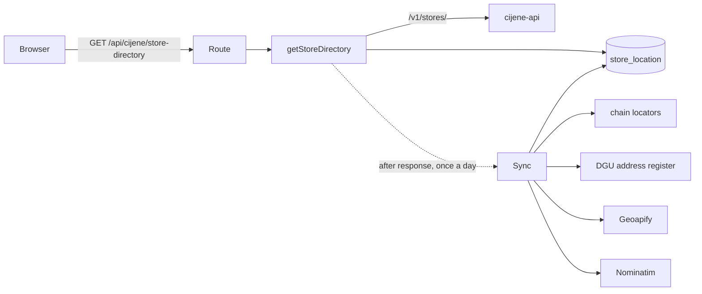

# Disscount: Stores Map

How `/map` finds, places and shows every store, where the coordinates come from, and what is deliberately left for later.

## Table of contents

1. [Quick reference](#1-quick-reference)
2. [Architecture](#2-architecture)
3. [Store locations: the sync](#3-store-locations-the-sync)
4. [The page](#4-the-page)
5. [Accessibility](#5-accessibility)
6. [Key files](#6-key-files)
7. [Config and env](#7-config-and-env)
8. [Gotchas](#8-gotchas)
9. [Decisions and why](#9-decisions-and-why)
10. [Future work](#10-future-work)

## 1. Quick reference

| Question                          | Answer                                                                                                                                                                |
| --------------------------------- | --------------------------------------------------------------------------------------------------------------------------------------------------------------------- |
| Map library                       | MapLibre GL JS 6 (exact pin) through `react-map-gl/maplibre`, client-only                                                                                             |
| Tiles                             | OpenFreeMap `positron`, keyless, labels patched to prefer `name:hr`                                                                                                   |
| Where do stores come from?        | cijene-api `/v1/stores/`, merged with our own coordinates                                                                                                             |
| How many have coordinates?        | Upstream alone: 798 of 1,668 (48%). After the sync: 1,523 (91%), measured 2026-10-13                                                                                  |
| Does it need a cron?              | No. The first request after the data is a day old starts the sync in the background                                                                                   |
| Opening hours, prices on the map? | Not yet, see [§10](#10-future-work)                                                                                                                                   |
| Per-store pages for SEO?          | No. Without hours they would be thin pages. `/map` renders no store text on the server either, so search engines see only its title, description and a hidden heading |

## 2. Architecture

- `getStoreDirectory` fetches every upstream store and our `store_location` rows, merges them (`buildDirectory`) and keeps the result in memory per process for 10 minutes.
- The route answers with `Cache-Control: public, max-age=3600, stale-while-revalidate=86400`. The service worker already caches `/api/cijene/*`, and the React Query key `["cijene", "store-directory"]` persists, so the list works offline after one visit.
- Merge rule: a `manual` table row wins, then a pin override from code; otherwise upstream coordinates win when they are usable; otherwise ours. Coordinates outside a box around Croatia are dropped, and swapped latitude and longitude are repaired.

## 3. Store locations: the sync

`runStoreLocationSync` places every store upstream cannot. Each source is a backup for the one before:

1. **Chain locators** (`lib/store-locations/sources/`): the chains' own store finders, read politely with an identifying User-Agent. 15 chains are covered. Matching is by store code where the chain shares it (Kaufland, Ribola, Eurospin, Roto, KTC), otherwise by address and town. Stanić's site has no codes and upstream gives Stanić only a code and a town, so `stanic-store-codes.ts` pairs them by hand from upstream's price file names; an unknown code stays unplaced, and the table can go once upstream publishes Stanić addresses. When neither code nor exact address matches, two looser passes run (`sync/match-locator-store.ts`), each trusting only a single candidate:
   - **Store number**: NTL's "BR. 350" is code 20350 (the number after one leading digit). It counts only when the address or the town agrees too, and never when another upstream code ends in the same number.
   - **Village-aware address**: the village a source writes after the comma or the house number ("B. RADICA 9, Ladimirevci") is compared with the other side's town; when both name a village, the villages decide. "0" and "bb" on both sides match only when upstream says so outright, and a street named exactly like the other side's town ("Bebrina 83") counts as that town.
   - Neither pass uses a point the source gave two different addresses, nor an NTL record without a house number: ntl.hr pins those at the street centre or in the wrong village (7 of 13 were 280 m to 4 km off). A few NTL records ntl.hr puts in the wrong town are skipped by name and point in `ntl-locator.ts`.
2. **DGU address register** (`lib/store-locations/dgu/`): the official INSPIRE addresses, one 84 MB zip streamed through `fflate` and scanned without holding the 2.6 GB GML in memory (about 30 s, about 220 MB peak). Coordinates arrive in EPSG:3035 and are converted with an inverse Lambert Azimuthal Equal Area on GRS80. Commercial use is allowed under the Otvorena dozvola with attribution.
   A candidate whose street matches only by a shared stem ("Posavskog" against "Posavska") is used only when no exact street exists in the town. When the town has the address in places more than 300 m apart, the register alone would be guessing, so `sync/dgu-anchor.ts` asks for an independent point: the chain's own record for that store number (under the locator step's rules), else a Geoapify building. The register place nearest it, within 150 m, is used (`dgu/near-anchor.ts`); otherwise the store goes on to the geocoders.
3. **Geoapify**, only when `GEOAPIFY_API_KEY` is set, through the EU endpoint, at most 1,000 a run. Like Nominatim it accepts only the building with the right house number; a street, a town centre or a near miss is dropped, because a wrong pin is worse than none. The top result must also score 0.9 on the building itself (`geocoders/geoapify-query.ts`): independent verification found every wrong "building" result below that, often at 0, which means only the street matched. Either end of a house number range counts, and an address without a house number sends no request, though it still takes a slot of the run's limit. Query cleanup, more results and a structured query were measured and rejected: none added a verified pin under this rule.
   Stridon publishes no coordinates, but its store table spells out the addresses upstream abbreviates ("Lj.Posavskog 23, V.gorica"). After the DGU step, `sync/address-source-step.ts` gives each unplaced Stridon store that address as a `lookup`, and the geocoders search with it; the pin still records upstream's address for the stale check. DGU never sees it, because DGU's stem matching put Stridon Velika Gorica on Posavska ulica in another village, 7 km away.
4. **Nominatim**, the last resort, at most 20 a run, 15 s apart, because the usage policy limits scheduled scripts to 4 requests a minute.
5. **Manual pin**: a row with source `manual` is never overwritten by a sync.
6. **Pin override** (`lib/store-locations/pin-overrides.ts`): a reviewed list in code for stores whose automatic pin was verified wrong. Each entry cites its evidence, and only OpenStreetMap points (ODbL, credited on the map) or places a person confirmed go in, never coordinates copied from Google Maps. The directory reports it as `manual`, and the sync skips the store, so no quota is spent on it.

7. **Pin correction** (`lib/store-locations/pin-corrections.ts`): saved register pins that failed verification, with the register's right place that verification confirmed within about 30 m. The sync never revisits a saved pin, so a fixed DGU rule cannot move these by itself. Each correction applies only to a `dgu` pin and only while upstream keeps the address it was checked for.

8. **Pin hold** (`lib/store-locations/pin-holds.ts`): stores whose pin failed or was doubtful in independent verification and that no OpenStreetMap point can fix. The map shows no pin for them and the sync leaves them alone until a person confirms the place in issue #261; then the entry becomes a pin override or is deleted. Only a `manual` table row still shows.

Which pin the map shows: a `manual` table row first, since someone set it in that environment on purpose; then a pin override; then upstream's own coordinates; then the sync's pin, or its pin correction. An override is not tied to upstream's address, because upstream may start publishing one for the same building. When the store moves, replace the entry: deleting it brings back the source's own point, which was the wrong one.

Every automatic pin records the upstream address it was found from. When upstream changes a store's address, the old pin is dropped from the map and the store is looked up again; if no source finds the new address, it becomes an ordinary failed store. Pins saved before addresses were recorded are kept as they are.

A store every source misses is recorded as a failed attempt and retried after 7 days, so quota is not spent daily on addresses that do not geocode. A Geoapify miss gets its own timestamp (`geoapify_missed_at`): Nominatim only takes 20 stores a run, so the store waits in its queue without spending Geoapify quota again, and the 7-day wait starts once Nominatim has missed too. A rate limit or an outage is not a miss, so those stores are simply tried again the next run.

**Lease, not cron.** `store_location_sync` holds one row. `acquireSyncLease` is a single conditional upsert that succeeds only when the last run finished over 24 hours ago, or a run started over 2 hours ago and never finished. Two app instances cannot both win it.

**Address matching** (`address-key.ts`) folds diacritics, drops words every spelling adds or omits ("ulica", "cesta", "sv."), treats "120/A" as "120a" and "0" as no number, accepts a shared five-letter stem for declined names and a short word that starts the other for abbreviations, and strips the postcode or store code some chains append upstream ("Savska 58 87079 Spar").

## 4. The page

- **Layout:** on desktop a 24rem list panel sits beside the map, and both fill the space between the header and the footer: the map marks itself `data-page-width="full"`, which lifts `<main>`'s reading width and makes the root layout exactly one screen tall, while the map itself stops at the footer box's width (`max-w-5xl`), so the page never scrolls (below 40rem of height it does, so the map keeps a usable size). Phones get a full-screen map above the bottom nav, which stands in for the footer, and the shared page header floats there from the start with the map's search inside it: the header leaves a slot in place of the logo (`header-slot.ts`), and `map-search-bar.tsx` renders the menu, the store search, and the bell and avatar into it through a portal, with an icon-only login when logged out. So the bar's height, gaps, padding and frosted background are the header's own. The slot is looked up after the page commits (`use-header-slot.ts`), because a language switch remounts the layout and the old header's slot is still in the page during that render. Pressing the search grows the bar into the full-screen search with the filters and the list: a full-screen surface animates its `clip-path` from the header frame's measured box to the whole screen (400 ms in, 200 ms out, Material 3's emphasized easing, instant under reduced motion), so nothing resizes or scales, and the field is never remounted, which iOS needs to raise the keyboard on the first tap. The back arrow, Escape, or picking a store closes it. Open, the row loses the header's side insets to line up with the filters below; the hook keeps the closed frame's box meanwhile, so closing shrinks back into it. The search layer is `fixed`, so its list escapes the layout's clip and scrolls under the bottom nav to the screen's bottom, padded by the nav's height (`--bottom-nav-total`, read off a probe so the virtualizer knows it) so the last store clears the nav, with `ScrollFade` at both ends. The selected store opens in a non-modal `SheetShell` (vaul) showing just that store; swiping it down or its X deselects it. vaul never passes `modal={false}` on to Radix, so the sheet still traps focus: the search therefore opens on the field's pointerdown, which closes the sheet before the tap focuses the field. A round near-me button sits above the zoom buttons; over the map it reports a failed locate as a toast, for every tap, since the list's inline message is out of sight.
- **Pins:** all stores share one clustered GeoJSON source, so nearby stores of any chain merge into one stack: up to three square logo tiles, fanned, for the most common chains inside, plus a count. Each cluster carries a per-chain count (`clusterProperties`), and since style expressions cannot sort, `utils/cluster-stack.ts` ranks each chain by counting the chains with more stores (ties go to the chain listed first). It uses no `let` bindings: MapLibre re-evaluates a bound expression at every `var`, and a nested ranking stalled the map worker on mixed clusters. Logos are drawn as rounded square tiles with a dark rim (`chain-icon.ts`), the same shape as on the landing page, for contrast on any basemap. The count is the app's own count badge (`Badge size="count"` with its `ring` prop for a white rim), placed as an HTML marker over each stack (MapLibre's "HTML clusters" pattern, `components/cluster-count-badges.tsx`). Stacks are read from the source, not a stack layer, so a stack of chains with no logo yet still gets a count, and tapping the badge opens its stack like tapping the tiles.
- **Stack taps:** a tap zooms to fit exactly that stack's stores (padding keeps them clear of the phone's store sheet, whose measured height the layout reports). Clustering runs to the map's deepest zoom (20), so stores within about 20 m of each other, typically one mall, never split; tapping them opens a shadcn Popover anchored to the spot through a react-map-gl `Marker` instead (`same-spot-popup.tsx`). It has no visible title (its name is for screen readers), closes on any map move because it does not follow the map, and picking a store opens its row.
- **Selection frame:** the selected store gets a green rounded square, the shape of the logo tiles. The count badges sit above the canvas, so the frame never covers a number. When zooming out merges the store into a stack, the frame moves to that stack and widens to fit it (`hooks/use-selected-frame.ts`, recomputed on the map's `idle` event).
- **List:** every matching store, placed or not, virtualized with TanStack Virtual. Search is the shared matcher over chain, town and address. Stores without coordinates carry an amber "bez lokacije" pin icon at the row's right edge, outside the lines an ellipsis can cut. The result count, including how many have no pin, is announced to screen readers only (`result-count-status.tsx`) and not shown on the page.
- **List follows the map:** when the map stops moving, stores inside the visible part (on phones, the part above the store sheet) move to an "On the map" group at the top, keeping the list's own order; the rest follow under "Elsewhere". Nothing is filtered out. While the pointer or keyboard focus is in the list, the new order waits (`hooks/use-held-view.ts`) and a chip offers it, so rows never jump under someone reading; it applies when they leave. A polite status announces the count on the map.
- **Store details:** each list row is a collapsible item, and the open one is the store selected on the map, so picking a pin opens its row, scrolls it to the top of the list and focuses it. The store already open when the list mounts is scrolled to but not focused, so the phone's search field keeps focus as the list opens. A row opened from the list itself scrolls only as far as needed to show it whole, never past its header, and not at all when it already fits (`utils/reveal-offset.ts`). The open row stays mounted in the virtualized list, and measured heights are keyed by store. A shared link to a store the filters hide puts that store on top of the list. Each row shows the chain name and, in smaller text, the full address with postcode and town; closed, both lines end in an ellipsis, and opening the row shows them whole. An open row's address line ends in a small "Podijeli" pill and a star that adds the store to the account's favourites (`favorite-store-button.tsx`; a guest gets the login dialog instead). Favourites are saved on the backend beside pinned places (`/api/favorite-stores`, up to 10, keyed `chain:code`, erased with the account), lead the list in an "Omiljene trgovine" group above the on-map and elsewhere groups (`utils/list-headings.ts`), and carry a small star on their pin, opposite the count badge, except inside a stack (`favorite-store-markers.tsx`). Each save replaces the whole list, so saves queue in click order and a star click waits until the saved list has loaded. The row's toggle is a button laid over the whole row rather than wrapped around it, so the pill can sit in the text without nesting a button in a button. The open panel adds only what the row has no room for: directions as one button group (Google Maps, Apple Maps), call, and "Prijavi grešku", which pre-fills the contact form through its draft key. Phone numbers are shown in Croatian national grouping (091 234 5678, 01 2345 678, 0800 400 000) by `utils/phone-format.ts`, while the call link keeps the full +385 number. Opening hours will go here too.
- **URL state:** `?store=<chain>:<code>` is pushed, so Back closes a store; `?chain=` replaces; `?q=` comes from the shared `SearchBar` in its `shallow` mode; the map view rides in `#map=zoom/lat/lon`. These writes use the History API, so they cause no server round trip.
- **Defaults:** signed-in users start with their pinned chains selected and the map on their first pinned place, centred on the average of that town's stores.
- **Near me:** the position comes from one low-accuracy `watchPosition` (Wi-Fi and cell, light on the battery) that runs while the map is visible, paused when the tab is hidden: from the start when the browser already reports the permission as `granted`, otherwise from the first tap, which may prompt. So the dot stays on the map and a tap moves to the latest fix at once; Chrome on Android otherwise starts its location provider cold for every request. The first fix of a watch the page started by itself centres the map; later fixes move the dot and re-sort the list only when they are sharper or more than 25 m (or their accuracy) away, so standing still does not reshuffle it. A tap with a fix vaguer than 100 m sharpens it with one high-accuracy request. The position never leaves the device. When a tap gets no position, the IP guess (below) stands in: the map fits a faint dashed 10 km area with no centre dot around it, the list sorts from it without kilometres, and a note says the order is approximate and suggests turning on the device's location. Chrome on Android with Location switched off never answers, so with the permission already granted the guess appears after 1.5 s while the watch keeps listening, and a real fix replaces it; without the permission a prompt may be open, so the guess waits for our 15 s timer or the browser's error. A refusal never guesses, and takes back a guess already shown. 10 km covers most home connections; mobile data often resolves to the carrier's gateway city 40 km or more away, which no IP database can see past.
- **Location order:** GPS first. Without it, Cloudflare's guess from the IP (below) centres the map at city zoom and sorts the list, unless the user pinned a place, which wins over a guess. An IP guess, or a GPS fix coarser than 2 km (Android and iOS "approximate" grants), sorts without showing kilometres. Opening on a guess shows no note that the order is approximate; only a tap that falls back to the guess says so, and only then is the 10 km area drawn. An automatic fix never moves the map once the user has panned it, a store is selected, or the page opened on a `#map=` view (the map writes its view into the hash, so a reload or Back keeps that view) (`resolveMapOrigin` in `utils/map-origin.ts`).
- **IP guess:** Cloudflare's "Add visitor location headers" managed transform adds `cf-iplatitude`, `cf-iplongitude` and `cf-ipcity` to requests that reach the origin. The page reads them per request (`utils/ip-location.ts`), keeps only a guess inside Croatia and rounds it to about a kilometre. `cf-ipcity` is not read. Nothing is stored. The data comes from IPinfo; for Croatia expect roughly half of visitors to get the right town, fewer on mobile networks, which often resolve to Zagreb. Without the transform the headers are absent and the map opens on all of Croatia, as before. The privacy policy describes both GPS and the IP guess.
- **Links in:** product price rows open `/map?store=...`; the product chains section has "Gdje kupiti", which opens `/map?chain=...`. A shopping list grouped "Po trgovinama" gives each chain's section a "Na karti" link: to the user's favourite store of that chain when there is one (`?store=...&chain=...`), else to the whole chain (`?chain=...`). The section groups each item under its chosen chain, else its cheapest one, else "Ostalo" last, with a subtotal that reads "najmanje" when some price is unknown (`shopping-lists/[id]/utils/group-items-by-store.ts`). The switch is remembered per list in local storage.

## 5. Accessibility

- The list is the source of truth and comes first on desktop; on phones the search sits in the page header, so it is the first stop in the tab order. The canvas itself is not keyboard or screen reader friendly, so nothing depends on it.
- Pan buttons satisfy WCAG 2.5.7 for mouse users; arrow keys pan the focused map.
- The store sheet has an X beside the store, so it closes without dragging, and closing it hands focus to the near-me button (a map control, so no phone keyboard appears). Closing the search from the keyboard hands focus back to the field; a tap blurs it instead, so the phone keyboard does not reappear.
- Result counts and location errors are `role="status"`; `easeTo` snaps instantly under `prefers-reduced-motion`.

## 6. Key files

| Area                | Files                                                                                                                                                                               |
| ------------------- | ----------------------------------------------------------------------------------------------------------------------------------------------------------------------------------- |
| Page and layout     | `frontend/src/app/[locale]/map/page.tsx`, `components/map-client.tsx`, `components/map-mobile-layout.tsx`, `components/map-search-bar.tsx`, `components/map-store-sheet.tsx`        |
| List                | `components/view-sorted-list.tsx`, `components/store-list.tsx`, `components/store-list-item.tsx`, `components/store-details.tsx`                                                    |
| Map                 | `components/store-map.tsx`, `components/store-map-view.tsx`, `components/map-store-source.tsx`, `utils/store-layers.ts`, `utils/cluster-stack.ts`, `components/same-spot-popup.tsx` |
| View model          | `hooks/use-map-view-model.ts`, `hooks/use-visible-stores.ts`, `hooks/use-map-url-state.ts`                                                                                          |
| Directory and route | `frontend/src/lib/store-locations/get-store-directory.ts`, `app/api/cijene/store-directory/`                                                                                        |
| Sync                | `frontend/src/lib/store-locations/sync/`, `sources/`, `dgu/`, `geocoders/`                                                                                                          |
| Table               | `frontend/src/db/store-location-schema.ts`, `frontend/drizzle/0003_store_locations.sql`, `0004_store_location_address.sql`                                                          |
| Pin overrides       | `frontend/src/lib/store-locations/pin-overrides.ts`, `pin-corrections.ts`, `pin-holds.ts`                                                                                           |

## 7. Config and env

| Variable           | Required | Scope       | Effect                                                        |
| ------------------ | -------- | ----------- | ------------------------------------------------------------- |
| `GEOAPIFY_API_KEY` | no       | server-only | enables the Geoapify step; without it the sync skips Geoapify |

The migration runs through the existing `migrate` service. The map needs no CSP change: the worker is same-origin and tiles are `https:`.

## 8. Gotchas

- **MapLibre 6 needs WebGL2.** The constructor throws `GPUInitializationError`, but react-map-gl 8 creates the map in an effect and catches that error itself, so an error boundary never sees it. `store-map.tsx` therefore probes for a WebGL2 context before mounting the map and also listens to `onError`. Either way it shows a message with a Reload button, and the list keeps working. Chromium refuses WebGL for the rest of a session after its GPU process crashes a few times (common on some Linux driver setups), so the message says a browser restart usually helps.
- **Blank map after context loss** (maplibre-gl-js#8690, open in 6.14): the map listens for `webglcontextlost` and offers a reload.
- **Worker under webpack:** `setWorkerUrl(new URL("maplibre-gl/dist/maplibre-gl-worker.mjs", import.meta.url))` at module scope. The 6.14 worker is one self-contained file.
- **`after()` and the memo are per process.** A redeploy clears the memo; the lease lives in the database.
- **A favourites save replaces the whole list.** A save built before the saved list loads, or two saves arriving out of order, erases favourites; the hook refuses clicks until the list has loaded and runs saves in one TanStack Query mutation scope, so they reach the server in click order.
- **A ticked shopping list item may have no stored price.** An item added without choosing a chain saves no price when ticked, so the store groups fall back to today's price at the group's chain.
- **A `?store=` link alone can hide its store.** With no `chain` in the URL, a signed-in user's pinned chains become the filter; links from shopping list sections therefore send the chain too.
- **Attribution must stay visible.** OpenFreeMap and OSM credits come from MapLibre; DGU and Geoapify credits are added as custom attribution. The credits sit bottom left and share the bottom line with the controls on the right, the zoom buttons and, on desktop, the pan arrows just left of them, wrapping before reaching them (`globals.css`). On phones the store sheet covers that line only while a store is selected. DGU's sentence cannot be shortened: the Open Licence requires it verbatim, with a link. OpenStreetMap's guidelines let credits fold away after five seconds or on the first pan or zoom, but not start hidden, so `utils/attribution.ts` folds them into the (i) button 5 seconds after the map first settles, or on the user's first move.

## 9. Decisions and why

The owner's choices for this page and the reasons given for them, so nobody "fixes" a deliberate behaviour. Quotes are the owner's words; where there was no reason beyond the choice itself, only the choice is listed.

### Layout and list

| Decision                                                                                                                                                                                     | Why                                                                                                                      |
| -------------------------------------------------------------------------------------------------------------------------------------------------------------------------------------------- | ------------------------------------------------------------------------------------------------------------------------ |
| Each store is an accordion row in the list, not a separate details page that replaces the list                                                                                               | "instead of opening a whole new thing, simply make each list item an accordion"; opening hours will go into the same row |
| Desktop map fills the space between header and footer with no page scroll; the page is as wide as the footer                                                                                 | "Make sure that the map has no scroll"; footer width picked from three screenshots                                       |
| Opening a row scrolls only when the row is not fully visible                                                                                                                                 | Scrolling to the row's top "adds unnecessary content shift"                                                              |
| Closed rows show name and full address on two ellipsised lines; the open row shows both whole                                                                                                | The old row cut the address off and repeated it once opened                                                              |
| No visible notes about approximate order, store counts or "Trgovine po lancima" above the list (a tap that falls back to the IP guess still says so under its button)                        | Removed on request; the counts are still announced to screen readers                                                     |
| Chain filter is the shared multiselect, not badge buttons; an empty selection means all chains; "Odaberi sve" after typing selects only the matches; the open field caps at about three rows | Same control as everywhere else in the app; 27 chain badges pushed the list off a phone screen                           |
| Share is a small labelled "Podijeli" pill inside the address line; directions are one shadcn button group; phone numbers use national grouping (0800 400 000)                                | Picked from screenshots; numbers are "usually separated" by convention                                                   |

### Pins and stacks

| Decision                                                                                                                                | Why                                                                                           |
| --------------------------------------------------------------------------------------------------------------------------------------- | --------------------------------------------------------------------------------------------- |
| Logos are square tiles with rounded corners                                                                                             | "Most if not all logos are square, look at landing"                                           |
| Nearby stores of all chains merge into one logo stack, at every zoom, with no town bubbles                                              | "The map does seem too crowded"; stacks were preferred to named town bubbles                  |
| Stores at the same spot (malls) open a small list popover                                                                               | Zooming can never split them                                                                  |
| The list reorders, it does not filter: stores in view go to the top, nearest first, and the reorder waits while the user is in the list | "if you zoom in all the way into the mall, the list would sort those stores first"            |
| The selection frame is rounded square, never covers the count, and follows the store into a stack when zooming out                      | It used to keep circling the old spot after a merge                                           |
| Store counts use the one shared `Badge` with a `ring` prop, in the primary colour, with full numbers (1550, not 1.5k)                   | "there should be only one badge in my whole code base"; it should match "the rest of the app" |
| Credits, controls and the near-me button sit at the bottom, on one line with a short credits text                                       | Credits must stay visible for the OSM, DGU and Geoapify licences, and they were being covered |
| Credits fold into the (i) button after 5 s                                                                                              | OpenStreetMap allows folding but not starting hidden                                          |
| No WebGL2: a clear message with Reload, and the list keeps working                                                                      | The owner's Opera on Linux loses WebGL after GPU crashes                                      |
| Cloudflare visitor location headers are on for dev and prod                                                                             | So the map can open near the visitor without asking for GPS                                   |

### Phones

The phone layout follows the owner's own spec: a floating bar (menu, store search, bell, avatar) "like Google maps"; tapping the search grows the bar into a full-screen list with history and filters, and back or close shrinks it again, animated ("morph into full page, and morph back into floating header"); a store picked on the map or in the list opens a bottom sheet with only that store's details; "Swiping the sheet down out of screen deselect the store". Use "shadcn components wherever possible".

| Decision                                                                                   | Why                                                                  |
| ------------------------------------------------------------------------------------------ | -------------------------------------------------------------------- |
| The search sits in the header on the map page on phones only                               | Other pages keep the normal header                                   |
| A round near-me button on the map, not only inside the search screen                       | Locating should not need opening the search first                    |
| Logged out, the bar shows an icon-only login                                               | The wide "Prijava" pill left the search too narrow on a 360 px phone |
| The store sheet fits its content and has a close X                                         | Closing must not depend on a drag                                    |
| The back arrow is named "Natrag na kartu" for screen readers                               | Chosen wording                                                       |
| Long text in inputs ends in "…" (`text-ellipsis` on the shared `Input` and `CommandInput`) | The search placeholder was being cut mid-word ("Trgovina, gra")      |

### Favourite stores and store groups

These came out of research the owner chose to act on at once ("in progress, do it now"). The strongest signals: the most-upvoted Play review of a competitor asks to list "samo one u mojoj blizini" instead of every store in Croatia, and an HGK survey found people pick a nearby store first, then price. Trolley users ask for "the ability to Group Lists By Store".

| Decision                                                                                             | Why                                                                 |
| ---------------------------------------------------------------------------------------------------- | ------------------------------------------------------------------- |
| Favourites live on the backend beside pinned places, not in local storage                            | They follow the account across devices                              |
| Favourites also get a star on their pin                                                              | Chosen with the list group                                          |
| Wording: "Omiljene trgovine", "Ostale trgovine · N", short toasts ("Najviše 10 omiljenih trgovina.") | Chosen wording                                                      |
| The list grouping is a switch, "Po trgovinama", remembered per list                                  | Chosen with the wording                                             |
| Each section links "Na karti"                                                                        | "section link should be short as well"                              |
| An incomplete subtotal reads "najmanje 4,50 €"                                                       | Chosen wording; it is the step before routing between stores (#270) |

## 10. Future work

- Opening hours and working Sundays (board task "Store opening hours", issue #280 for Sundays): per-chain hours from the same locators, OpenStreetMap as a fallback, with an explicit "nije potvrđeno" state. The owner's rule: "always link if there's a page where users can recheck by themselves". Kaufland, Spar, Plodine, Lidl, Eurospin, Stanić, Trgovina Krk, dm and Studenac have per-store pages to link to. Shoppers distrust wrong "open" badges, and the law (NN 33/2023) does not oblige chains to publish their 16 working Sundays.
- Favourites whose store left the directory still take one of the 10 slots and cannot be removed from the map; drop unknown keys before counting.
- In the grouped shopping list, changing an item's chain moves it to another section and loses keyboard focus.
- Prices on the map and cheapest basket near me.
- Store photos, a store type filter, an offline map.
- An admin way to set manual pins (the table already honours them); until then, verified corrections go in the pin override list.
