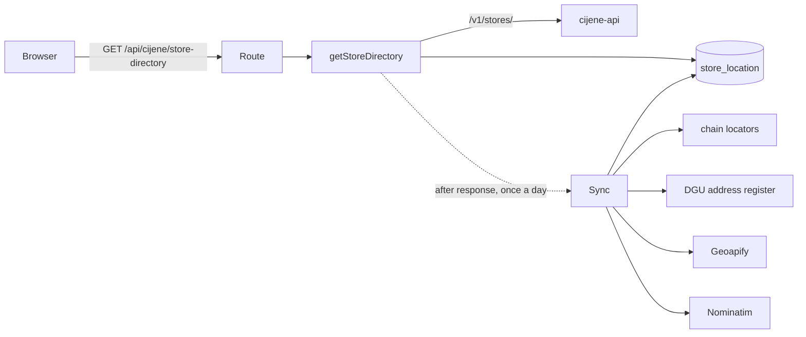

# Disscount: Stores Map

How `/map` finds, places and shows every store, where the coordinates come from, and what is deliberately left for later.

## Table of contents

1. [Quick reference](#1-quick-reference)
2. [Architecture](#2-architecture)
3. [Store locations: the sync](#3-store-locations-the-sync)
4. [The page](#4-the-page)
5. [Accessibility](#5-accessibility)
6. [Key files](#6-key-files)
7. [Config and env](#7-config-and-env)
8. [Gotchas](#8-gotchas)
9. [Future work](#9-future-work)

## 1. Quick reference

| Question                          | Answer                                                                                     |
| --------------------------------- | ------------------------------------------------------------------------------------------ |
| Map library                       | MapLibre GL JS 6 (exact pin) through `react-map-gl/maplibre`, client-only                  |
| Tiles                             | OpenFreeMap `positron`, keyless, labels patched to prefer `name:hr`                        |
| Where do stores come from?        | cijene-api `/v1/stores/`, merged with our own coordinates                                  |
| How many have coordinates?        | Upstream alone: 798 of 1,668 (48%). After the sync: 1,523 (91%), measured 2026-10-13       |
| Does it need a cron?              | No. The first request after the data is a day old starts the sync in the background        |
| Opening hours, prices on the map? | Not yet, see [§9](#9-future-work)                                                          |
| Per-store pages for SEO?          | No. Without hours they would be thin pages; `/map` server-renders a chain overview instead |

## 2. Architecture

- `getStoreDirectory` fetches every upstream store and our `store_location` rows, merges them (`buildDirectory`) and keeps the result in memory per process for 10 minutes.
- The route answers with `Cache-Control: public, max-age=3600, stale-while-revalidate=86400`. The service worker already caches `/api/cijene/*`, and the React Query key `["cijene", "store-directory"]` persists, so the list works offline after one visit.
- Merge rule: a `manual` table row wins, then a pin override from code; otherwise upstream coordinates win when they are usable; otherwise ours. Coordinates outside a box around Croatia are dropped, and swapped latitude and longitude are repaired.

## 3. Store locations: the sync

`runStoreLocationSync` places every store upstream cannot. Each source is a backup for the one before:

1. **Chain locators** (`lib/store-locations/sources/`): the chains' own store finders, read politely with an identifying User-Agent. 14 chains are covered. Matching is by store code where the chain shares it (Kaufland, Ribola, Eurospin, Roto, KTC), otherwise by address and town.
2. **DGU address register** (`lib/store-locations/dgu/`): the official INSPIRE addresses, one 84 MB zip streamed through `fflate` and scanned without holding the 2.6 GB GML in memory (about 30 s, about 220 MB peak). Coordinates arrive in EPSG:3035 and are converted with an inverse Lambert Azimuthal Equal Area on GRS80. Commercial use is allowed under the Otvorena dozvola with attribution.
3. **Geoapify**, only when `GEOAPIFY_API_KEY` is set, through the EU endpoint, at most 1,000 a run. Like Nominatim it accepts only the building with the right house number; a street, a town centre or a near miss is dropped, because a wrong pin is worse than none.
   Stridon publishes no coordinates, but its store table spells out the addresses upstream abbreviates ("Lj.Posavskog 23, V.gorica"). After the DGU step, `sync/address-source-step.ts` gives each unplaced Stridon store that address as a `lookup`, and the geocoders search with it; the pin still records upstream's address for the stale check. DGU never sees it, because DGU's stem matching put Stridon Velika Gorica on Posavska ulica in another village, 7 km away.
4. **Nominatim**, the last resort, at most 20 a run, 15 s apart, because the usage policy limits scheduled scripts to 4 requests a minute.
5. **Manual pin**: a row with source `manual` is never overwritten by a sync.
6. **Pin override** (`lib/store-locations/pin-overrides.ts`): a reviewed list in code for stores whose automatic pin was verified wrong. Each entry cites its evidence, and only OpenStreetMap points (ODbL, credited on the map) or places a person confirmed go in, never coordinates copied from Google Maps. The directory reports it as `manual`, and the sync skips the store, so no quota is spent on it.

Which pin the map shows: a `manual` table row first, since someone set it in that environment on purpose; then a pin override; then upstream's own coordinates; then the sync's pin. An override is not tied to upstream's address, because upstream may start publishing one for the same building. When the store moves, replace the entry: deleting it brings back the source's own point, which was the wrong one.

Every automatic pin records the upstream address it was found from. When upstream changes a store's address, the old pin is dropped from the map and the store is looked up again; if no source finds the new address, it becomes an ordinary failed store. Pins saved before addresses were recorded are kept as they are.

A store every source misses is recorded as a failed attempt and retried after 7 days, so quota is not spent daily on addresses that do not geocode. A Geoapify miss gets its own timestamp (`geoapify_missed_at`): Nominatim only takes 20 stores a run, so the store waits in its queue without spending Geoapify quota again, and the 7-day wait starts once Nominatim has missed too. A rate limit or an outage is not a miss, so those stores are simply tried again the next run.

**Lease, not cron.** `store_location_sync` holds one row. `acquireSyncLease` is a single conditional upsert that succeeds only when the last run finished over 24 hours ago, or a run started over 2 hours ago and never finished. Two app instances cannot both win it.

**Address matching** (`address-key.ts`) folds diacritics, drops words every spelling adds or omits ("ulica", "cesta", "sv."), treats "120/A" as "120a" and "0" as no number, accepts a shared five-letter stem for declined names and a short word that starts the other for abbreviations, and strips the postcode or store code some chains append upstream ("Savska 58 87079 Spar").

## 4. The page

- **Layout:** a fixed layer between the floating header and the bottom nav. Desktop has a 24rem list panel beside the map; phones get a full-screen map with a custom bottom sheet (peek, half, full). vaul is not used here: its non-modal mode is unmaintained and buggy.
- **Pins:** every chain is its own clustered GeoJSON source, so a cluster always shows that chain's logo with a count and splits apart on zoom. Logos are drawn into a white disc with a dark rim (`chain-icon.ts`) for contrast on any basemap.
- **List:** every matching store, placed or not, virtualized with TanStack Virtual. Search is the shared matcher over chain, town and address. Stores without coordinates carry a "bez lokacije" label and the note above the list counts them.
- **Store card:** directions (Google Maps, Apple Maps), call, share, and "Prijavi grešku", which pre-fills the contact form through its draft key.
- **URL state:** `?store=<chain>:<code>` is pushed, so Back closes a store; `?chain=` replaces; `?q=` comes from the shared `SearchBar` in its `shallow` mode; the map view rides in `#map=zoom/lat/lon`. These writes use the History API, so they cause no server round trip.
- **Defaults:** signed-in users start with their pinned chains selected and the map on their first pinned place, centred on the average of that town's stores.
- **Near me:** the button asks for the position at low accuracy with our own 15 s timer; when the browser already reports the permission as `granted`, the page locates by itself without a prompt. A fix vaguer than 100 m is then sharpened by one high-accuracy request. The position never leaves the device.
- **Location order:** GPS first. Without it, Cloudflare's guess from the IP (below) centres the map at city zoom and sorts the list, unless the user pinned a place, which wins over a guess. An IP guess, or a GPS fix coarser than 2 km (Android and iOS "approximate" grants), sorts without showing kilometres, and a note says the order is approximate. An automatic fix never moves the map once the user has panned it or a shared store link opened (`resolveMapOrigin` in `utils/map-origin.ts`).
- **IP guess:** Cloudflare's "Add visitor location headers" managed transform adds `cf-iplatitude`, `cf-iplongitude` and `cf-ipcity` to requests that reach the origin. The page reads them per request (`utils/ip-location.ts`), keeps only a guess inside Croatia, rounds it to about a kilometre, and repairs the city name, which Node reads as latin1 although Cloudflare sends UTF-8. Nothing is stored. The data comes from IPinfo; for Croatia expect roughly half of visitors to get the right town, fewer on mobile networks, which often resolve to Zagreb. Without the transform the headers are absent and the map opens on all of Croatia, as before. The privacy policy describes both GPS and the IP guess.
- **Links in:** product price rows open `/map?store=...`; the product chains section has "Gdje kupiti", which opens `/map?chain=...`.

## 5. Accessibility

- The list is the source of truth and comes first on desktop; on phones a "Preskoči kartu" link jumps to it. The canvas itself is not keyboard or screen reader friendly, so nothing depends on it.
- Pan buttons satisfy WCAG 2.5.7 for mouse users; arrow keys pan the focused map.
- The sheet handle is a real button, so every height is reachable without dragging.
- Result counts and location errors are `role="status"`; `easeTo` snaps instantly under `prefers-reduced-motion`.

## 6. Key files

| Area                | Files                                                                                                                      |
| ------------------- | -------------------------------------------------------------------------------------------------------------------------- |
| Page and layout     | `frontend/src/app/[locale]/map/page.tsx`, `components/map-client.tsx`, `components/map-bottom-sheet.tsx`                   |
| Map                 | `components/store-map.tsx`, `components/map-chain-source.tsx`, `utils/chain-layers.ts`                                     |
| View model          | `hooks/use-map-view-model.ts`, `hooks/use-visible-stores.ts`, `hooks/use-map-url-state.ts`                                 |
| Directory and route | `frontend/src/lib/store-locations/get-store-directory.ts`, `app/api/cijene/store-directory/`                               |
| Sync                | `frontend/src/lib/store-locations/sync/`, `sources/`, `dgu/`, `geocoders/`                                                 |
| Table               | `frontend/src/db/store-location-schema.ts`, `frontend/drizzle/0003_store_locations.sql`, `0004_store_location_address.sql` |
| Pin overrides       | `frontend/src/lib/store-locations/pin-overrides.ts`                                                                        |

## 7. Config and env

| Variable           | Required | Scope       | Effect                                                        |
| ------------------ | -------- | ----------- | ------------------------------------------------------------- |
| `GEOAPIFY_API_KEY` | no       | server-only | enables the Geoapify step; without it the sync skips Geoapify |

The migration runs through the existing `migrate` service. The map needs no CSP change: the worker is same-origin and tiles are `https:`.

## 8. Gotchas

- **MapLibre 6 needs WebGL2.** The constructor throws `GPUInitializationError`; an error boundary shows a message and the list keeps working.
- **Blank map after context loss** (maplibre-gl-js#8690, open in 6.14): the map listens for `webglcontextlost` and offers a reload.
- **Worker under webpack:** `setWorkerUrl(new URL("maplibre-gl/dist/maplibre-gl-worker.mjs", import.meta.url))` at module scope. The 6.14 worker is one self-contained file.
- **`after()` and the memo are per process.** A redeploy clears the memo; the lease lives in the database.
- **Attribution must stay visible.** OpenFreeMap and OSM credits come from MapLibre; DGU and Geoapify credits are added as custom attribution. The control sits top left, because the phone sheet covers the bottom of the map at every height.

## 9. Future work

- Opening hours and working Sundays (board task "Store opening hours"): per-chain hours from the same locators, with an explicit "nije potvrđeno" state.
- Prices on the map and cheapest basket near me.
- Store photos, a store type filter, an offline map.
- An admin way to set manual pins (the table already honours them); until then, verified corrections go in the pin override list.
