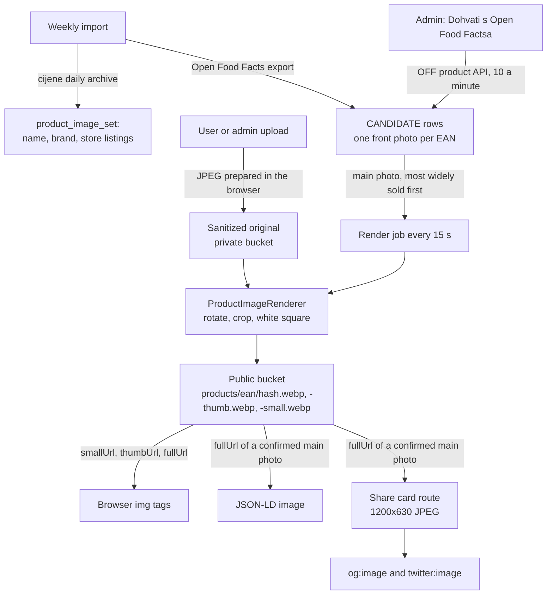
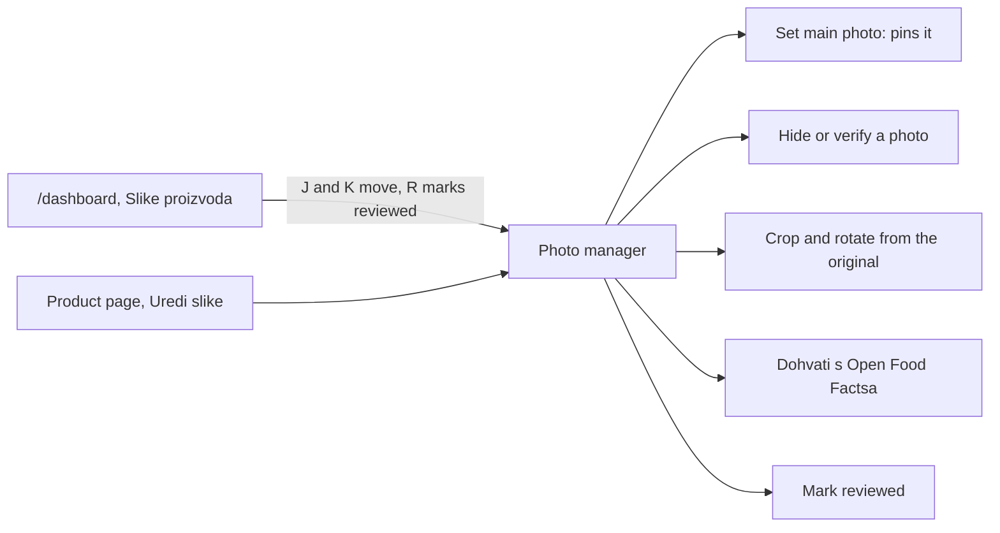

# Disscount: Product Images

How Disscount shows product photos: where they come from, how they are stored and rendered, how they reach the page, who can change them, what breaks and how, and what has to be set up by hand. Written for someone new to the code, so the concepts are explained as they come up. Product data itself (names, prices) is in [PRODUCTS.md](PRODUCTS.md).

> **Mental model in one sentence:** every product (EAN) keeps a list of candidate photos from Open Food Facts and from users; one of them is the main photo, each is rendered from its untouched source into three square WebP files on baked-in white in a public R2 bucket, the browser loads those files straight from the bucket's own domain, and the admin curates the list from the product page or from a popularity-ordered queue in the dashboard.

---

## 1. Quick reference

| Thing              | Value                                                                                                                                                                |
| ------------------ | -------------------------------------------------------------------------------------------------------------------------------------------------------------------- |
| Sources            | Open Food Facts (CC BY-SA, credited in the terms of service) and photos uploaded by users and admins                                                                 |
| Storage            | Public R2 bucket (EU jurisdiction) behind its own domain; user originals in the private card photo bucket                                                            |
| Files served       | `products/<ean>/<hash>.webp` (up to 1080 px square), `-thumb.webp` (up to 400 px) and `-small.webp` (up to 256 px, for list rows and small tiles), cached for a year |
| Delivery           | Plain `` tags pointing at the bucket's domain; no `next/image`, no proxy through our servers                                                                    |
| Viewer             | `yet-another-react-lightbox` with the zoom, thumbnails and counter plugins                                                                                           |
| Crop               | `react-image-crop` in the admin; the backend renders the crop from the original                                                                                      |
| Env vars           | `R2_ENDPOINT` plus `R2_PUBLIC_BUCKET`, `R2_PUBLIC_ACCESS_KEY_ID`, `R2_PUBLIC_SECRET_ACCESS_KEY`, `R2_PUBLIC_URL` (backend)                                           |
| Off switch         | Any of those five blank: no photos anywhere, uploads answer 503, the jobs copy nothing                                                                               |
| Admin entry points | "Uredi slike" on a product page, and the "Slike proizvoda" tab in `/dashboard`                                                                                       |
| Introduced in      | PR #372 (product photos from Open Food Facts and users, with admin curation)                                                                                         |

---

## 2. How a photo flows

Step by step:

1. **Catalogue.** Once a week the backend reads the latest cijene daily archive into `product_image_set`: one row per EAN with its name, brand and how widely it is sold (`store_listings`, the priced store rows). That popularity orders every queue, and the same table feeds the product sitemap ([PRODUCTS.md §6](PRODUCTS.md#6-seo-metadata-json-ld-and-sitemaps)).
2. **Candidates.** The same import streams the Open Food Facts export and records the selected front photo of every EAN we carry as a `CANDIDATE`. Nothing is downloaded yet.
3. **Copy.** Every 15 seconds the render job takes up to 10 main photos that are not copied yet, downloads each from Open Food Facts, renders it, and writes the three WebP files to the public bucket. When no main photo is waiting, the same tick re-renders up to 10 photos copied before WebP (see [§6](#6-rendering-and-the-white-background)).
4. **Uploads.** A user's upload is sanitized, kept as an original in the private bucket, and rendered at once.
5. **Show.** The public API returns `smallUrl`, `thumbUrl` and `fullUrl` for each visible photo (`smallUrl` falls back to the thumb on photos rendered before the small file existed). The browser loads them directly from the bucket's domain.

---

## 3. Where photos come from

The cijene API has no images at any layer, so photos come from outside it.

- **Open Food Facts.** The weekly job streams their full product export (about 1.5 GB gzipped, `product-images.off.export-url`) and keeps the selected front photo of every EAN in our catalogue. In November 2026 that matched about 30,000 of 222,000 catalogue EANs (13.5%), about half of the products sold in ten or more chains, and 69% of the products users had saved. Croatian barcodes (prefix 385) were only 4.3% covered. "Dohvati s Open Food Factsa" in the admin editor reads one product through their API and adds every front photo (one per photo, Croatian first) and up to 30 recent raw photos as candidates.
- **Users.** A logged-in user uploads a JPEG prepared in the browser (long edge up to 2048 px, under 480 KB, white behind any transparency; see [§8](#8-uploads)).
- **Admins.** Same upload, but verified and pinned as the main photo straight away.

Their API allows 15 product reads a minute per IP and may ban an IP that goes over, so we cap ourselves at 10 a minute (`OpenFoodFactsClient.PRODUCT_READS_PER_MINUTE`) and never call it when a page opens. Every request identifies itself with the user agent `Disscount/1.0 (https://disscount.me)`, as their terms ask.

---

## 4. States and the main photo

| Status      | Meaning                                                      | Shown to users                                                                                                    |
| ----------- | ------------------------------------------------------------ | ----------------------------------------------------------------------------------------------------------------- |
| `CANDIDATE` | Known on Open Food Facts, not copied into our bucket yet     | no                                                                                                                |
| `PENDING`   | A user photo nobody has confirmed                            | only while it is the main photo, with a badge, and never outside the app (see [§7](#7-how-photos-reach-the-page)) |
| `VERIFIED`  | Open Food Facts, admin, or a confirmed user photo            | yes                                                                                                               |
| `HIDDEN`    | Hidden by the admin, or skipped because it could not be read | no                                                                                                                |

- A user's photo confirms any other user's pending photo of the same EAN: two different people uploaded from the same barcode page. The pixels are not compared.
- An admin's choice confirms a pending photo. Setting a main photo pins it, and automatic picks never replace a pinned one.
- Without a pin, the main photo is the best of (`MainPicker`): an admin photo, a Croatian front, an English front, any front, a verified user photo, an uncopied front (which the background job copies next), then a pending user photo. A new upload never takes the main spot from an uncopied front, so an Open Food Facts photo is not pushed out by an unconfirmed one.
- Hiding the main photo unpins and hands the choice back to the automatic pick.

---

## 5. Background jobs

All in `ProductImageJobs`, all off when `product-images.jobs.enabled=false` (the test profile). Without the public bucket only the catalogue part of the weekly import runs, because the product sitemap reads it; the Open Food Facts seed and photo copying wait for the bucket.

| Job                | When                                                                                                                                    | What                                                                                                                                                                                       |
| ------------------ | --------------------------------------------------------------------------------------------------------------------------------------- | ------------------------------------------------------------------------------------------------------------------------------------------------------------------------------------------ |
| Weekly import      | checked every 6 h; each part runs when its own last run is over 7 days old, and the seed also runs right after a fresh catalogue import | cijene archive into `product_image_set` (name, brand, store listings, chain count), then the Open Food Facts seed once the bucket is on; a failed import does not block a seed that is due |
| Render main photos | every 15 s, 10 at a time                                                                                                                | copies uncopied main photos into the bucket, most widely sold first, one download at a time                                                                                                |

The first weekly check runs 10 minutes after startup and the first render 2 minutes after. The last catalogue import (`weekly-import`) and the last Open Food Facts seed (`photo-seed`) are stored separately in `product_image_import_run`, so a redeploy does not download the export again, and turning the bucket on mid-week seeds at the next 6-hour check instead of waiting for the next catalogue week. The jobs share a scheduler pool of four threads (`spring.task.scheduling.pool.size`), so the long weekly import never holds back card purges or photo copying.

How the render job treats a failure is in [§16](#16-failure-modes).

---

## 6. Rendering and the white background

`ProductImageRenderer` decodes the source (JPEG or PNG, at most 10,000 px a side and 24 megapixels), paints it on white, rotates by a multiple of 90 degrees, crops, centres it on a white square with a 4% margin and writes three WebP files: 1080 px (`FULL_SIDE`), 400 px (`THUMB_SIDE`) and 256 px (`SMALL_SIDE`, for list rows and other small tiles, sharp up to about 128 CSS px on 2x screens). Each starts at quality 0.80 and steps down (0.70, 0.60, 0.50) until it fits its ceiling: 200 KB full, 60 KB thumb, 30 KB small. The lowest step is kept even if a very noisy photo still exceeds it, and that case is logged. WebP at 0.80 measured about half the bytes of the earlier JPEG at 0.86 on dev photos ([#563](https://github.com/OffCrazyFreak/Disscount/issues/563)). The encoder is `com.github.usefulness:webp-imageio`, which bundles libwebp for Linux x86_64 and arm64; the JDK cannot write WebP. It never upscales, and a crop must be at least 16 px a side. The crop is stored as `x, y, width, height` in pixels of the rotated original plus the rotation, like Open Food Facts stores it, so a new crop always starts from the original.

The key is `products/<ean>/<first 20 hex characters of the SHA-256 of the full file>.webp`, plus `-thumb.webp` and `-small.webp`. Photos rendered before the switch keep their `.jpg` keys and stay valid. The render job re-renders them in the background, most widely sold first, only while no new main photo waits and at the same one-at-a-time pace, because Open Food Facts photos are downloaded again (`findRenderedWithoutSmallFile`, `ProductImageRendering.rerender`). A re-render is dropped when an admin reframed or replaced the photo meanwhile, and a photo whose source keeps failing is tried five times an hour apart, then keeps its JPEG files. Until it is re-rendered a photo has no small file, so lists show its thumb. A new render is a new hash and so a new URL, which is what makes the one-year immutable cache safe.

The white is part of the file on purpose. Dark Reader's default mode recolours CSS backgrounds but leaves image pixels alone, its filter modes and iOS Smart Invert invert images back, and Windows forced colours keeps images. The tile around a photo is a plain `` (never a CSS background, which Dark Reader hides or inverts), with `color-scheme: only light` so Chrome's auto dark mode leaves it alone and `forced-color-adjust: none` for high contrast. Samsung Internet's forced dark still greys whites inside images and cannot be opted out of.

---

## 7. How photos reach the page

**Direct URLs, no image optimizer.** The one exception is the share card below, which crawlers fetch from our server. The backend answers with absolute URLs on `R2_PUBLIC_URL` (`R2ProductImageStore.publicUrl`). The browser loads them with a plain `` in `PhotoTile` (`components/custom/product-photos/photo-tile.tsx`), never `next/image`, so no request goes through our servers and `next.config.ts` needs no `images` setting. The files are already the right sizes and formats, including a 256 px file for list rows and small tiles, so an optimizer would only add a hop.

| Where                                          | File used                           | How it gets the URL                                                                                                                                 |
| ---------------------------------------------- | ----------------------------------- | --------------------------------------------------------------------------------------------------------------------------------------------------- |
| Product page gallery, main tile                | `smallUrl` (256 px, else thumb)     | `useProductImages(ean)` in the browser, `GET /api/products/{ean}/images` through the backend proxy                                                  |
| Product page gallery, strip tiles              | `smallUrl`                          | Same response                                                                                                                                       |
| Viewer (lightbox)                              | `fullUrl` (1080 px)                 | Same response                                                                                                                                       |
| Product rows, shopping list rows, modal header | small (256 px), else thumb          | `useProductThumbnail(ean)`; `thumbnail-batcher.ts` gathers every ask within 15 ms into one `GET /api/products/images/thumbnails?eans=` of up to 100 |
| JSON-LD `image`                                | `fullUrl` of a confirmed main photo | `getVerifiedMainPhotoUrl` on the server (`lib/api/product-images/server.ts`), 3 second timeout, `null` when unconfirmed or on any failure           |
| `og:image`, `twitter:image`                    | 1200x630 share card                 | `/og/products/<ean>/<version>.jpg`, composed from that same URL at request time; see below                                                          |

The gallery is fetched in the browser, not seeded by the server render, so the server HTML of a product page shows a skeleton where the photo goes. Only the share card and JSON-LD use the photo on the server. Without a confirmed main photo the share tags keep the brand OG image and JSON-LD leaves `image` out, because [Google wants structured data images relevant to the page](https://developers.google.com/search/docs/appearance/structured-data/sd-policies) and [lists neither as required nor recommended for product snippets](https://developers.google.com/search/docs/appearance/structured-data/product-snippet).

**Only confirmed photos leave the app.** A `PENDING` main photo still shows in our own gallery, with its badge, but it never becomes the share card or the JSON-LD image: nobody has looked at it, and a link preview or a search result would present it as the product with no badge. Only the main photo counts: a confirmed photo further down the list does not stand in, because the main photo is what the page leads with. The check reads `status` from the public images response, so it needs no backend change.

**The share card.** Photos are square, which Meta shows as a small image and X crops to 2:1, while [Meta asks for about 1.91:1 at 1200x630](https://developers.facebook.com/docs/sharing/webmasters/images/). So `og:image` and `twitter:image` point at a card that `app/og/render-product-og.tsx` composes with `next/og` and encodes as JPEG with `sharp`: the brand gradient, the wordmark, and the photo on a white tile in the middle, because a chat app may crop to the centre square. JSON-LD keeps the real photo, because it describes the product, not a link preview. The tags carry width, height, type and alt, which lets Meta show the image on the very first share.

- **The URL follows the photo and the design.** The file name is a hash of `fullUrl` and `CARD_DESIGN_VERSION` (`app/og/product-share-image.ts`), so a new main photo or a raised version gets a new URL, and platforms and Cloudflare, which all cache by URL, pick it up. That is what makes the year-long `immutable` cache safe. A link already shared on Meta keeps its old preview until someone refreshes it in the Sharing Debugger.
- **It ends in `.jpg` on purpose.** `proxy.ts` skips paths with a file extension, so next-intl never redirects it, and [Cloudflare caches `.jpg` by default](https://developers.cloudflare.com/cache/concepts/default-cache-behavior/). Without a Cache Rule, a card renders once per Cloudflare location, not once per crawler.
- **Only the exact advertised URL renders.** Any other file name or a query string for that EAN gets an uncached 302 to the current URL, and an EAN without a photo gets one to the brand image, so random URLs cannot force renders past the CDN. Each of those still costs one backend lookup, as a product page does. Links to the earlier `.png` cards take this same path, so they keep working without a route of their own.
- **No text but the wordmark.** Platforms print `og:title` right next to the card, a name on the card would need layout rules for long names, and without translated copy all five locales share one cached file.
- **Why JPEG through `sharp`.** [`ImageResponse` only writes PNG](https://nextjs.org/docs/app/api-reference/functions/image-response), and a PNG holding a photo compresses poorly: 100 random dev photos gave cards of 152 to 585 KB (median 350 KB), close to [WhatsApp's 600 KB limit](https://developers.facebook.com/documentation/business-messaging/whatsapp/link-previews/). So `next/og` still lays the card out, and `sharp` re-encodes its PNG. The same 100 photos give 44 to 100 KB (median 64 KB), and a test keeps a photo of pure random noise, far harder to compress than a real one, under the limit.
- **Quality 85, `chromaSubsampling: "4:4:4"`, no mozjpeg.** The default 4:2:0 stores colour at half resolution, which visibly washes out the saturated green wordmark, and [`mozjpeg: true` forces progressive encoding](https://sharp.pixelplumbing.com/api-output/). No source says link preview crawlers fail on progressive files, and none says they are safe, so the card stays baseline. Size is not the constraint here: the two choices add about 25 KB a card.
- **`sharp` is a runtime dependency.** `next` already lists it as an optional dependency for its image optimizer, and [Next keeps it out of the server bundle by default](https://nextjs.org/docs/app/api-reference/config/next-config-js/serverExternalPackages), so file tracing copies it and its native binary into the standalone image. Importing it needs the direct entry, because pnpm does not expose a dependency of a dependency. Its native code runs only here, on a card render. It is imported lazily inside `renderProductOg`, so a missing native binary rejects that one render and the route answers with the brand image (uncached), instead of the module failing to load and every card URL answering 500.

**Caching.**

| Layer              | Rule                                                                                                                       |
| ------------------ | -------------------------------------------------------------------------------------------------------------------------- |
| R2 objects         | `Cache-Control: public, max-age=31536000, immutable`, set on every put; safe because the key carries the hash              |
| Image list APIs    | `GET /{ean}/images` and `/images/thumbnails` answer `Cache-Control: no-cache`, so a new main photo shows on the next fetch |
| Catalogue EAN list | `public, max-age=3600`, and the sitemap fetch revalidates every hour                                                       |
| React Query        | Photo queries are fresh for 5 minutes; a missing thumbnail is not retried. Photo queries are not persisted to IndexedDB    |
| Service worker     | The bucket is cross-origin, so it has no rule of its own in `app/sw.ts` and falls under Serwist's `defaultCache` rules     |

**CSP.** `img-src 'self' data: blob: https:` in `frontend/src/utils/content-security-policy.ts` already allows any `https:` image, so the bucket's domain needs no entry. The admin crop screen shows the private original as a `blob:` URL, which the same rule allows.

**Loading.** The main tile loads `eager`; every other tile is `lazy` with `decoding="async"`. Alt text is `productPhotos.photo.alt` with the product name.

**The product page.** `ProductOverview` (`app/[locale]/products/components/product-overview.tsx`) lays the photo and the facts out as one CSS grid. The photo is a square spanning the first three fact rows (brand, barcode, quantity), so its side is exactly their natural height and every fact cell keeps the same padding. On narrow screens the facts card wraps around the photo in an L: two outline pieces drawn behind a subgrid `dl`, joined by a small radial gradient that rounds the inside corner. From `md` up the facts are a two-column table to the photo's right, and the strip sits between them (`product-photo-strip.tsx`): up to two more photos and a primary add button, in three equal rows, so three slots fill the photo's height exactly and fewer sit at the top. With more than three photos the last tile shows "+N" for the rest, and with only the main photo there is no strip. Narrow screens show a "+N" count badge on the main photo instead. Tapping any photo opens the viewer, whose footer (`viewer-footer.tsx`) holds "Dodaj sliku" and, for admins, "Uredi slike". Without a photo the main tile is the add button. Every tappable photo carries a dark band along its bottom edge (`photo-band.tsx`) with an expand icon, or a camera on the empty tile. Photos and the facts card share the cards' `rounded-xl`; strip tiles and the add button use the icon button's `rounded-md`.

**Squares that follow their row.** A flex row cannot size a square's width from its stretched height, because it never revisits the width after the height is known; a grid does, because it sizes rows first and then widens an `auto` column to fit. So the product page grid, the strip (`grid-rows-3`, slots `h-full aspect-square`) and `MediaRow` (`components/custom/common/media-row.tsx`) all use a grid. `MediaRow` puts a square as tall as the content beside it; `ProductSummary` uses it for the list photo and the store card on the product page (`store-item.tsx`) for the chain logo, each with even padding so the square sits as far from every edge of the card. The image inside `PhotoTile` is absolutely positioned, so the file's own pixel size never sizes its tile.

**List thumbnails.** `ProductThumbnail` (`components/custom/product-photos/product-thumbnail.tsx`) is the photo box of every row that lists products: search results (list view, and the grid view too once its switcher returns, #61), watchlist rows and the quick actions sheet (all through `ProductSummary`, which shows it when given an `ean`), shopping list rows (`items/item-photo.tsx`), and the product header inside the add to list and watchlist modals (`product-info-display.tsx`, from `sm` up). In `ProductSummary` rows it is as tall as the row's text, through `MediaRow`, and tapping it opens the viewer for that product in place (`product-thumbnail-viewer.tsx`, which asks for the product's photos only then) without following the row's link. Shopping list rows (32 px, 38.4 px from `sm`) and modal headers (51.2 px) keep a fixed square. Either way the box is there from the first render, so nothing shifts when the photo arrives. While the thumbnail request runs the box is plain `bg-muted`; afterwards it shows the photo, or a `Package` icon on `bg-muted` when there is none: no photo for the EAN, photos switched off, a typed shopping list item without an EAN, a failed request (offline included), or an image that fails to load (`onError` on the ``, so no broken image icon; a change in connection tries the file again). The image is `lazy`, so rows below the fold load their file only when scrolled near, and its alt is empty because the product name sits beside it (in modal headers, the heading). A ticked off shopping list item fades its photo with its struck through name.

---

## 8. Uploads

The browser side (decode, resize to a 2048 px long edge, JPEG at 0.82 stepping down until under 480 KB, white behind transparency, metadata stripped by the re-encode) is shared with avatars and card photos and is described in [IMAGE-UPLOADS.md](IMAGE-UPLOADS.md). Product photo uploads are always JPEG, because the renderer decodes only JPEG and PNG and the admin crops from the original; the public files rendered from it are WebP.

On the server, `POST /api/products/{ean}/images` takes the multipart field `photo`, applies the same Spring multipart limits and `PhotoValidator` as card photos, then accepts JPEG only. The sanitized bytes are stored as `product-originals/<ean>/<uuid>.jpg` through `ProductOriginalStore` ([server disk storage](#storage-on-the-servers-disk) gives them their own folder; on R2 they stay in the private card photo bucket), and `ProductImageRenderer` writes the public files. A user may upload 10 photos per 10 minutes (the `productPhotoUploadLimiter` bean in `config/UploadLimitConfig.java`, in memory per instance, which drops expired windows every 5 minutes); admins are exempt.

A user's upload starts `PENDING` and flags the product for review; an admin's upload is `VERIFIED`, pinned as the main photo, and marks the product reviewed.

---

## 9. The admin review flow

Admins (`accountType` admin) curate photos in two places that share one editor (`components/custom/product-photos/photo-manager.tsx`).

- **The queue** (`app/[locale]/dashboard/components/product-photos/`) has three filters, each ordered by `store_listings` (how widely the product is sold): `todo` (never reviewed, or flagged since: a user upload or a report sets `needs_review`), `pending` (has an unconfirmed user photo) and `reported` (has a visible photo with reports). J and K move through the list, R marks the product reviewed and moves on (`use-queue-keys.ts`).
- **The editor** lists every candidate with its source, language and status stamps, and offers: set as main (pins), verify (also clears reports), hide, crop and rotate, and fetch more from Open Food Facts. Crop opens the original: for an upload, the private original through `GET /api/admin/product-images/images/{id}/original`; for an Open Food Facts photo, the source is downloaded again.
- **From the viewer**, opened from the product page, an admin's footer has "Uredi slike", which opens this editor, and the toolbar has a star that sets the photo on screen as the main one, and every logged-in user has "Prijavi sliku" (report, once per user and photo).
- **Reviewed** stamps `reviewed_at` and `reviewed_by_id` and clears `needs_review`, so the product leaves the `todo` filter until something new happens to it. Setting a main photo marks the product reviewed too.

---

## 10. Data model

Entities in `backend/.../productImage/domain/`. Tables are created by Hibernate `ddl-auto=update`.

| Table                      | Key columns                                                                                                                                                                                                                                                                                                                                                                                                                                                                                      |
| -------------------------- | ------------------------------------------------------------------------------------------------------------------------------------------------------------------------------------------------------------------------------------------------------------------------------------------------------------------------------------------------------------------------------------------------------------------------------------------------------------------------------------------------ |
| `product_image_set`        | `ean` (primary key), `name`, `brand`, `store_listings` (indexed, the popularity order), `chain_count`, `main_image_id`, `pinned`, `needs_review`, `reviewed_at`, `reviewed_by_id`, `off_details_fetched_at`                                                                                                                                                                                                                                                                                      |
| `product_image`            | `id`, `ean` (indexed), `source`, `status`, `hidden_reason` (`ADMIN` or `JOB_SKIPPED`), `external_key` and `external_rev` (the Open Food Facts photo), `lang`, `original_key`, `original_width`, `original_height`, `rotation`, `crop_x`, `crop_y`, `crop_width`, `crop_height`, `full_key`, `thumb_key`, `small_key` (null on photos rendered before WebP), `rendered_at`, `render_retry_at`, `render_attempts`, `contributor_id`, `confirmed_by_id`, `report_count`, `flagged_at`, `created_at` |
| `product_image_report`     | `id`, `image_id`, `user_id`, `created_at`; one per user and photo                                                                                                                                                                                                                                                                                                                                                                                                                                |
| `product_image_import_run` | `kind` (`weekly-import`), `finished_at`                                                                                                                                                                                                                                                                                                                                                                                                                                                          |

---

## 11. API

Public (no login): `GET /api/products/{ean}/images` (visible photos, main first), `GET /api/products/images/thumbnails?eans=a,b` (up to 100; malformed EANs are left out, not rejected) and `GET /api/products/catalog/eans` (every EAN with `store_listings > 0`, read by the frontend's product sitemap). Logged in: `POST /api/products/{ean}/images` (multipart field `photo`, JPEG, 10 per 10 minutes per user, admins exempt) and `POST /api/products/images/{id}/report` (once per user and photo).

Admin, under `/api/admin/product-images`: `GET /queue?filter=todo|pending|reported&page&size`, `GET /{ean}`, `POST /{ean}/refresh`, `PUT /{ean}/main`, `POST /{ean}/reviewed`, `PUT /images/{id}/status` (`VERIFIED` also clears reports, or `HIDDEN`), `PUT /images/{id}/crop`, `GET /images/{id}/original` (the private original, for the crop screen).

The browser reaches all of them through the backend proxy ([BACKEND-PROXY.md](BACKEND-PROXY.md)); the server calls the two public reads directly on `NEXT_PUBLIC_API_URL`.

---

## 12. Tests

Not covered by tests: a real upload to R2, durability of the disk stores across a power cut (the sync calls run, but no test can prove they reach the platter), the real Open Food Facts export, how photos look under dark mode extensions, and how the share card looks; those need a manual check.

---

## 13. Key files

| File                                                             | What                                                                                       |
| ---------------------------------------------------------------- | ------------------------------------------------------------------------------------------ |
| `backend/.../productImage/render/ProductImageRenderer.java`      | Decode, rotate, crop, white square, WebP                                                   |
| `backend/.../productImage/service/`                              | Reads, uploads, admin actions, jobs, the main photo rules (`MainPicker`)                   |
| `backend/.../productImage/off/`                                  | Open Food Facts client, URL layout, export reader                                          |
| `backend/.../productImage/catalog/`                              | cijene archive reader and import                                                           |
| `backend/.../productImage/storage/`                              | `ProductImageStore`, `ProductOriginalStore`, their R2, disk and disabled stores and config |
| `backend/.../storage/AtomicFileStore.java`                       | Key validation and atomic writes shared by every disk store                                |
| `backend/.../storage/R2Clients.java`                             | The S3 client both buckets use                                                             |
| `frontend/src/components/custom/product-photos/`                 | Tile, list thumbnail, viewer, upload, admin editor, crop                                   |
| `frontend/src/app/[locale]/products/components/product-photos/`  | The product page gallery and strip; `../product-overview.tsx` lays it out with the facts   |
| `frontend/src/app/[locale]/dashboard/components/product-photos/` | The review queue                                                                           |
| `frontend/src/lib/api/product-images/`                           | Fetchers, hooks, thumbnail batcher, server helpers                                         |
| `frontend/src/app/og/products/[ean]/[file]/route.tsx`            | The share card route: fallbacks and redirects                                              |
| `frontend/src/app/og/render-product-og.tsx`                      | The share card layout, JPEG encoding and cache header                                      |
| `frontend/src/app/og/product-share-image.ts`                     | The card's versioned URL                                                                   |
| `frontend/src/lib/api/schemas/product-image.ts`                  | Zod schemas for every response                                                             |
| `frontend/src/utils/browser/product-photo.ts`                    | Upload preparation settings                                                                |

`backend/...` is `backend/src/main/java/disscount/`.

---

## 14. Config and env vars

All backend, runtime; a change needs a backend restart, not a rebuild. Set them in Dokploy per environment; [INFRASTRUCTURE.md](INFRASTRUCTURE.md#product-photo-env-vars) has the bucket setup.

| Var                           | Required for photos | What it controls                                                                                                 |
| ----------------------------- | ------------------- | ---------------------------------------------------------------------------------------------------------------- |
| `R2_ENDPOINT`                 | yes                 | The EU R2 endpoint, shared with the card photo bucket                                                            |
| `R2_PUBLIC_BUCKET`            | yes                 | The public product photo bucket                                                                                  |
| `R2_PUBLIC_ACCESS_KEY_ID`     | yes, secret         | A token scoped to that one bucket, object read and write                                                         |
| `R2_PUBLIC_SECRET_ACCESS_KEY` | yes, secret         | Its secret                                                                                                       |
| `R2_PUBLIC_URL`               | yes                 | The bucket's public `https://` domain                                                                            |
| `R2_BUCKET` and its key pair  | for uploads only    | The private bucket that keeps upload originals ([DIGITAL-CARDS.md §13](DIGITAL-CARDS.md#13-config-and-env-vars)) |

Properties with defaults, not env vars: `product-images.jobs.enabled` (true; false in the test profile), `product-images.catalog.list-url` (the cijene `v0/list`), `product-images.off.api-base` and `product-images.off.export-url` (Open Food Facts), `spring.task.scheduling.pool.size=4`.

### Storage on the server's disk

Issue #486 moves photos from R2 to folders on the server. The code for it is in place and off by default: with `PHOTO_DIR` and `PUBLIC_PHOTO_DIR` blank everything stays on R2. The volumes, the nginx container and the data move come later in #486.

| Var                | What it controls                                                        | Folders it needs inside                                              |
| ------------------ | ----------------------------------------------------------------------- | -------------------------------------------------------------------- |
| `PHOTO_DIR`        | Server only, optional. When set, card photos and originals use the disk | `cards/` (card photos) and `product-originals/` (product originals)  |
| `PUBLIC_PHOTO_DIR` | Server only, optional. When set, public product photos use the disk     | `products/`; URLs still come from `R2_PUBLIC_URL`, the same hostname |

**One switch per store.** Each store is off while its own folder is missing or not writable, checked on every call, so creating the folder turns it on without a restart. Without `product-originals/` uploads answer 503 while Open Food Facts photos and public reads keep working. Without `cards/` card photos answer 503, on upload and on read, and product uploads carry on. Without `products/` the read APIs return empty lists. A set directory never falls back to R2, because that would split photos across two stores.

**Keys are paths.** A key is the file's path below the directory, so an `rclone copy` of a bucket lands every file where the database expects it. `AtomicFileStore` accepts only plain path segments and only keys inside the store's own folder, so the card store cannot read or delete an original, nor the reverse. `ProductOriginalStore` is also its own type, so the card code cannot be handed it.

**Writes.** A write goes to `.tmp-<random>` beside the target, is synced, renamed over the target, and the directory is synced. A reader sees the old file or the whole new one, and a write that returned survives a power cut. A failed write, usually a full disk, is logged as an error and answers 503.

**Gotchas for the steps still to come.**

- The app never creates the top folders: a missing folder means the volume is not mounted, and writes there would vanish on the next deploy. Something must create them owned by uid 1001.
- If the image itself contains those folders and the compose file forgets the volume, the check passes and writes land in the container layer. Create them from outside the image.
- The hourly backup must skip `.tmp-*`, which holds unfinished writes. A crash can leave one behind: under `cards/` an erasure removes it, elsewhere nothing sweeps it yet.
- Copy `product-originals/` before the first deploy with `PHOTO_DIR` set, or crops of existing uploads answer 404 until it arrives.
- nginx runs under another uid, so public files are `644` in `755` directories and private ones `600` in `700`. nginx has to send the `Cache-Control: public, max-age=31536000, immutable` that R2 stores per object today.
- `R2_PUBLIC_URL` keeps its name for now even on disk.
- Directory sync works on Linux only, so these stores do not run on Windows.

---

## 15. Libraries

Versions are in `frontend/package.json` and `backend/pom.xml`. The ones whose role is not obvious from the name:

- `yet-another-react-lightbox`: the viewer, with its zoom, thumbnails and counter plugins.
- `react-image-crop`: the admin crop screen.
- `sharp`: encodes the share card as JPEG.
- `software.amazon.awssdk` (BOM): `s3` and `url-connection-client` for both R2 buckets.
- JDK ImageIO: decoding, and JPEG encoding of originals on the backend.
- `webp-imageio`: WebP encoding of the public files (bundles libwebp).

---

## 16. Failure modes

| What fails                                                                                          | What the user sees                                                         | What the system does                                                                                                                                                                                                                                                     |
| --------------------------------------------------------------------------------------------------- | -------------------------------------------------------------------------- | ------------------------------------------------------------------------------------------------------------------------------------------------------------------------------------------------------------------------------------------------------------------------ |
| Any of the five public bucket variables blank                                                       | No photos; the empty tile; uploads answer 503 "unavailable"                | `DisabledProductImageStore`: the read APIs return empty lists, only the catalogue part of the weekly import runs                                                                                                                                                         |
| The private bucket blank, or the `product-originals` folder missing                                 | Photos show, uploads, crops of uploads and the admin's original answer 503 | Uploads need both stores; Open Food Facts photos keep rendering because they never read an original                                                                                                                                                                      |
| Open Food Facts photo unreadable, gone (404, 410), too large (15 MB cap) or a key that forms no URL | Nothing; the next pick takes the slot                                      | Hidden with `hidden_reason` `JOB_SKIPPED`, so it cannot block the queue; it comes back as a candidate when the weekly seed or "Dohvati" finds a new revision. An admin hide (`ADMIN`, or no reason on rows hidden before the column existed) never comes back on its own |
| Any other answer for one image (403, 500)                                                           | Nothing yet                                                                | That photo waits an hour (`render_retry_at`); the fifth failure (`render_attempts`) skips it so the next pick or an upload takes the main slot                                                                                                                           |
| Rate limiting (429), gateway errors (502 to 504), network or bucket trouble                         | Nothing yet                                                                | The whole batch pauses and retries at the next tick                                                                                                                                                                                                                      |
| An admin edits a photo while the job downloads it                                                   | The admin's change wins                                                    | The job reads the row again before writing and drops its result when the photo is no longer an uncopied candidate, has a new revision or a new crop                                                                                                                      |
| A crop is rolled back                                                                               | The old files keep showing                                                 | Replaced files are deleted only after the database commit                                                                                                                                                                                                                |
| The backend is slow or down during a product page render                                            | The page renders; share image falls back to the brand image                | `getVerifiedMainPhotoUrl` gives up after 3 seconds and returns `null`                                                                                                                                                                                                    |
| The bucket or backend fails while a share card is requested                                         | The preview shows the brand image                                          | The card route answers an uncached 302 to the brand image, so the next request tries again                                                                                                                                                                               |
| The backend is down when a crawler fetches a product sitemap                                        | Sitemap answers 500                                                        | Deliberate: crawlers retry a 500, an empty sitemap would drop every URL                                                                                                                                                                                                  |
| The thumbnails request fails                                                                        | Cards show no photo                                                        | Not retried; the next list load asks again                                                                                                                                                                                                                               |
| A user uploads too often                                                                            | 429 with a message                                                         | 10 per 10 minutes per user, swept every 5 minutes                                                                                                                                                                                                                        |

A successful copy clears `render_attempts` and `render_retry_at`.

---

## 17. What is automatic vs manual

| Task                                                 | Automatic? | Who and where                                                                                        |
| ---------------------------------------------------- | ---------- | ---------------------------------------------------------------------------------------------------- |
| Weekly catalogue import and Open Food Facts seed     | ✅ auto    | backend job                                                                                          |
| Copying main photos into the bucket                  | ✅ auto    | backend job, a few thousand an hour                                                                  |
| Picking a main photo when nobody pinned one          | ✅ auto    | `MainPicker` on every change                                                                         |
| Rendering an upload                                  | ✅ auto    | on upload                                                                                            |
| **Creating the public bucket, its domain and token** | ❌ manual  | Owner, Cloudflare dashboard once (see [INFRASTRUCTURE.md](INFRASTRUCTURE.md#product-photo-env-vars)) |
| **Setting the `R2_PUBLIC_*` variables**              | ❌ manual  | Agent or owner, Dokploy per environment, then restart the backend                                    |
| **Choosing the best photo for popular products**     | ❌ manual  | An admin, the dashboard queue                                                                        |
| **Handling reports**                                 | ❌ manual  | An admin, the `reported` filter                                                                      |
| **Adding an `ImageStatus` or `ImageSource` value**   | ❌ manual  | Agent, updating the CHECK constraint in every database that has it (see [§18](#18-gotchas))          |

---

## 18. Gotchas

- **Do not fetch Open Food Facts on page views.** Their limit is per IP and the whole server shares one.
- **The export is about 1.5 GB.** It is streamed and never written to disk; only lines whose barcode we carry are split.
- **Barcodes are matched without leading zeros.** Sources disagree about padding.
- **Public files are WebP, originals stay JPEG.** The browser always sends JPEG and the sanitized original keeps that format; only the rendered public files are WebP, through `webp-imageio`. That library is written in Kotlin, so `pom.xml` overrides `kotlin.version` to the one it is built against.
- **The share card converts the photo to JPEG first.** `render-product-og.tsx` re-encodes the fetched photo with `sharp` before handing it to Satori, whose docs never list WebP; a test renders a WebP photo and checks it lands in the card.
- **`R2_PUBLIC_URL` must be `https://`.** The Content Security Policy allows images only from `https:`, so a local `http://` S3 stand-in shows broken images unless you widen `img-src` while testing.
- **Never use `next/image` or a CSS background for a product photo.** The optimizer would proxy files that are already sized, and a CSS background is what dark mode extensions hide or invert.
- **Photos exist only for barcode shaped ids.** The backend accepts 8 to 14 digits (`Barcodes.isEanShape`), while cijene also has longer codes and `<chain>:<code>` ids. For those, `GET /{ean}/images` answers 400, the thumbnails request drops them, and the product page falls back to the brand share image.
- **Never reuse a key.** The year-long immutable cache is only safe because a new render gets a new hash; writing new bytes to an old key would leave every browser on the old photo.
- **The crop height limit sits on `ReactCrop`, not the ``.** `ReactCrop.css` makes the image inherit `max-height`, so a class on the image is ignored and a tall photo pushes the buttons off screen.
- **A fresh database gets a CHECK on the status and source values.** Since Hibernate 7 the converter no longer keeps it out, so a database created from scratch has `product_image_status_check` and `product_image_source_check`. Production's table is older and has neither. `ddl-auto=update` never refreshes a CHECK, so until the move to Flyway, adding an `ImageStatus` or `ImageSource` value means updating that constraint by hand in every database that has it.

---

## 19. Future work

- #463: remove the background from card and product photos with an AI model, so every product sits on the same clean white.
- #486: move these photos from R2 to the server's disk and decide what account deletion does with a user's originals and `contributor_id` (today nothing deletes an original).
- Contribute user photos back to Open Food Facts (their API accepts end-user photos), which would grow coverage of Croatian products.
- Seed the gallery from the server render, so the first HTML shows the photo instead of a skeleton.
- Moving avatars from Postgres base64 to the public bucket (decided, separate PR).
