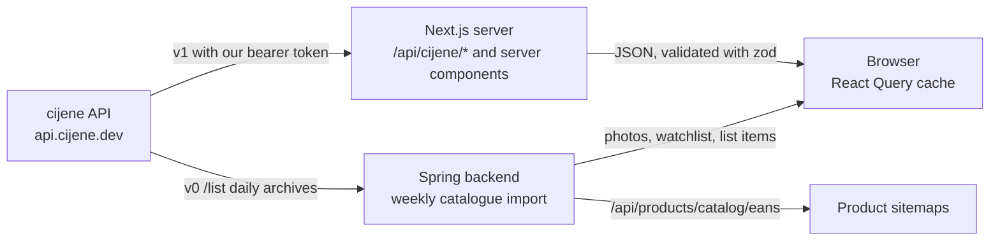
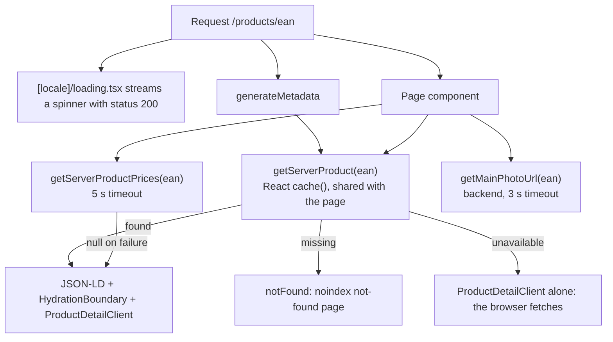

# Disscount: Products

A reference for how product data reaches the app: where it comes from, how the product list and the product page are built, how prices, price history, the watchlist and shopping lists use it, and what works offline. Written for someone new to the code, so the concepts are explained as they come up. Keep it up to date as the feature changes.

> **Mental model in one sentence:** every product, price and store comes from the upstream cijene API, which is not ours; the Next.js server proxies and caches it, the product page is rendered on the server with its prices already in the React Query cache, and everything we add (photos, the watchlist, shopping list rows, the product sitemap) is keyed by the product's EAN and stored by the Spring backend.

---

## Table of contents

1. [Quick reference](#1-quick-reference)
2. [Where product data comes from](#2-where-product-data-comes-from)
3. [The proxy routes](#3-the-proxy-routes)
4. [Product search and the product list](#4-product-search-and-the-product-list)
5. [The product page](#5-the-product-page)
6. [SEO: metadata, JSON-LD and sitemaps](#6-seo-metadata-json-ld-and-sitemaps)
7. [Chain and store prices](#7-chain-and-store-prices)
8. [Price history](#8-price-history)
9. [Watchlist and price alerts](#9-watchlist-and-price-alerts)
10. [Shopping list integration](#10-shopping-list-integration)
11. [Caching and offline](#11-caching-and-offline)
12. [i18n](#12-i18n)
13. [Key files](#13-key-files)
14. [Config and env vars](#14-config-and-env-vars)
15. [Libraries](#15-libraries)
16. [What is automatic vs manual](#16-what-is-automatic-vs-manual)
17. [Tests](#17-tests)
18. [Gotchas and lessons learned](#18-gotchas-and-lessons-learned)
19. [Future improvements and TODOs](#19-future-improvements-and-todos)

---

## 1. Quick reference

| Thing                | Value                                                                                                                                   |
| -------------------- | --------------------------------------------------------------------------------------------------------------------------------------- |
| Routes               | `/products` (search and list), `/products/<ean>` (product page), both public                                                            |
| Product modals       | `?modal=add-to-list&ean=`, `?modal=watchlist&ean=`, `?modal=product-actions&ean=` (built by `frontend/src/hooks/use-product-modals.ts`) |
| Data source          | The upstream cijene API (https://github.com/senko/cijene-api), called only from our Next.js server                                      |
| Our proxy            | `frontend/src/app/api/cijene/**`, one route handler per upstream resource                                                               |
| Product id           | The EAN as cijene gives it (leading zeros stripped), or a `<chain>:<code>` id for products sold without a barcode                       |
| Backend additions    | Product photos (see [PRODUCT-IMAGES.md](PRODUCT-IMAGES.md)), watchlist items, shopping list items, the catalogue EAN list               |
| Price data freshness | Upstream publishes once a day; we treat an hour old as current                                                                          |
| Env vars             | `CIJENE_API_URL`, `CIJENE_API_TOKEN` (frontend, server only); `NEXT_PUBLIC_API_URL` for the backend                                     |
| Offline              | Products, prices and history you have seen stay readable; watchlist add and remove queue and replay                                     |
| Tests                | `pnpm test` (frontend), `mvn -B verify` (backend)                                                                                       |

**Daily workflow:** nothing to configure. The upstream token is set once per environment in Dokploy, and the weekly catalogue import that feeds the sitemap runs by itself.

---

## 2. Where product data comes from

Disscount does not own a product database. Croatian law requires chains to publish their daily price lists, and the cijene API (an open project hosted at `api.cijene.dev`) collects them into one searchable API. Everything a user sees about a product (name, brand, quantity, unit, category, every chain's price) comes from there. We cannot change that API; a missing field or endpoint means an issue on `senko/cijene-api`, linking back to https://disscount.me and this repository.

What each side adds:

| Layer          | What it adds on top of upstream                                                                                                                                                                                                                                                        |
| -------------- | -------------------------------------------------------------------------------------------------------------------------------------------------------------------------------------------------------------------------------------------------------------------------------------- |
| Next.js server | A proxy that keeps the token on the server, validates every response with zod, maps errors, merges exact and fuzzy search, reduces store prices per city with an in-memory cache, and renders the product page with its data                                                           |
| Spring backend | Never calls the price endpoints. It reads the upstream daily archive once a week for the photo catalogue (name, brand, and how many priced store listings carry each EAN), stores photos, watchlist items and shopping list items keyed by EAN, and serves the EAN list to the sitemap |
| Browser        | Ranks and filters search results locally, computes discounts and watchlist alerts, and keeps what it has seen in IndexedDB                                                                                                                                                             |

The product shape (`productResponseSchema` in `frontend/src/lib/cijene-api/schemas.ts`) is `{ ean, brand, name, quantity, unit, chains[] }`. Each chain entry carries `chain` (the chain id) and that chain's own `code` (its product code), `name`, `brand`, `category`, `unit`, `quantity`, `min_price`, `max_price`, `avg_price` (prices are strings) and `price_date`. A store price (`storePriceSchema`) adds `regular_price`, `special_price`, `unit_price`, `best_price_30` (the lowest price in the last 30 days, which Croatian law requires on a sale), `anchor_price` and the store itself.

---

## 3. The proxy routes

The browser never calls cijene directly. It calls same-origin routes under `/api/cijene/`, and those call upstream with the token. Each route parses its own parameters with zod, then hands the upstream call to `withCijeneRoute` (`lib/cijene-api/utils/with-cijene-route.ts`), which validates the payload and maps failures.

| Route                                           | Upstream call                          | Notes                                                                                                                        |
| ----------------------------------------------- | -------------------------------------- | ---------------------------------------------------------------------------------------------------------------------------- |
| `GET /api/cijene/products?q=`                   | v1 `/products?q=` (once or twice)      | Exact search, topped up with fuzzy matches when exact finds fewer than 10 (see [§4](#4-product-search-and-the-product-list)) |
| `GET /api/cijene/products/{ean}`                | v1 `/products/{ean}`                   | Optional `date` (for history) and `chains`                                                                                   |
| `GET /api/cijene/prices?eans=`                  | v1 `/prices`                           | Every store's price for the given EANs, optionally by chain, city or address                                                 |
| `GET /api/cijene/location-prices`               | v1 `/prices`, per city or country wide | Our own shape: min and max per EAN across cities, plus `partial`                                                             |
| `GET /api/cijene/chains`                        | v1 `/chains/`                          |                                                                                                                              |
| `GET /api/cijene/stores`, `/stores/{chainCode}` | v1 `/stores`, `/{chain}/stores/`       | Store search and per chain lists, used by the map and the location facet                                                     |
| `GET /api/cijene/chain-stats`                   | v1 `/chain-stats/`                     |                                                                                                                              |
| `GET /api/cijene/archives`                      | v0 `/list`                             | The daily archive list                                                                                                       |
| `GET /api/cijene/health`                        | `/health`                              | 10 second timeout instead of 30                                                                                              |
| `GET /api/cijene/store-directory`               | (our own data)                         | The only route that sends a public `Cache-Control`; see [MAP.md](MAP.md)                                                     |

**Error mapping.** An upstream 4xx the caller could fix keeps its status. Upstream 401 and 403 become 502, because our own token authenticates the call, so they mean the proxy is misconfigured, and passing them on would tell the user they are logged out. A payload that fails the zod schema is a 502 too. Every other route answers `Cache-Control: no-cache` on success and `no-store` on an error (`createApiResponse` in `utils/response-utils.ts`), so freshness is decided by React Query and the service worker, not the HTTP cache.

**Three axios clients** live in `lib/cijene-api/client.ts`: v1 (bearer token, 30 s timeout), v0 (no token, 30 s) and health (10 s). They log every call in development and always throw a `CijeneApiError` carrying the upstream status (`errors.ts`). The module warns at startup when the token is missing.

---

## 4. Product search and the product list

The matching, ranking and diacritic folding are covered in [SEARCH.md](SEARCH.md); this section only covers what is specific to products.

- **Server side.** `/products?q=` asks upstream with `fuzzy=false` first. When that returns fewer than 10 rows (or fewer than the requested limit) and the query has at least three characters, it asks again with `fuzzy=true` and appends the new EANs (`product-search-fallback.ts`). Upstream fuzzy search ranks by trigram distance, which loses to exact search on every well-spelled query, so it is only a fallback (upstream issue https://github.com/senko/cijene-api/issues/65).
- **Client side.** `use-infinite-products.ts` re-ranks the result locally with `product-relevance.ts` and reveals it in batches (`use-revealed-batches.ts`, `product-batches.ts`) as the user scrolls.
- **Facets.** Trgovine (chains), Lokacije (cities), Kategorije and Marka are multi-selects built from the loaded results (`utils/facets/`). On an unfiltered view the chain and location filters are seeded once from the user's pinned stores and places (`use-seed-preferred-filters.ts`); a URL that already carries a filter is left alone. Filters live in the URL (`use-filter-params.ts`), so a filtered search can be shared.
- **City prices.** With a Lokacije filter, the list shows each product's price range in those cities only. `use-filtered-product-prices.ts` calls `/api/cijene/location-prices`, which is described in [§7](#7-chain-and-store-prices).
- **Product cards** (`components/product-item/`, built on the shared `components/custom/product/product-card.tsx`) show the price range, the photo thumbnail (batched, see [PRODUCT-IMAGES.md](PRODUCT-IMAGES.md#7-how-photos-reach-the-page)), and quick actions. Before opening a product modal, `useProductModals` seeds the product into the by-EAN cache entry, so the modal opens with data instead of refetching.
- **Rendering.** `/products` is a server page that only reads `q` and renders `ProductsClient` inside `Suspense`; the results themselves are fetched in the browser. Only the product page is server rendered with data.

---

## 5. The product page

`/products/<ean>` (`app/[locale]/products/[id]/page.tsx`) is server rendered since PR #418 (server render the product page body with its prices).

Step by step:

1. **Decode the id.** Next hands the page its `[id]` still percent encoded but `generateMetadata` a decoded one, so both call `decodeProductId` (`utils/product-id.ts`) and share one cached lookup. The client keeps the raw segment, since that is the key it always queried with.
2. **Fetch once.** `getServerProduct` (`lib/cijene-api/server/get-product.ts`) is wrapped in React `cache()`, so metadata and the page make one upstream call per request. It returns one of three states: `found`, `missing` (upstream 404) or `unavailable` (any other failure). Keeping an outage apart from a 404 means a short upstream blip never turns a real product into a not-found page.
3. **Prices in parallel.** `getServerProductPrices` asks `/prices?eans=` with a 5 second timeout and returns `null` on any failure, because the browser can fetch the prices itself.
4. **Seed the cache.** `productCacheState` (`[id]/utils/product-cache-state.ts`) puts the product under `CIJENE_QUERY_KEYS.productByEan(rawId)` and the prices under `productStorePrices({ eans: rawId })`, then dehydrates. `HydrationBoundary` hands both to the client, so the first render already has the product name, the chain list and the prices, with no second fetch.
5. **Client.** `ProductDetailClient` renders the header (`ProductInfoDisplay`: back button, name, category, action buttons, photo gallery) and two tabs in `SectionTabs`: "Cijene po trgovinama" (chains) and "Povijest cijena" (price history). While React Query restores the persisted cache it reports idle, and the server render is always restoring, so the client shows the spinner only when there is no product in the cache yet.

**Action buttons** (`product-action-buttons.tsx`): add to (or edit on) a shopping list, the watchlist toggle, share (`use-product-share.ts`), and "search images", which opens a Google image search for the name, brand and quantity (`productImageSearchUrl`). The photo gallery is described in [PRODUCT-IMAGES.md](PRODUCT-IMAGES.md).

---

## 6. SEO: metadata, JSON-LD and sitemaps

Issue #230 (product page SEO) asked for real titles, server rendered data, sitemap entries and Product JSON-LD. PR #392 added the metadata and sitemaps and PR #418 the server render; #230 stays open for what is left (see [§19](#19-future-improvements-and-todos)).

**Metadata** (`[id]/utils/product-metadata.ts`):

| Case                 | Title                                       | Robots                           | Other                                                                                                                                     |
| -------------------- | ------------------------------------------- | -------------------------------- | ----------------------------------------------------------------------------------------------------------------------------------------- |
| Product found        | `productDetail.meta.productTitle`, absolute | Croatian indexed, others noindex | Description with the lowest price and the chain count; canonical; Open Graph and Twitter with the main photo, or the layout's brand image |
| Upstream unavailable | Generic `productDetail.meta.title`          | Same as found                    | Canonical kept, so an outage never marks a real product noindex                                                                           |
| Product missing      | `productDetail.notFound.title`              | `noindex, nofollow`              | The page calls `notFound()`                                                                                                               |

- The title is `absolute`, because the layout template would otherwise prefix "Disscount - " to a product name.
- Only the Croatian page is indexed. The translations repeat the Croatian product data around translated boilerplate, which Google treats as thin duplicates. For the same reason there is no hreflang set: Google ignores a set whose other members are noindex. `translatedProductRobots` keeps `follow` only on an indexable origin.
- The canonical uses the EAN as upstream returns it (leading zeros stripped), so every spelling of a barcode lands on one URL.
- `openGraph` and `twitter` replace the layout's whole objects in Next, so the page passes the parent's resolved images through when there is no product photo.

**JSON-LD** (`[id]/utils/product-json-ld.ts`, rendered by `product-json-ld.tsx`): a schema.org `Product` with `name`, `url`, `image` (the main photo, or the brand OG image), `brand`, `gtin` only for a public GTIN (valid GS1 check digit, not an in-store code with prefix 2, mirroring the backend's `Barcodes.isPublicGtin`), and an `AggregateOffer` with `lowPrice`, `highPrice`, `priceCurrency: "EUR"` and `offerCount` (the number of chains). `AggregateOffer`, not `Offer`, because we compare prices and sell nothing, and Google reserves merchant listings for shops. The numbers are the page's own visible chain prices, as Google requires.

**Sitemaps.**

- `app/products/sitemap.ts` uses `generateSitemaps` to write eight files, `/products/sitemap/0.xml` to `7.xml` (`utils/product-sitemap.ts`). Eight files leave room for 400,000 products under Google's 50,000 URLs per file.
- Each EAN goes to the file chosen by a stable hash of the EAN, so it stays in the same file from one weekly import to the next.
- The EANs come from the backend (`GET /api/products/catalog/eans`: every EAN some chain priced in the latest weekly catalogue import), fetched with `next: { revalidate: 3600 }` and a 15 second timeout. A failed fetch throws, so the sitemap answers 500, which crawlers retry, instead of an empty list.
- The product sitemaps call `connection()`, so they render per request: the backend is not reachable while the Docker image builds.
- Croatian URLs only, and no `lastmod`, because the catalogue has no honest per-product date and Google ignores one it cannot trust.
- Next writes no sitemap index for `generateSitemaps`, so `app/robots.ts` lists `sitemap.xml` and every product file by name. The main `app/sitemap.ts` lists `/products` itself.

---

## 7. Chain and store prices

The chains tab (`product-chains-section.tsx`) lists every chain carrying the product. Each chain row needs only the product, so it renders before the store prices arrive; expanding a chain shows its stores (`store-item/`).

- **Data.** `useProductDetail` (`[id]/hooks/use-product-detail.ts`) reads the product and `useGetPrices({ eans })`, groups the store prices by chain, and sorts the chains.
- **Sort modes** (`utils/product-chain-sort.ts`): `stores` (default: pinned chains first, then the lowest average price), `price` (the chain with the single cheapest store first, ignoring preferences), and `distance` (the chain whose nearest store is closest, from the device location or a chosen town via `use-distance-sort.ts`, chains without a located store last).
- **Store rows** show the city, the address with a link to the map, and one price: the special price when there is one, otherwise the regular price (`store-price-cell.tsx`). The chain header says which day its data is from, compared with today in Zagreb time (`store-item.tsx`). `unit_price`, `best_price_30` and `anchor_price` are parsed but not shown yet. The "refreshed" label shows when the prices were last fetched (`LastSyncedLabel`).
- **City price ranges** for the product list come from our own `/api/cijene/location-prices` route (`lib/cijene-api/location-prices/`). Upstream takes one city per request, and every visitor shares one token with a daily request quota, so the route decides how to spend requests: it asks per city for up to three uncached cities (`MAX_CITY_REQUESTS`), and above that makes one country wide request and reduces it by city, remembering the cities nobody asked for yet too. Results sit in an in-memory cache per server process (one hour, 5,000 entries) that stores promises, so concurrent searches for the same city share one upstream request, and a failed request is evicted at once. If some cities fail the response is `partial: true`; if all fail the upstream status is kept.

---

## 8. Price history

The price history tab draws one line per chain over time with Recharts (`price-history/price-history-chart.tsx`, shell in `components/custom/price/price-history-chart-shell.tsx`).

**How it is fetched.** Upstream has no history endpoint, so history is the product fetched once per day with `?date=YYYY-MM-DD`. `usePriceHistory` (`lib/cijene-api/hooks.ts`) builds the date window (`buildDateWindow`, never before `PRICE_ARCHIVE_START`, 2025-05-16) and runs one query per day with `useQueries`. A week is 7 requests, a month 30.

**`priceHistoryQueries`** (`lib/cijene-api/price-history-queries.ts`) builds those query options in one place, because the product page and the shopping list chart (`use-shopping-list-price-history.ts`) share the cache entries, so the key and `staleTime` must be identical:

| Day in the window          | `staleTime` | Why                                                                          |
| -------------------------- | ----------- | ---------------------------------------------------------------------------- |
| The first and the last day | 1 minute    | The newest day can still change today, and the window edge moves at midnight |
| Every day in between       | 6 hours     | A past day's prices never change                                             |

The key is `["cijene", "product", "history", ean, date]`, which is persisted for offline use like the rest of the `cijene` root.

**Periods** (`constants/price-history.ts`): 1W and 1M are on; 1Y and ALL are disabled (`DISABLED_PERIODS`) until upstream can return a range in one request (issues #62, longer periods, and #45, batched history). `getEnabledPeriod` coerces a saved disabled period back to 1W, so a stored preference cannot mount straight into 365 requests.

**Preferences.** The chosen period and chains are saved per EAN in `localStorage` (`use-product-preferences.ts`, through `useSyncExternalStore`). The server cannot see `localStorage`, so it renders the defaults (1W; pinned chains if any carry the product, otherwise all), and saving happens in the change handler, never in an effect, so hydration cannot overwrite the saved state. At least one chain always stays selected.

---

## 9. Watchlist and price alerts

The watchlist (`/watchlist`, login required, `app/[locale]/(user)/watchlist/`) lets a user follow a product and be told when it is cheap.

**Storage.** The backend stores only the rule, never a price. Table `watchlist_item` (`backend/.../watchlistItem/domain/WatchlistItem.java`): `id`, `user_id`, `product_api_id` (the EAN), `watch_type` (`PERCENTAGE` or `ABSOLUTE`), `threshold_value`, `last_notified_at`, `created_at`, `updated_at`, `deleted_at` (soft delete).

| Method and path                             | What it does                                                                                |
| ------------------------------------------- | ------------------------------------------------------------------------------------------- |
| `POST /api/watchlist`                       | Upsert by user, product and watch type; `thresholdValue` must be positive                   |
| `GET /api/watchlist/me`                     | The caller's items                                                                          |
| `GET /api/watchlist/product/{productApiId}` | The caller's items for one product                                                          |
| `DELETE /api/watchlist/{id}`                | Soft delete; a repeat delete answers 204, and another user's id answers like an unknown one |

All need a signed-in session (through the backend proxy, see [BACKEND-PROXY.md](BACKEND-PROXY.md)).

**Rules.** A product can carry one rule of each type. The modal (`products/components/forms/watchlist-item-modal.tsx`, `watchlist-type-picker.tsx`) offers "price drops by €" (`ABSOLUTE`, 0.1 to 999 €) and "discount is at least %" (`PERCENTAGE`, 1 to 99 %). The defaults are 10 % and 10 % of the average price (clamped, 1 € when there is no price). The ranges are enforced in the frontend only (`utils/watchlist-thresholds.ts`); the backend checks only that the value is positive.

**How an alert fires.** There is no backend job: alerts are computed in the browser, every time the app has the data.

1. `useWatchedProducts` (`lib/watchlist/use-watched-products.ts`) loads `/api/watchlist/me`, groups the rows by product, and runs one `productByEanQueryOptions` query per product (the same cache entry the product page and the modal use).
2. For each product, the baseline is the mean of the chains' `avg_price`, compared with the cheapest chain's `min_price`, among the user's pinned chains when they have any (`watchlist-discount-utils.ts`).
3. A rule fires when that price is below the baseline by at least the threshold, in euros or percent (`watchlist-threshold-utils.ts`). Any one rule firing counts.
4. `useWatchlistNotifications` (`context/use-watchlist-notifications.ts`) turns the matches into notifications for the bell (`components/custom/notifications/notifications-dropdown.tsx`) and the sidebar's price drop count (`use-watchlist-price-drop-count.ts`). The watchlist page can also turn the discounted items into a shopping list (`create-discounted-list-button.tsx`).

So an alert reaches the user only when they open the app. The backend has no notification store: the unused `notification` table and `/api/notifications` endpoints were removed, and the server-side inbox is planned as #222. `last_notified_at` on watchlist items is still sent but never written; and `spring-boot-starter-mail` is on the classpath but unused. Moving alerts to the server is planned (see [§19](#19-future-improvements-and-todos)).

---

## 10. Shopping list integration

"Dodaj na popis za kupnju" opens `?modal=add-to-list&ean=` (`add-to-shopping-list-form.tsx`, hooks `use-add-to-list-form.ts`, `use-add-to-list-prices.ts`, `use-add-to-list-submit.ts`). The user picks a list (or creates one, which is a `POST /api/shopping-lists` first), an amount, and optionally marks the item as already bought.

`buildShoppingListItemRequest` (`utils/shopping-list-item-request.ts`) always sends `ean`, `name`, `brand`, `quantity`, `unit`, `amount` and `isChecked`. Only for an item marked bought, and only when a chain is known, it adds `chainCode` (the chosen chain, or the cheapest one, pinned stores preferred), `avgPrice` (the mean of the chains' averages) and `storePrice` (that chain's price). Those prices are a snapshot taken when the item was ticked off; an unbought row sends none.

The backend stores them in `shopping_list_item` (`ean` nullable for plain text items, `brand`, `name`, `quantity`, `unit`, `amount` up to 999, `is_checked`, `chain_code`, `avg_price`, `store_price`). Adding a product that is already on the list merges by EAN (`ShoppingListItemMatcher`), and a catalogue product takes over a plain row with the same name. Plain text items are added with `add-plain-item-modal.tsx`. Sharing a list is covered in [SHARING.md](SHARING.md).

---

## 11. Caching and offline

Three browser layers and one server layer keep product data fast and available. [PWA.md](PWA.md) describes the machinery; this is what it does for products.

| Layer                       | What it holds for products                                                                                                                                                                | Where                                          |
| --------------------------- | ----------------------------------------------------------------------------------------------------------------------------------------------------------------------------------------- | ---------------------------------------------- |
| React Query, in memory      | Product by EAN, search, store prices: `staleTime` 6 hours. Chains 1 hour, stores 30 minutes, health 30 seconds. History as in [§8](#8-price-history)                                      | `lib/cijene-api/query-hooks.ts`                |
| React Query, IndexedDB      | Everything under the `cijene` key root, except `prices` keys other than `product`, so the city price ranges are not stored. The watchlist is persisted too. Product photo queries are not | `lib/offline/cached-query-keys.ts`             |
| Service worker (production) | `GET /api/cijene/*` is stale while revalidate in the `cijene-api` cache (200 entries, 7 days). Other `/api/` calls are network only. R2 photos fall under Serwist's `defaultCache` rules  | `app/sw.ts`                                    |
| Next.js server              | The in-memory city price cache (1 hour); the sitemap's EAN list (`revalidate: 3600`)                                                                                                      | `location-prices/`, `product-images/server.ts` |

What that means offline:

- A product, its store prices and its history days that were seen before load from IndexedDB with no network. A product never seen has nothing to show offline.
- Watchlist add and remove (`watchlistAdd`, `watchlistRemove`) and adding to a shopping list (`shoppingListItemAdd`) are on the offline mutation allowlist (`lib/offline/offline-mutation-keys.ts`): they pause and replay on reconnect.
- Photo uploads, reports and admin actions are not queued and fail offline.

**Query keys are a contract.** `CIJENE_QUERY_KEYS` (`lib/cijene-api/keys.ts`) are stored as they are in every user's IndexedDB, so renaming one strands every offline copy. `canonicalizeStorePricesParams` sorts and dedupes the CSV parameters, so the same set of products and chains always lands on one entry, whatever order a caller used.

---

## 12. i18n

All copy is in the next-intl catalogs, in all five languages ([I18N.md](I18N.md)): `products.json` (list, facets, cards), `productDetail.json` (page, metadata, chains, price tables, price history), `productPhotos.json` (gallery, viewer, admin editor), `watchlist.json` and `shoppingListDetail.json`. Product data itself (names, brands, categories) is Croatian from upstream and is never translated; the elements that show it carry `lang="hr"` so screen readers pronounce it correctly. Prices go through `formatPrice(value, locale)` and dates through the locale-aware helpers in `utils/`.

---

## 13. Key files

| Path                                                                                                          | Role                                                                  |
| ------------------------------------------------------------------------------------------------------------- | --------------------------------------------------------------------- |
| `frontend/src/lib/cijene-api/client.ts`, `errors.ts`                                                          | The three upstream axios clients; `CijeneApiError`                    |
| `frontend/src/lib/cijene-api/schemas.ts`                                                                      | Zod schemas for every upstream response and parameter set             |
| `frontend/src/lib/cijene-api/keys.ts`                                                                         | Query keys and parameter canonicalization                             |
| `frontend/src/lib/cijene-api/queries.ts`, `query-hooks.ts`, `hooks.ts`                                        | Browser fetchers, query options with `staleTime`, `usePriceHistory`   |
| `frontend/src/lib/cijene-api/price-history-queries.ts`                                                        | The shared per-day history queries                                    |
| `frontend/src/lib/cijene-api/server/`                                                                         | `getServerProduct`, `getServerProductPrices` (server only, `cache()`) |
| `frontend/src/lib/cijene-api/utils/`                                                                          | `withCijeneRoute`, the fuzzy fallback, response helpers               |
| `frontend/src/lib/cijene-api/location-prices/`                                                                | City price reduction and its in-memory cache                          |
| `frontend/src/app/api/cijene/`                                                                                | The proxy route handlers                                              |
| `frontend/src/app/[locale]/products/page.tsx`, `components/`, `hooks/`, `utils/`                              | The product list, facets, cards and the product modal forms           |
| `frontend/src/app/[locale]/products/[id]/page.tsx`                                                            | The server rendered product page and its metadata                     |
| `frontend/src/app/[locale]/products/[id]/utils/`                                                              | Metadata, JSON-LD, cache seeding                                      |
| `frontend/src/app/[locale]/products/[id]/components/`                                                         | Detail client, chains section, store rows, price history              |
| `frontend/src/app/products/sitemap.ts`, `frontend/src/utils/product-sitemap.ts`, `frontend/src/app/robots.ts` | Product sitemaps and their listing                                    |
| `frontend/src/utils/product-id.ts`, `product-links.ts`                                                        | Product id shape and decoding; the one place the product URL is built |
| `frontend/src/constants/price-history.ts`                                                                     | Periods, the archive start date, disabled periods                     |
| `frontend/src/lib/watchlist/`, `frontend/src/context/use-watchlist-notifications.ts`                          | Alert computation and notifications                                   |
| `frontend/src/app/[locale]/(user)/watchlist/`                                                                 | The watchlist page                                                    |
| `frontend/src/lib/api/watchlist/`, `frontend/src/lib/api/schemas/watchlist.ts`                                | Watchlist API client and schemas                                      |
| `backend/.../watchlistItem/`                                                                                  | Watchlist entity, controller, service                                 |
| `backend/.../shoppingListItem/`                                                                               | Shopping list items, including the product snapshot fields            |
| `backend/.../productImage/catalog/`                                                                           | The weekly catalogue import behind the sitemap's EAN list             |

`backend/...` is `backend/src/main/java/disscount/`.

---

## 14. Config and env vars

| Var                   | Side                          | Required                                                                         | What it controls                                                         |
| --------------------- | ----------------------------- | -------------------------------------------------------------------------------- | ------------------------------------------------------------------------ |
| `CIJENE_API_URL`      | frontend, server only         | No, defaults to `https://api.cijene.dev`                                         | The upstream base URL                                                    |
| `CIJENE_API_TOKEN`    | frontend, server only, secret | In practice yes: v1 needs it                                                     | Sent as `Authorization: Bearer` on v1 calls                              |
| `NEXT_PUBLIC_API_URL` | frontend, public              | Defaults to `http://localhost:8080`; set it per environment, baked at build time | The backend origin the server uses for photos and the sitemap's EAN list |

`CIJENE_API_*` are validated in `frontend/src/lib/server-env.ts` and listed with placeholders in `frontend/.env.local.example` and the root `.env.example`; [DEPLOYMENT.md](DEPLOYMENT.md) has the full table. They are runtime values, so a change needs a restart, not a rebuild. The backend reads no cijene variable; the catalogue import's archive list URL is the property `product-images.catalog.list-url`, defaulting to the public `v0/list`.

---

## 15. Libraries

Versions read from `frontend/package.json` and `backend/pom.xml`.

| Library                                | Version    | Role here                                                                |
| -------------------------------------- | ---------- | ------------------------------------------------------------------------ |
| `next`                                 | `16.4.3`   | Server rendering, `generateMetadata`, `generateSitemaps`, route handlers |
| `react`                                | `19.2.8`   | `cache()` for the per-request upstream lookup                            |
| `@tanstack/react-query`                | `^5.90.12` | Every product, price and history query; hydration from the server        |
| `@tanstack/react-query-persist-client` | `^5.101.1` | The IndexedDB snapshot                                                   |
| `axios`                                | `^1.13.2`  | Upstream clients and browser fetchers                                    |
| `zod`                                  | `^4.1.13`  | Validates every upstream response and parameter                          |
| `recharts`                             | `^3.10.0`  | The price history charts                                                 |
| `serwist`, `@serwist/next`             | `^9.5.11`  | Service worker caching of `/api/cijene/*`                                |
| `next-intl`                            | `^4.14.9`  | Copy and locale routing                                                  |
| `spring-boot-starter-parent`           | `4.1.2`    | Backend (watchlist, shopping list items, catalogue import)               |

---

## 16. What is automatic vs manual

| Thing                                         | Auto or manual       | How                                                                       |
| --------------------------------------------- | -------------------- | ------------------------------------------------------------------------- |
| Fresh prices every day                        | Auto                 | Upstream publishes; our caches expire within hours                        |
| Weekly catalogue import (sitemap EANs)        | Auto                 | Backend job, see [PRODUCT-IMAGES.md](PRODUCT-IMAGES.md#5-background-jobs) |
| Product sitemaps                              | Auto                 | Rendered per request from the backend's EAN list                          |
| Watchlist alerts                              | Auto, in the browser | Computed whenever the app loads the watched products                      |
| Replaying offline watchlist and list writes   | Auto                 | Paused mutations, see [PWA.md](PWA.md)                                    |
| **The upstream token**                        | Manual               | Obtained once from the cijene API, set in Dokploy per environment         |
| **Submitting the sitemaps to Search Console** | Manual               | Once; `robots.txt` already lists every file                               |
| **A missing upstream field or endpoint**      | Manual               | An issue on `senko/cijene-api`                                            |

---

## 17. Tests

| Suite             | What it covers                                                                                                                                                                                                                                                                                                                                              |
| ----------------- | ----------------------------------------------------------------------------------------------------------------------------------------------------------------------------------------------------------------------------------------------------------------------------------------------------------------------------------------------------------- |
| Frontend (Vitest) | Product metadata, JSON-LD, cache seeding and the detail client (`[id]/`), chart preferences, chain sort, display prices, batches, facets, search results and their status, add to list prices, city price reduction and cache, query hooks, sitemap ids, product ids, watchlist discount, price drop and schema rules, the shopping list history chart data |
| Backend (H2)      | `WatchlistItemOwnershipTest`, `WatchlistWireFormatTest`, `ShoppingListItemServiceAddTest`, `ShoppingListItemRequestTest`, the shopping list ownership, link access and wire format tests, and the product image suite (see [PRODUCT-IMAGES.md](PRODUCT-IMAGES.md#12-tests))                                                                                 |

Not covered: the proxy routes against real upstream responses, the fuzzy fallback, and the price history fetch across a date window. Nothing on the backend computes alerts, so there is nothing there to test yet.

---

## 18. Gotchas and lessons learned

| Gotcha                                                   | What happens / fix                                                                                                                                                                                 |
| -------------------------------------------------------- | -------------------------------------------------------------------------------------------------------------------------------------------------------------------------------------------------- |
| **One shared upstream token with a daily quota**         | Every visitor's request spends it. Count requests, not bytes: that is why city prices switch to one country wide request above three cities, and why 1Y and ALL history are off                    |
| **An outage is not a 404**                               | `getServerProduct` keeps `unavailable` apart from `missing`. Treating both as not found would serve real products as noindex 404s during an upstream blip                                          |
| **`loading.tsx` has already sent a 200**                 | The locale layout's `app/[locale]/loading.tsx` streams first, so by the time the page calls `notFound()`, the status is on the wire, so Next marks the page noindex instead of sending a 404       |
| **Upstream strips leading zeros**                        | Use the EAN from the response for canonicals, sitemaps and photos; the backend matches barcodes without leading zeros too                                                                          |
| **Not every product id is a barcode**                    | cijene keys products sold without one as `<chain>:<code>`, and in-store codes fail the GS1 check digit. `isWellFormedProductId` checks the shape only; JSON-LD emits `gtin` only for a public GTIN |
| **Next decodes `[id]` differently in metadata and page** | Always go through `decodeProductId`, or the two make separate upstream calls and can build different canonicals                                                                                    |
| **Build product URLs with `productPath`**                | Three call sites once forgot `encodeURIComponent`, so an EAN with a stray character built a different URL depending on where you clicked                                                           |
| **History keys and `staleTime` must match**              | The product page and the shopping list chart share entries; build them only with `priceHistoryQueries`                                                                                             |
| **Do not save chart preferences in an effect**           | The server renders defaults; an effect during hydration would overwrite the saved choice                                                                                                           |
| **401 from upstream is our fault**                       | `withCijeneRoute` turns it into 502. Passing it through would make the app think the user is logged out                                                                                            |
| **Persisted keys are forever**                           | Changing a `CIJENE_QUERY_KEYS` shape strands every user's offline copy; it is not a free rename                                                                                                    |
| **Watchlist ranges live in the frontend only**           | The backend accepts any positive threshold; a new client must apply `watchlistLimits` itself                                                                                                       |
| **Alerts need the app open**                             | No server job checks prices, so a user who does not open the app hears nothing. Do not document email or push alerts until they exist                                                              |
| **The sitemaps cannot be prerendered**                   | The backend is not reachable during the Docker build, hence `connection()`; removing it fails the build or writes empty files                                                                      |

---

## 19. Future improvements and TODOs

**Product page**

- [ ] #433, follow-ups from the server render review: read "today" once instead of in render, let the chain panels toggle when the `localStorage` write fails, keep showing the cached product when a background refetch fails, an offline state for an expanded chain with no cached prices, and confirm the JSON-LD script warning is gone.
- [ ] #230, product page SEO: what is left after PRs #392 and #418, such as caching the server fetch and checking the rich result in Search Console.
- [ ] `getServerProduct` uses the client's 30 second timeout, while prices and the photo have their own short ones; a slow upstream holds the HTML that long.

**Prices and history**

- [ ] #62 and #45: periods longer than a month, once history can be fetched in one request instead of one per day.
- [ ] #278: show sale prices and flag sales that are not below the 30-day low. #63: base discount detection on price history.
- [ ] #279: each store's price level against its chain on the map. #277: where a whole shopping list is cheapest.

**Watchlist and alerts**

- [ ] #222: a server-side notification inbox with read state, shared by in-app, push and email. #221: Web Push alerts. #216: consent and a compliant email alert path. These need a backend job that checks prices, which does not exist today.
- [ ] #200: re-check the watchlist ownership report against the current code; an ownership test now exists for it (the notification half went away with the notification endpoints).

**Browsing and search**

- [ ] #82, #83, #84: browse by category, by discount and by brand. #162 and #406: search while typing and suggestions from local data.
