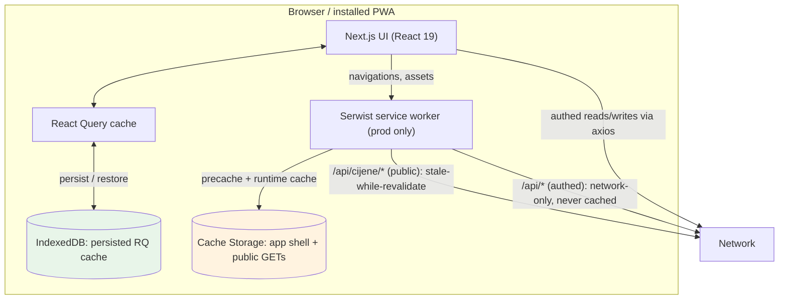
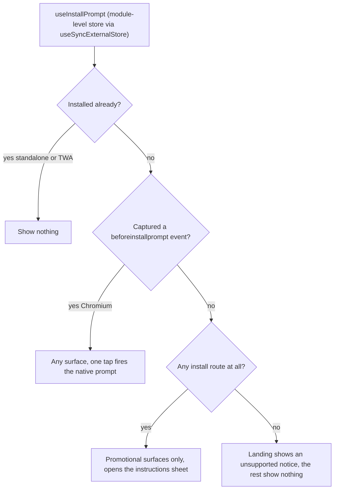
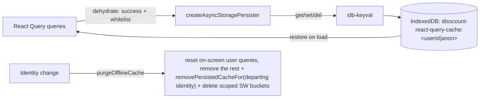
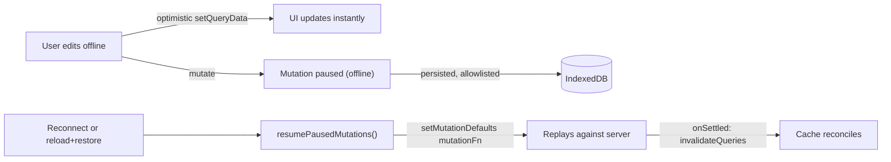

# Disscount: Progressive Web App (PWA) Guide

A complete reference for how Disscount behaves as an installable, offline-capable Progressive Web App: how it installs, how it caches reads, how it queues writes made offline, and the native polish (status bar, splash screens, icons) that makes it feel like a real app. Written to be understandable even if you are new to PWAs. Keep it up to date as the setup changes.

_Last verified on branch `feat/pwa`, 2026-07-04: installable on Android/iOS, offline reads + writes working, manifest and service worker served correctly._

> **Mental model in one sentence:** Disscount is a normal Next.js site plus two cooperating layers, a **Serwist service worker** that caches the app shell and public data (production only), and a **persisted React Query cache in IndexedDB** that holds your dynamic and private data offline and replays writes you make while offline.

---

## 1. Quick reference

| Thing                        | Value                                                                                                                                                                                                                                 |
| ---------------------------- | ------------------------------------------------------------------------------------------------------------------------------------------------------------------------------------------------------------------------------------- |
| Service worker library       | **Serwist** (`@serwist/next`), the maintained successor to `next-pwa`                                                                                                                                                                 |
| Service worker source        | `frontend/src/app/sw.ts` (compiled to `public/sw.js` at build)                                                                                                                                                                        |
| Service worker active in     | **production builds only** (disabled in dev, since it fights Turbopack/HMR)                                                                                                                                                           |
| Web app manifest             | `frontend/src/app/manifest.ts` (served at `/manifest.webmanifest`)                                                                                                                                                                    |
| Offline data store           | IndexedDB via a persisted React Query cache (`idb-keyval` + `@tanstack/react-query-persist-client`)                                                                                                                                   |
| Build command                | `next build --webpack` (Serwist needs webpack; dev stays on Turbopack)                                                                                                                                                                |
| Status-bar / theme color     | `#ffffff` (neutral white, set in both `manifest.ts` and the `viewport` export)                                                                                                                                                        |
| Install UX                   | floating dismissible banner + sidebar and landing cards + a four-platform instructions sheet                                                                                                                                          |
| Icons / splash / screenshots | `public/brand/icons`, `public/splash` (18 iOS sizes), `public/screenshots` (2); see `docs/BRAND.md`                                                                                                                                   |
| Screen wake lock             | `frontend/src/hooks/use-wake-lock.ts`, held while the digital card view modal is open and requested again when the tab returns to view; where it is unsupported or refused, the modal's brightness hint warns that the screen may dim |
| What is NOT built yet        | push notifications, app badging (see [TODOs](#14-future-improvements-and-todos))                                                                                                                                                      |

**The one rule that explains most decisions:** public data may be cached by the service worker; **private (authenticated) data is never written to the HTTP Cache Storage**, it lives only in the React Query IndexedDB cache and is wiped on logout.

---

## 2. The four layers of the PWA

Disscount's PWA was built in stages, and it helps to keep the four layers separate in your head because they use different mechanisms and fail in different ways.

| Layer              | What it gives the user                                                                       | Mechanism                                                                                                     | Active in dev?                           |
| ------------------ | -------------------------------------------------------------------------------------------- | ------------------------------------------------------------------------------------------------------------- | ---------------------------------------- |
| **Installability** | Add-to-home-screen, standalone window, app shortcuts                                         | Web App Manifest + a registered service worker                                                                | manifest yes, SW no                      |
| **Offline reads**  | Previously seen products, lists, and watchlist still load offline                            | Persisted React Query cache in IndexedDB, plus Serwist runtime caching for the app shell and public price API | React Query layer yes, service worker no |
| **Offline writes** | Edits made offline (check off items, rename, track/untrack) sync when the connection returns | React Query paused mutations, persisted and replayed via `setMutationDefaults` + `resumePausedMutations`      | yes                                      |
| **Native polish**  | Neutral status bar, iOS splash screen instead of a white flash, durable storage              | Manifest fields, `apple-touch-startup-image` links, `navigator.storage.persist()`                             | yes (except the SW-dependent parts)      |

The most important consequence: the **data layer (React Query in IndexedDB) works in `pnpm dev`**, so you can test offline reads and writes locally, but the **service worker layer only exists in a production build**, so app-shell offline and the `/offline` fallback need `next build --webpack`.

---

## 3. Architecture

Two caches, on purpose:

- **Cache Storage (service worker):** the app shell (HTML/JS/CSS precache), static assets, and **public** `/api/cijene/*` GET responses. Never authenticated responses.
- **IndexedDB (React Query):** the dynamic and **private** data (shopping lists, watchlist, viewed products, recent searches, profile). This is what makes authed screens work offline, and it is purged whenever the session ends (logout, expiry, revoked cookie, or sign-out in another tab). The purge of a signed-in session also drops the recent product searches in localStorage and the in-memory product lookups, public data whose keys say what was searched and opened; the store map's recent searches stay.

Everything is same-origin: the browser calls `/api/cijene/*` (Next.js route handlers to the external Cijene API) and `/api/*` (the Next.js backend proxy route to Spring, [BACKEND-PROXY.md](BACKEND-PROXY.md)), so the service worker can see and selectively cache them.

---

## 4. Installability

### What it does

Disscount ships a Web App Manifest and a registered service worker, which together let Android/desktop Chromium and iOS Safari install the app to the home screen as a standalone window, with app shortcuts, a themed splash, and the right icons.

### The manifest (`src/app/manifest.ts`)

A Next.js dynamic manifest (a function returning `MetadataRoute.Manifest`) served at `/manifest.webmanifest`. Key fields:

| Field              | Value                                          | Why                                                                                                                  |
| ------------------ | ---------------------------------------------- | -------------------------------------------------------------------------------------------------------------------- |
| `display`          | `standalone`                                   | opens without browser chrome, like an app                                                                            |
| `orientation`      | `portrait`                                     | shopping is a phone-in-hand, portrait activity (also means we only need portrait splash screens)                     |
| `background_color` | `#ffffff`                                      | the splash background while the app boots (white, to match the iOS launch screens)                                   |
| `theme_color`      | `#ffffff`                                      | neutral title bar (the light/dark pair is set in `layout.tsx` `viewport.themeColor`)                                 |
| `icons`            | 192 + 512 `any`, and 192 + 512 **maskable**    | maskable avoids the icon being shrunk onto Android's own white plate; see [Icon sizing](#icon-sizing)                |
| `shortcuts`        | Skeniraj, then the qualifying `shortcutNavIds` | long-press the icon to scan a barcode or jump to Shopping lists / Loyalty cards; see [App shortcuts](#app-shortcuts) |
| `screenshots`      | one `narrow` + one `wide` (each `label`ed)     | Chrome's richer, app-store-like install dialog                                                                       |
| `share_target`     | GET to `/share-target`                         | registers Disscount in the system share sheet; the route handler funnels shared text/title/url into `/products?q=`   |
| `launch_handler`   | `{ client_mode: "navigate-existing" }`         | reuse an open window instead of spawning a duplicate, **and** navigate it to the shortcut's url                      |

Icons are generated from the happy-cart source (`public/brand/logo/cart/cart-rgb.svg`) by `scripts/generate-pwa-icons.mjs` (uses `sharp`), into `public/brand/icons` (plus the legacy `src/app/favicon.ico`). See `docs/BRAND.md` for the full asset map.

### Polarity

The two icon families run opposite ways on purpose:

| Family                          | Polarity                                  |
| ------------------------------- | ----------------------------------------- |
| App icons, apple-touch, favicon | green cart on **white**                   |
| Shortcut tiles                  | white glyph on **full-bleed brand green** |

**The app icon is a deliberate brand call, taken against the general guidance.** The advice for Android's adaptive background layer is to fill it with your primary colour, and the argument for it is real: a home screen is dense with saturated tiles, so a white plate reads as empty space with something small floating in it, and it fades against a light wallpaper. Disscount keeps the white plate anyway, because the happy cart is the brand and it reads as itself in green. Both were built and compared side by side before choosing. Do not "fix" this back to a green fill without asking.

The shortcut tiles do take the fill, because a shortcut has to read as its own destination rather than as the app, and because they are only ever seen against the dark long-press sheet.

Worth knowing when tempted to make a mark bigger: **size and polarity are not independent levers.** Enlarging on a plate is capped by the mask and the cap arrives early, at roughly 0.74 for the scan glyph before its corner brackets clip. Filling the tile has no cap, because the mark becomes the whole circle. Flipping the app icon to a green fill and back proved this, and proved the reverse too, that the two versions are pixel-identical in ink box and padding: a light mark on a dark ground simply _looks_ larger than the same mark dark-on-light.

**The cart sits left of centre and that is intended.** Its `viewBox` is `-1 6 68 50.5` while the art inside is `translate(2.5 0) rotate(-7)`, so about 11.5% of the box on the right is dead space and the ink midpoint lands roughly 5.75% left of the tile centre. Do not re-centre it.

The splash screens are a green cart on white too, matching `background_color` so the launch does not flash.

### Icon sizing

Every crop ratio in the generators is fixed by one rule: **Android masks a `maskable` icon, but shrinks an `any` icon onto a white plate of its own.** The second behaviour is what makes a mark look small on a phone, because the artwork gets scaled down twice.

The safe zone for a masked icon is a circle centred on the tile with a **radius of 40% of the width**, so a diameter of 80%. Aggressive OEM masks can go tighter, down to the 72dp visible area of Android's 108dp adaptive-icon layer (**66.7%**). Anything whose bounding-box corners carry ink has to fit its _diagonal_ inside that circle, not its width.

| Asset                        | Ratio  | Bound                                                                       |
| ---------------------------- | ------ | --------------------------------------------------------------------------- |
| `icon-192` / `icon-512`      | `0.86` | never masked, so this is just the roomiest crop that keeps a visible margin |
| `icon-maskable-192` / `-512` | `0.70` | the widest crop whose ink still sits on the 80% safe-zone boundary          |
| `apple-touch-icon-180`       | `0.86` | iOS applies a squircle, whose corners the cart does not reach into          |
| favicon frames               | `0.92` | line art needs the tightest crop to survive 16px                            |
| shortcut glyphs              | `0.66` | lucide insets its art by about 2 of 24 units, landing the ink near 0.55     |

Both maskable sizes ship so Chrome never falls back to an `any` icon merely because it wanted 192.

**iOS ignores all of this for shortcuts.** Safari has no app-shortcut support at all, so the `shortcuts` array is an Android and desktop feature. `apple-touch-icon-180` is the only piece of this that iOS reads.

To re-check a ratio, mask the generated PNG against circles at 80% and 66.7% and look at it. That is faster and more honest than the trigonometry.

### App shortcuts

Long-pressing the installed icon opens a shortcut menu. Ours is built in `constants/pwa-shortcuts.ts` from one hand-written entry (Skeniraj) plus the navigation items listed in `shortcutNavIds`, in that order, kept only when released (`!comingSoon`) and carrying a `shortcutDescriptionKey`, so a listed feature joins the menu on its own once both hold.

**There are fewer slots than it looks.** Chrome for Android shows **3** shortcuts. It allowed 4 until Chrome 92 started injecting its own "Site settings" entry, which takes a slot. Desktop Chrome and Edge show up to 10. Shortcuts render in manifest order, so the order of `shortcutNavIds` is what decides which three a phone actually surfaces. The order is the owner's call from [#127](https://github.com/OffCrazyFreak/Disscount/issues/127): Skeniraj, Popisi and Kartice take the phone slots (loyalty cards are needed fast at the till), and the rest show on desktop. Every row has its tiles, but a row stays out of the manifest until it qualifies:

| Order | Shortcut  | Url               | Icon          |
| ----- | --------- | ----------------- | ------------- |
| 1     | Skeniraj  | `/?scan=1`        | `ScanBarcode` |
| 2     | Popisi    | `/shopping-lists` | `ListChecks`  |
| 3     | Kartice   | `/digital-cards`  | `CreditCard`  |
| 4     | Praćenje  | `/watchlist`      | `Eye`         |
| 5     | Karta     | `/map`            | `Map`         |
| 6     | Potrošnja | `/spending`       | `PiggyBank`   |

Potrošnja is not emitted yet because it is still `comingSoon`, so the manifest carries the first five today.

That "Site settings" entry and its black gear come from Chrome, not from us. No manifest key can recolour, reorder or remove it.

**Icons.** Chrome accepts **PNG only** here and asks for 192x192. `scripts/generate-shortcut-icons.mjs` renders the same `lucide-react` component the nav uses through `renderToStaticMarkup`, then rasterizes it with `sharp` into `public/brand/shortcuts/`: a white glyph on a brand-green tile, glyph at 66% (see [Icon sizing](#icon-sizing)). Rendering the component rather than a copied path is what keeps a shortcut icon from drifting away from its nav icon. `constants/pwa-shortcuts.ts` derives each `src` from the nav item's `id` and emits a shortcut only for a released item that carries a `shortcutDescriptionKey`, so a missing description drops the shortcut rather than shipping one with no accessible name. Adding a shortcut therefore takes three manual steps: put its id in `shortcutNavIds` at the right position, give it a `shortcutDescriptionKey` in `constants/navigation.ts` if it has none, and add its glyph to `generate-shortcut-icons.mjs` and re-run it. Dropping the `comingSoon` flag does the rest. `constants/pwa-shortcuts.test.ts` fails if a listed shortcut is missing either tile.

**Each shortcut ships two tiles**, because one image cannot do both jobs:

| File           | `purpose`  | Shape                                 | Who draws it                  |
| -------------- | ---------- | ------------------------------------- | ----------------------------- |
| `<id>.png`     | `maskable` | full bleed, square                    | Android, which applies a mask |
| `<id>-any.png` | `any`      | brand corner radius (96/512 = 18.75%) | desktop jump lists, unmasked  |

The masked one has to stay full bleed. Chrome hands a maskable icon to Android as an adaptive-icon layer, and transparent corners there are filled in by the launcher rather than left alone, which is how the first version ended up shrunk onto a second white plate with its corners poking past the mask. The unmasked one is drawn exactly as given, where a hard square reads as a blank block, so it keeps the radius. Splitting them is also what the maskable guidance recommends: an icon designed for a mask looks wrong without one.

**Skeniraj has no route of its own.** The scanner is imperative (`context/scanner-context.tsx`), so the shortcut points at `/?scan=1` and `components/custom/pwa/scan-shortcut.tsx` picks the flag up, strips it from the URL with `replaceState` before opening the camera (so a refresh or a back navigation does not reopen it), and routes the scanned code through `useProductNavigation`.

Praćenje and Karta come after the three phone slots, so Android drops them in favour of Chrome's own "Site settings" slot; desktop Chrome and Edge show them.

### The install UX (`src/components/custom/pwa/`)

The tricky part of install UX is that support varies wildly by browser, so a shared hook centralizes the detection.

The store exposes three gates rather than one, because "can install" is not a single question.

| Gate                    | Means                                                 | Used by                                        |
| ----------------------- | ----------------------------------------------------- | ---------------------------------------------- |
| `canShowInstallUI`      | an install is one tap away: a captured prompt, or iOS | unprompted surfaces (floating banner, sidebar) |
| `canPromoteInstall`     | an install is possible at all, prompt or browser menu | promotional surfaces (the landing page)        |
| `showUnsupportedNotice` | genuinely no route, so name another browser           | the landing page only                          |

The split exists because `beforeinstallprompt` is Chromium-only. Gating everything on it wrote off macOS Safari (File, then Add to Dock), Firefox on Android, and Opera on Android, all of which install fine from their own menus and would otherwise be told to go and fetch Chrome for no reason. Opera Android is the common case: it is Chromium and is listed as supporting the event, but does not fire it in practice, so it lands in the middle tier.

- `use-install-prompt.ts` keeps a **single shared** captured `beforeinstallprompt` event at module scope (read via `useSyncExternalStore`), so no two surfaces hold separate, stale copies. It also exposes a `ready` flag so nothing flashes before client-side detection runs, and a `platform` value (`ios`, `macSafari`, `android`, `desktop`) that picks the instruction wording.
- The event is captured **twice over**. A `beforeInteractive` script in `layout.tsx` stashes it on `window.__installPrompt`, and the store adopts that stash on init. Without it, an event that fires before hydration is lost for the whole page, and since Chrome never re-fires it the button silently degrades to manual instructions when a one-tap install was available. The store keeps its own listener for events that arrive after hydration.
- `promptInstall` dedupes concurrent clicks with a flag and clears the event only once the choice resolves. `prompt()` may only be called once per event, so a dismissal spends it exactly as an accept does; clearing up front instead would flip every mounted surface to the instructions branch while the native sheet is still open.
- `install-banner.tsx`: a one-time **dismissible floating banner** (dismissal persisted in the existing `Disscount_app` localStorage object, 7-day snooze). Mounted in `layout.tsx`.
- `install-card.tsx`: the shared card, in the sidebar footer and, with `permanent`, on the landing page. `permanent` is what switches it from `canShowInstallUI` to `canPromoteInstall` and gives it the unsupported notice.
- `install-perk.tsx`: the landing page's "Instaliraj kao aplikaciju" perk row, clickable wherever an install is possible.
- `install-copy.ts`: the button label and pitch, shared so the banner, the card and the sheet cannot contradict each other.
- `install-instructions-sheet.tsx`: manual steps for when there is no native prompt, with four separate step lists. A share sheet, a menu bar, a phone menu and an address-bar icon are four different things to press, and naming the wrong one is worse than saying nothing.

The service worker registration is handled automatically by `@serwist/next` (no hand-written registration component). In development the service worker is disabled, so there is no `/sw.js` and no install prompt locally; test installability against a production build.

---

## 5. Offline reads: caching and persistence

Two mechanisms cooperate, split by data sensitivity.

### 5a. Serwist service worker (`src/app/sw.ts`), production only

Runtime caching rules, evaluated top to bottom (first match wins):

| Request                                                          | Strategy                                   | Notes                                                                                                                                                                                  |
| ---------------------------------------------------------------- | ------------------------------------------ | -------------------------------------------------------------------------------------------------------------------------------------------------------------------------------------- |
| `GET /api/cijene/*` (public price data)                          | **StaleWhileRevalidate**                   | cache `cijene-api`, `CacheableResponsePlugin` (statuses 0 + 200), `ExpirationPlugin` (200 entries, 7 days)                                                                             |
| any other `/api/*` (authed, proxied to Spring)                   | **NetworkOnly**                            | deliberately never cached; private data lives in IndexedDB instead. Serwist ignores `Cache-Control`, so this rule, not the proxy's `no-store`, keeps account data out of Cache Storage |
| `/shopping-lists/*` and `/<locale>/shopping-lists/*`             | **NetworkFirst**                           | cache `shopping-list-pages`, 5s network timeout, 20 entries, 1 day. Must stay above `defaultCache`. See the note below                                                                 |
| wallet documents (`/digital-cards` in every language, any query) | **NetworkOnly**, 3s timeout                | never cached at runtime; offline the fallback serves this build's precached wallet in the same language. The bare URL is answered by the precache first. See "The wallet shell" below  |
| everything else (app shell, `_next`, fonts, images)              | `defaultCache` from `@serwist/next/worker` | Next.js-tuned precache + runtime rules                                                                                                                                                 |

The `/shopping-lists/*` rule is a privacy decision as much as a caching one. A list is
shared at its own URL, so one of those documents can carry someone else's list title, and
`defaultCache` would keep it for 24 days keyed by URL alone with no notion of who asked. It was
`NetworkOnly` at first, which kept them off disk entirely but sent every offline reload
to the `/offline` fallback, making the queued-write story unreachable in exactly the
bad-signal case it exists for. NetworkFirst with a one-day expiry is the trade, and it
is only safe because `purgeOfflineCache` now deletes this bucket (and `cijene-api`) when
the signed-in identity changes. Nothing else in the app has ever called `caches.delete()`.

**The wallet shell.** The loyalty card wallet is the main reason to install the app (a cashier asks for a card in a shop with no signal), so it does not depend on a runtime cache that expires. `next.config.ts` precaches `/digital-cards` in every language next to `/offline`, from the page list in `lib/pwa/precached-pages.ts`, with a fresh revision per build. That is the app shell pattern: the page is installed with the same service worker as the chunks it loads, refreshed with them on every deploy and pruned with them when the next worker activates, so a cached page can never point at chunks a later deploy deleted (a copy in `defaultCache`'s 24 hour `others` bucket could, and it was evicted by any 32 other pages). A request for the bare URL is served from the precache even online, which opens the wallet at once on a slow connection. Any other wallet document (`?q=`, a `?modal=` card view, a trailing slash) goes to the network with a 3 second timeout, and on failure the `fallbacks` list serves the precached wallet of the same language; that rule is listed before the `/offline` one, since the first matching fallback wins. The precached page carries no account data, because one copy serves everyone on the device: the root layout reads no session and the wallet renders its cards from IndexedDB after hydration. Keep it that way, and keep anything account-specific out of `PRECACHED_PAGE_PATHS`. The page does not read `searchParams`, so the search runs shallow on the client (`SearchBar shallow`): offline, a server render per keystroke would fall back to the precached page and drop what was typed. Opening the wallet offline also needs the account, which the session lookup cannot confirm with no network; see `hasUnverifiedAccount` in §5b.

Plus: `precacheEntries: self.__SW_MANIFEST` (the build-injected app-shell precache), `precacheOptions.ignoreURLParametersMatching` (adds `dpl` to Serwist's defaults, see below), `defaultCache` wrapped in `ignoreDeploymentParam`, `skipWaiting: false`, `clientsClaim`, `navigationPreload`, and a `fallbacks` rule that serves a precached offline page for document requests that fail offline. There is one per language (`/offline`, `/en/offline` and so on), and a failed document gets the one matching its own prefix. `LOCALE_PREFIXES` in `sw.ts` mirrors `LOCALES` in `src/i18n/locales.ts` and has to change with it.

**Updates after a deploy.** A new build ships a new `sw.js`, and the browser installs it next to the running one. With `skipWaiting` off it stays in the waiting state, so open tabs keep the old worker and its precached chunks, and nothing breaks under a user mid task. `useAppUpdatePrompt` (mounted by `AppUpdatePrompt` in the providers) listens for Serwist's `waiting` event, and also checks `registration.waiting` once on load, since a worker left waiting by an earlier visit can finish before the listener exists. Client navigations never make the browser look for a new worker, so it also calls `registration.update()` each time the tab becomes visible again. It then shows a sonner toast with one **Osvježi** button. Osvježi posts `{ type: "SKIP_WAITING" }` to the waiting worker (Serwist's worker handles that message when `skipWaiting` is false) and reloads on `controllerchange`; if another tab already activated it, it reloads at once. Swiping the toast away just closes it: the new worker takes over once every tab is closed, and the toast comes back on the next load. Once one tab accepts, the other tabs lose the old precached chunks, and a lazy load there falls back to the chunk reload below. The logic is in `lib/pwa/service-worker-update.ts`.

Two more guards cover a tab that still runs into the new build:

- `deploymentId` in `next.config.ts` is set from `GIT_SHA`. Next then adds `?dpl=<id>` to asset URLs, sends the id with client navigations, and turns a navigation into a full page load when the server's id differs. The precache keys carry no query, hence `dpl` in `ignoreURLParametersMatching`; without it every chunk would miss the precache and offline loads would break. Serwist also tests `defaultCache`'s RegExp rules against the full URL, and they end in `$`, so `ignoreDeploymentParam` (`lib/pwa/deployment-param.ts`) wraps them to test the URL without `dpl`; otherwise chunks fell into the generic page bucket. Builds with no `GIT_SHA` (production, which still builds on the server) leave it unset.
- A lazy chunk that fails to load (`ChunkLoadError`) lands in `[locale]/error.tsx` or `global-error.tsx`, which call `handleBoundaryError`, or in the map's own `MapErrorBoundary`, which tries the same reload before its fallback. For a chunk error it reloads the page once instead of reporting it, unless the device is offline, where the boundary's retry button is the better offer; a timestamp in `sessionStorage` blocks a second reload within a minute, so a chunk that is really broken shows the error page instead of looping (`lib/pwa/chunk-load-recovery.ts`).

### 5b. Persisted React Query cache (IndexedDB), works everywhere

This is what makes authed screens (shopping lists, watchlist) and previously viewed products load offline.

- `react-query-provider.tsx` uses `PersistQueryClientProvider`. The `QueryClient` takes its defaults from `lib/api/query-client-defaults.ts`: a `gcTime` of 7 days, so a query nobody has watched for that long leaves memory and, at the next save, the snapshot (the digital card keys get `gcTime: Infinity` through `setQueryDefaults` in the provider, which also covers restored entries, so the wallet never ages out however long the app stays open); a `staleTime` of 60 seconds, so an entry restored or fetched a moment ago is not refetched on every mount (queries that set their own keep it); and one retry, given only to network failures, 408, 429 and 5xx. A network failure stays retryable on purpose, because React Query pauses a retry while offline and resumes it on reconnect. Its `QueryCache` and `MutationCache` report unexpected failures (5xx, network faults while the device is online, responses that failed to parse) to Sentry, tagged with the query key root only and the HTTP status. They never report a 4xx, a cancelled request or anything that fails while offline, and a query that keeps failing (a shared list polls every 30 seconds) is reported once until it succeeds again. The rules read the status off an `AxiosError`, so a fetcher that bypasses `apiClient` (a bare `fetch`, a better-auth client call) throws through `lib/api/http-status-error.ts` to get the same treatment.
- `persister.ts` builds a `createAsyncStoragePersister` backed by `idb-keyval` (IndexedDB, larger and safer than localStorage). `maxAge` `Infinity`, so a snapshot is restored however long ago it was saved: with the earlier 7 days, a wallet last opened more than a week before was thrown away, together with any queued writes, on the first offline open. Staleness is shown by the "last synced" labels instead, and any identity change purges the snapshot. Queued writes are the exception: one that has not reached the server within seven days is dropped (see §6). `buster` `"3"`. The history: `"2"` was the `ShoppingListDto` reshape for sharing, where a restored pre-change list had no `myAccess` and every capability check would have read that as no access; `"3"` was the move to a per-identity key, which orphaned the old shared blob. **Bumping it is heavier than it looks:** a mismatch makes `persistQueryClient` call `removeClient()`, which discards the whole persisted client, queued offline writes included, under every key rather than only the changed one. The token-to-id sharing move deliberately did not bump it and retired its two mutation keys with tombstone defaults instead.
- The product page seeds the cache from the server. `page.tsx` fetches the product and its store prices in parallel, and `product-cache-state.ts` dehydrates both under the exact keys the client queries (`CIJENE_QUERY_KEYS.productByEan` and `CIJENE_QUERY_KEYS.productStorePrices` from `lib/cijene-api/keys.ts`, keyed by the raw route segment) into a `HydrationBoundary`. While the persisted cache is still restoring, queries report idle, but a seeded entry is already there, so the product renders in the server HTML and the browser fetches neither again. A persisted copy restored afterwards only replaces the seeded entry if its `dataUpdatedAt` is newer, so an old offline snapshot never overwrites fresh server data. If the server could not load the prices within five seconds, the browser fetches them as before.
- `cache-identity.ts` scopes the IndexedDB entry to the signed-in account (`disscount-react-query-cache:<userId>`, or `:anon`). Before this there was one browser-wide blob shared by every account on a device, with a destructive purge as the only defence, which is why a shared list could not be persisted at all. The identity is mirrored in localStorage because the persister has to pick a key synchronously at boot, before the session resolves.
- Offline the session lookup always fails, and a failed lookup is not a sign-out (the purge treats it the same way). `user-context.tsx` exposes `hasUnverifiedAccount`, true while the lookup failed and this device's cache identity still names an account (`isUnverifiedAccount` in `context/sync-cache-identity.ts`), and `canShowAccountData`, signed in or unverified. Every page that shows the account's saved data gates on `canShowAccountData` instead of `isAuthenticated`: the wallet and the entity modals, the shopping lists overview, the list detail's signed-in controls (back link, copy, the banner's next step; what a shared list allows still comes from the saved `myAccess`), and the watchlist. Their queries stay gated on `isAuthenticated`, since a disabled query still returns what the snapshot restored, and the overview and the watchlist count `useIsRestoring` as loading, so the failed lookup landing before IndexedDB is read back does not flash an empty page. Settings, onboarding and the list actions modals still need a verified session. The header and the mobile sidebar follow `canShowAccountData` too, so offline they show the account menu (with a working sign-out) instead of a login button. `accountUser` is the signed-in user, or for an unverified account the profile this device saved under `["users", "me"]` (`context/use-account-user.ts`); every reader of pinned stores and places uses it (the watchlist and its notifications, a list's cheapest store, the product page order, price history and store price table, add to list, the search filter seed, the map defaults, the distance origin and the list share text), so offline they keep using the pinned stores rather than every chain. The profile is saved through `purge-gate.ts`, so the purge a sign-in fires cannot reset it right after it lands, and only while the cache identity still names its account. Settings still reads `user`, since it edits the account. It is for showing the account only, never for deciding what may call the API. A page this device never opened online has nothing in the snapshot, so `useIsNotSavedOffline` (an unverified account, the restore finished, no saved data) makes the lists overview, the watchlist and the wallet say the page is not saved for offline use instead of showing an empty account.
- Signing out offline (`context/use-logout.ts`, `lib/auth/pending-sign-out.ts`): the purge runs at once and the device's cache identity goes back to anonymous, so the empty device asks to log in. The sign-out request cannot reach the server and the httpOnly cookie survives, so every sign-out is recorded in localStorage (`pendingSignOut`) with the session it ends, taken from `lastSession`, the session this device last saw online. better-auth refetches the session on reconnect; an answer naming that same session counts as nobody, and the sign-out is sent again unless the server already confirmed it. The record is kept until a session read shows another session or none, so a stale answer cannot sign the user back in, and a later sign-in (a new session id, even for the same account) is never undone. A network failure, 408, 429 or 5xx counts as not ended; another 4xx means there is no session left. Matching is by session id rather than time, because the device clock and the server's `createdAt` can disagree.
- `cached-query-keys.ts` is the **whitelist**: only successful queries whose top-level key is in `cijene`, `shoppingLists`, `shoppingListItems`, `watchlist`, `digitalCards`, `pinnedStores`, `pinnedPlaces`, `favoriteStores`, or `users` are persisted. Keys under `cijene/prices` have a narrower allowlist: only `cijene/prices/product` is persisted, while every other `cijene/prices/*` key is excluded. Bulk product-list ranges under `cijene/prices/locations`, for example, stay in the in-memory React Query cache and the bounded service-worker cache instead of accumulating in IndexedDB as searches and facets change. Canonical single-product price keys remain persisted for product-detail offline reads. The `cardPhoto` root is excluded explicitly, because image bytes would bloat the single persisted blob; they live in their own IndexedDB stores instead (see [DIGITAL-CARDS.md](DIGITAL-CARDS.md#6-offline)). `digitalCards` keys carry a version segment (`["digitalCards", "v2", "me"]`), and `shouldPersistQuery` refuses any `digitalCards` key without the current version, so an older card shape ages out without bumping `CACHE_BUSTER`. Everything else (for example admin data) is never written to disk.
- `purge.ts` (`purgeOfflineCache`) resets the user-specific queries that are on screen and removes the rest from the in-memory cache, wipes the persisted snapshot, and deletes the `shopping-list-pages`, `cijene-api` and `others` service worker buckets, matched by exact name rather than by substring so a bucket like `pages-rsc` is never caught by accident, guarded so a failed clear never blocks logout. Public `cijene` queries remain in memory and are persisted again on the next successful save, while in-flight cancellation is scoped to user-specific queries so logging out cannot abort a public price fetch. It also deletes the departing account's digital card photo blobs, photo outbox and last-used queue (their own IndexedDB stores), its watched-price baseline and its form drafts (both in localStorage), and `purge-gate.ts` makes the persister, the saved profile and the card outbox, photo and last-used writes wait for a running purge, so a fast re-login is not wiped by the previous account's purge. The gate also counts purges: each writer captures the count before its async work (the persister when it dehydrates a snapshot, since its throttle can hold one past a purge) and drops the write if any purge started since, including one for the same account. Resetting rather than removing the mounted ones matters: React Query never refetches a removed query that a component still watches, so after a sign-in (for example a Google return, where calls made before the session landed were refused by the backend proxy) the screen stayed failed or empty. `resetQueries` clears the data in the same step, so the departing account's data is never rendered, then refetches as the new identity. `user-context.tsx` calls it on **any change of identity**, which covers explicit logout, session expiry, a revoked cookie, sign-out in another tab, and one account replacing another. It deliberately does **not** fire merely because there is no session: that condition is true on every page load for a visitor who never logs in, and firing there wiped their queued offline writes on the next boot with no error and nothing left to replay.

### 5c. Offline UX

- `use-online-status.ts`: reads connectivity from React Query's `onlineManager` via `useSyncExternalStore`, so the whole app shares one source of truth.
- `offline-indicator.tsx`: a thin top banner shown while offline, which also reports how many writes are queued to sync.
- `last-synced-label.tsx` + `utils/date.ts` (`formatRelativeTime`): a small "last synced" label (for example "Cijene osvježene prije 2 h"), placed on the product detail prices, the watchlist header, and the shopping-list detail, reading each query's `dataUpdatedAt`.
- Shopping-list item price states (`shopping-lists/[id]/utils/item-price-state.ts`): each unchecked item reads its own product lookup. A lookup React Query paused offline with nothing saved shows "Cijene nisu spremljene za rad bez interneta", a failed one "Cijene nisu dostupne" plus one list-level status banner whose button refetches only the failed EANs, and an upstream 404 or a product with no chain prices "Nema cijena u trgovinama" (a 404 is never asked again on focus, reconnect or remount). A failed lookup is not retried on remount either: it waits for the banner's retry button, and a refetch from window focus, or a retry pressed offline that React Query pauses until the connection returns, keeps the row failed until it answers. The "Cijene po trgovinama" summary shows its load error only while a row is failed, so a 404 or a bought item's failed lookup does not replace the store comparison. The store select stays focusable with `aria-disabled`, is named "Trgovina" plus its reason, and never opens. Bought items keep the prices saved with them, so they never show these states. Plain items (no EAN, added by name) have no lookup at all, so they get no price state and show only "Bez cijene".

---

## 6. Offline writes: queue and replay

Edits made offline are queued and replayed automatically. This is the part that turns the app from read-only-offline into genuinely usable in a store with bad signal.

### How it works

React Query pauses a mutation when the device is offline (network mode `online`, the default) and resumes it when the connection returns. Because the whole cache (including paused mutations) is persisted to IndexedDB, a queued write can even survive a full reload, but only if React Query knows what function to run on resume, since the original inline callbacks are gone after a reload.

Three pieces make replay-after-reload correct:

- `offline-mutation-keys.ts`: the **allowlist** of mutation keys that may queue offline (shopping list create/update/delete, item add/update/delete, which cover a list someone shared with you as well since both are reached by the list's id, watchlist add/remove, digital card save/delete/pin/archive), plus the shared `DIGITAL_CARD_MUTATION_SCOPE` (`{ id: "digitalCards" }`) that makes the card mutations replay one at a time in order, plus `shouldPersistMutation` used by the persister so only paused, allowlisted mutations are written to disk.
- `offline-mutations.ts` (`registerOfflineMutationDefaults`): registers, per mutation key, the `mutationFn` to re-run and the `onSettled` cache invalidation. These run when a paused mutation is replayed after a reload. The matching hooks in `lib/api/shopping-lists` and `lib/api/watchlist` carry the same `mutationKey`. The item update and item delete defaults additionally pass an `onError` toast (`listWriteFailed` and `deleteWriteFailed` in `lib/offline/list-write-failed.ts`): a reload loses the `onError` given at `mutate()` time, so a failed replay would otherwise revert silently. A hook level `onError` replaces the default rather than running beside it, so the matching hooks call the same handler from their own. The toast claims lost access only for a 403, and the delete handler stays silent on a 404, because a replayed delete of an item already gone has reached the desired end state. Two tombstone defaults for the keys sharing used before it moved from a token to the list id (`sharedShoppingList` item update and delete) let a write queued by an older build resolve with a "dropped" toast instead of throwing, since the endpoint it targets no longer exists.
- `react-query-provider.tsx`: registers those defaults when the client is created, and once the persisted cache has been restored and on every `online` event drops expired writes, calls `resumePausedMutations()`, then replays the digital card photo outbox after the paused saves have finished.

**Queued writes expire after seven days** (`lib/offline/queued-write-expiry.ts`), Workbox Background Sync's default retention. The snapshot itself never expires, so without this a change queued offline would replay however old it was. `drop-expired-writes.ts` removes every paused, allowlisted mutation whose `submittedAt` is older than that before the replay, with the existing failed write toast once per message (`offline.writeFailed` for lists and the watchlist, `offline.cardSaveFailed` or `offline.cardDeleteFailed` for cards). Nothing is refetched by hand: data that old is stale and refetches as soon as it is shown online. The card photo outbox stamps each entry with `queuedAt` and drops an expired one with its photo toast; entries queued by earlier builds carry no stamp and never expire. The card last used queue drops expired uses quietly, since a lost use only costs a sort position. Resumed card writes keep their five attempt cap.

A replay needs only the session cookie: the backend proxy signs the token on the server, so there is no token fetch to race on reconnect. A replay whose session has ended gets 401 and stays queued; one whose cookie now names another account gets 401 `session_changed`, stays queued and is purged with the account it belonged to.

### Nuance: creating and renaming offline

`use-shopping-list-modal.ts` detects offline (via `onlineManager.isOnline()`) and, instead of leaving the submit button spinning on a paused mutation, closes the modal immediately and shows a "will sync when back online" toast. The write is still queued and replays on reconnect.

---

## 7. Native polish: status bar, splash, icons, screenshots

| Feature                  | What / where                                                                                                                                                                                                                                                                | Why                                                                                                                |
| ------------------------ | --------------------------------------------------------------------------------------------------------------------------------------------------------------------------------------------------------------------------------------------------------------------------- | ------------------------------------------------------------------------------------------------------------------ |
| **Neutral status bar**   | `theme_color: "#ffffff"` in `manifest.ts` and `themeColor` in the `viewport` export of `layout.tsx`                                                                                                                                                                         | removed the brand-green top bar in favor of a default/white look; iOS uses `appleWebApp.statusBarStyle: "default"` |
| **iOS splash screens**   | `constants/ios-splash-screens.json` (18 portrait device sizes) + `scripts/generate-ios-splash.mjs` (writes `public/splash/*`) + `constants/ios-startup-images.ts` (fed to `appleWebApp.startupImage` in the root layout, which emits the `apple-touch-startup-image` links) | iOS ignores the manifest for launch screens, so without these the installed app opens to a white flash             |
| **Persistent storage**   | `request-persistent-storage.tsx` calls `navigator.storage.persist()` once on load                                                                                                                                                                                           | asks the browser not to evict the IndexedDB offline cache under storage pressure or after disuse (notably on iOS)  |
| **Manifest screenshots** | `public/screenshots/screenshot-narrow.png` + `screenshot-wide.png`                                                                                                                                                                                                          | Chrome's richer install dialog; currently branded placeholder cards to be swapped for real captures                |
| **Icons**                | `public/brand/icons/*` from `scripts/generate-pwa-icons.mjs` (plus hand-authored `icon.svg` + `mask-icon.svg`)                                                                                                                                                              | 192 + 512 `any`, 192 + 512 maskable, apple-touch 180, favicon SVG, Safari mask-icon                                |
| **Shortcut icons**       | `public/brand/shortcuts/*` from `scripts/generate-shortcut-icons.mjs`                                                                                                                                                                                                       | two 192 PNGs per app shortcut, a full-bleed `maskable` and a rounded `any`; Chrome takes PNG only                  |
| **Web Share (outgoing)** | `utils/browser/share.ts` (`shareOrCopy`), used by product sharing and both shopping-list share paths                                                                                                                                                                        | opens the OS share sheet where there is one and copies to the clipboard where there is not; see the note below     |

`shareOrCopy` returns an outcome (`shared`, `dismissed`, `copied`, `failed`) rather than toasting, so each caller keeps its own wording. Two things about it are deliberate and easy to undo by accident. It treats `AbortError` and `InvalidStateError` as dismissals rather than failures, because falling through to the clipboard there would copy behind the user's back while their sheet is still open. And it carries no pending state: `navigator.share` does not reliably settle when the sheet is dismissed on mobile, so a spinner cleared on completion strands the control until a reload. Do not add one.

The persistent-storage request is mounted inside `providers.tsx`. The splash links are not: the root layout declares them as `appleWebApp.startupImage`, so Next.js writes the `apple-touch-startup-image` links into the initial HTML `<head>`, where iOS reads them at launch.

The screenshot generator script was removed after the images were generated, so the screenshots are now static assets: to change them, replace the PNGs in `public/screenshots` directly (ideally with real app captures).

---

## 8. Key files

| Path                                                     | Role                                                                                        |
| -------------------------------------------------------- | ------------------------------------------------------------------------------------------- |
| `frontend/next.config.ts`                                | wraps the config with `withSerwistInit` (composed around Sentry); disables the SW in dev    |
| `frontend/src/lib/sentry/ignore-service-worker-noise.ts` | drops the registration failures Serwist reports from crawlers and restricted browsers       |
| `frontend/src/app/[locale]/layout.tsx`                   | `beforeInteractive` script that captures `beforeinstallprompt` before hydration             |
| `frontend/src/components/custom/pwa/scan-shortcut.tsx`   | serves the Skeniraj app shortcut: consumes `?scan=1` and opens the camera                   |
| `frontend/src/lib/pwa/service-worker-update.ts`          | detects a waiting worker, activates it on request and reloads                               |
| `frontend/src/lib/pwa/chunk-load-recovery.ts`            | one-time reload after a failed chunk load, with the loop guard                              |
| `frontend/src/lib/pwa/deployment-param.ts`               | makes `defaultCache`'s RegExp rules ignore the `dpl` asset parameter                        |
| `frontend/src/app/providers/react-query-provider.tsx`    | `PersistQueryClientProvider`, registers offline mutation defaults, resumes paused mutations |
| `frontend/src/lib/offline/cached-query-keys.ts`          | whitelist of query keys that may be persisted                                               |
| `frontend/src/lib/offline/offline-mutation-keys.ts`      | allowlist of mutation keys that may queue offline                                           |
| `frontend/src/lib/offline/offline-mutations.ts`          | registers replay `mutationFn` + invalidation per key                                        |
| `frontend/src/lib/offline/purge.ts`                      | clears in-memory + IndexedDB cache on logout                                                |
| `frontend/src/app/share-target/route.ts`                 | receives a system share and redirects it into `/products?q=`                                |

---

## 9. Config, build, and environment

**Build.** `package.json` sets `"build": "next build --webpack"`. Serwist compiles the service worker with webpack, and Next.js 16 defaults `next build` to Turbopack, so the build is pinned to webpack. Development stays on Turbopack (`"dev": "next dev"`). Reverting to plain `next build` would silently stop generating the service worker. The frontend Dockerfile runs `pnpm build`, so this flag flows into the production image; see [`INFRASTRUCTURE.md`](INFRASTRUCTURE.md) for how it fits the deploy.

**Service-worker toggle.** `next.config.ts` calls `withSerwistInit({ swSrc: "src/app/sw.ts", swDest: "public/sw.js", disable: process.env.NODE_ENV === "development", additionalPrecacheEntries: <"/offline" and "/digital-cards" in every language, from PRECACHED_PAGE_PATHS, each with a per-build revision>, reloadOnOnline: true })`, then wraps the Sentry-wrapped config. `disable` in development means no service worker is generated or registered locally.

**TypeScript.** `tsconfig.json` adds `"webworker"` to `lib`, `"@serwist/next/typings"` to `types`, and excludes the generated `public/sw.js`.

**Git ignore.** `public/sw*` and `public/swe-worker*` are gitignored because Serwist generates them at build time.

**Environment variables.** The PWA adds **no new env vars**. `metadataBase` (used for absolute manifest/icon URLs) reads the existing `NEXT_PUBLIC_APP_URL`. When push notifications are built (see TODOs), they will add VAPID keys, which must then be documented and added with placeholders to `.env.example` and `frontend/.env.local.example`.

---

## 10. Libraries and versions

Read from `frontend/package.json`.

| Library                                   | Version             | Role                                                                                          |
| ----------------------------------------- | ------------------- | --------------------------------------------------------------------------------------------- |
| `@serwist/next`                           | `^9.5.11`           | Next.js integration for the Serwist service worker                                            |
| `serwist`                                 | `^9.5.11` (dev)     | the service-worker toolkit (Workbox successor): strategies, plugins, precaching               |
| `@tanstack/react-query`                   | `^5.90.12`          | data fetching + cache (the offline read/write engine)                                         |
| `@tanstack/react-query-persist-client`    | `^5.101.1` (pinned) | persist/restore the query cache                                                               |
| `@tanstack/query-async-storage-persister` | `^5.101.1` (pinned) | async persister used with IndexedDB                                                           |
| `idb-keyval`                              | `^6.2.5`            | tiny IndexedDB key-value wrapper backing the persister                                        |
| `sharp`                                   | `^0.35.5`           | image generation for icons and splash screens; also encodes the product share card at runtime |
| `next`                                    | `16.4.5`            | App Router, dynamic manifest, metadata hoisting                                               |
| `react`                                   | `19.2.8`            | renders and hoists the `<link>`/metadata tags                                                 |
| `@yudiel/react-qr-scanner`                | `^2.6.0`            | barcode/QR scanning (used by digital cards; native Barcode Detection is a future option)      |

> 🔑 **Version pin:** the two `@tanstack` persist packages (`^5.101.1` in `package.json`) must resolve to the same version as `@tanstack/react-query`. A mismatch pulls a second copy of `@tanstack/query-core`, whose `Query` type is nominally incompatible and breaks `tsc`. If `react-query` is upgraded, bump these in lockstep.

---

## 11. What is automatic vs manual

| Task                                        | Automatic? | Notes                                                                                                                                                               |
| ------------------------------------------- | ---------- | ------------------------------------------------------------------------------------------------------------------------------------------------------------------- |
| Service-worker registration + precache      | ✅ auto    | `@serwist/next`, **production builds only**                                                                                                                         |
| Offline read cache (dynamic + private data) | ✅ auto    | persisted React Query cache in IndexedDB                                                                                                                            |
| Offline write queue + replay                | ✅ auto    | on reconnect, and after reload once the cache restores                                                                                                              |
| Capturing the install prompt                | ✅ auto    | `beforeinstallprompt` captured pre-hydration by a `beforeInteractive` script, into a shared store                                                                   |
| Purging offline data on identity change     | ✅ auto    | `purgeOfflineCache`, from `user-context.tsx` on any identity change, not only `handleLogout` (see §5b)                                                              |
| Offering the update after a deploy          | ✅ auto    | a toast once the new worker is waiting; the reload itself waits for the user                                                                                        |
| iOS splash links in `<head>`                | ✅ auto    | `appleWebApp.startupImage` in the root layout metadata                                                                                                              |
| **Service worker in development**           | ❌ no      | disabled on purpose; use a production build to test the SW                                                                                                          |
| **Regenerating icons / splash**             | ❌ manual  | run `node scripts/generate-pwa-icons.mjs` / `generate-ios-splash.mjs`                                                                                               |
| **Updating manifest screenshots**           | ❌ manual  | the generator was removed; replace the PNGs in `public/screenshots`                                                                                                 |
| **Bumping the cache `buster`**              | ❌ manual  | change it in `persister.ts` after a breaking data-shape change                                                                                                      |
| **Adding a new offline-cached feature**     | ❌ manual  | add its key factory root to `cached-query-keys.ts` and a value assertion to `query-key-values.test.ts` (and mutation key to `offline-mutation-keys.ts` + a default) |

---

## 12. How to test and verify

**Data layer (works in `pnpm dev`):**

- Load a shopping list / product while online, then toggle **Offline** in DevTools (Network) and navigate back: the data should still render from IndexedDB, with a "last synced" label and the offline banner.
- Block `/api/cijene/products/*` in DevTools (Network request blocking) and reload a shopping list: unchecked items read "Cijene nisu dostupne" and one banner counts them; unblock and press Pokušaj ponovno to refetch only those.
- Check off an item offline: the UI updates optimistically and the banner shows a queued-writes count. Go back online: it syncs (a network request fires).
- Log out: DevTools, Application, IndexedDB, the `disscount-react-query-cache` store should be cleared.
- Log out offline: the lists page then asks to log in, and Application, Local Storage shows `pendingSignOut` (with `isServerEnded: false`) inside `Disscount_app`. Go back online: a `POST /api/auth/sign-out` fires and the header stays signed out.

**Service-worker layer (needs a production build, which you run):**

- `next build --webpack` then start, open DevTools, Application, Service Workers: Serwist should be active.
- Reload offline: the app shell loads; an unknown route offline serves `/offline`; `/api/cijene` GETs are served from the `cijene-api` cache.
- Wallet offline: sign in, open `/digital-cards` once, then in DevTools Application delete the `others` and `pages-rsc` caches (or wait a day), go Offline and reload: the cards render, a card opens with its barcode, and typing in the search filters without a reload. The same holds for `/en/digital-cards` and for a reload on a `?modal=digital-card&action=view&id=<id>` URL. Application, Cache Storage, the precache bucket lists `/digital-cards` with a `__WB_REVISION__` per language.
- Update prompt: build and start once, open the app, then build again (any change, or a different `GIT_SHA`) and restart the server. Reload the tab, or switch to another tab and back: DevTools shows the new worker as "waiting to activate" and the toast offers Osvježi; clicking it activates the worker and reloads.

**Install + native:**

- Android/desktop Chrome: the install banner/sidebar entry appears and the prompt works; installed app opens standalone with the white status bar.
- iOS Safari: the instructions sheet opens; after Add to Home Screen, the app launches with a branded splash (not a white flash).
- DevTools, Application, Manifest: no errors, icons and screenshots load, "Installability" passes.
- App shortcuts: DevTools lists every emitted shortcut under Manifest, in the order above, with their icons resolving. On a phone, reinstall first (Android caches the WebAPK), then long-press the icon; Skeniraj should open the camera modal and land on the product page after a scan.

**Endpoints (against a running server):** `curl -s http://localhost:3000/manifest.webmanifest` (fields present), `curl -s http://localhost:3000/ | grep apple-touch-startup-image` (18 links in `<head>`), `curl -s http://localhost:3000/ | grep 'theme-color'` (`#ffffff`). The splash check only proves the links are in the server HTML; whether iOS actually shows the splash still needs a launch from the home screen on an iPhone, as in the install checks above.

---

## 13. Gotchas and lessons learned

| Gotcha                                                            | What happened / fix                                                                                                                                                                                                                                                                                                                                                                                                                                                                                                                                                                                                                                                                                                                                                                                                                                                                                                                                                                                                                                                                      |
| ----------------------------------------------------------------- | ---------------------------------------------------------------------------------------------------------------------------------------------------------------------------------------------------------------------------------------------------------------------------------------------------------------------------------------------------------------------------------------------------------------------------------------------------------------------------------------------------------------------------------------------------------------------------------------------------------------------------------------------------------------------------------------------------------------------------------------------------------------------------------------------------------------------------------------------------------------------------------------------------------------------------------------------------------------------------------------------------------------------------------------------------------------------------------------- |
| **Serwist needs webpack**                                         | Next.js 16 defaults to Turbopack, so `build` is `next build --webpack`. The SW only exists in production builds.                                                                                                                                                                                                                                                                                                                                                                                                                                                                                                                                                                                                                                                                                                                                                                                                                                                                                                                                                                         |
| **No service worker in dev**                                      | `disable: NODE_ENV === "development"`, so `/sw.js` does not exist locally. This is intentional (SW + HMR do not mix).                                                                                                                                                                                                                                                                                                                                                                                                                                                                                                                                                                                                                                                                                                                                                                                                                                                                                                                                                                    |
| **Stale SW 404s `/sw.js` in dev**                                 | A service worker registered during earlier production testing keeps re-checking `/sw.js`, which 404s in dev. Harmless; unregister it in DevTools, Application, Service Workers.                                                                                                                                                                                                                                                                                                                                                                                                                                                                                                                                                                                                                                                                                                                                                                                                                                                                                                          |
| **Registration failures are unavoidable, and reach Sentry**       | `@serwist/next` injects the entry point itself (`window.serwist = new Serwist(...)` followed by `window.serwist.register()`, which reaches `navigator.serviceWorker.register()` inside Serwist), so there is no call site of ours to catch its rejection on. Google's renderer stubs `register`, and storage-restricted browsers fail too. Serwist's `register()` does `this._registration = await this._registerScript()` and then reads `this._registration.waiting`, so **how** the environment stubs `register` decides which of two errors you get, and one call never produces both: a stub that _rejects_ surfaces as an unhandled `Rejected`, while one that _resolves `undefined`_ throws a TypeError on the `.waiting` read. That is why the two arrive as separate Sentry issues with very different event counts. The app is fine either way, it just runs without offline caching. Filtered in `beforeSend` by `lib/sentry/ignore-service-worker-noise.ts`, which matches the message **and** a registration frame, because either message alone would swallow real errors. |
| **Persisted paused mutations need defaults**                      | Persisting a paused mutation without a matching `setMutationDefaults` means it cannot be replayed after a reload. That is why `offline-mutations.ts` + `resumePausedMutations()` exist, and why the persister only dehydrates allowlisted mutations.                                                                                                                                                                                                                                                                                                                                                                                                                                                                                                                                                                                                                                                                                                                                                                                                                                     |
| **A gc'd query leaves the snapshot**                              | `maxAge` is `Infinity`, so what bounds the snapshot is `gcTime` (7 days): an entry gc'd from memory is missing from the next save. Anything that must survive offline indefinitely, like the digital card keys, sets `gcTime: Infinity` with `setQueryDefaults` so restored entries get it too                                                                                                                                                                                                                                                                                                                                                                                                                                                                                                                                                                                                                                                                                                                                                                                           |
| **Authed data must not hit Cache Storage**                        | The service worker uses `NetworkOnly` for `/api/*` (non-cijene). Private data lives only in IndexedDB, which is purged on any transition to unauthenticated (logout, expiry, revoked cookie, other-tab sign-out), not just explicit logout.                                                                                                                                                                                                                                                                                                                                                                                                                                                                                                                                                                                                                                                                                                                                                                                                                                              |
| **Auth-loss purge clears the stored snapshot, not public memory** | `purgeOfflineCache` resets on-screen user-specific queries (cleared and refetched) and removes the rest from memory, then wipes the whole persisted snapshot so no private data survives. Public `cijene` queries remain in memory and can populate a clean snapshot on the next persister save. In production the Serwist service worker also serves cached `/api/cijene` GETs from Cache Storage.                                                                                                                                                                                                                                                                                                                                                                                                                                                                                                                                                                                                                                                                                      |
| **iOS splash must be server-rendered**                            | The `apple-touch-startup-image` links must be in the initial HTML `<head>` (iOS reads them at launch). They come from the root layout's `appleWebApp.startupImage` metadata, which Next.js renders on the server, never from a client component.                                                                                                                                                                                                                                                                                                                                                                                                                                                                                                                                                                                                                                                                                                                                                                                                                                         |
| **`@tanstack` persist version pin**                               | Kept on the version `react-query` resolves to (`^5.101.1` in `package.json`); a mismatch causes duplicate `query-core` and `tsc` errors.                                                                                                                                                                                                                                                                                                                                                                                                                                                                                                                                                                                                                                                                                                                                                                                                                                                                                                                                                 |
| **Watchlist add/remove is not optimistic offline**                | The write queues correctly but the UI does not reflect it until it syncs. A future optimistic-toggle improvement.                                                                                                                                                                                                                                                                                                                                                                                                                                                                                                                                                                                                                                                                                                                                                                                                                                                                                                                                                                        |
| **Offline create has no temp entity**                             | A list created offline appears only after reconnect (the modal closes with a toast). True optimistic create needs temp IDs + reconciliation.                                                                                                                                                                                                                                                                                                                                                                                                                                                                                                                                                                                                                                                                                                                                                                                                                                                                                                                                             |
| **iOS can evict storage**                                         | Hence `navigator.storage.persist()`; treat the offline cache as best-effort, never as the source of truth.                                                                                                                                                                                                                                                                                                                                                                                                                                                                                                                                                                                                                                                                                                                                                                                                                                                                                                                                                                               |
| **`focus-existing` silently drops the url**                       | `launch_handler` was `focus-existing`, which focuses an already-open window **without navigating** and hands the target url to `window.launchQueue`. Nothing here consumes `launchQueue`, so every shortcut did nothing whenever the app was already open. Now `navigate-existing`.                                                                                                                                                                                                                                                                                                                                                                                                                                                                                                                                                                                                                                                                                                                                                                                                      |
| **Android caches the WebAPK**                                     | Manifest changes (new shortcuts, new icons) do not appear on a refresh. Uninstall and reinstall the PWA to see them, or expect a delay of up to a day or two while Chrome re-fetches.                                                                                                                                                                                                                                                                                                                                                                                                                                                                                                                                                                                                                                                                                                                                                                                                                                                                                                    |
| **A rounded tile gets plated twice**                              | The first shortcut icons were rounded white tiles with a 52% glyph. Android reads a non-maskable icon as legacy artwork, shrinks it and drops it on a white plate of its own, so the glyph came out unreadably small and the tile's corners poked past the launcher's mask. A full-bleed `maskable` tile is the fix, with the rounded variant split off under `any`, and the same reasoning is why the app icon ships maskable at both 192 and 512.                                                                                                                                                                                                                                                                                                                                                                                                                                                                                                                                                                                                                                      |

---

## 14. Future improvements and TODOs

- [ ] **Push notifications** (#221): the highest-leverage PWA gap. Sending can live in the Next.js app with no Spring change; the open question is what evaluates thresholds and triggers a send.
- [ ] **Max brightness** while showing a loyalty-card barcode. Screen Wake Lock shipped with the digital cards view modal; the app has no way to raise brightness, so the modal shows a dismissible hint instead.
- [ ] **Real manifest screenshots** to replace the branded placeholder cards.
- [ ] Optimistic watchlist add/remove offline.
- [ ] Optimistic offline list creation with temp IDs + reconciliation.
- [ ] Package the PWA for the **Google Play Store** via a Trusted Web Activity (Bubblewrap / PWABuilder), and optionally the iOS App Store. The generated icons and splash/screenshot assets are the same ones a store listing needs.
