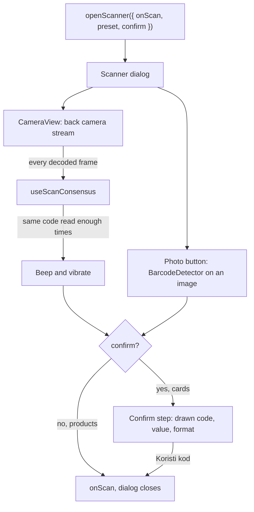

# Disscount: Barcode scanner

A reference for the camera barcode scanner: who opens it, how a frame becomes a product or a card number, the camera picking rules, the photo fallback, and the traps. Written for someone still learning the codebase.

> **Mental model in one sentence:** one app-wide dialog, opened through `useCameraScanner().openScanner(...)`, streams the back camera into `@yudiel/react-qr-scanner`, waits until the same code has been read a few times, and hands it to whoever opened it; products go straight to the product page, cards stop at a confirm step first.

Card-specific hardening (consensus counts, check digits, normalization, the confirm step) is documented in [DIGITAL-CARDS.md, section 7](DIGITAL-CARDS.md#7-scanner-hardening). This doc covers the shared machinery around it and links there instead of repeating it.

---

## Table of contents

1. [Quick reference](#1-quick-reference)
2. [How it works end to end](#2-how-it-works-end-to-end)
3. [Who opens the scanner](#3-who-opens-the-scanner)
4. [Presets: products vs cards](#4-presets-products-vs-cards)
5. [The camera](#5-the-camera)
6. [Scanning a photo instead](#6-scanning-a-photo-instead)
7. [Errors, feedback and accessibility](#7-errors-feedback-and-accessibility)
8. [What is automatic vs manual](#8-what-is-automatic-vs-manual)
9. [Key files](#9-key-files)
10. [Config, security headers and libraries](#10-config-security-headers-and-libraries)
11. [Tests](#11-tests)
12. [Gotchas and lessons learned](#12-gotchas-and-lessons-learned)
13. [Future improvements and TODOs](#13-future-improvements-and-todos)

---

## 1. Quick reference

| Thing               | Value                                                                                                     |
| ------------------- | --------------------------------------------------------------------------------------------------------- |
| Entry point         | `useCameraScanner()` from `context/scanner-context.tsx`; the provider is in `app/providers/providers.tsx` |
| Dialog              | `components/scanner/camera-scanner.tsx`, content unmounts on close so each open starts fresh              |
| Live decoding       | `@yudiel/react-qr-scanner` (`Scanner` component)                                                          |
| Photo decoding      | `barcode-detector/ponyfill` (zxing compiled to WebAssembly), loaded on first use                          |
| Product formats     | EAN-8, EAN-13, UPC-A, UPC-E                                                                               |
| Card formats        | The four above plus QR, Aztec, Codabar, Code 39, 93, 128, Data Matrix, ITF, PDF417                        |
| PWA shortcut        | The manifest's "Skeniraj" shortcut opens `/?scan=1`                                                       |
| Remembered setting  | The camera the user picked by hand (`preferredCameraId` in localStorage)                                  |
| Backend involvement | None. Scans never leave the device                                                                        |
| Copy                | `frontend/src/i18n/messages/<locale>/scanner.json`                                                        |

---

## 2. How it works end to end

1. A caller passes an `onScan` callback, a `preset` (`"product"` by default) and whether to `confirm`. The context stores the callback in a ref and opens the dialog.
2. `ScannerContent` runs a small step machine: `camera`, `manual` and `confirm`. It moves focus to the step title when the step changes, because the previous step's controls unmount and take focus with them.
3. `CameraView` renders the library's `Scanner` with `allowMultiple` and `scanDelay={0}`, so every decoded frame reaches the consensus hook, which counts repeated reads ([DIGITAL-CARDS.md](DIGITAL-CARDS.md#7-scanner-hardening) has the counts and windows).
4. When a code is stable, `ScannerCamera` plays a beep, `ScannerContent` vibrates once, and either calls `onScan` (no confirm) or shows the confirm step.
5. The context ignores an empty `rawValue`, calls the stored callback, and closes the dialog.

---

## 3. Who opens the scanner

| Caller                                                                                                       | Preset and confirm  | What happens with the code                                                                                                          |
| ------------------------------------------------------------------------------------------------------------ | ------------------- | ----------------------------------------------------------------------------------------------------------------------------------- |
| Search bar scan button (`components/custom/search/search-bar-field.tsx`, shown where `allowScanning` is set) | product, no confirm | `openResult`: `router.push(<searchRoute>/<code>)`, for products `/products/<ean>`                                                   |
| Bottom nav scan action (`components/custom/bottom-nav/bottom-nav.tsx`)                                       | product, no confirm | `useProductNavigation` to the product page                                                                                          |
| Landing hero and the scanner feature card (`app/[locale]/(root)/components/sections/`)                       | product, no confirm | Product page                                                                                                                        |
| PWA shortcut (`components/custom/pwa/scan-shortcut.tsx`)                                                     | product, no confirm | Product page. The `scan=1` flag is removed from the URL before the camera opens, so a refresh or back navigation does not reopen it |
| Card form code field (`app/[locale]/(user)/digital-cards/components/forms/code-value-field.tsx`)             | `all`, confirm      | Fills the card's code and format                                                                                                    |

A scanned EAN is not checked against the product catalogue before navigating; an unknown EAN lands on the product page's not found state ([PRODUCTS.md](PRODUCTS.md#5-the-product-page)).

---

## 4. Presets: products vs cards

The format lists live in `constants/scanner.ts` and use the `BarcodeDetector` format names, so one list feeds both the live scanner and the photo detector.

| Behaviour                     | `product`                     | `all` (cards)                                              |
| ----------------------------- | ----------------------------- | ---------------------------------------------------------- |
| Formats                       | EAN-8, EAN-13, UPC-A, UPC-E   | Everything in `ALL_SCAN_FORMATS`                           |
| Library retry delay           | 400 ms (spares the battery)   | 200 ms (cards need up to four reads inside 1.5 seconds)    |
| Confirm step                  | No                            | Yes                                                        |
| "Upiši ručno" (type it)       | Not offered                   | Offered on the confirm step and after 5 seconds of rejects |
| Normalization (UPC to EAN-13) | No, the scanned value is kept | Yes                                                        |

Manual entry is offered only when `confirm` is on (`canType={confirm}` in `ScannerContent`), so product scans have no typing fallback inside the dialog; the user types the EAN into the search bar instead.

---

## 5. The camera

**Constraints** (`camera-view.tsx`): ideal 1920 by 1080 with no minimum or maximum, frame rate ideal 24 and at most 30, and `facingMode: "environment"` unless a specific camera is chosen, in which case `deviceId: { exact }`. The comment there explains why: a hard min or max raises `OverconstrainedError` on devices with no matching mode, and capping at 720p lost detail across EAN-13 bars at arm's length.

**Picking the back camera** (`utils/browser/camera.ts`): browsers expose camera labels only after permission, and some label only the camera they granted. `pickBackCamera` scores labels (back, rear and environment up; front, selfie, ultrawide, tele, macro and depth down) and returns a device only when there are at least two cameras and the best label scores non-negative. Otherwise it returns `null` and the browser's `facingMode` decides. `useCameraDevices` re-reads the device list once the camera is playing, since labels appear only then.

**Choosing by hand** (`camera-select.tsx`): the user can pick a camera; it is saved as `preferredCameraId` (`utils/browser/storage/scanner.ts`) and wins over auto-pick on the next open. A reset button returns to auto-pick. Labels are turned into translated names ("back camera 2, ultrawide") by the same file.

**Lifecycle:**

- The `Scanner` is remounted per device (`key={deviceId}`), because the library only re-applies constraints to the live track.
- It pauses while the page is hidden (`usePageVisible`), so a background tab does not keep the camera busy.
- The torch is forced off on every new stream, since some devices remember it across streams, and on unmount. Every track is stopped and `srcObject` cleared on unmount, which releases the camera indicator.
- The library's own finder, torch, zoom and on/off controls are enabled; the overlay (`scan-overlay.tsx`) and `scanner.css` restyle the finder.

---

## 6. Scanning a photo instead

`scan-image.tsx` adds "pick an image" under the camera, for a screenshot of a loyalty card or a photo taken earlier.

1. The file is decoded with `createImageBitmap` and scaled down so its longest side is at most 2048 px.
2. `barcode-detector/ponyfill` is imported dynamically, so its WebAssembly cost is paid only when someone uses it. It is the ponyfill rather than the browser's native `BarcodeDetector`, so the result is the same on every browser.
3. Every code found is filtered to the preset's formats, normalized (cards only), checked for a valid check digit and de-duplicated. Each failure has its own toast: no code, not a product barcode, unsupported format, unreadable, or the file failed to load.
4. All surviving codes go to the same path as a camera read, so the confirm step can offer several.

The image never leaves the device ([IMAGE-UPLOADS.md](IMAGE-UPLOADS.md) lists the uploads that do).

---

## 7. Errors, feedback and accessibility

- **Errors.** `describeScannerError` maps the library's error `kind` to a `scanner.errors.*` key: permission denied, no camera, camera in use, overconstrained, insecure context (camera access needs HTTPS or localhost), or generic. The error replaces the video with a warning banner; picking another camera clears it.
- **Beep.** `scan-beep.ts` creates a Web Audio context while the opening tap is still a fresh user gesture, then plays a 120 ms, 1 kHz tone per stable code. It exists because iOS Safari ignores the library's sound option for muted video, so the library's own sound is off.
- **Vibration.** One `navigator.vibrate(80)` per stable code in `ScannerContent`; see the DIGITAL-CARDS gotcha about not adding it back to the context.
- **Screen readers.** A polite status region announces the found code, several codes, or a typed code. The step title takes focus on every step change. The dialog itself comes from the shadcn `Dialog`, which moves focus in and restores it on close.

---

## 8. What is automatic vs manual

| Task                               | Automatic or manual | Notes                                                                                         |
| ---------------------------------- | ------------------- | --------------------------------------------------------------------------------------------- |
| Choosing the back camera           | Automatic           | Label scoring, then `facingMode` as the fallback                                              |
| Remembering a hand-picked camera   | Automatic           | Per browser, in localStorage                                                                  |
| Pausing the camera in a hidden tab | Automatic           |                                                                                               |
| Releasing the camera on close      | Automatic           | Tracks stopped on unmount                                                                     |
| Granting camera permission         | Manual, by the user | The browser prompt; a denial shows the permission error                                       |
| Adding a new barcode format        | Manual code change  | `constants/scanner.ts`, plus `check-digits.ts` and the card renderer if cards should store it |

---

## 9. Key files

| Path                                                                                           | Role                                                               |
| ---------------------------------------------------------------------------------------------- | ------------------------------------------------------------------ |
| `frontend/src/context/scanner-context.tsx`                                                     | `CameraScannerProvider` and `useCameraScanner`                     |
| `frontend/src/components/scanner/camera-scanner.tsx`                                           | The dialog                                                         |
| `frontend/src/components/scanner/scanner-content.tsx`                                          | Step machine, focus, announcements, vibration                      |
| `frontend/src/components/scanner/scanner-camera.tsx`                                           | Camera step: error banner, hint, camera select, photo button, beep |
| `frontend/src/components/scanner/camera-view.tsx`                                              | The library `Scanner`, constraints, torch and track cleanup        |
| `frontend/src/components/scanner/scan-consensus.ts`, `hooks/use-scan-consensus.ts`             | Repeated-read consensus                                            |
| `frontend/src/components/scanner/scan-confirm.tsx`, `code-preview.tsx`, `code-choice-list.tsx` | The confirm step                                                   |
| `frontend/src/components/scanner/scan-manual-entry.tsx`, `manual-entry-error.ts`               | Typing a code                                                      |
| `frontend/src/components/scanner/scan-image.tsx`                                               | Photo decoding                                                     |
| `frontend/src/components/scanner/scan-beep.ts`                                                 | Web Audio beep                                                     |
| `frontend/src/components/scanner/camera-select.tsx`, `hooks/use-camera-devices.ts`             | Camera list and choice                                             |
| `frontend/src/utils/browser/camera.ts`                                                         | Back camera scoring, camera naming, error mapping                  |
| `frontend/src/utils/barcode/`                                                                  | Check digits and normalization, shared with cards                  |
| `frontend/src/constants/scanner.ts`                                                            | Formats per preset                                                 |
| `frontend/src/components/custom/pwa/scan-shortcut.tsx`                                         | The `/?scan=1` PWA shortcut                                        |

`frontend/src/lib/store-locations/dgu/gml-scanner.ts` has "scanner" in its name but is an XML stream reader for the store map ([MAP.md](MAP.md)), unrelated to barcodes.

---

## 10. Config, security headers and libraries

No environment variables or feature flags.

**Content Security Policy** (`utils/content-security-policy.ts`): `script-src` carries `'wasm-unsafe-eval'` because the barcode-detector polyfill compiles its zxing WebAssembly module in the page. Removing it breaks photo scanning, and live scanning too if the library uses the same polyfill (unverified: the library's internals were not read).

**Where the WebAssembly binary comes from** is unverified. Neither the app nor `next.config.ts` configures a location for it, and `connect-src` allows any `https:` origin, so a CDN fetch by the library would be allowed. Check the network tab on a first photo scan before relying on photo scanning offline.

| Library                    | Version in `package.json` | Locked | Used for                        |
| -------------------------- | ------------------------- | ------ | ------------------------------- |
| `@yudiel/react-qr-scanner` | `^2.6.0`                  | 2.6.0  | Live camera decoding            |
| `barcode-detector`         | `^3.2.1`                  | 3.2.3  | Photo decoding (ponyfill)       |
| `zxing-wasm`               | transitive                | 3.1.6  | The decoder inside the ponyfill |

---

## 11. Tests

`components/scanner/scan-consensus.test.ts` covers the consensus rules. The check digit and normalization helpers under `utils/barcode/` have their own tests ([DIGITAL-CARDS.md](DIGITAL-CARDS.md)). The camera, the photo path and the dialog are browser-only and have no automated test; [TESTING.md](TESTING.md) explains what is left to a real browser.

---

## 12. Gotchas and lessons learned

| Gotcha                                          | Why it bites                                                                                                 | What to do                                                                                 |
| ----------------------------------------------- | ------------------------------------------------------------------------------------------------------------ | ------------------------------------------------------------------------------------------ |
| **Camera labels are empty before permission**   | Auto-pick sees no names on the first open                                                                    | `pickBackCamera` returns `null` and `facingMode` decides; devices are re-read once playing |
| **Some browsers label only the granted camera** | Counting labelled devices made a multi-camera phone look single-camera, and Android then gave the front lens | Count all devices first; trust a label only when it scores non-negative                    |
| **Constraints are not re-applied**              | Switching cameras on a mounted `Scanner` keeps the old track                                                 | Keep `key={deviceId}`                                                                      |
| **The torch can survive between streams**       | Some devices come back with the light on, including after a tab switch                                       | Turn it off per stream, not once per mount                                                 |
| **The library drops repeated reads by default** | Consensus would never reach its count                                                                        | Keep `allowMultiple` and `scanDelay={0}`                                                   |
| **iOS ignores the library's sound**             | No feedback on iPhones                                                                                       | The Web Audio beep, created during the opening gesture                                     |
| **A stale `scan=1` reopens the camera**         | A refresh or a shared link would start the camera unasked                                                    | The shortcut strips the flag with `history.replaceState` first                             |
| **Camera needs a secure context**               | Testing over a LAN IP on plain HTTP fails with the insecure context error                                    | Use localhost or HTTPS                                                                     |

---

## 13. Future improvements and TODOs

- [ ] Verify where zxing's `.wasm` is loaded from and whether photo scanning works offline; if it is a CDN, consider self-hosting it so the CSP and privacy story stay first party.
- [ ] Offer a typed EAN fallback inside the dialog for product scans too, or document the search bar as the fallback in the copy.
- [ ] Browser coverage: there is no automated test of the camera path; a manual checklist per platform (Android Chrome, iOS Safari, desktop) would catch regressions in camera picking.
