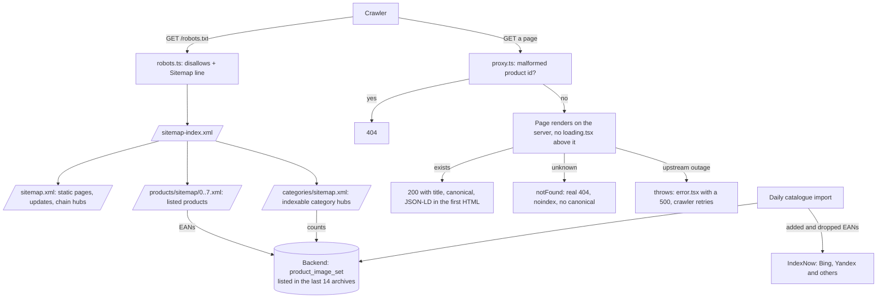

# Disscount: Crawling and Indexing (SEO)

How search engines and AI crawlers find, fetch and index Disscount: real status codes, the cached server lookups that feed crawlable pages, the product page markup, the category and chain hubs, the sitemaps, robots rules, page metadata and IndexNow. Issue #530 (SEO and AI search) is the tracking issue; issue #230 (product page SEO) started the work.

> **Mental model in one sentence:** every page a crawler should index renders its content, title and canonical in the first HTML without JavaScript, answers a real 404 or 500 when it has nothing true to show, and is listed exactly once in a sitemap that the backend's daily catalogue import keeps current.

---

## 1. Quick reference

| Thing                | Where                                                                                                             |
| -------------------- | ----------------------------------------------------------------------------------------------------------------- |
| Sitemap index        | `/sitemap-index.xml` (`frontend/src/app/sitemap-index.xml/route.ts`), the one URL to give Search Console and Bing |
| robots.txt           | `frontend/src/app/robots.ts`                                                                                      |
| Catalogue import     | `backend/.../productimage/catalog/` and `productimage/jobs/ProductImageJobs.java`                                 |
| Category rules       | `backend/src/main/resources/catalog/taxonomy.yaml`                                                                |
| IndexNow key file    | `/<INDEXNOW_KEY>.txt`, rewritten to `frontend/src/app/indexnow-key/[key]/route.ts`                                |
| Crawler check script | `frontend/scripts/seo-check.sh <base-url>`                                                                        |
| Indexable origin     | only `https://disscount.me`; every other origin (dev, local) is `noindex` everywhere                              |
| Product page details | [PRODUCTS.md §5 and §6](PRODUCTS.md#5-the-product-page)                                                           |

**Daily workflow:** nothing to do. The catalogue import runs by itself, the sitemaps and hubs follow it, and IndexNow tells Bing about new and gone products. Search Console and Bing Webmaster Tools are checked by hand (see [§13](#13-what-is-automatic-vs-manual)).

---

## 2. How a crawler sees the site



Each status code is chosen on purpose:

- **200** only when the page has real content. Crawlers index what they get.
- **404** for anything that does not exist. A 200 page that says "not found" is a soft 404, which Google reports as an error and keeps crawling.
- **500** when an upstream source is down. Google treats a 5xx as temporary and comes back, while a 200 shell or a `noindex` could drop a real product from the index.

---

## 3. Real 404s and the missing `loading.tsx`

A `loading.tsx` file wraps its segment in a Suspense boundary, so Next starts streaming the spinner at once. The Next docs say "Starting the stream sends the response headers and fixes the status code", so once a spinner has streamed, a later `notFound()` can only add a `noindex` tag to a page that already answered 200. Next maintainers closed vercel/next.js #93253 and #45801 as expected behaviour.

Before #530 the only loading file was `app/[locale]/loading.tsx`, above every page. Every unknown product, unknown route and bad suggestion id answered 200. It also pushed the page content out of `<main>` and moved `<title>` and the canonical deep into the body for crawlers.

Now there is no loading file on `[locale]`. The spinner lives in `app/[locale]/components/page-loading.tsx`, and each segment that wants it re-exports it from its own `loading.tsx` (the home page, the user pages, `/map`, `/statistics`, the legal pages, `/offline`, `/dashboard`). The list pages moved into route groups, `products/(browse)`, `suggestions/(browse)` and `updates/(browse)`, so they keep their spinner while their `[id]` siblings sit outside it.

These pages call `notFound()` and have no loading file anywhere above them:

| Page                               | 404 when                                                   |
| ---------------------------------- | ---------------------------------------------------------- |
| `products/[id]`                    | upstream answers 404 for the EAN                           |
| `categories/[slug]`                | unknown slug, a malformed `?page=`, or a page past the end |
| `chains/[slug]`                    | a chain code with no name and logo in `storeNamesMap`      |
| `suggestions/[id]`, `updates/[id]` | unknown id                                                 |
| `[...rest]`                        | any other unknown path                                     |

`app/[locale]/loading-boundaries.test.ts` walks from `[locale]` down to each of these pages and fails if it finds a `loading.tsx` on the way. Add a page that can 404 to its `NOT_FOUND_PAGES` list.

Malformed product ids never reach the page: `proxy.ts` answers an id that is neither 8 or more digits nor a cijene `chain:code` key with a 404 before rendering.

---

## 4. Cached server lookups

Crawlers fetch many pages, and the price API (cijene) is one shared token with a quota the hosted service enforces and does not publish. So every server lookup a crawlable page makes is cached.

| Lookup                             | File                                          | Cache                                                     | On failure                                         |
| ---------------------------------- | --------------------------------------------- | --------------------------------------------------------- | -------------------------------------------------- |
| Product (`/v1/products/<ean>`)     | `lib/cijene-api/server/get-product.ts`        | `unstable_cache`, 1 hour                                  | `missing` on a 404, `unavailable` on anything else |
| Product prices (`/v1/prices`)      | `lib/cijene-api/server/get-product-prices.ts` | `unstable_cache`, 1 hour, 5 second timeout                | `null`; the browser fetches prices itself          |
| Chain stats (`/v1/chain-stats/`)   | `lib/cijene-api/server/get-chain-stats.ts`    | `unstable_cache`, 1 hour, one call serves every chain hub | `null`                                             |
| Categories and counts (backend)    | `lib/api/catalog-categories/server.ts`        | `fetch` revalidate 10 minutes, 10 second timeout          | throws, so the page answers 500                    |
| Category products (backend)        | same file                                     | `fetch` revalidate 1 hour                                 | throws, or `null` for an unknown slug              |
| A product's category (backend)     | same file                                     | `fetch` revalidate 1 hour, 2.5 second timeout             | `null`; the breadcrumb leaves the category out     |
| Listed EANs for sitemaps (backend) | `lib/api/product-images/server.ts`            | `fetch` revalidate 1 hour, 15 second timeout              | throws, so the sitemap answers 500                 |

The rules behind the table:

- **An outage is never cached.** The cached function throws on a 404, an outage or a bad response shape, and `unstable_cache` stores only values that resolve. A one minute blip therefore cannot hide a product for an hour. The wrapper around it turns the error into a result.
- **A miss is remembered, briefly.** A product upstream does not know is kept in an in-memory set for 10 minutes (`createExpiringKeySet` in `lib/expiring-key-set.ts`, at most 10,000 keys per server process, oldest dropped first), so a crawler walking made-up EANs costs one upstream call per EAN per 10 minutes. The product's category lookup keeps its 404s the same way. A miss is trusted for minutes, not the hour a find gets, because upstream may add the product soon.
- **`fetchedAt` travels with the value.** The data cache serves a stale copy while it refreshes, so each cached product and price carries when upstream actually answered, and the "refreshed" label on the page shows that time.
- **React `cache()` around each lookup** means `generateMetadata` and the page share one call per request.
- `SERVER_LOOKUP_REVALIDATE_SECONDS` (3600) in `server-lookup-cache.ts` is the one TTL for upstream lookups; prices change about once a day.

---

## 5. The product page

The full page flow is in [PRODUCTS.md §5](PRODUCTS.md#5-the-product-page) and its metadata and JSON-LD in [PRODUCTS.md §6](PRODUCTS.md#6-seo-metadata-json-ld-and-sitemaps). The crawl relevant parts:

- **Everything is awaited, nothing streamed.** The product, its prices, the confirmed photo and its category load before the HTML is sent, so a crawler without JavaScript finds the name, photo and prices inside `<main>`.
- **`<h1>`.** `ProductInfoDisplay` renders the product name as an `<h1>` on the product page and as an `<h3>` in the product modal, which sits under another page's heading. The look is the same.
- **Breadcrumbs.** Početna › Proizvodi › category hub (when the product has one) › product. `PageBreadcrumbs` (`components/custom/common/page-breadcrumbs.tsx`) renders the visible trail and a `BreadcrumbList` JSON-LD from one list of steps, so the two never disagree. The category comes from the backend (`GET /api/products/{ean}/category`).
- **Server photo.** A confirmed main photo is loaded on the server and seeded into the gallery's query, so the first HTML has the `` with its alt text, width and height ([PRODUCT-IMAGES.md](PRODUCT-IMAGES.md#7-how-photos-reach-the-page)).
- **Offers.** The `Product` JSON-LD has one `AggregateOffer` (lowest and highest chain price, EUR) with one `Offer` per chain inside it, each with its lowest price and the chain as `seller`. Google documents `AggregateOffer` for sites that compare prices; the nested offers are valid schema.org that Bing lists in its product guidance. No `availability`, `priceValidUntil` or ratings, because the page states none of them.
- **Freshness.** `dateModified` is the newest `price_date` of any chain, and the page shows the same day as "Cijene objavljene …" under the chain table (`prices-published-on.tsx`). It is the day the chains published the prices; the separate "refreshed" label shows when we last fetched them.
- **Similar products.** Up to 8 links to other products in the same category, server rendered (`similar-products.tsx`). They come from page 1 of the category listing on the backend, names and brands only, so they spend no upstream quota.
- **Price API outage.** The page throws and `error.tsx` answers 500 (see [§2](#2-how-a-crawler-sees-the-site)).

---

## 6. Category hubs

Upstream has no category taxonomy. Its per-chain category text is free form, missing for several big chains (Konzum, Plodine, Lidl, dm), and most chains use the same six or seven coarse groups. So the backend sorts products itself.

**Taxonomy.** `backend/src/main/resources/catalog/taxonomy.yaml` defines 6 departments and 33 everyday categories:

- **Departments** follow the six groups of the price display rules (Pravilnik o isticanju bazne cijene), which most chains already file products under. Each lists the chain category spellings that mean it.
- **Categories** are tried top to bottom, first match wins, so narrow ones come first. Each has `include` name terms, `exclude` terms, an optional list of finer chain groups (Roto, Žabac) that mean only this category, and the department it belongs to.
- **10 are indexable:** mlijeko, jaja, kruh, kava, ulje, sir, jogurt, pivo, deterdzent-za-rublje, pelene (owner decision 2026-11-23: "All 33, index 10"). The other 23 hub pages exist and link onward, but carry `noindex, follow` and stay out of the sitemap until their rules are reviewed.

`ProductClassifier` places each product at import time from its names and chain categories across every chain that lists it, and `CatalogStore` stores `department`, `category` and the rule file's hash (`taxonomy_version`) on `product_image_set` (migration `V12`). An edited rule file changes the hash, so the next import replaces every stored place instead of only filling gaps.

**Order.** A hub lists products by `chain_count + list_uses`, then by store listings. `list_uses` counts the people keeping the EAN on a shopping list or watchlist, refreshed at each import, so a hub leads with what people actually buy. The index `idx_product_image_set_category_rank` matches this order, so a page is an index range.

**Backend API** (public, `Cache-Control: max-age=3600`):

| Endpoint                                       | Returns                                                                                                           |
| ---------------------------------------------- | ----------------------------------------------------------------------------------------------------------------- |
| `GET /api/products/categories`                 | every department and category in rule file order, with `indexable` and listed product counts, empty ones included |
| `GET /api/products/categories/{slug}/products` | one page of listed products (`ean`, `name`, `brand`), 24 by default; 404 for an unknown slug                      |
| `GET /api/products/{ean}/category`             | the product's department and category; 404 when the product is not in the catalogue                               |

**Pages.** `/categories` groups the hubs by department with their product counts. `/categories/<slug>` (`app/[locale]/categories/[slug]/page.tsx`) has breadcrumbs, an `<h1>`, a short intro, a list of 24 products and pagination.

- **Upstream calls on page 1 only.** Page 1 looks up live prices for its 24 products through the cached product lookup, 6 at a time with a 3 second deadline (`live-priced-products.ts`). Products still waiting at the deadline show without a price. If nothing was found and a lookup failed or the deadline passed, the page answers 500 instead of an unpriced 200. Later pages show names and links only.
- **Intro facts** come only from those live prices (`category-price-facts.ts`): how many chains price the shown products, the range of per-product average prices (owner decision 2026-11-23), and the chain that is cheapest most often, out of how many priced products.
- **Pagination** uses plain `?page=N` links with `rel="prev"` and `rel="next"`. Each page has a self canonical (page 2 points at `?page=2`, not at page 1) and a title with the page number. A `page` that is not a plain positive number is a 404. A page far past the known count is a 404 before any backend call (`pageGuard` allows 10% slack, at least 2 pages, because counts can lag the listing for up to 10 minutes after an import); the backend's own total decides the rest. Page 1 always exists.
- **Empty hubs.** A category with no listed products still answers 200 on page 1 with an "empty" line, so a hub never flips to 404 between imports. It is `noindex` and out of the sitemap while empty (`isHubIndexable`).
- **Croatian only.** Translated hubs are `noindex, follow` and carry no hreflang, as with product pages: Google ignores a hreflang set whose other members are noindex.
- **Links in.** The sidebar ("Kategorije"), the `/products` landing and the product breadcrumbs.

---

## 7. Chain hubs

`/chains` lists every chain we have a name and logo for (`MAPPED_CHAIN_CODES` from `storeNamesMap`), and `/chains/<code>` (`app/[locale]/chains/[slug]/page.tsx`) shows one chain: logo, `<h1>`, an intro with its store count, top cities and upstream price facts from `/v1/chain-stats/`, a link to the map filtered to the chain (`/map?chain=<code>`), and its cities by store count.

- Store counts come from our own store directory (`getStoreDirectory`), counting only the stores the map shows (`chainStores`), so a hub never counts a placeholder the map leaves out.
- An unknown or unmapped code is a 404, decided before any lookup.
- A chain with no stores and no upstream prices is `noindex` and left out of the sitemap (`hasChainContent`). When chain stats are unavailable the hub stays indexable, because the store facts come from our own data.
- Croatian only, like the category hubs. The `/chains` pages are the crawlable store directory; the map itself is a client page.
- Linked from the sidebar ("Trgovački lanci").

---

## 8. The `/products` landing

`/products` is a client search page. Below it, `products/(browse)/layout.tsx` renders `ProductsLandingLinks` on the server, outside the segment's `loading.tsx`, so its text and links sit in `<main>` of the first HTML: one intro sentence with the product and category counts, a link to each indexable hub, and the 2 most popular named products of each hub. The lookups use the 2.5 second optional timeout, one slow hub costs only its own links, and a backend outage leaves the section out so the search still renders.

---

## 9. Sitemaps

`robots.txt` names one file, `/sitemap-index.xml`, a hand-written route because Next writes no index for `generateSitemaps`. It lists:

| File                                 | Contents                                                                                                                                                               |
| ------------------------------------ | ---------------------------------------------------------------------------------------------------------------------------------------------------------------------- |
| `/sitemap.xml` (`app/sitemap.ts`)    | `/`, `/products`, `/updates`, `/suggestions`, `/map` with hreflang alternates; update posts; the legal pages, `/chains` and the chain hubs with content, Croatian only |
| `/categories/sitemap.xml`            | `/categories` and page 1 of each indexable, non-empty category hub, Croatian only                                                                                      |
| `/products/sitemap/0.xml` to `7.xml` | every listed product, Croatian only, split by a stable hash of the EAN so a product stays in the same file                                                             |

- **No `priority` or `changefreq`.** Google ignores both.
- **`lastmod` only where it is true.** Update posts carry their publish date. Products and hubs carry none: the catalogue has no honest per-product change date, and Google uses `lastmod` only when it is "consistently and verifiably accurate".
- **Per request, never at build.** Each sitemap calls `connection()`, because the backend and upstream are not reachable while the Docker image builds.
- **500, never empty.** A failed EAN or category fetch throws, so crawlers retry instead of reading an empty list. The chain part falls back to every mapped chain when the store directory fails.
- `/statistics` stays out until its server HTML has more than a heading.
- Eight product files leave room for 400,000 URLs under Google's 50,000 per file.

---

## 10. robots.txt and indexability

`app/robots.ts` allows everything except the protected routes (watchlist, digital cards, spending, dashboard), `/reset-password`, `/offline` and `/api/`, each repeated for every locale prefix. Shopping lists are left crawlable on purpose: a disallowed URL is never fetched, so its `X-Robots-Tag: noindex, nofollow` header from `next.config.ts` would never be seen.

On any origin other than `https://disscount.me` (`isIndexableOrigin`), `next.config.ts` sends `X-Robots-Tag: noindex, nofollow` on every response and the layout adds a `noindex` meta, so dev and preview deployments never get indexed.

| Route                                                | Croatian                            | Other languages     | In sitemap          |
| ---------------------------------------------------- | ----------------------------------- | ------------------- | ------------------- |
| `/`, `/products`, `/updates`, `/suggestions`, `/map` | index                               | index, hreflang set | yes                 |
| `/updates/<id>`                                      | index                               | index, hreflang set | yes, with `lastmod` |
| `/suggestions/<id>`                                  | index                               | index, hreflang set | no                  |
| `/products/<ean>`                                    | index                               | noindex, follow     | yes                 |
| `/categories`                                        | index                               | noindex, follow     | yes                 |
| `/categories/<slug>`, indexable and non-empty        | index, page 2+ too                  | noindex, follow     | page 1              |
| `/categories/<slug>`, other                          | noindex, follow                     | noindex, follow     | no                  |
| `/chains`, `/chains/<code>` with content             | index                               | noindex, follow     | yes                 |
| Legal pages                                          | index                               | index, no hreflang  | Croatian only       |
| `/statistics`                                        | index                               | index               | no                  |
| `/offline`                                           | noindex, no canonical               | same                | no, and disallowed  |
| User pages, `/reset-password`                        | disallowed in robots.txt            | same                | no                  |
| `/shopping-lists/...`                                | `X-Robots-Tag: noindex, nofollow`   | same                | no                  |
| Any 404 or error page                                | one noindex from Next, no canonical | same                | no                  |

---

## 11. Metadata rules

- **One robots tag.** The layout sets `robots` only on a non-production origin. Next adds its own `noindex` to 404 and error pages, so a layout robots tag there would make a second one. `not-found.tsx` sets `robots: null`.
- **No canonical where there is no page.** `not-found.tsx` and `offline/page.tsx` set `alternates: null`, because the layout's self canonical would point at the missing URL, at `/_not-found`, or at whatever URL the service worker served the offline page for. The product outage branch sets `canonical: null` for the same reason.
- **Own share preview per page.** A child page's title never reaches the layout's `openGraph`, and a page-level `openGraph` drops the parent's image. `withSharePreview` (`utils/share-metadata.ts`) builds `og:title`, `og:url`, `og:description` and the Twitter card from the page's own title, description and canonical and passes the layout's image through. Every static page and hub uses it; product pages use `productMetadata` with their own 1200x630 photo card. Before this, every page without its own `openGraph` shared the home page's title.
- **`WebSite` JSON-LD** on the home page has `alternateName: "disscount.me"`, the domain as people type it. "Discount" is left out on purpose: it is a different, common word.
- The `keywords` meta is gone; Google ignores it.
- All JSON-LD goes through `JsonLdScript` (`components/custom/common/json-ld-script.tsx`), which escapes `<` so a product name cannot close the script tag.

---

## 12. IndexNow and the catalogue import

### The import window

The upstream archive for one day holds only the chains that published that day (20 to 28 of 29), and the count swung between 253,000 and 358,000 EANs across 2026-11-20 to 2026-11-22. Reading only the newest archive made products drop out of the sitemap and come back. So:

- **Daily.** `ProductImageJobs.importCatalogue` checks every hour (first check 10 minutes after startup) and imports an archive date once; `product_image_import_run.archive_date` (kind `weekly-import`, an old name kept so the existing row is reused) holds the last date imported. After downtime only the newest date is read.
- **14 archive dates.** `product_image_set.last_seen_on` is the last archive that priced the EAN, and a product counts as listed while it falls within the 14 dates ending at the newest archive (`CatalogListing`, migration `V11`). The window counts back from the newest archive, not from today, so an upstream outage cannot empty the sitemap.
- **Per-chain window.** `product_chain_listing` keeps each chain's last price per EAN, so chain and store counts cover the whole window and do not jump with which chains published today.
- **Failed-date backoff.** A date whose import failed is not downloaded again for 6 hours (`RETRY_FAILED_AFTER`); a newer date is tried at once.

### IndexNow

[IndexNow](https://www.indexnow.org/) tells Bing, Yandex and the other participating engines about changed URLs. Google does not take part.

1. After each import, `CatalogStore` compares the listed EANs before and after and returns the newly listed and the dropped ones.
2. Once the run is recorded, `CatalogImportService.announce` sends both to `IndexNowClient`. Dropped products are included: they now answer 404, and IndexNow asks for those too.
3. The client POSTs to `https://api.indexnow.org/indexnow` in batches of up to 10,000 URLs (`https://<INDEXNOW_HOST>/products/<ean>`), with the key and its file location.
4. A 429 or 5xx is retried once after `Retry-After` (or 1 minute); a 403 or 422 (bad key) stops the run. The whole run stops after 15 minutes. It never throws: a missed ping only means the engines find the change at their next sitemap read.

The engines verify the key by fetching `https://<host>/<key>.txt`. A rewrite in `next.config.ts` sends any `/<8 to 128 letters, digits or dashes>.txt` to `app/indexnow-key/[key]/route.ts`, which answers the key as plain text when it matches `INDEXNOW_KEY` and 404 otherwise.

---

## 13. What is automatic vs manual

| Task                                                       | Automatic? | Who and where                                                |
| ---------------------------------------------------------- | ---------- | ------------------------------------------------------------ |
| Catalogue import, categories, listing window               | Auto       | backend job, daily                                           |
| Sitemaps and hubs following the catalogue                  | Auto       | per request, cached up to 1 hour                             |
| IndexNow pings for new and dropped products                | Auto       | backend, after each import, when both env vars are set       |
| Search Console Domain property and sitemap submission      | Manual     | owner, once: submit `https://disscount.me/sitemap-index.xml` |
| Bing Webmaster Tools (import from Search Console)          | Manual     | owner, once                                                  |
| Checking status codes and head tags after a release        | Manual     | `scripts/seo-check.sh https://disscount.me`                  |
| Reviewing coverage and queries 60 to 90 days after release | Manual     | owner, Search Console and Bing                               |
| Making another category indexable                          | Manual     | review its rules, set `indexable: true` in `taxonomy.yaml`   |

---

## 14. Checking it: `seo-check.sh`

`frontend/scripts/seo-check.sh` fetches pages the way a crawler does and checks status codes and `<head>` tags: robots.txt names the index, every sitemap in the index answers 200, the first product and the first hub are indexable (200, one `<title>`, one canonical, at most one robots tag, no `noindex`), an unknown EAN, an unknown route and an unknown update are 404 with one `noindex` and no canonical, a hub past its last page is 404, a hub outside the sitemap is `noindex`, and the Konzum chain hub is indexable.

It sends a Googlebot user agent, because Next streams metadata into the body for browsers and keeps it in `<head>` only for known bots.

Run it against a production build with the backend and the upstream token available:

```bash
cd frontend
pnpm build
pnpm start -p 3311
# in a second shell
scripts/seo-check.sh http://localhost:3311
```

On a non-production origin every page carries `noindex`, so the "indexable" checks fail locally by design; the status code, canonical and 404 checks still mean what they say. Against production run `scripts/seo-check.sh https://disscount.me`. It exits non-zero when a check fails.

---

## 15. Config and env vars

| Variable              | Where                             | What                                                                                                     |
| --------------------- | --------------------------------- | -------------------------------------------------------------------------------------------------------- |
| `INDEXNOW_KEY`        | backend and frontend (same value) | the IndexNow key; the backend sends it, the frontend serves it as `/<key>.txt`; blank turns IndexNow off |
| `INDEXNOW_HOST`       | backend                           | the bare site name, for example `disscount.me`; blank turns IndexNow off                                 |
| `NEXT_PUBLIC_APP_URL` | frontend build arg                | the origin; only `https://disscount.me` is indexable                                                     |

Both IndexNow variables are passed through the Compose files and listed in `.env.example`, `backend/.env.example` and `frontend/.env.local.example`. Local and test runs leave them blank, so they never ping a search engine.

---

## 16. Gotchas and lessons learned

| Gotcha                                        | What happens / fix                                                                                                                                                          |
| --------------------------------------------- | --------------------------------------------------------------------------------------------------------------------------------------------------------------------------- |
| **A `loading.tsx` above a page that can 404** | The spinner streams a 200 first and `notFound()` can only add `noindex`. Keep loading files per segment; `loading-boundaries.test.ts` fails when one lands above a 404 page |
| **Caching an outage**                         | A cached failure would hide a real product for an hour. The cached function throws and the wrapper outside it turns the error into a result                                 |
| **Treating an outage as a 404**               | Real products would answer 404 during an upstream blip. `missing` and `unavailable` stay apart, and an outage answers 500                                                   |
| **An empty sitemap**                          | A sitemap that answers 200 with no URLs tells crawlers the pages are gone. Every sitemap fetch throws on failure instead                                                    |
| **`lastmod` that is not true**                | Google stops trusting a site's `lastmod` when it is wrong. Only update posts carry one                                                                                      |
| **Metadata in the body for browsers**         | Next streams `<title>` and the canonical into the body for normal browsers and keeps them in `<head>` only for known bots, so check head tags with a bot user agent         |
| **A translated page in a hreflang set**       | Google ignores a hreflang set whose other members are `noindex`, so product and hub pages carry none                                                                        |
| **Disallowing a page to hide it**             | A disallowed URL is never fetched, so its `noindex` is never read and the bare URL can still be indexed from links. Shopping lists stay crawlable with a `noindex` header   |
| **One archive is not the catalogue**          | A day's archive misses whole chains. Listing needs the 14-date window, or products flap in and out of the sitemap                                                           |
| **Hub counts lag the listing**                | Category counts refresh every 10 minutes and listings hourly, so `pageGuard` allows slack and the backend's own total decides the last page                                 |

Tests cover the loading boundaries, robots, the sitemap index and each sitemap, the cached lookups and their outage branches, metadata per route type and the JSON-LD shape. Whether Google actually indexes and shows a page is only visible in Search Console.

---

## 17. Future improvements and TODOs

- [ ] #530: brand hubs, once brands are normalized (15,116 raw spellings today, with importers listed as brands).
- [ ] #530: mobile LCP work, once Search Console has field data to say which pages need it.
- [ ] #530: review Search Console and Bing coverage, queries and the rich result report 60 to 90 days after the release, then decide which of the other 23 categories to index.
- [ ] Owner: Search Console Domain property and Bing Webmaster Tools import, then submit `sitemap-index.xml` in both.
- [ ] #531: an About and methodology page.
- [ ] `/statistics` back in the sitemap once its server HTML has content.
