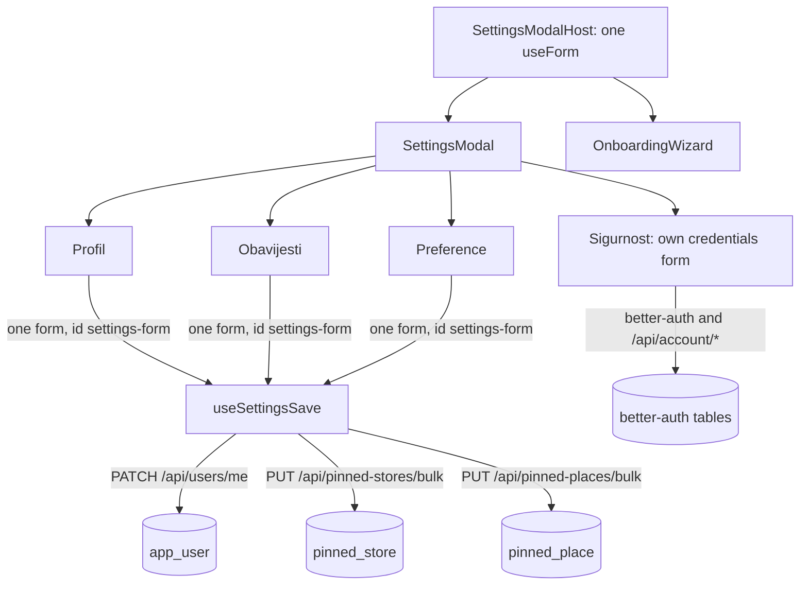
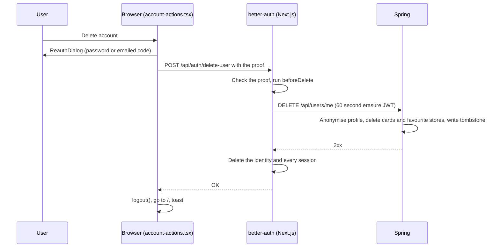

# Disscount: Settings and account (Postavke)

A reference for the settings modal ("Postavke"): its four tabs, how one form saves to three backends, what each tab stores, and the account actions on Sigurnost (sessions, deleting the account). Written for someone still learning the codebase.

> **Mental model in one sentence:** Postavke is a URL modal (`?modal=settings&tab=...`) backed by one react-hook-form instance that stays mounted for the whole signed-in session; Profil, Obavijesti and Preference share that form and save in up to three parallel requests, while Sigurnost runs its own immediate actions through better-auth.

Most of the security machinery already has a home in [AUTH.md](AUTH.md): re-authentication, active sign-ins and security emails in [section 8.4](AUTH.md#84-re-authentication-active-sign-ins-and-security-emails), mandatory onboarding in [section 8.2](AUTH.md#82-mandatory-onboarding-after-sign-in), and the account deletion flow in [section 13](AUTH.md#13-gotchas-and-lessons). This doc covers the settings surface and links there for the details.

---

## Table of contents

1. [Quick reference](#1-quick-reference)
2. [How the modal works](#2-how-the-modal-works)
3. [Profil](#3-profil)
4. [Obavijesti](#4-obavijesti)
5. [Preference: pinned stores, places and language](#5-preference-pinned-stores-places-and-language)
6. [Saving](#6-saving)
7. [Sigurnost](#7-sigurnost)
8. [Deleting the account](#8-deleting-the-account)
9. [What is automatic vs manual](#9-what-is-automatic-vs-manual)
10. [Key files](#10-key-files)
11. [Config, env vars and libraries](#11-config-env-vars-and-libraries)
12. [Tests](#12-tests)
13. [Gotchas and lessons learned](#13-gotchas-and-lessons-learned)
14. [Future improvements and TODOs](#14-future-improvements-and-todos)

---

## 1. Quick reference

| Thing            | Value                                                                                                                                                                                                       |
| ---------------- | ----------------------------------------------------------------------------------------------------------------------------------------------------------------------------------------------------------- |
| URL              | `?modal=settings&tab=profil\|obavijesti\|preference\|sigurnost` (tab ids are Croatian in every locale)                                                                                                      |
| Opened from      | The user menu (`openModalUrl({ name: "settings", tab })`), a long press on a bottom nav item (Preference, see [MOBILE-NAV.md](MOBILE-NAV.md)), and the "notify me" button on coming-soon pages (Obavijesti) |
| Host             | `SettingsModalHost`, mounted for signed-in users, also hosts the onboarding wizard                                                                                                                          |
| Profile API      | `GET` and `PATCH /api/users/me` (Spring)                                                                                                                                                                    |
| Preferences API  | `GET /api/pinned-stores/me`, `PUT /api/pinned-stores/bulk`, `GET /api/pinned-places/me`, `PUT /api/pinned-places/bulk`                                                                                      |
| Language         | better-auth `updateUser({ locale })`, not Spring                                                                                                                                                            |
| Sessions API     | `GET /api/account/sessions`, `DELETE /api/account/sessions/[id]` (Next.js routes)                                                                                                                           |
| Account deletion | better-auth `POST /api/auth/delete-user`, which calls Spring `DELETE /api/users/me` from the server                                                                                                         |
| Draft            | Unsaved edits survive a reload as the `settings` form draft ([STATE-PERSISTENCE.md](STATE-PERSISTENCE.md))                                                                                                  |
| Copy             | `frontend/src/i18n/messages/<locale>/settings.json`                                                                                                                                                         |

---

## 2. How the modal works

- **The form outlives the dialog.** `SettingsModalHost` (`components/custom/settings/settings-modal-host.tsx`) owns the form and stays mounted while the user is signed in. Closing the dialog does not lose state, so a save can close the modal immediately and still report a failure by reopening it with the errors in place.
- **Defaults come from the user context.** `useSettingsDefaults` builds the baseline from the loaded profile; pinned stores and places come from the user context, falling back to their own queries. The form resets to that baseline once, when it is first ready.
- **Tabs are URL state.** Changing tab swaps the URL (`swapModalUrl`), so back and forward and a shared link work. A horizontal swipe steps one tab, clamped at both ends. `useLastSettingsTarget` remembers the last tab while the dialog animates closed.
- **One footer, two forms.** The Save and Reset buttons drive `settings-form` on the first three tabs and the Sigurnost credentials form on the fourth, through each form's `id`.
- **Dirty markers.** `dirtySections` compares the values with the baseline per section (`SECTION_FIELDS` in `settings-schema.ts`), and each dirty tab gets a small dot with an accessible "unsaved changes" name.
- **Replay the guide.** The modal caption reopens the onboarding wizard in replay mode (`?modal=onboarding&mode=replay`), which shares this form ([AUTH.md](AUTH.md#82-mandatory-onboarding-after-sign-in)).

---

## 3. Profil

| Field                 | Stored where                           | Rules                                                                                                                                |
| --------------------- | -------------------------------------- | ------------------------------------------------------------------------------------------------------------------------------------ |
| Avatar                | `app_user.image`, as a base64 data URL | Resized and stripped in the browser, checked again on the server; up to 400 000 characters. See [IMAGE-UPLOADS.md](IMAGE-UPLOADS.md) |
| Username              | `app_user.username`, unique            | 2 to 40 characters on both sides. A taken name answers 409 `error.user.usernameTaken` with a field error                             |
| "How did you find us" | `app_user.acquisition_channel`         | One `AcquisitionChannel` value; optional                                                                                             |

The avatar is user-owned after the profile is created: `ensureActiveProfile` never copies the sign-in provider's picture again, so a cleared avatar stays cleared. Sending `image: ""` clears it, and leaving `image` out keeps it.

---

## 4. Obavijesti

Four switches, each stored on `app_user` as a timestamp of when it was turned on (`notifications_push_enabled_at`, `notifications_email_enabled_at`, `newsletter_enabled_at`, `feedback_contact_enabled_at`). The PATCH sends booleans; `UserService.applyToggle` keeps the original time when a switch that is already on is sent as on again, and clears it when sent as off.

| Switch             | State in the UI          | New profile default |
| ------------------ | ------------------------ | ------------------- |
| Push notifications | Disabled, "USKORO" badge | On                  |
| Email alerts       | Disabled, "USKORO" badge | On                  |
| Newsletter         | Disabled, "USKORO" badge | Off                 |
| Feedback contact   | Usable                   | On                  |

Nothing reads the push, email or newsletter values yet: no price alert is sent by push or email ([WATCHLIST.md](WATCHLIST.md)), and no newsletter exists. See the consent gotcha in [Section 13](#13-gotchas-and-lessons-learned).

---

## 5. Preference: pinned stores, places and language

- **Pinned stores** (`components/pinned-stores-grid.tsx`): the chains the user shops at. They are stored as chain codes (`storeApiId`) in `pinned_store` through `PUT /api/pinned-stores/bulk`, which replaces the whole set. Pinned stores scope the watchlist's discount maths ([WATCHLIST.md](WATCHLIST.md#5-when-a-rule-fires)), the product page's default chains ([PRODUCTS.md](PRODUCTS.md)) and the shopping list's store grouping ([SHOPPING-LISTS.md](SHOPPING-LISTS.md)).
- **Pinned places** (`components/pinned-places-select.tsx`): towns the user cares about, stored in `pinned_place` through `PUT /api/pinned-places/bulk`. The place name doubles as its API id.
- **Language** (`components/language-select.tsx`): shown in the modal only (`showLanguage`), not in onboarding. It applies at once, not on Save: `useChangeLocale` replaces the route under the new locale and saves the account language through better-auth's `updateUser({ locale })`, queued in `components/custom/locale/account-locale-save.ts` so saves land in order and never on an account that signed in after the save was queued. The account language picks the language of emails. Details in [I18N.md](I18N.md).

Favourite stores (`/api/favorite-stores`) are a different thing, set on the map, and are not part of this tab ([MAP.md](MAP.md)).

---

## 6. Saving

`useSettingsSave` (`hooks/use-settings-save.ts`) turns one Save press into separate jobs, built in `settings-save-jobs.ts`:

| Job      | Runs when                                               | Request                                            |
| -------- | ------------------------------------------------------- | -------------------------------------------------- |
| `user`   | Profil or Obavijesti changed, or the avatar was touched | `PATCH /api/users/me` with only the changed fields |
| `stores` | Pinned stores changed                                   | `PUT /api/pinned-stores/bulk`                      |
| `places` | Pinned places changed                                   | `PUT /api/pinned-places/bulk`                      |

1. The modal closes at once (optimistic close). With nothing dirty, that is the whole save.
2. Offline, a toast warns first. None of these mutations is on the offline mutation allowlist (`lib/offline/offline-mutation-keys.ts`), so they are not queued for replay; what the user sees after that was not checked in a browser (unverified).
3. The jobs run in parallel with `Promise.allSettled`, so one failure does not undo the others.
4. **All succeed:** the draft is cleared, the form takes the saved values as its new baseline, and a toast confirms.
5. **Some fail:** `settings-save-recovery.ts` re-baselines only the sections that saved, reopens the modal on the first failed tab, and puts the server's problem response on the form (field errors where it has them, otherwise a per-job message).
6. The profile response carries no pinned stores or places, so `saveUser` merges it into the user context instead of replacing it; otherwise it would wipe the pins the parallel jobs just saved.

Onboarding uses the same jobs, with one difference: it always runs the `user` job, to stamp `onboardingOutcome: "completed"` in the same PATCH as the profile fields, so a second PATCH can never land after the pins and undo them.

---

## 7. Sigurnost

The fourth tab (`tabs/security-tab.tsx`) is not part of the settings form. Its state lives in `useSecuritySettings`, loaded only while that tab is open, and is shared through `SecurityProvider`.

| Section           | Component                                   | What it does                                                                                                                                                              |
| ----------------- | ------------------------------------------- | ------------------------------------------------------------------------------------------------------------------------------------------------------------------------- |
| Credentials       | `security/components/credentials-form.tsx`  | Change the email, change the password, or set a first password on a social-only account. The email is locked for social-only accounts and for accounts without a password |
| Linked accounts   | `security/components/linked-accounts.tsx`   | Link or unlink Google (and Facebook when enabled); unlinking asks for a fresh proof                                                                                       |
| Password recovery | `security/components/password-recovery.tsx` | The "check your inbox" notice after a reset email was requested from this tab (`use-password-recovery.ts`, better-auth `requestPasswordReset`)                            |
| Active sign-ins   | `security/sessions/active-sessions.tsx`     | Lists devices by country and browser, signs one out, or signs out all others                                                                                              |
| Delete account    | `security/components/account-actions.tsx`   | See [Section 8](#8-deleting-the-account)                                                                                                                                  |

Sensitive actions ask for a fresh proof (current password or an emailed code) through `ReauthDialog` and `useReauth`. The rules for which action needs what, the session list's data and its limits are in [AUTH.md section 8.4](AUTH.md#84-re-authentication-active-sign-ins-and-security-emails); hourly session cleanup is in [section 8.5](AUTH.md#85-session-retention-and-the-stored-address).

---

## 8. Deleting the account

- The button stays disabled until the sign-in methods have loaded, because they decide whether the proof is a password or a code.
- The dialog always asks for a proof, even inside the 15 minute fresh window, because the proof travels inside the delete request.
- If Spring refuses or times out, better-auth aborts and the identity stays whole, so the user can retry.

**What is erased and what stays** (`UserService.deleteAccount`):

| Data                                                      | What happens                                                                       |
| --------------------------------------------------------- | ---------------------------------------------------------------------------------- |
| better-auth identity, sessions, linked accounts           | Deleted by better-auth after Spring commits                                        |
| `app_user` username and avatar                            | Nulled; the row is soft deleted                                                    |
| Digital cards and their photos                            | Hard deleted, photos queued for R2 deletion ([DIGITAL-CARDS.md](DIGITAL-CARDS.md)) |
| Favourite stores                                          | Deleted                                                                            |
| `erasure_ledger`                                          | A tombstone with the user id and time                                              |
| Shopping lists, watchlist rules, pinned stores and places | Kept, attached to the anonymised row                                               |
| Notification switch timestamps, acquisition channel       | Kept on the anonymised row                                                         |
| Contact messages                                          | Kept, including the email and name typed into the form                             |

The failure modes (Spring committed but the identity delete failed, the 410 `account_erased` answer, finishing a half-done deletion) are in [AUTH.md section 13](AUTH.md#13-gotchas-and-lessons). An admin deleting someone runs the same `deleteAccount` ([ADMIN.md](ADMIN.md#4-users-tab)).

---

## 9. What is automatic vs manual

| Task                                          | Automatic or manual | Notes                                                   |
| --------------------------------------------- | ------------------- | ------------------------------------------------------- |
| Keeping unsaved edits across a reload         | Automatic           | Form draft, cleared on a successful save                |
| Retrying a failed section                     | Manual, by the user | The modal reopens on the failed tab with the error      |
| Seeding the account language on first sign-in | Automatic           | Same queue as a manual switch                           |
| Cleaning up expired sessions                  | Automatic           | `SessionRetentionJob`, hourly                           |
| Restoring a deleted account                   | Not possible        | The identity is gone; the anonymised row cannot sign in |
| Exporting a user's data                       | Not built           | No export endpoint or button exists                     |

---

## 10. Key files

| Path                                                                                                                        | Role                                                                             |
| --------------------------------------------------------------------------------------------------------------------------- | -------------------------------------------------------------------------------- |
| `frontend/src/components/custom/settings/settings-modal-host.tsx`                                                           | The long-lived form, avatar state, draft, onboarding host                        |
| `frontend/src/components/custom/settings/settings-modal.tsx`                                                                | Tabs, swipe, shared footer, dirty dots                                           |
| `frontend/src/components/custom/settings/settings-schema.ts`                                                                | Form schema and fields per section                                               |
| `frontend/src/components/custom/settings/settings-save-jobs.ts`, `settings-save-recovery.ts`, `hooks/use-settings-save*.ts` | Building, running and recovering saves                                           |
| `frontend/src/components/custom/settings/tabs/`                                                                             | The four tabs                                                                    |
| `frontend/src/components/custom/settings/components/`                                                                       | Avatar, language, switches, pinned stores and places                             |
| `frontend/src/components/custom/settings/security/`                                                                         | Sigurnost: credentials, linked accounts, sessions, reauth, deletion              |
| `frontend/src/components/custom/settings/onboarding/`                                                                       | The onboarding wizard ([AUTH.md](AUTH.md#82-mandatory-onboarding-after-sign-in)) |
| `frontend/src/lib/modal/modal-registry.ts`                                                                                  | The settings tab ids                                                             |
| `frontend/src/lib/api/users/`, `lib/api/preferences/`, `lib/api/account-sessions/`                                          | API clients                                                                      |
| `frontend/src/app/api/account/`                                                                                             | Next.js account routes: sessions, set password, change email, register           |
| `frontend/src/lib/auth/erase-backend-account.ts`, `finish-erased-account.ts`                                                | Server side of deletion and its recovery                                         |
| `backend/src/main/java/disscount/user/`                                                                                     | Profile entity, `UserController` (`/api/users/me`), `UserService`, erasure       |
| `backend/src/main/java/disscount/pinnedStore/`, `pinnedPlace/`                                                              | Pinned stores and places                                                         |

---

## 11. Config, env vars and libraries

No settings-specific environment variables. The auth variables the security tab depends on are listed in [AUTH.md section 9](AUTH.md#9-config-env-vars-and-feature-flags).

| Library                      | Version                 | Used for                                         |
| ---------------------------- | ----------------------- | ------------------------------------------------ |
| `react-hook-form`            | `^7.90.0` (lock 7.91.0) | The settings and credentials forms               |
| `zod`, `@hookform/resolvers` | `^4.1.13`, `^5.2.2`     | Form validation                                  |
| `better-auth`                | `1.7.15` (exact pin)    | Credentials, linked accounts, sessions, deletion |
| `bowser`                     | `2.15.0`                | Device names in the sign-ins list                |
| `@tanstack/react-query`      | `^5.90.12`              | Profile and preference queries and mutations     |

---

## 12. Tests

| Side     | Tests                                                                                                                                                                                                                                                                                                                     |
| -------- | ------------------------------------------------------------------------------------------------------------------------------------------------------------------------------------------------------------------------------------------------------------------------------------------------------------------------- |
| Frontend | `security-actions.test.tsx`, `use-security-settings.test.tsx`, `use-reauth.test.tsx`, `sign-in-methods.test.ts`, `list-linked-accounts.test.tsx`, `lib/api/account-sessions/queries.test.tsx`, `lib/auth/account-sessions.test.ts`, `lib/auth/erase-backend-account.test.ts`, the `app/api/account/*/route.test.ts` files |
| Backend  | `AccountErasureTest` (what is erased and kept, repeat erasure, admin delete), `SoftDeletedUserLookupTest`, the `FullStackTest` suites                                                                                                                                                                                     |

The save job building and recovery (`settings-save-jobs.ts`, `settings-save-recovery.ts`) have no test of their own (checked by file name only).

---

## 13. Gotchas and lessons learned

| Gotcha                                                            | Why it bites                                                                                                                                                                                                           | What to do                                                       |
| ----------------------------------------------------------------- | ---------------------------------------------------------------------------------------------------------------------------------------------------------------------------------------------------------------------- | ---------------------------------------------------------------- |
| **Push and email default to on, and their switches are disabled** | A new profile gets `notifications_push_enabled_at` and `notifications_email_enabled_at` set, while the UI shows both as "USKORO" and cannot turn them off. Nothing sends yet, but the stored value is not real consent | Fix before any alert is sent; #216 tracks it                     |
| **Read form state with `useWatch` and `useFormState`**            | The React Compiler caches reads off the stable `form` object                                                                                                                                                           | Follow the AGENTS.md rule; the modal already does                |
| **Merge, never replace, the user after a profile save**           | The PATCH response has no pins, and the pin jobs run in parallel                                                                                                                                                       | Keep `mergeUser` in `use-settings-save-runners.ts`               |
| **Onboarding must PATCH once**                                    | A second user PATCH could land after the pin jobs and undo them                                                                                                                                                        | Keep the outcome in the same patch                               |
| **The server refuses to un-finish onboarding**                    | A late `skipped:<step>` ping could otherwise lock a user back into the required flow                                                                                                                                   | `UserService.updateProfile` ignores a downgrade from `completed` |
| **Tab ids are Croatian everywhere**                               | `?tab=security` does not exist                                                                                                                                                                                         | Use `profil`, `obavijesti`, `preference`, `sigurnost`            |
| **Pinned stores are chain codes**                                 | Loading names and saving codes once made every save look dirty                                                                                                                                                         | `useSettingsDefaults` maps to `storeApiId`                       |

---

## 14. Future improvements and TODOs

- [ ] #216: fix the pre-set notification consent and build a compliant email path; #221: Web Push. Until then the push, email and newsletter switches stay disabled.
- [ ] #203: bound how long a deleted account or a signed-out device keeps working against Spring with a token it already holds.
- [ ] Decide whether contact messages, notification timestamps and the acquisition channel should be erased with the account (see [Section 8](#8-deleting-the-account)).
- [ ] A self-service data export, if data access requests become common.
