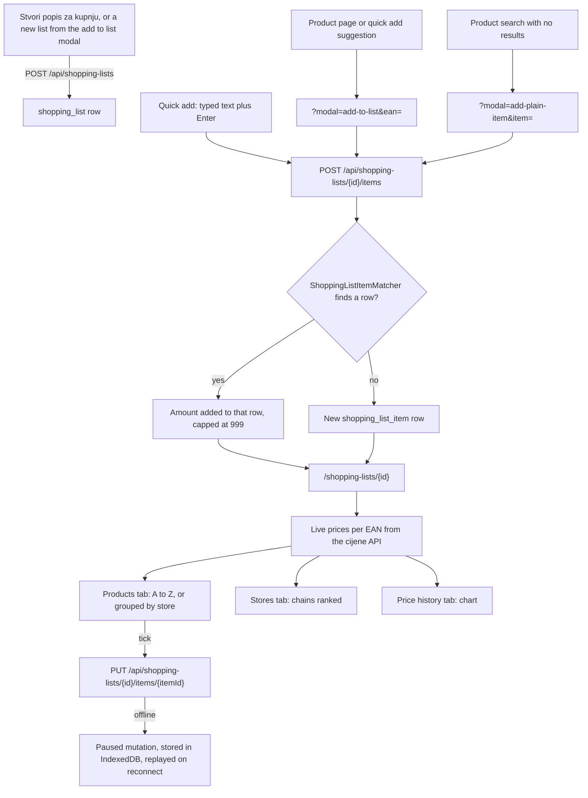

# Disscount: Shopping Lists (Popisi za kupnju)

A reference for how shopping lists work: how a list and its items are stored, how an added product merges into a row already there, how ticking works offline, how the list is priced, grouped by store and charted, and where it links out to the map. Written for someone new to the code, so the concepts are explained as they come up. Keep it up to date as the feature changes.

Sharing a list (link access levels, the one route that serves owners and link visitors, live polling, the privacy decisions) has its own reference, [SHARING.md](SHARING.md). This doc links there instead of repeating it.

> **Mental model in one sentence:** a list is a title plus rows the Spring backend stores; a row is either a catalogue product (it has an EAN, so the app can look up its live prices from the cijene API) or a plain text item (no EAN, no prices); the frontend prices, groups and charts the rows in the browser, and every write is optimistic and queues offline so ticking items off works with no signal in the shop.

---

## 1. Quick reference

| Thing            | Value                                                                                                                                                                                                                          |
| ---------------- | ------------------------------------------------------------------------------------------------------------------------------------------------------------------------------------------------------------------------------ |
| Routes           | `/shopping-lists` (login required), `/shopping-lists/<id>` (owner, or anyone holding the link when it is shared)                                                                                                               |
| Modals           | `?modal=shopping-list/new`, `shopping-list/edit&id=`, `shopping-list/copy&id=`, `shopping-list/share&id=`, `shopping-list-actions&id=`, `add-to-list&ean=` (optionally `&list=`), `add-plain-item` (optionally `&item=`)       |
| Backend packages | `disscount.shoppinglist` (lists, access, copy, items, merging)                                                                                                                                                                 |
| Tables           | `shopping_list`, `shopping_list_item` (both soft delete with `deleted_at`)                                                                                                                                                     |
| Limits           | 50 lists per person and 50 items per list ([BACKEND.md §7.1](BACKEND.md#71-per-user-limits)), title 3 to 100 characters (the backend checks the 100), item amount 1 to 999, item text fields 255 characters (the column width) |
| Who adds items   | only the owner, on the server and in the UI                                                                                                                                                                                    |
| Prices           | live from the cijene API per EAN; a ticked item keeps the prices captured when it was ticked                                                                                                                                   |
| Offline          | lists and items are cached on the device; create, rename, delete, add, tick and remove queue and replay                                                                                                                        |
| Env vars         | none of its own                                                                                                                                                                                                                |
| Frontend tests   | `pnpm test` (Vitest)                                                                                                                                                                                                           |
| Backend tests    | `mvn -B test` (H2, no network)                                                                                                                                                                                                 |

---

## 2. How a list flows

Step by step:

1. **Create.** A list is created from `/shopping-lists` ("Stvori popis za kupnju" opens `?modal=shopping-list/new`) or from the list picker inside the add to list modals, which first creates the list and then adds to it. The server generates the list id.
2. **Add.** Items arrive through four doors: the product page's "Dodaj na popis za kupnju" (`?modal=add-to-list&ean=`), the quick add field at the top of a list, the plain item modal that product search offers when nothing matches, and the watchlist's "turn the discounted items into a list" button. All of them end at `POST /api/shopping-lists/{id}/items`, where the backend merges a duplicate into the row already there ([§5](#5-adding-items-and-merging-duplicates)).
3. **Price.** The list page looks up every catalogue item's live prices by EAN. Plain items have no EAN and so no prices ([§8](#8-prices-on-the-list-page)).
4. **Shop.** In the shop, the user picks a chain per item and ticks items off. A tick captures the prices of that moment onto the row ([§6](#6-ticking-items-off-and-captured-prices)), and it works offline ([§7](#7-optimistic-updates-and-the-offline-queue)).

---

## 3. Data model

### Backend entities

Entities live in `backend/src/main/java/disscount/shoppinglist/`. The tables come from the Flyway files in `backend/src/main/resources/db/migration`; Hibernate only validates them ([INFRASTRUCTURE.md](INFRASTRUCTURE.md#103-backend-tables-and-flyway)).

#### `shopping_list` (entity `ShoppingList`)

| Column        | Type                | Notes                                                                                                                         |
| ------------- | ------------------- | ----------------------------------------------------------------------------------------------------------------------------- |
| `id`          | UUID, primary key   | Generated by the server (`GenerationType.UUID`), unlike digital cards                                                         |
| `owner_id`    | UUID, FK `app_user` | Not null, lazy                                                                                                                |
| `title`       | varchar             | Not null, `@NotBlank`, `@Size(max = 100)` on create, rename and copy. The 3 character minimum is the frontend form's only     |
| `link_access` | varchar(16), null   | `VIEW`, `SHOP`, `EDIT`, or null for "not shared". Read through `resolvedLinkAccess()`, see [SHARING.md](SHARING.md#9-gotchas) |
| `created_at`  | timestamp           | Stamped through `Timestamps.nowUtc()` in `@PrePersist`                                                                        |
| `updated_at`  | timestamp           | Moves on a rename and on every item write (`touchList`), which is what orders the lists index                                 |
| `deleted_at`  | timestamp, null     | Soft delete marker                                                                                                            |

#### `shopping_list_item` (entity `ShoppingListItem`)

| Column                      | Type                      | Notes                                                                                                                                                                   |
| --------------------------- | ------------------------- | ----------------------------------------------------------------------------------------------------------------------------------------------------------------------- |
| `id`                        | UUID, primary key         | Generated by the server                                                                                                                                                 |
| `shopping_list_id`          | UUID, FK `shopping_list`  | Not null, lazy                                                                                                                                                          |
| `ean`                       | varchar(255), null        | The product's barcode number. Null for a plain item typed by the user; a blank EAN is stored as null                                                                    |
| `brand`, `quantity`, `unit` | varchar(255), null        | A snapshot of the product's catalogue fields, taken when it was added                                                                                                   |
| `name`                      | varchar(255)              | Not null, `@NotBlank`, stored stripped of outer whitespace                                                                                                              |
| `amount`                    | integer                   | Not null, default 1. The request allows 1 to 999 and a merge caps the sum at 999                                                                                        |
| `is_checked`                | boolean                   | Not null, default false. "Bought"                                                                                                                                       |
| `chain_code`                | varchar(255), null        | The chain the item is bought at, a cijene slug such as `konzum`. Only the format is validated (`^[a-z0-9_-]+$`), never a fixed list, so new upstream chains never break |
| `avg_price`                 | numeric(10,4), null       | The average across chains, captured at the tick                                                                                                                         |
| `store_price`               | numeric(10,4), null       | The price at `chain_code`, captured at the tick                                                                                                                         |
| `updated_by_user_id`        | UUID, FK `app_user`, null | The account that last wrote the row. Sent to the owner only, see [SHARING.md](SHARING.md#7-privacy-decisions)                                                           |
| `created_at`, `updated_at`  | timestamp                 | `Timestamps.nowUtc()`                                                                                                                                                   |
| `deleted_at`                | timestamp, null           | Soft delete marker                                                                                                                                                      |

The API refuses a negative `avgPrice` or `storePrice`, or one above 999999.9999, with a form error. Extra decimals are allowed, because the app sends unrounded averages and the column rounds them to four places.

There is no position column: the page sorts rows itself ([§9](#9-grouping-by-store-and-the-map-link)).

### Wire format and the frontend schemas

The DTOs (`ShoppingListDto`, `ShoppingListItemDto`) are built in one place, `ShoppingListMapper`, so the owner's view and a link visitor's view cannot drift apart. Deleted lists and items never load (`@SQLRestriction`, [AUTH.md 7.3](AUTH.md#73-soft-delete-and-the-erasure-ledger)), and the mapper still drops an item deleted earlier in the same request, nulls `ownerId`, `linkAccess` and every `updatedByUserId` for anyone but the owner, and echoes the caller's resolved access as `myAccess`.

On the frontend the contract lives in two zod files:

- `lib/api/schemas/shopping-list.ts`: `shoppingListRequestSchema` (form rules: title trimmed, then 3 to 100 characters; the backend checks only the 100), `shoppingListDtoSchema` (the response), `shoppingListCopyRequestSchema`, and the `LinkAccess` and `ListAccess` enums.
- `lib/api/schemas/shopping-list-item.ts`: `shoppingListItemRequestSchema` (name required, amount an integer from 1 to `MAX_SHOPPING_LIST_ITEM_AMOUNT`, defaulting to 1) and `shoppingListItemDtoSchema`.

Request and response schemas are separate objects on purpose. The request schemas carry form rules the backend does not enforce, so inheriting them into the response would make a row the server considers valid (saved before a limit existed) fail to parse. The response schemas require every key, because the backend always sends every key with null for "unset" (PR #462, require the response DTO keys Spring always sends).

**Responses are parsed at the service boundary** since #481 (parse shopping list and watchlist responses): every fetcher in `lib/api/shopping-lists/queries.ts` runs the body through `shoppingListDtoSchema.parse` or `shoppingListItemDtoSchema.parse` before React Query sees it. A drifted response therefore fails as a `ZodError` instead of reaching a screen as `undefined`. The shared query defaults never retry a `ZodError` and report it to Sentry, and a failed background refetch keeps the cached list on screen.

---

## 4. API

Errors are RFC 9457 `ProblemDetail` bodies whose messages are `error.shoppingList.*`, `error.shoppingListItem.notFound` and `validation.*` codes, resolved in the request's language from the five `messages*.properties` files (see [I18N.md](I18N.md)). Swagger UI at `/api/swagger-ui/index.html` lists every route.

| Method and path                                  | Chain          | What it does                                                                                         |
| ------------------------------------------------ | -------------- | ---------------------------------------------------------------------------------------------------- |
| `POST /api/shopping-lists`                       | authenticated  | Create a list. Body `{title, linkAccess?}`; the caller is the owner                                  |
| `GET /api/shopping-lists/me`                     | authenticated  | The caller's active lists with their items, newest `updatedAt` first (one query, items fetch joined) |
| `GET /api/shopping-lists/items`                  | authenticated  | Every item on the caller's active lists, flattened. Feeds the watchlist suggestions                  |
| `GET /api/shopping-lists/{id}`                   | optional token | One list, for the owner or a link visitor                                                            |
| `PUT /api/shopping-lists/{id}`                   | optional token | Rename (`EDIT` or owner) and change `linkAccess` (owner only); signed in, or 401                     |
| `DELETE /api/shopping-lists/{id}`                | optional token | Soft delete. Owner only; signed in, or 401                                                           |
| `POST /api/shopping-lists/{id}/copy`             | optional token | Copy into a new list the caller owns, in one transaction ([§12](#12-copying-deleting-and-sharing))   |
| `POST /api/shopping-lists/{id}/items`            | optional token | Add an item, merging into a matching row. Owner only                                                 |
| `PUT /api/shopping-lists/{id}/items/{itemId}`    | optional token | Update an item. `SHOP` may change the in-shop fields, `EDIT` everything                              |
| `DELETE /api/shopping-lists/{id}/items/{itemId}` | optional token | Soft delete an item. `EDIT` or owner                                                                 |

"Optional token" is the `@Order(1)` chain in `SecurityConfig` (`optionalAuthShoppingListChain`), which matches these routes (plus `HEAD` on the single list read, for link unfurlers) by method plus a UUID shaped id. Every write on it still needs a signed-in caller: `ShoppingListGuard` checks visibility first, so a hidden or unknown list answers 404 to anyone; on a list the anonymous caller can see, `requireWriteUser` answers 401 with `error.shoppingList.signInToChange`. The access rules per level, why an unknown or hidden list answers 404 rather than 403, and why anonymous callers are capped at `VIEW` are all in [SHARING.md §4](SHARING.md#4-backend). The short version for this doc: `ShoppingListGuard` checks every by-id method before it runs, then the method loads the list through `ShoppingListService.findVisible` and asks `ShoppingListAccessService.resolve` what the caller may do.

---

## 5. Adding items and merging duplicates

Adding a product that is already on the list does not create a second row. `ShoppingListItemService.addItemToShoppingList` asks `ShoppingListItemMatcher.findMergeTarget` for a row to merge into, among the list's active items:

| Adding          | Merges into                                                                                           |
| --------------- | ----------------------------------------------------------------------------------------------------- |
| A product (EAN) | The row with the same EAN; else a plain row (no EAN) with the same name, which the product takes over |
| A plain item    | Any row with the same name, product or plain                                                          |

"Same name" ignores case and outer whitespace (`strip().toLowerCase(Locale.ROOT)`). Matching runs in Java over the loaded rows, not in SQL, so Croatian letters fold the same way on Postgres (whose `lower()` depends on the database collation) and on H2 in the tests. Two different products that share a name stay two rows, because products match by EAN first.

On a merge:

- The amounts add up, capped at 999, the same limit the request enforces.
- When the add carries an EAN, the row's EAN and name are overwritten with the request's. That is how a product takes over a plain row (linking it to live prices from then on), and it also refreshes the name of a row with the same EAN.
- `brand`, `quantity`, `unit`, `chainCode`, `avgPrice` and `storePrice` are overwritten only when the request carries them.
- `is_checked` is left as it was: adding more of something already bought does not untick it.

Without a match, a new row is created with the request's values. Either way the list's `updatedAt` is bumped (`touchList`), which moves it to the top of the lists index.

**The frontend mirrors the rule** in `shopping-lists/utils/item-merge.ts` (`mergesIntoExisting`), only so the add to list modal's toast can say whether the add bumped an amount or made a new row. The server stays the authority; the two must be changed together.

### The add paths

- **Add to list modal** (`?modal=add-to-list&ean=`, from the product page and from quick add suggestions): picks a list or creates one, an amount, and optionally marks the item as already bought. What it sends is described in [PRODUCTS.md §10](PRODUCTS.md#10-shopping-list-integration).
- **Quick add** (`shopping-list-quick-add.tsx`, hook `use-quick-add-item.ts`): a field at the top of a list, shown to the owner only. Typing two or more characters searches the catalogue after a 300 ms debounce and shows up to eight products. Enter or the Dodaj button adds the typed text as a plain item (`{name, amount: 1, isChecked: false}`); picking a suggestion instead opens the add to list modal for that product, with the product seeded into the React Query cache first so the modal works offline. The suggestion list does not highlight on hover, so a pointer resting on a suggestion cannot turn Enter into opening it. Because the new row only appears after the refetch, a visually hidden status line announces "Dodano: <name>".
- **Plain item modal** (`?modal=add-plain-item&item=`, `products/components/forms/add-plain-item-modal.tsx`): offered by product search when nothing matches the query (`products-empty-results.tsx`), so a thing the catalogue does not carry can still go on a list. It has the same list picker and amount as the add to list modal.
- **Discounted items from the watchlist** (`watchlist/components/create-discounted-list-button.tsx`): creates a dated list, then adds each discounted product with its own request. If some adds fail it deletes the list again, or keeps it and says so if the delete fails too.

---

## 6. Ticking items off and captured prices

An item row (`[id]/components/items/shopping-list-item.tsx`) has a checkbox, a store select, the amount controls and a remove button. Each control is enabled by the access the server resolved (`resolveShoppingListAccess` in `utils/shopping-list-access.ts`, which mirrors the backend's `ListAccess`): ticking and the store select need `SHOP`, the amount and remove need `EDIT`. A disabled control points at the access banner with `aria-describedby`.

**A tick captures prices.** `useShoppingListItemMutations.handleUpdateItem` builds the request from the cached row plus the change, and when the item becomes ticked it adds:

- `avgPrice`: the item's live average across chains, when known.
- `storePrice`: the live price at the item's chain, when it is priced there.

The chain sent is the saved `chainCode`, or when there is none, the cheapest chain the store select shows as its placeholder. That default is derived in render and never saved by opening the list (`StoreChainSelect` has no effect, and keeps the default out of its `value` so picking that same chain still counts as a change): only picking a chain or ticking the item writes it, an untick sends the saved chain only, so viewing a list, including someone else's shared one, sends no request, and an unsaved default follows whichever chain is cheapest today. A ticked item never borrows the default.

An untick clears both, so a row unticked and ticked again at another shop never keeps the first shop's price. These snapshots are what "Potrošeno" and "Ušteđeno" in the info table are computed from, and they are why a bought item keeps its price after the live price moves.

**What a `SHOP` caller can change.** `applyItemUpdate` on the server always applies `isChecked`, `chainCode`, `avgPrice` and `storePrice`, and applies `ean`, `brand`, `name`, `quantity`, `unit` and `amount` only for `EDIT` or the owner. A fuller payload from a `SHOP` caller is ignored rather than refused. An update that omits the EAN never unlinks a product from its row. Every add, update and delete stamps `updated_by_user_id` and bumps the list's `updatedAt`.

A plain item has no store select at all, since it has no prices to choose between.

---

## 7. Optimistic updates and the offline queue

"Optimistic" means the screen changes before the server answers, and is put back if the server refuses. "The offline queue" is React Query's paused mutations, persisted to IndexedDB so they survive a reload and replay when the connection returns. The general machinery is in [PWA.md §5](PWA.md#5-offline-reads-caching-and-persistence); this section is what shopping lists add to it.

### Reads

The query roots `shoppingLists` and `shoppingListItems` (`lib/api/shopping-lists/keys.ts`) are on the persisted allowlist in `lib/offline/cached-query-keys.ts`, so a list loaded once opens offline, with a "last synced" label. The keys:

| Key                           | Holds                                                    |
| ----------------------------- | -------------------------------------------------------- |
| `["shoppingLists", "me"]`     | The lists index                                          |
| `["shoppingLists", <id>]`     | One list, for the owner and link visitors alike          |
| `["shoppingListItems", "me"]` | Every item on the caller's lists (watchlist suggestions) |

`useGetShoppingListById` sets `staleTime` to 30 seconds and refetches on window focus. A shared list also polls; the rules are in [SHARING.md §5](SHARING.md#5-the-route).

### Writes

Every list write has a mutation key in `lib/offline/offline-mutation-keys.ts` and a replay function in `lib/offline/offline-mutations.ts` (`registerOfflineMutationDefaults`), because a reload loses the hook's inline `mutationFn`:

| Write               | Key                                    | Optimistic                                     | On failure                                                   |
| ------------------- | -------------------------------------- | ---------------------------------------------- | ------------------------------------------------------------ |
| Create list         | `["shoppingLists", "create"]`          | no                                             | the caller's toast                                           |
| Rename, share       | `["shoppingLists", "update"]`          | yes, `byId` and `me` (`optimistic-list.ts`)    | restore the snapshot                                         |
| Delete list         | `["shoppingLists", "delete"]`          | the caller removes it from `me` and rolls back | the caller's toast                                           |
| Add item            | `["shoppingLists", "items", "add"]`    | no                                             | the caller's toast (quick add hands the text back)           |
| Tick, store, amount | `["shoppingLists", "items", "update"]` | yes, one item (`optimistic-items.ts`)          | restore that item, `listWriteFailed` toast                   |
| Remove item         | `["shoppingLists", "items", "delete"]` | yes, one item                                  | restore that item, `deleteWriteFailed` toast (silent on 404) |

Copying a list has no mutation key, so it is not queued: it simply fails offline.

How the item optimism works:

1. `onMutate` cancels in-flight reads of the list (so a late GET cannot overwrite the change), remembers the one item and its position, and patches or removes it in the cached list.
2. `onError` puts back **only that item** (`restoreItem`). Restoring a whole-list snapshot looks equivalent and is not: two quick ticks overlap, and rolling back to the state before the first would also undo the second, which the server already accepted.
3. `onSettled` invalidates the list, the index and the items, so the cache reconciles with the server either way.

The list rename works the same way on the list's own fields, and also writes the server's answer into the cache in `onSuccess`, because `invalidateQueries` only starts a refetch and the control would otherwise flicker new, old, new.

**Replay after a reload.** `onMutate` does not run again for a mutation restored from IndexedDB, because query-core skips it for a mutation already pending. What makes a queued tick still show after a reload is the persisted query snapshot `onMutate` wrote before the reload. That is why the shopping list roots have to stay in `cached-query-keys.ts`.

**Errors on replay.** A hook's own `onError` replaces the mutation default's rather than running beside it, and a reload loses the hook entirely, so the item update and delete hooks call the shared handlers themselves and the defaults register them too. `listWriteFailed` says "you lost access" on a 403 and a generic failure otherwise; `deleteWriteFailed` stays silent on a 404, since a replayed delete for an item already gone has reached the desired end state.

**Retired keys.** Two keys from the token based sharing that sharing by id replaced, `["sharedShoppingList", "items", "update"]` and `["sharedShoppingList", "items", "delete"]`, keep tombstone defaults: a write queued by an old build resolves, shows "offline.retiredWriteDropped", and stops, instead of throwing for want of a `mutationFn`.

**Polling yields to writes.** A poll landing mid-write would replace the optimistic cache with the pre-write list, so `useGetShoppingListById` subscribes to `useIsMutating({ mutationKey: ["shoppingLists"] })` and pauses polling while any list write is pending. Every list write key starts with `shoppingLists` for this reason; a new one has to as well.

**The create and edit modal close optimistically.** `use-shopping-list-modal.ts` closes the modal on submit, online or offline, and reopens it with the error if the write fails. Offline it also shows a "will sync when back online" toast, because a paused mutation only resolves on reconnect.

### The limit dialog

A create refused at a per-user limit ([BACKEND.md §7.1](BACKEND.md#71-per-user-limits)) opens one dialog, `components/custom/limit-reached/limit-reached-dialog.tsx`, for lists, items, watchlist entries, cards and product photos alike. It says the limit in one sentence and has a button that opens the contact form (`?modal=contact`). The query client's `MutationCache.onError` (`lib/api/query-client-defaults.ts`) opens it through a small module store (`lib/limits/limit-reached-store.ts`), so a create replayed from the offline queue after a reload opens it too. The call sites skip their own toast or reopened form for that error (`isLimitReached`), and the typed draft stays saved. A 409 is a permanent failure, so a queued create past the limit is dropped and the refetch removes its optimistic row.

---

## 8. Prices on the list page

`useShoppingListData` (`[id]/hooks/use-shopping-list-data.ts`) is the one read for the page. It loads the list, then runs one product lookup per unique catalogue EAN (`catalogEans`) with `useQueries`, using `productLookupQuery` (`[id]/utils/product-lookup-query.ts`): the shared `["cijene", ...]` product key, a six hour `staleTime`, one retry, and never a retry or refetch for a 404, since upstream answers 404 for an EAN it does not carry and asking again cannot change that.

From each lookup it derives, per item: the cheapest chain (pinned stores preferred), the average price, the price at every chain, and a price state (`[id]/utils/item-price-state.ts`):

| State      | Meaning                                             | The row shows                                                                      |
| ---------- | --------------------------------------------------- | ---------------------------------------------------------------------------------- |
| `loading`  | the lookup has not answered                         | a skeleton in place of the store select                                            |
| `ready`    | prices known, or the item is ticked                 | the store select                                                                   |
| `failed`   | the lookup failed                                   | "Cijene nisu dostupne", plus one list banner with a retry for only the failed EANs |
| `offline`  | React Query paused the lookup and nothing was saved | "Cijene nisu spremljene za rad bez interneta"                                      |
| `noPrices` | upstream 404, or no chain prices the product        | "Nema cijena u trgovinama"                                                         |

A ticked item is always `ready`, because it shows the prices saved with it. A plain item has no lookup and no price state at all. The full offline behaviour of these states is described in [PWA.md](PWA.md) under the shopping list item price states.

**The info table** (`shopping-list-info-table.tsx`, maths in `utils/shopping-list-stats-utils.ts`) shows the created and updated dates, the list total, what is left to spend, what was spent and what was saved:

- The total and "left to spend" are the sum of each item's live average times its amount. Their low and high ends are that average minus and plus 10 percent, an estimate, not the real cheapest and dearest chains.
- "Spent" is the sum of the captured `storePrice` of ticked items; "saved" is their captured `avgPrice` minus their `storePrice`, shown as "Preplaćeno" (overpaid) when it is negative.
- Plain items and unpriced products add nothing, and the table counts them (`countUnpricedItems`) so the total does not look complete when it is not.

---

## 9. Grouping by store and the map link

The Proizvodi tab (`[id]/components/items/shopping-list-item-views.tsx`) lists the items A to Z with Croatian collation (`compareHr`), or, with the "Po trgovinama" switch on, split into one card per chain. The switch is remembered per list in local storage (`shoppingListsPreferences[<id>].groupByStore`, `utils/browser/storage/shopping-lists.ts`). Grouping waits until the prices have loaded, because until then no item knows its cheapest chain.

`groupItemsByStore` (`[id]/utils/group-items-by-store.ts`) puts each item under the chain its store select shows: its saved `chainCode`, else, for an unticked item, the suggested cheapest chain (`suggestedChain`, the same rule the select and the share text use), else a last group called "Ostalo". That last group holds every plain item and any item ticked with no saved chain, which its select shows with no store. Chains run A to Z by their display label, items A to Z within a chain. Each group gets a subtotal: a ticked item counts at its captured price, an unticked one at today's price at that chain. When some item has no known price there, the group is partial and its header reads "najmanje" ("at least") before the subtotal; a partial group with no known price at all shows no subtotal.

**"Na karti".** Each chain's group header (`store-group-header.tsx`) has a "Na karti" link to the stores map:

- When the signed-in user has a favourite store of that chain, it opens that store: `/map?store=<chain>:<code>&chain=<chain>`.
- Otherwise it opens every store of the chain: `/map?chain=<chain>`.

The chain always travels with the store, because on the map a `?store=` link alone lets a signed-in user's pinned chains become the filter, which can hide the very store the link points at. The map side is in [MAP.md](MAP.md).

---

## 10. The stores tab

"Cijene po trgovinama" (short label "Trgovine", `[id]/components/stores/shopping-list-stores-list.tsx`) compares chains for the items still to buy (`itemsToCompare`: unticked catalogue items). For each chain it shows how many of those items it carries, its price range, which items are cheapest or dearest there, and a per chain table of the items with unavailable ones badged.

The sort (`use-store-optimize-mode.ts`, comparator `compareStoreChains` in `utils/store-sorting-utils.ts`) has four modes, saved across all lists in local storage (`storeOptimizeMode`):

| Mode       | Ranks by                                                                                             |
| ---------- | ---------------------------------------------------------------------------------------------------- |
| `products` | how many of the items the chain carries (the default)                                                |
| `basket`   | items carried, then average price                                                                    |
| `total`    | how many items are cheapest there, then average price, for a shopper willing to visit several stores |
| `distance` | the nearest 0.5 km band, then items carried, then price                                              |

Pinned chains come first in every mode except `distance`, which is about where the shopper stands. A saved `distance` comes back on the next visit only when the browser already allows location, or from a picked or saved town, so opening a list never prompts for location; `distance` is saved only once it worked.

The price range bar compares only chains that carry every item (`store-chain-completeness.ts`), because a partial basket measures a different set of products.

---

## 11. The price history chart

"Povijest cijena" (`shopping-list-price-history.tsx`, hook `use-shopping-list-price-history.ts`) charts each catalogue item's price over a chosen period, one line per product, using recharts through the shadcn chart wrapper.

1. `getPriceHistoryDates` builds the list of days for the period, never before `PRICE_ARCHIVE_START` (2025-05-16), the first day the upstream archive has. The hook reads today's Zagreb date on every render and opts out of the React Compiler (`"use no memo"`), so a tab left open past midnight rebuilds the window for the new day on its next render, as `usePriceHistory` does ([PRODUCTS.md](PRODUCTS.md), price history).
2. For every EAN and every day it runs one product lookup at that date, built by `priceHistoryQueries` (`lib/cijene-api/price-history-queries.ts`). The product page's chart uses the same builder, so the two share cache entries; the key and `staleTime` must stay identical.
3. `buildChartData` (`[id]/utils/price-history-chart-data.ts`) averages, per product and day, the average prices of the selected chains, rounded to cents. Results stay aligned with their dates by position, which is why missing days are kept as holes rather than filtered out. Each row keeps the raw `YYYY-MM-DD` date; the shared chart shell formats it for the axis and the tooltip ([PRODUCTS.md](PRODUCTS.md), price history).
4. `calculateTotalPriceChange` compares the first and the last day, counting only products priced on both, so a product priced on one side only cannot show a price change no price made.

The period and the selected chains are remembered per list in local storage (`priceHistoryPeriod`, `priceHistoryChains`). The first time, the chain selection is the user's pinned chains that appear in the data, else every chain; it waits until every lookup has settled, so a half loaded list cannot save a wrong default.

**Only one week and one month are enabled.** `DISABLED_PERIODS` in `constants/price-history.ts` turns off one year and all time, and `getEnabledPeriod` maps a stored disabled period back to one week. The reason is cost: one month of a 20 item list is 600 requests, because the upstream API has no range endpoint (#45, batch price history requests; #62, longer periods).

The "Cijene po trgovinama" and "Povijest cijena" tabs only appear when the list has items (`shopping-list-sections.tsx`).

---

## 12. Copying, deleting and sharing

- **Copy** (`?modal=shopping-list/copy&id=`, `use-copy-list-modal.ts`): one request, `POST /api/shopping-lists/{id}/copy`, handled by `ShoppingListCopyService` in a single transaction, so a failure cannot leave a half filled copy behind. The copy button is shown on the list page only to a signed-in caller (`showCopyButton={isSignedIn}`). The modal asks what to carry: the products (on by default), the shopping progress (ticks, chosen chains and captured prices, which move together or not at all; off by default), and the sharing setting (off by default, owner only, enforced on the server). The name is prefilled with a "(Kopija)" suffix that always fits inside the 100 character limit. The details are in [SHARING.md §9](SHARING.md#9-gotchas).
- **Delete** (owner only): soft deletes the list. `useShoppingListMutations.confirmDelete` removes it from the index first, awaits the request, and rolls back with a toast if it fails, then goes to `/shopping-lists`. Items of a deleted list are left as they are; the list is simply never loaded again.
- **Share**: the owner gets the share modal (`?modal=shopping-list/share&id=`); anyone else passes on the list's URL and a plain text version through the OS share sheet or the clipboard (`shareOrCopy`, `formatShoppingListForSharing`). The text names each item's store the way its store select shows it: the saved chain, else for an unticked item the suggested cheapest one (`suggestedChain`, `hooks/use-list-share-text.ts`), with no marker telling the two apart. The suggestion is read from the product cache, never fetched, because sharing runs inside a tap and a network wait can outlast the browser's permission to open the share sheet; shared from a screen that loaded no prices (a card's long press menu after the cache expired), an unpicked item goes out with no store, as it shows there. Everything about access levels is in [SHARING.md](SHARING.md).

---

## 13. Screens and modals

| Screen or modal                  | File                                                                                                                                        | Notes                                                                                                                      |
| -------------------------------- | ------------------------------------------------------------------------------------------------------------------------------------------- | -------------------------------------------------------------------------------------------------------------------------- |
| Lists index `/shopping-lists`    | `shopping-lists/components/shopping-lists-client.tsx`                                                                                       | Login required. Search by title (`?q=`), newest `updatedAt` first (`sortShoppingListsByRecency`), "Stvori popis za kupnju" |
| List card actions                | `shopping-lists/components/shopping-list-actions-sheet.tsx`, outlet `app/[locale]/components/modal-router/shopping-list-actions-outlet.tsx` | `?modal=shopping-list-actions&id=`, the long press sheet on mobile                                                         |
| List page `/shopping-lists/<id>` | `shopping-lists/[id]/components/shopping-list-detail-client.tsx`                                                                            | Access banner, header with actions, info table, then the Proizvodi, Cijene po trgovinama and Povijest cijena tabs          |
| Unavailable list                 | `[id]/components/shopping-list-unavailable.tsx`                                                                                             | Shown only for a 404 (deleted or no longer shared) or when nothing is cached; other errors keep the list on screen         |
| Create and edit                  | `shopping-lists/components/forms/shopping-list-modal.tsx`                                                                                   | Title only; a localStorage draft (see [STATE-PERSISTENCE.md](STATE-PERSISTENCE.md))                                        |
| Copy                             | `shopping-lists/components/forms/copy-list-modal.tsx`                                                                                       | [§12](#12-copying-deleting-and-sharing)                                                                                    |
| Share                            | `shopping-lists/components/forms/share-list-modal.tsx`                                                                                      | [SHARING.md](SHARING.md)                                                                                                   |
| Add to list                      | `products/components/forms/add-to-shopping-list-form.tsx`                                                                                   | [PRODUCTS.md §10](PRODUCTS.md#10-shopping-list-integration)                                                                |
| Add plain item                   | `products/components/forms/add-plain-item-modal.tsx`                                                                                        | [§5](#5-adding-items-and-merging-duplicates)                                                                               |

The whole `/shopping-lists` subtree is wrapped in `data-sentry-block` (`shopping-lists/layout.tsx`), so Sentry Replay never records a list's contents; see [SHARING.md §7](SHARING.md#7-privacy-decisions).

---

## 14. Key files

Frontend paths are under `frontend/src/`, and `shopping-lists/` means `app/[locale]/(user)/shopping-lists/`. Backend paths are under `backend/src/main/java/disscount/`.

| Path                                                               | Role                                                                              |
| ------------------------------------------------------------------ | --------------------------------------------------------------------------------- |
| `shoppinglist/ShoppingListMapper.java`                             | The one place lists and items become DTOs, with the owner only redaction          |
| `shoppinglist/item/ShoppingListItemMatcher.java`                   | The merge rule                                                                    |
| `lib/api/shopping-lists/hooks.ts`                                  | React Query hooks; attaches the mutation keys and the optimism                    |
| `lib/api/shopping-lists/optimistic-items.ts`, `optimistic-list.ts` | Single item and list field optimism with rollback                                 |
| `lib/offline/offline-mutation-keys.ts`, `offline-mutations.ts`     | The offline write allowlist and its replay functions                              |
| `constants/shopping-list.ts`                                       | `MAX_SHOPPING_LIST_ITEM_AMOUNT` (999), `MAX_SHOPPING_LIST_ITEM_NAME_LENGTH` (255) |
| `shopping-lists/utils/item-merge.ts`                               | Frontend mirror of the merge rule, for the toast                                  |
| `shopping-lists/utils/shopping-list-access.ts`                     | Client mirror of `ListAccess`                                                     |

---

## 15. Config and env vars

Shopping lists need **no environment variables of their own**. They use what the rest of the app uses: the backend URL and the JWT setup ([AUTH.md](AUTH.md)), the cijene API proxy for prices ([PRODUCTS.md](PRODUCTS.md)), and `NEXT_PUBLIC_APP_URL`, which `shareListUrl` reads through `appUrl()` to build the link it shares.

Fixed settings worth knowing, all in code:

| Setting                            | Value                                                                                         | Where                                           |
| ---------------------------------- | --------------------------------------------------------------------------------------------- | ----------------------------------------------- |
| List read `staleTime`              | 30 s, refetch on focus                                                                        | `lib/api/shopping-lists/hooks.ts`               |
| Shared list polling                | 5 s, then 30 s                                                                                | `lib/api/shopping-lists/shared-list-polling.ts` |
| Product lookup `staleTime`         | 6 h                                                                                           | `[id]/utils/product-lookup-query.ts`            |
| Quick add debounce, minimum, limit | 300 ms, 2 characters, 8                                                                       | `[id]/hooks/use-quick-add-item.ts`              |
| Enabled history periods            | 1 week, 1 month                                                                               | `constants/price-history.ts`                    |
| Service worker page cache          | `NetworkFirst`, `shopping-list-pages`                                                         | [PWA.md](PWA.md)                                |
| Response headers                   | `X-Robots-Tag: noindex, nofollow`, `Referrer-Policy: no-referrer` on `/shopping-lists/:path*` | `frontend/next.config.ts`                       |

---

## 16. Libraries

Versions are in `frontend/package.json` and `backend/pom.xml`. The ones whose role is not obvious from the name:

- `@tanstack/react-query-persist-client`, `@tanstack/query-async-storage-persister`: persisting the cache and paused writes.
- `idb-keyval`: the IndexedDB store under the persister.
- `recharts`: the price history chart.
- `@base-ui/react`: the quick add autocomplete (`components/reui/autocomplete.tsx`).

---

## 17. What's automatic vs manual

| Thing                                    | Automatic or manual                                                                            |
| ---------------------------------------- | ---------------------------------------------------------------------------------------------- |
| Merging a duplicate add                  | Automatic, on the server                                                                       |
| Capturing prices at a tick               | Automatic                                                                                      |
| Choosing a chain per item                | Automatic default: the select shows the cheapest chain, saved only on a pick or a tick         |
| Replaying offline writes                 | Automatic on reconnect, and after a reload                                                     |
| Live updates on a shared list            | Automatic polling ([SHARING.md §5](SHARING.md#5-the-route))                                    |
| Schema changes                           | A new Flyway file, applied by the `flyway` job on deploy; dropping a column takes two releases |
| Cleaning up soft deleted lists and items | Nothing does it; the rows stay                                                                 |
| Turning on longer history periods        | Manual: remove them from `DISABLED_PERIODS` once the API can serve them                        |

---

## 18. Tests

Not covered by an automated test: the info table maths against real prices, the stores tab ranking against live data, and the price history chart's lines. Those are checked in the browser.

---

## 19. Gotchas & lessons learned

| Gotcha                                                       | Why it bites, and the fix                                                                                                                                                                                                                     |
| ------------------------------------------------------------ | --------------------------------------------------------------------------------------------------------------------------------------------------------------------------------------------------------------------------------------------- |
| **The merge rule lives in two places**                       | `ShoppingListItemMatcher` decides, `item-merge.ts` predicts it for a toast. Change both together, or the toast lies                                                                                                                           |
| **Only the owner adds items**                                | The backend refuses every other level (`error.shoppingList.ownerOnlyAddItems`), and the quick add field is hidden for them. Do not offer an add path to link visitors until membership exists ([SHARING.md §10](SHARING.md#10-not-built-yet)) |
| **The title minimum is the frontend's**                      | The server checks `@NotBlank` and at most 100 characters, so a request from outside the app can store a one or two character title. Titles saved before the 100 limit may be longer, which is why the response schema has no length rule      |
| **Item text is capped at the column width**                  | Every item text field is 255 characters wide. The request refuses longer text with a form error (#703, limits for long text and pins), and the frontend caps the inputs with `MAX_SHOPPING_LIST_ITEM_NAME_LENGTH`. Keep the two equal         |
| **Roll back one item, never the list**                       | Overlapping ticks undo each other under a whole list rollback. Use the helpers in `optimistic-items.ts`                                                                                                                                       |
| **Renaming a query root stops offline persistence**          | `shoppingLists` and `shoppingListItems` must match `cached-query-keys.ts`, and a queued tick only survives a reload through that persisted snapshot                                                                                           |
| **A new list write key must start with `shoppingLists`**     | Polling pauses on `useIsMutating({ mutationKey: ["shoppingLists"] })`; another prefix would let a poll overwrite the optimistic cache                                                                                                         |
| **A hook level `onError` replaces the default**              | Call `listWriteFailed` or `deleteWriteFailed` from the hook as well, or a live failure reverts silently                                                                                                                                       |
| **Ticked items keep old prices**                             | By design: a tick is a receipt. Group subtotals and "Potrošeno" read the captured prices, unticked rows read today's                                                                                                                          |
| **The totals' low and high ends are estimates**              | They are the average minus and plus 10 percent, not real chain prices                                                                                                                                                                         |
| **History keys and `staleTime` must match the product page** | Build them only with `priceHistoryQueries`, or the two charts fetch the same days twice                                                                                                                                                       |
| **Account deletion keeps the lists, not their links**        | `UserService.deleteAccount` anonymises the profile and keeps the lists (owner, 2026-11-11), and `ShoppingListService.onAccountErased` switches every link off, so a link visitor gets the 404 of an unknown list (`AccountErasureTest`)       |
| **Deleting a list leaves its items**                         | Only the list gets `deleted_at`; the items stay live rows, but every route reaches them through their hidden list and answers 404 (`ShoppingListSoftDeleteTest`)                                                                              |
| **The watchlist's discounted list is not transactional**     | It is a create plus one add per product from the browser, unlike the copy endpoint; it cleans up after a partial failure itself                                                                                                               |

---

## 20. Future improvements & TODOs

- [ ] #182 (shared lists live updates): polling shipped in #358; the issue stays open for the push option, Server Sent Events from Spring turned into `invalidateQueries`, quiet when nothing changes.
- [ ] #416 (plain item follow-ups): an optimistic row for quick add and one name matching rule shared by frontend and backend. The server side name length limit came with #703 (limits for long text and pins).
- [ ] #277 (where a whole list is cheapest near you, and what a second store would save) and #270 (a store to store route for a list, in the app and in Google or Apple Maps).
- [ ] #45 (batch price history requests) and #62 (periods longer than 30 days), which unblock the disabled history periods.
- [ ] #168 (store select blank when price data fails): the price states in [§8](#8-prices-on-the-list-page) replace the blank select with a reason, which may resolve it; unverified in a browser.
- [ ] #154 and #155 (personalise lists with images and colours), #61 (switchable, personalised list views).
- [ ] Membership, adding through a link, attribution in the UI: see [SHARING.md §10](SHARING.md#10-not-built-yet).
