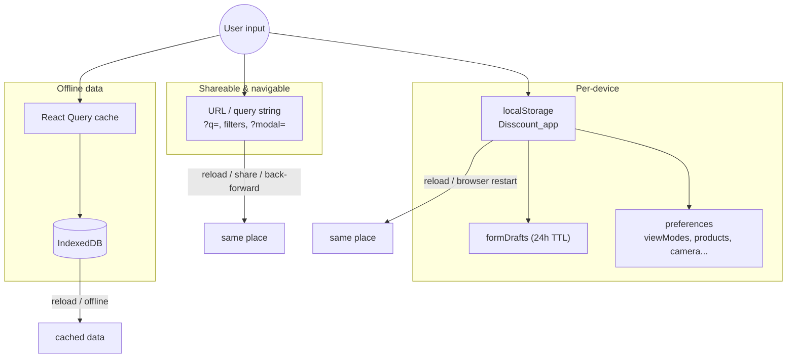
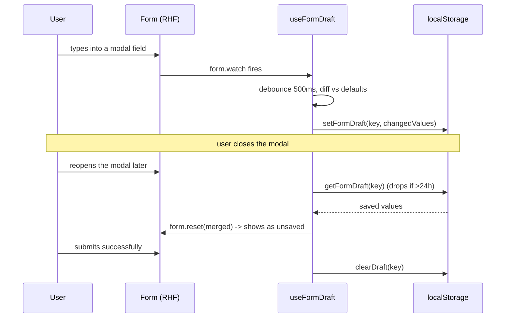

# Disscount: Client State Persistence Guide

A complete reference for how the app remembers what the user was doing, so a reload, a shared link, or a closed modal never loses their place. Written to be understandable even if you're new to this. Keep it up to date as inputs and forms change.

_Last audited end-to-end on 2026-07-22: every user-facing input and form accounted for; the contact modal was the last gap and is now drafted._

> **Mental model in one sentence:** anything the user is in the middle of is saved by **intent**, across three layers: the **URL** holds state that should be shareable or navigable (search, filters, which modal is open), a single **localStorage** object holds per-device preferences and unsaved modal-form drafts, and **IndexedDB** holds the offline data cache.

---

## 1. Quick reference

| Thing              | Value                                                                                        |
| ------------------ | -------------------------------------------------------------------------------------------- |
| URL state          | search query `?q=`, product filters (repeated params), open modal `?modal=`                  |
| localStorage key   | a single JSON object under `Disscount_app`                                                   |
| localStorage holds | modal-form drafts (24h TTL) + device preferences (view mode, chart periods, camera, banners) |
| Draft engine       | `useFormDraft` (auto-save changed values on a 500ms debounce, restore on reopen)             |
| Offline data store | persisted React Query cache in IndexedDB (see [PWA.md](PWA.md))                              |
| Never persisted    | passwords, the avatar base64 image, admin dashboard filters                                  |

**The one rule that explains most decisions:** state is placed by intent. Shareable or navigable state goes in the URL, personal per-device state goes in localStorage, and cached server data goes in IndexedDB.

---

## 2. Architecture

Three independent layers, each with a different lifetime and scope. A given screen usually uses more than one at once (for example the products page keeps its filters in the URL, its grid/list toggle in localStorage, and its results in the React Query cache).

| Layer            | Backed by                       | Holds                                                    | Survives                              | Scope       |
| ---------------- | ------------------------------- | -------------------------------------------------------- | ------------------------------------- | ----------- |
| **URL**          | query string + route            | search query, active filters, which modal is open        | reload, share, back/forward, bookmark | the link    |
| **localStorage** | one `Disscount_app` JSON object | per-device preferences + unsaved modal-form drafts (24h) | reload, browser restart               | the device  |
| **IndexedDB**    | persisted React Query cache     | offline data cache (lists, watchlist, viewed products)   | reload, offline; wiped on logout      | the session |

---

## 3. Layer 1: URL state

Shareable and back/forward-safe. Everything here can be pasted into a new tab and lands the user in the same place. This is the right home for anything a user might bookmark or send to a friend.

- **Search query (`?q=`).** The global `SearchBar` writes `q` through `useSearchNavigation`. Every search-backed page (`/products`, `/watchlist`, `/shopping-lists`, `/digital-cards`) reads `q` on the server (`readSearchParam`) and hydrates the input from it, so a reload or a shared link keeps the query. Searching from the route itself preserves other params (active filters); searching from elsewhere starts clean. `/map` passes `shallow`, which writes `q` through the History API instead of the router, so typing causes no server render and the `#map=` view survives. Text typed but not yet submitted in a product search box lives in memory only (`productSearchDraft`, [SEARCH.md §10](SEARCH.md#10-gotchas--lessons-learned)), so a reload drops it.

- **Stores map.** `/map` keeps the selected store in `?store=<chain>:<code>` (pushed, so Back closes it), the chain filter in `?chain=` (replaced; empty or `all` means every chain), the search in `q`, and the map view in `#map=zoom/lat/lon`. They are written through the History API, so no server round trip happens. Recent map searches live in localStorage (`mapRecentSearches`, newest first, five at most). See [MAP.md](MAP.md).
- **Product filters.** Chain, location, category, and brand are stored as repeated query params by `useFilterParams` / `useProductFilters`. They are written with `router.replace` (so they do not spam browser history) and read back on load. Selecting every location that has results stores no location filter, which gives the same results and keeps the URL short. Product search first fetches the upstream result set for `q`, narrows chain candidates, and when a location is selected asks `/api/cijene/location-prices` for the price range per product across the selected source cities, in one request. That route asks upstream city by city for up to three uncached cities and makes one country-wide request above that, since upstream takes one city per request and every visitor shares one daily request quota; it caches each city's reduced prices in memory for an hour. Category and brand filtering then applies client-side without repeating the location-price request. A location filter keeps only products with a published price in the selected source cities and resolved chain intersection, and derives each card's range from those exact store rows. Without a location filter, card ranges come from the matching chain summaries in the search response. The URL-driven quick-actions sheet resolves the same filters, so its range still matches the card after a reload or direct link. When only some cities load, the route marks the answer partial and the page labels it; a complete store or price lookup failure remains an error rather than silently widening the scope. The upstream search cap still bounds the candidate set, and products with no published price in the exact location and chain scope are deliberately omitted rather than shown with a Croatia-wide range. When that omission empties a search that would show products without the location filter and every selected city answered, the page says the selected places have no price and offers a button that drops only the location filter.

- **Open modal (`?modal=`).** Which modal is open is itself a URL param (`use-modal-url` + `modal-registry`), so modals are deep-linkable and survive a reload. A target's own values ride beside it: `id`, `ean`, `type`, `list` (the list the add-to-list modal preselects when opened from a list's quick add), `item` (the name the add-plain-item modal prefills from an empty product search), and `error` (better-auth's code on a failed verification link, read by the email-verified and email-changed modals). Opening or closing a modal clears all of them (`modal-search.ts`). Required onboarding uses `?modal=onboarding`, while the optional Settings replay uses `?modal=onboarding/replay`. The full modal-URL flow and onboarding gate are documented in [AUTH.md](AUTH.md).

- **One-shot tokens.** The reset-password token and OAuth error arrive as URL params and are consumed by the page that handles them. They are transient by nature, not something to persist.

---

## 4. Layer 2: localStorage (`Disscount_app`)

All localStorage lives under a **single key**, `Disscount_app`, a JSON object that the core wrapper merges field-by-field so an unrelated write never wipes other settings (`utils/browser/storage/core.ts`). Two kinds of thing live here: form drafts and device preferences.

### 4a. Form drafts (`useFormDraft`, 24h TTL)

Modal forms auto-save their **changed** values to `formDrafts[key]` on a 500ms debounce and restore them the next time the modal opens, so a user can close a modal and come back later. "Changed" is computed by diffing the current values against the form's default values (not React Hook Form's `dirtyFields`, whose proxy can read empty inside a callback). Submitting clears the draft, and drafts older than 24h are dropped on read. Passwords and base64 images are never written (the `exclude` option). A form whose rules a restored value can break passes `validateRestored`, the fields to validate right after the restore, because the restore resets the form and clears its errors.

**Drafts belong to one account.** Each draft stores the cache identity that wrote it (`owner`, the same `getCacheIdentity()` value that scopes the IndexedDB cache), and a read under any other identity sees no draft and evicts it, so a username typed into onboarding by one account is never restored into the next account's form on a shared device. Drafts written before the field existed have no owner and read as none. The purge deletes the departing account's drafts and every ownerless one (`removeFormDraftsFor`), and `useLogout` deletes that account's drafts once more after it resets the identity, because a form the sign-out unmounts flushes while the purge is still awaiting IndexedDB; a guest's drafts, such as an unsent contact message, are the exception: the first sign-in after them re-tags them to that account (`adoptGuestFormDrafts`, called from `syncCacheIdentity` before the purge), the start of the planned guest mode that imports on login. They are re-tagged, not shared, so a later switch to another account purges them with the account that adopted them. `useFormDraft` takes the owner each time the form opens and skips its flush when the identity moved while the form was open, because on a direct account switch (another tab signs in) the old form unmounts only after the identity already names the new account. `ModalRouter` also keys the signed-in modals (onboarding gate, settings host, list actions) by user id, and `PublicModalsOutlet` keys the contact modal the same way, so a form that seeds its values once per mount starts over for the new account.

Forms wired to drafts:

| Form                      | File                         | Notes                                                                                                                                                                                                                                                                                                                                                                                                                                                       |
| ------------------------- | ---------------------------- | ----------------------------------------------------------------------------------------------------------------------------------------------------------------------------------------------------------------------------------------------------------------------------------------------------------------------------------------------------------------------------------------------------------------------------------------------------------- |
| Watchlist item modal      | `watchlist-item-modal.tsx`   | restore handled by the hook; one number per watch mode, `watchType` excluded                                                                                                                                                                                                                                                                                                                                                                                |
| Add to shopping list      | `use-add-to-list-form.ts`    | restore handled by the hook; keyed `add-to-list.<ean>`, or `add-to-list.<ean>.<listId>` when opened from a list, so that list wins over an older draft                                                                                                                                                                                                                                                                                                      |
| Add plain item            | `use-add-plain-item-form.ts` | restore handled by the hook; keyed `add-plain-item.<name>` with the name trimmed and lowercased as items merge, so one item's list never preselects itself for another; only the list and amount are drafted (the name rides the `item` URL param), flushed on submit for the optimistic close and moved to the submitted name's key when the name was edited (kept defaults remove an older draft there, and a failed add drops the original name's draft) |
| Shopping list create/edit | `shopping-list-modal.tsx`    | prefill-then-merge (`restore: false`)                                                                                                                                                                                                                                                                                                                                                                                                                       |
| Digital card create/edit  | `digital-card-modal.tsx`     | keys `digital-card.new` and `digital-card.edit.<id>`; `codeValue` and `barcodeValue` excluded; new cards auto-restore, edits merge the draft themselves                                                                                                                                                                                                                                                                                                     |
| Settings and onboarding   | `settings-modal-host.tsx`    | one shared draft, cleared after a successful save and onboarding completion                                                                                                                                                                                                                                                                                                                                                                                 |
| Contact                   | `contact-modal.tsx`          | restore handled by the hook once the profile has loaded; the profile is seeded as the defaults with `keepDirtyValues`, so a late profile never overwrites an edited field. The modal stays mounted, so the hook restores on every open, which is how the map's location report arrives prefilled                                                                                                                                                            |

**Clearing one field, not the whole draft.** The watchlist modal keeps a number per watch mode and submits only the active one, so a submit calls `removeFormDraftField(key, field)` rather than `clearDraft()`. The unsaved mode's number deliberately survives, because someone typing a euro threshold, switching to percentage and saving that has not abandoned the euro one. `removeFormDraftField` carries the draft's original `savedAt` forward, so clearing one field does not restart the 24h clock on the others.

**Drafts are observable.** `subscribeToFormDrafts` bumps a version on every write, which anything outside the form can read through `useSyncExternalStore`. A product row uses it: the row stays mounted while the add-to-list modal opens over it, so without a subscription its "already on a list" icon would keep describing the list that was drafted when the row first rendered rather than the one the modal will actually preselect. Readers on a render path must call `peekFormDraft`, not `getFormDraft`: the latter evicts an expired draft, and that write plus its subscriber notification during render would schedule updates on sibling components mid-render.

### 4b. Device preferences

Written by the small domain helpers in `utils/browser/storage/*`, each of which reads, merges its own field, and writes back through the core wrapper.

| Field                      | Meaning                                                                                                                                                        | Helper              |
| -------------------------- | -------------------------------------------------------------------------------------------------------------------------------------------------------------- | ------------------- |
| `viewModes`                | grid/list toggle, per list key (parked, see below)                                                                                                             | `view-mode.ts`      |
| `productsPreferences`      | price-history period + chains, per product EAN                                                                                                                 | `products.ts`       |
| `shoppingListsPreferences` | group-by-store switch + price-history prefs, per list                                                                                                          | `shopping-lists.ts` |
| `storeOptimizeMode`        | preferred store-list sort, all lists; `distance` only if location granted                                                                                      | `shopping-lists.ts` |
| `preferredCameraId`        | manually chosen scanner camera (absent means auto-pick)                                                                                                        | `scanner.ts`        |
| `installBannerDismissedAt` | "install app" banner snooze (7 days)                                                                                                                           | `pwa.ts`            |
| `lastLoginMethod`          | drives the "last used" sign-in badge                                                                                                                           | `auth.ts`           |
| `lastSession`              | account and session id this device last saw, so an offline sign-out can name the session it ends                                                               | `auth.ts`           |
| `pendingSignOut`           | the session a sign-out ended or still has to end, kept until a session read shows it gone                                                                      | `auth.ts`           |
| `watchlistPriceSnapshots`  | store scope plus best price per watched EAN in cents, per account id, at the last `/watchlist` visit; the Praćenje badge baseline, deleted by the logout purge | `watchlist.ts`      |

The shape of the whole object is declared in `typings/local-storage.ts` as `IAppData`.

Two digital-card preferences deliberately sit **outside** that object, under their own keys, because they are read by one component each and carry no shared shape: `Disscount_digital_cards_sort` (the chosen sort of `/digital-cards`) and `disscount:card-brightness-hint-dismissed` (the dismissed brightness hint in the card view). A third, `disscount-persist-storage-requested`, is a one-time flag so the browser's persistent-storage request is made once. None of them holds a card number.

---

## 5. Layer 3: IndexedDB offline cache

The persisted React Query cache (shopping lists, watchlist, viewed products, profile with pinned stores, and selected public price data) lives in IndexedDB and is what makes authed screens work offline. Bulk product-list price queries are deliberately excluded because every search and filter combination can carry prices for up to the full candidate set; canonical single-product price queries remain persisted for product-detail offline reads. Digital cards add three small IndexedDB stores of their own, all scoped by account identity: `disscount-card-photos` (downloaded photo bytes), `disscount-card-photo-outbox` (photos and removals chosen offline, waiting to send), and `disscount-card-used` (the last-used queue of card ids and times), all three cleared by the logout purge. Card query keys carry a version segment (`v2`), and older shapes are not persisted. Photo bytes stay out of the persisted query blob on purpose; see [DIGITAL-CARDS.md](DIGITAL-CARDS.md#6-offline). It is a **data cache**, not "resume where you left off" form state, and its stored snapshot is keyed per signed-in account and purged on any change of identity, before retained public in-memory queries are persisted again. It is fully documented in [PWA.md](PWA.md#5-offline-reads-caching-and-persistence); this guide only cross-references it so the full persistence picture is in one place.

### Query keys are the persisted address

The snapshot stores every query under its key, so a key is part of the on-disk format. Each domain keeps its keys in one factory next to its service: `lib/cijene-api/keys.ts` (`CIJENE_QUERY_KEYS`, every key under the `cijene` root, including the store directory and the canonicalised store prices params) and a `keys.ts` in each `lib/api/<domain>/` folder (`SHOPPING_LIST_QUERY_KEYS`, `DIGITAL_CARD_QUERY_KEYS`, `WATCHLIST_QUERY_KEYS`, `PREFERENCE_QUERY_KEYS`, `FAVORITE_STORE_QUERY_KEYS`, `STORE_NAME_QUERY_KEYS`, `ACCOUNT_SESSION_QUERY_KEYS`, `ADMIN_QUERY_KEYS`, `CONTACT_QUERY_KEYS`, `PRODUCT_IMAGE_KEYS`). Hooks build their queries with TanStack's `queryOptions` from those keys, and invalidations, `setQueryData` seeds and the server side product page seeding (`product-cache-state.ts`) read the same factory, so no key is written as a literal at its call site. Two single-use keys outside `lib/` stay inline because nothing else reads, invalidates or persists them: `["linked-accounts"]` in the security settings and `["map-style"]` on the map.

Changing a key value strands every user's offline copy of that data. The only clean way out is a `CACHE_BUSTER` bump in `persister.ts`, which also discards queued offline writes under every identity, so `lib/offline/query-key-values.test.ts` pins each factory to the literal it replaced. If a test there fails, the change altered a persisted address: revert it, or bump the buster deliberately and update the literal. The roots themselves must also match the allowlist in `cached-query-keys.ts`; renaming a root without renaming it there silently stops the data being written to disk.

---

## 6. Deliberately ephemeral state

Not everything should be remembered. These are intentionally **not** persisted, and that is the correct behaviour:

- **Auth forms** (login, signup, forgot-password, reset-password) and the **security / credentials** form. They carry passwords, so nothing is written to disk.
- **The avatar image** in Settings. It is a base64 data URI, deliberately excluded from drafts so it can never blow the localStorage quota (`avatar-field.tsx`).
- **Admin dashboard table filters** (contact inbox search/view/show-deleted, users table). Session-only `useState`. This is admin tooling with live-refetched data, so a reset on reload is fine.

---

## 7. Coverage matrix (every input and form)

| Input / form                        | Persisted?    | Where                     |
| ----------------------------------- | ------------- | ------------------------- |
| Global search                       | Yes           | URL `?q=`                 |
| Product filters                     | Yes           | URL repeated params       |
| Open modal                          | Yes           | URL `?modal=`             |
| Watchlist item modal                | Yes           | localStorage draft        |
| Add-to-list form                    | Yes           | localStorage draft        |
| Shopping list modal                 | Yes           | localStorage draft        |
| Digital card modal                  | Yes           | localStorage draft        |
| Settings modal and onboarding       | Yes           | shared localStorage draft |
| Contact modal                       | Yes           | localStorage draft        |
| View mode / sort / camera / periods | Yes           | localStorage preferences  |
| Auth + security forms               | No, by design | passwords, never stored   |
| Avatar upload                       | No, by design | base64, quota-excluded    |
| Admin dashboard filters             | No, by design | session `useState`        |

---

## 8. What's automatic vs manual

| Thing                                         | Auto / manual | Notes                                                                                                                         |
| --------------------------------------------- | ------------- | ----------------------------------------------------------------------------------------------------------------------------- |
| Saving a modal draft while typing             | Auto          | `useFormDraft` watches the form and debounces writes                                                                          |
| Restoring a draft on reopen                   | Auto          | hook restores on every enable, or the modal merges it (`restore: false`)                                                      |
| Expiring stale drafts (24h)                   | Auto          | dropped on read                                                                                                               |
| Clearing a draft after a successful submit    | Auto          | submit handlers call `clearDraft()` / the mutation clears it                                                                  |
| Clearing only the field a submit saved        | Auto          | `removeFormDraftField`, so the other watch mode's number survives                                                             |
| Telling other surfaces a draft changed        | Auto          | `subscribeToFormDrafts` bumps a version, read via `useSyncExternalStore`                                                      |
| Dropping a draft field the form no longer has | Auto          | restore skips unknown keys, so a shape change cannot strand one for 24h                                                       |
| Keeping search + filters in the URL           | Auto          | the search and filter hooks own it                                                                                            |
| Persisting a preference (camera, periods...)  | Auto          | the relevant `storage/*` helper writes on change                                                                              |
| Persisting the view mode                      | Parked        | `useViewMode` writes on the setter, which has no callers yet (see below)                                                      |
| Adding a new query                            | Manual        | add its key to the domain's `keys.ts`, build the hook with `queryOptions`, and assert the value in `query-key-values.test.ts` |
| Adding a NEW modal form to the draft system   | Manual        | call `useFormDraft` with a unique `draftKey`; pick `restore` and `exclude`                                                    |
| Adding a NEW preference                       | Manual        | add the field to `IAppData` and a helper in `utils/browser/storage/`                                                          |
| Excluding a sensitive field from a draft      | Manual        | pass it in `exclude` (do this for passwords and base64 images)                                                                |

---

## 9. Key files

| File                                                                       | Role                                                                   |
| -------------------------------------------------------------------------- | ---------------------------------------------------------------------- |
| `frontend/src/hooks/use-form-draft.ts`                                     | modal-form draft save/restore engine (24h TTL, diff-vs-defaults)       |
| `frontend/src/utils/browser/storage/core.ts`                               | single-key `Disscount_app` localStorage read/merge/write               |
| `frontend/src/app/[locale]/products/[id]/hooks/use-product-preferences.ts` | reads and merges one product's panel preferences, hydration safe       |
| `frontend/src/utils/browser/storage/storage-subscription.ts`               | same-tab and cross-tab change notifications for `useSyncExternalStore` |
| `frontend/src/lib/cijene-api/keys.ts`, `frontend/src/lib/api/*/keys.ts`    | query key factories; their values are the persisted cache's addresses  |
| `frontend/src/lib/offline/query-key-values.test.ts`                        | pins every factory key to its persisted value                          |

---

## 10. Config, flags, and libraries

There are no environment variables or feature flags specific to this subsystem. The one tunable constant worth knowing is the draft lifetime:

- `DRAFT_TTL_MS` in `utils/browser/storage/drafts.ts` (currently 24 hours). Drafts older than this are dropped on read.
- The localStorage key name `Disscount_app` in `utils/browser/storage/core.ts`.

Libraries (versions read from `frontend/package.json`):

| Library                 | Version    | Role here                                                          |
| ----------------------- | ---------- | ------------------------------------------------------------------ |
| `react-hook-form`       | `^7.90.0`  | owns every form's values, dirty state, and the `watch` drafts hook |
| `@hookform/resolvers`   | `^6.0.2`   | bridges Zod schemas into the forms                                 |
| `zod`                   | `^4.1.13`  | validates form values                                              |
| `next`                  | `16.4.5`   | `useSearchParams` / `useRouter` power all URL state                |
| `@tanstack/react-query` | `^5.90.12` | the offline data cache (layer 3, see PWA.md)                       |
| `idb-keyval`            | `^6.2.5`   | IndexedDB backing store for the persisted cache (layer 3)          |

The URL and localStorage layers use only browser-native APIs; there is no extra dependency for them.

---

## 11. Gotchas & lessons learned

- **The product page's chart preferences stay hydration safe.** The price history chart sits on its own tab, which the server never renders because it cannot see the URL hash, so the chart mounts on the client with the saved period and chains already in place. `useProductPreferences` still reads `productsPreferences` through `useSyncExternalStore` with a server snapshot of "nothing saved" (one week, pinned stores or all chains), so moving the chart back into the server HTML cannot cause a hydration mismatch. Writes happen in the chart handlers, never in an effect, because an effect running during hydration would overwrite the saved state with the server default.
- **Always go through the storage helpers, never `localStorage.setItem` directly.** Everything shares the one `Disscount_app` object, and `setAppStorage` merges your partial into the rest. A raw `setItem` would overwrite the whole object and wipe unrelated preferences and drafts.

- **Drafts diff against `defaultValues`, not RHF `dirtyFields`.** The React Hook Form dirty proxy can read empty inside a stable callback, which made persistence unreliable. `useFormDraft` compares current values to the form defaults instead, so what gets saved is genuinely what changed.

- **Gate restore until server defaults are loaded (`enabled`).** For edit modals, if the draft is restored before the loaded record populates the form, the draft diffs against empty defaults and marks every field dirty. Pass `enabled` so restoring waits for the data.

- **New-entity modals auto-restore; edit modals merge the draft themselves.** The shopping-list and digital-card modals pass `restore: !isEdit`: a brand-new list or card is rehydrated by the hook (its own effect re-runs when the draft key changes), while an edit modal loads its base record first and merges the draft on top with `restore: false` (draft wins). Letting the hook auto-restore an edit modal would double-reset and fight the prefill. The contact modal lets the hook restore, but only after the profile has loaded: restoring first made the form dirty over empty defaults, and the email and name prefill then never ran.

- **Never draft passwords, base64 images, or card codes.** Pass them in `exclude`. Passwords must not touch disk, a base64 avatar would blow the localStorage quota, and the digital-card numbers (`codeValue` and `barcodeValue`) are excluded so a card number never persists. If a save fails after the modal closed, `pending-card-stash.ts` keeps the number in memory for five minutes so the reopened form is not empty; it is never written to disk. The avatar field lives outside forms and drafts entirely for this reason.

- **Old drafts are type-guarded on restore.** If a field's type changed since a draft was written (for example a number where the field is now a string), the restore skips it so a stale draft cannot poison validation. Keys the form no longer has at all are skipped too, so renaming or splitting a field cannot strand a dead entry for the rest of the TTL.

- **A prefill has to become the form's `defaultValue`, or the draft engine saves it as a change.** Drafts diff against the defaults, so seeding a server-loaded value with `setValue` writes a draft for a number the user never typed, and makes the reset button offer to clear a field the user never touched. Seed with `reset(values, { keepDirtyValues: true })`, which updates values and defaults together and leaves in-progress edits alone. `resetField` does the same thing for one field but only works on a field that is registered right now, so it silently does nothing while the modal is still loading or for a field the current branch does not render (the watchlist modal renders only the selected watch mode). Note that `keepDirtyValues` keeps the dirty flags as they were rather than recomputing them, so a flag can outlive the edit that set it: gate buttons on a value-vs-baseline comparison, not on `dirtyFields`. On its own it also publishes `isDirty: false` while edits remain, so add `keepDirty: true` where a footer gates on `isDirty` (the security tab does). Pass both on the seeding call, never through `useForm`'s `resetOptions`: react-hook-form merges those into every `reset()`, so a Reset button meant to discard edits would keep them. `formState.isValid` is stale after seeding for the same kind of reason, since it only refreshes when the resolver runs and a seeding `reset` does not run it, so a form that is prefilled with a valid value reads as invalid until an unrelated change triggers a pass. Where an untouched prefill has to be submittable straight away, parse the schema yourself (`schema.safeParse(values).success`) and gate on that; the resolver still owns the messages under the fields. Most modals hide this by gating on `!isDirty || !isValid`, where the dirty term disables the button anyway.

- **Closing mid-debounce still saves, but a finished submit never re-persists.** The watch effect's cleanup flushes the last keystrokes on unmount unless a submit has finished (`isSubmitted` without `isSubmitting`), since that submit already cleared or reset the draft. It still flushes while a submit is in flight, for the optimistic-close pattern: add-to-list, add plain item and the watchlist close the modal before the request starts, the outlet unmounts it, and a failed request reopens a fresh modal that reads only the draft. Both flags come from `useFormState` in render and reach the cleanup through a ref, because `form.formState` read in an effect is the last render's snapshot and react-hook-form never refreshes a flag no render has read.

- **`clearDraft` and `flushDraft` cancel the queued save.** The 500ms timer lives in a ref shared with both, so an edit made just before a failed add's `clearDraft` cannot fire afterwards and write the removed draft back, and a flush that wrote the values leaves no second write behind.

- **Filters use repeated params, not a comma-joined string.** A category or brand can itself contain a comma, so joining would read back as two filters. Chain and location still accept a legacy comma-joined value so links shared before this change keep working.

- **Filter writes use `router.replace`, not `push`.** Otherwise every filter tweak would pile up a browser-history entry and make the back button useless.

- **`useSearchParams` needs a Suspense boundary, and the fallback is what gets prerendered.** Any component reading URL state through it must sit under `<Suspense>` (the root layout's modal router already provides one). Components that only open a modal should import `openModalUrl` directly instead of subscribing.

  The cost is easy to miss: during a static prerender the boundary emits its **fallback**, not the component, so anything inside disappears from the served HTML. That is fine for a filter panel and wrong for navigation, which is how the sidebar's product links briefly stopped being crawlable. When a subtree only needs the query string for cosmetic state such as an active highlight, use `useClientSearchParams` (`frontend/src/hooks/use-client-search-params.ts`) instead: it reads the query string after mount, so the caller stays in the prerender, and it returns `null` until then. Keep `useSearchParams` wherever the URL genuinely drives what renders.

- **localStorage preferences are per-device and are NOT purged on logout.** The IndexedDB data cache and the scoped service worker buckets are wiped when the identity changes. Preferences like view mode or the install-banner snooze are intentionally device-level and survive a logout. The exceptions are `watchlistPriceSnapshots`, which the purge deletes for the departing account because it lists every watched EAN, and the departing account's form drafts, which hold what it typed (its username among them).

- **`viewModes` is wired but never written yet.** `useViewMode` returns `[mode, setMode]`, and both consumers (`products-client.tsx`, `digital-cards-client.tsx`) destructure the mode alone, because `ViewSwitcher` is parked behind [issue #61](https://github.com/OffCrazyFreak/Disscount/issues/61). So the key exists in the storage shape and in the hook, but nothing writes it and every list renders its default. Unparking the switcher means taking the setter at both call sites. Read the hook's own comment before changing it: the storage read is deliberately deferred to an effect, because `getViewMode` returns the default when there is no `window`, so seeding state from it directly would be a hydration mismatch.

---

## 12. Future improvements & TODOs

- **Automated product-filter regression coverage.** The scoped price summarizers and filter contract are verified by TypeScript, the production build, and manual API requests. The frontend now has Vitest (see [TESTING.md](TESTING.md)), and the basic product price helpers have tests, but the filters and scoped summarizers still do not. [Issue #153](https://github.com/OffCrazyFreak/Disscount/issues/153), which recorded the cases to cover, was closed as not planned on 2026-08-05, so the gap is real but untracked. Tests were deliberately excluded from [PR #151](https://github.com/OffCrazyFreak/Disscount/pull/151).

- **Cross-device drafts.** Drafts are per-device by design. If users ever expect an unsaved message or list to follow them across devices, that would mean moving drafts server-side, which is a much bigger change and probably not worth it for short-lived modal input.
