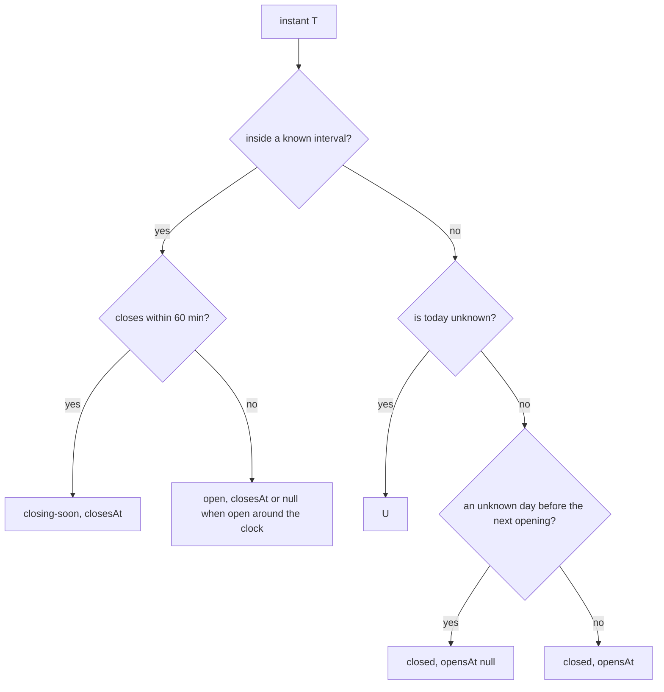

# Disscount: Store opening hours

How Disscount knows whether a store is open, where the hours come from, and why a Sunday is never guessed. The map shows the result; [MAP.md](MAP.md) covers the map itself.

> **Mental model in one sentence:** each store has a weekly template plus dated entries (its own exceptions and the chain's Sunday and holiday announcements), and one pure function, `openingStatusAt`, turns that into "open until 21:00", "closing soon", "closed, opens at 07:00" or "hours not confirmed" for any instant, in Zagreb time, on the server and in the browser alike.

## Table of contents

1. [Quick reference](#1-quick-reference)
2. [The model](#2-the-model)
3. [Deciding open or closed](#3-deciding-open-or-closed)
4. [Serving the hours](#4-serving-the-hours)
5. [Automatic vs manual](#5-automatic-vs-manual)
6. [Key files](#6-key-files)
7. [Config and libraries](#7-config-and-libraries)
8. [Gotchas](#8-gotchas)
9. [Future improvements and TODOs](#9-future-improvements-and-todos)

## 1. Quick reference

| Question                         | Answer                                                                                                              |
| -------------------------------- | ------------------------------------------------------------------------------------------------------------------- |
| Where are hours stored?          | Our own Postgres, tables `store_hours`, `store_hours_overlay`, `store_hours_run` (migration `0010_store_hours.sql`) |
| Why not in the cijene-api fork?  | Hours change weekly and come from the chains' sites; the fork's store table suits stable fields, and it is AGPL     |
| Which time zone?                 | Always `Europe/Zagreb`, whatever the device or server runs in                                                       |
| Can a Sunday be open by default? | No. Without a dated entry a Sunday is "not confirmed", unless the store is marked exempt (`sundays: "weekly"`)      |
| Public holidays?                 | Closed by law unless a dated entry says otherwise; the dates come from `date-holidays`                              |
| When does data go stale?         | Each layer 14 days after its own `verifiedAt` (two missed weekly refreshes); a stale layer counts as unknown        |
| API                              | `GET /api/cijene/store-hours`, cached an hour, stale-while-revalidate a day                                         |

## 2. The model

The law sets the shape. Since 1 July 2023 shops close on Sundays except 16 Sundays each trader picks, plus exempt sites (stations, airports, ports), and on public holidays ([NN 33/2023](https://narodne-novine.nn.hr/clanci/sluzbeni/full/2023_03_33_580.html)). Nobody publishes the 16 Sundays in a register; chains announce them per store a few days ahead. So a weekly template can describe Monday to Saturday, but not which Sunday is a working one.

Each store has three layers, each with its source and when it was verified:

| Layer                      | Table                    | Refreshed                 | Example                                                                                 |
| -------------------------- | ------------------------ | ------------------------- | --------------------------------------------------------------------------------------- |
| Weekly template            | `store_hours.weekly`     | weekly                    | Monday to Saturday 07:00 to 21:00                                                       |
| Store exceptions           | `store_hours.exceptions` | weekly, with the template | Kaufland's `2026-11-01 closed`                                                          |
| Sunday and holiday overlay | `store_hours_overlay`    | Thursday to Saturday      | Konzum's `open_this_sunday` for one store; an empty `store_code` covers the whole chain |

The wire format (`frontend/src/lib/api/schemas/store-hours.ts`):

- `weekly`: seven entries, Monday first as ISO 8601 counts. Each is a list of `{ opens, closes }` intervals (split shifts are two), an empty list for closed, or `null` when the source did not say.
- `dated`: `{ date, ranges, verifiedAt }` for single days, already merged on the server: per date the latest observation wins, because the weekly refresh and the Thursday to Saturday poll often read the same date from the same feed; on a tie the store's exception beats the chain's word on that store, which beats a chain-wide one.
- `sundays`: `"dated"` (the default: a Sunday opens only through a dated entry) or `"weekly"` (an exempt store that keeps its weekly Sunday hours).
- `source`: `"chain"` or `"osm"`; `verifiedAt`; `checkUrl`, the page where a shopper can check the hours.

It maps one to one onto both standards, so data from either fits and could be published again:

| Ours                             | schema.org [OpeningHoursSpecification](https://schema.org/OpeningHoursSpecification) | OSM [opening_hours](https://wiki.openstreetmap.org/wiki/Key:opening_hours) |
| -------------------------------- | ------------------------------------------------------------------------------------ | -------------------------------------------------------------------------- |
| `weekly[0]` = `[{07:00, 21:00}]` | `dayOfWeek: Monday, opens: 07:00, closes: 21:00`                                     | `Mo 07:00-21:00`                                                           |
| `weekly[6]` = `[]`               | no Sunday specification                                                              | `Su off`                                                                   |
| dated `2026-11-01`, `[]`         | `validFrom = validThrough = 2026-11-01`, `opens = closes = 00:00`                    | `2026 Nov 01 off`                                                          |
| holiday rule (law)               | none                                                                                 | `PH off`                                                                   |
| `closes` at or before `opens`    | `closes` past midnight                                                               | `22:00-02:00`                                                              |

## 3. Deciding open or closed

`hoursOnDate` (`lib/store-hours/hours-on-date.ts`) resolves one day, first match wins:

1. a dated entry for that date, if verified within 14 days;
2. nothing more when the template is older than 14 days: the day is unknown;
3. a public holiday: closed, or unknown for an exempt store, since no source says which holidays exempt sites keep;
4. a Sunday: unknown, unless the store is exempt;
5. the weekly template for that weekday (`null` stays unknown).

`openingStatusAt` (`lib/store-hours/opening-status.ts`) lays yesterday to a week ahead out as minutes from today's midnight, so a late shift (`16:00` to `02:00`) reaches into today and `24:00` followed by `00:00` counts as one opening. Then:

A closed store on Saturday evening before an unconfirmed Sunday therefore says only "closed", not "opens Monday 07:00", because the Sunday may be a working one. `asOf` is the `verifiedAt` of the layer that decided today, so the page can show how fresh the answer is.

The function is pure and runs in the browser: the server sends the holidays as plain dates (`holidays` in the response), so the 11 MB holiday library never reaches the client bundle.

## 4. Serving the hours

`getStoreHours` (`lib/store-hours/get-store-hours.ts`) reads both tables, keeps each process's result for 10 minutes like the store directory, and `buildStoreHours` turns the rows into the response:

- Rows and announcements read from a chain whose switch is off are dropped; OpenStreetMap rows have their own switch (see [§7](#7-config-and-libraries)).
- Each store is validated against the wire schema on its own, so one malformed row (a bad time, a link that is not http or https) drops that store, not the whole response.
- Dated entries outside two days back to 45 days ahead are dropped, which keeps the payload small and still covers a response the service worker serves days later.
- `checkUrl` is the store's own page unless the link checker found it gone (404 or 410); then, or when a store has no page, the chain's store finder from `hours-chains.ts`.

The response is keyed `chain:code`, the same key as the store directory, under the `cijene` path so the service worker caches it for offline use.

## 5. Automatic vs manual

| Task                                              | How                                                                       |
| ------------------------------------------------- | ------------------------------------------------------------------------- |
| Creating the tables                               | Automatic: the `migrate` service applies `0010_store_hours.sql` on deploy |
| Holiday dates, Easter and Corpus Christi included | Automatic: `date-holidays`, public holidays only                          |
| Turning a chain off (for example on its request)  | Manual: set `enabled: false` in `hours-chains.ts` and deploy              |
| Marking a store exempt from the Sunday rule       | Manual: `sundays = 'weekly'` on its row; no source states it yet          |

## 6. Key files

| Path (under `frontend/`)                   | Role                                                        |
| ------------------------------------------ | ----------------------------------------------------------- |
| `src/db/store-hours-schema.ts`             | Drizzle tables                                              |
| `drizzle/0010_store_hours.sql`             | The migration                                               |
| `src/lib/api/schemas/store-hours.ts`       | Zod wire schema and types                                   |
| `src/lib/store-hours/zagreb-clock.ts`      | Zagreb wall clock, ISO date arithmetic, ISO weekday         |
| `src/lib/store-hours/hours-on-date.ts`     | One day's hours: dated entry, law, template                 |
| `src/lib/store-hours/opening-status.ts`    | `openingStatusAt`, the four states                          |
| `src/lib/store-hours/croatian-holidays.ts` | Public holidays between two dates (server only)             |
| `src/lib/store-hours/hours-chains.ts`      | Per-chain switch and store finder URL                       |
| `src/lib/store-hours/build-store-hours.ts` | Rows to response: switches, layering, window, link fallback |
| `src/lib/store-hours/get-store-hours.ts`   | Database read and memo                                      |
| `src/app/api/cijene/store-hours/route.ts`  | The public route                                            |

## 7. Config and libraries

- No environment variable. The per-chain switch is code (`HOURS_CHAINS` in `hours-chains.ts`) so turning a chain off is reviewed and deployed like any change; `OSM_HOURS_ENABLED` in the same file covers OpenStreetMap data.
- [`date-holidays`](https://github.com/commenthol/date-holidays) `^3.38.0` (ISC code, CC BY 3.0 data). Only `type === "public"` counts: the library also lists observances (Pokladni utorak, Majčin dan) and optional religious days, which shops keep.

## 8. Gotchas

- **Never read a Sunday from the template.** Most chains' feeds list Sunday as closed, or list Sunday hours that apply only on working Sundays. Either way the template would be wrong on some Sundays, and a wrong "open" is the top complaint in reviews of Croatian store hour apps.
- **Wall clock, not UTC.** `zagrebClock` formats the instant in `Europe/Zagreb`; date arithmetic works on ISO date strings through `Date.UTC`, so DST changes never shift a day.
- **Staleness hides everything.** After 14 days without a successful refresh even a holiday shows "not confirmed": an old row may belong to a store that has since changed its hours or closed. A fresh Sunday announcement still counts on its own day.
- **`00:00-00:00` is not 24 hours.** Feeds write a closed day that way, so the schema refuses equal `opens` and `closes`; a parser writes a closed day as `[]` and an all-day opening as `00:00` to `24:00`.

## 9. Future improvements and TODOs

- Exempt stores (stations, ports) are not detected; a source or a reviewed list would let their Sundays show.
- The 60 minute "closing soon" threshold is a product choice; revisit with feedback.
