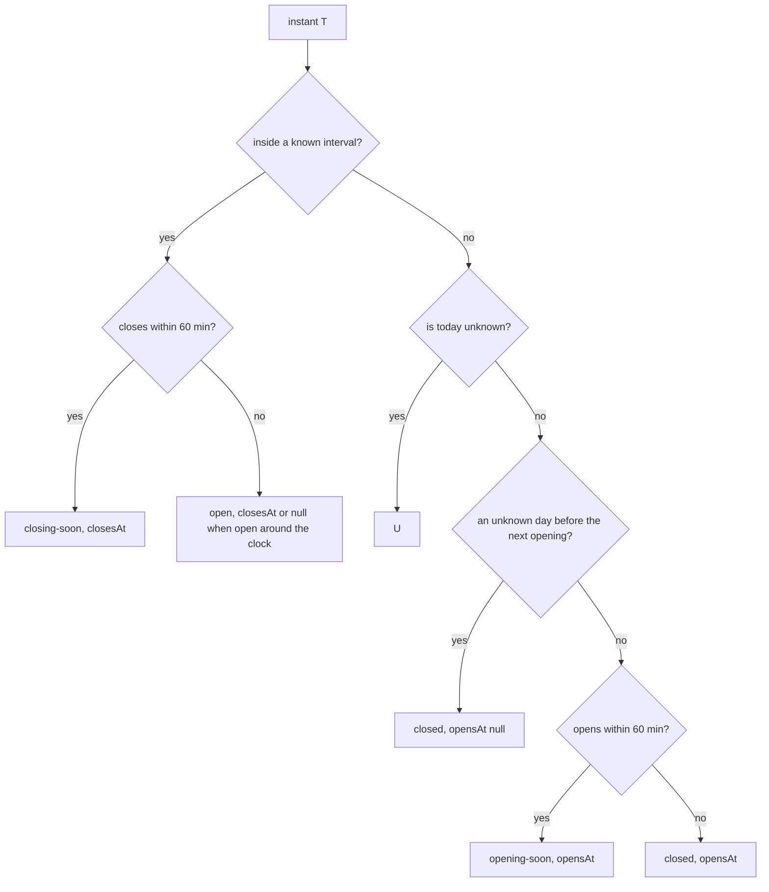
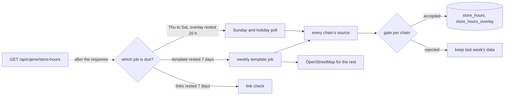

# Disscount: Store opening hours

How Disscount knows whether a store is open, where the hours come from, and why a Sunday is never guessed. The map shows the result; [MAP.md](MAP.md) covers the map itself.

> **Mental model in one sentence:** each store has a weekly template plus dated entries (its own exceptions and the chain's Sunday and holiday announcements), and one pure function, `openingStatusAt`, turns that into "open until 21:00", "closing soon", "closed, opens at 07:00", "opening soon" or "hours not confirmed" for any instant, in Zagreb time, on the server and in the browser alike.

## Table of contents

1. [Quick reference](#1-quick-reference)
2. [The model](#2-the-model)
3. [Deciding open or closed](#3-deciding-open-or-closed)
4. [Serving the hours](#4-serving-the-hours)
5. [Refreshing the hours](#5-refreshing-the-hours)
6. [Sources per chain](#6-sources-per-chain)
7. [Automatic vs manual](#7-automatic-vs-manual)
8. [Key files](#8-key-files)
9. [Config and libraries](#9-config-and-libraries)
10. [Gotchas](#10-gotchas)
11. [Future improvements and TODOs](#11-future-improvements-and-todos)

## 1. Quick reference

| Question                         | Answer                                                                                                              |
| -------------------------------- | ------------------------------------------------------------------------------------------------------------------- |
| Where are hours stored?          | Our own Postgres, tables `store_hours`, `store_hours_overlay`, `store_hours_run` (migration `0010_store_hours.sql`) |
| Why not in the cijene-api fork?  | Hours change weekly and come from the chains' sites; the fork's store table suits stable fields, and it is AGPL     |
| Which time zone?                 | Always `Europe/Zagreb`, whatever the device or server runs in                                                       |
| Can a Sunday be open by default? | No. Without a dated entry a Sunday is "not confirmed", unless the store is marked exempt (`sundays: "weekly"`)      |
| Public holidays?                 | Closed by law unless a dated entry says otherwise; the dates come from `date-holidays`                              |
| When does data go stale?         | Each layer 14 days after its own `verifiedAt` (two missed weekly refreshes); a stale layer counts as unknown        |
| API                              | `GET /api/cijene/store-hours`, cached an hour, stale-while-revalidate a day                                         |

## 2. The model

The law sets the shape. Since 1 July 2023 shops close on Sundays except 16 Sundays each trader picks, plus exempt sites (stations, airports, ports), and on public holidays ([NN 33/2023](https://narodne-novine.nn.hr/clanci/sluzbeni/full/2023_03_33_580.html)). Nobody publishes the 16 Sundays in a register; chains announce them per store a few days ahead. So a weekly template can describe Monday to Saturday, but not which Sunday is a working one.

Each store has three layers, each with its source and when it was verified:

| Layer                      | Table                    | Refreshed                 | Example                                                                                 |
| -------------------------- | ------------------------ | ------------------------- | --------------------------------------------------------------------------------------- |
| Weekly template            | `store_hours.weekly`     | weekly                    | Monday to Saturday 07:00 to 21:00                                                       |
| Store exceptions           | `store_hours.exceptions` | weekly, with the template | Kaufland's `2026-11-01 closed`                                                          |
| Sunday and holiday overlay | `store_hours_overlay`    | Thursday to Saturday      | Konzum's `open_this_sunday` for one store; an empty `store_code` covers the whole chain |

The wire format (`frontend/src/lib/api/schemas/store-hours.ts`):

- `weekly`: seven entries, Monday first as ISO 8601 counts. Each is a list of `{ opens, closes }` intervals (split shifts are two), an empty list for closed, or `null` when the source did not say.
- `dated`: `{ date, ranges, verifiedAt }` for single days, already merged on the server: per date the latest observation wins, because the weekly refresh and the Thursday to Saturday poll often read the same date from the same feed; on a tie the store's exception beats the chain's word on that store, which beats a chain-wide one.
- `sundays`: `"dated"` (the default: a Sunday opens only through a dated entry) or `"weekly"` (an exempt store that keeps its weekly Sunday hours).
- `source`: `"chain"` or `"osm"`; `verifiedAt`; `checkUrl`, the page where a shopper can check the hours.

It maps one to one onto both standards, so data from either fits and could be published again:

| Ours                             | schema.org [OpeningHoursSpecification](https://schema.org/OpeningHoursSpecification) | OSM [opening_hours](https://wiki.openstreetmap.org/wiki/Key:opening_hours) |
| -------------------------------- | ------------------------------------------------------------------------------------ | -------------------------------------------------------------------------- |
| `weekly[0]` = `[{07:00, 21:00}]` | `dayOfWeek: Monday, opens: 07:00, closes: 21:00`                                     | `Mo 07:00-21:00`                                                           |
| `weekly[6]` = `[]`               | no Sunday specification                                                              | `Su off`                                                                   |
| dated `2026-11-01`, `[]`         | `validFrom = validThrough = 2026-11-01`, `opens = closes = 00:00`                    | `2026 Nov 01 off`                                                          |
| holiday rule (law)               | none                                                                                 | `PH off`                                                                   |
| `closes` at or before `opens`    | `closes` past midnight                                                               | `22:00-02:00`                                                              |

## 3. Deciding open or closed

`hoursOnDate` (`lib/store-hours/hours-on-date.ts`) resolves one day, first match wins:

1. a dated entry for that date, if verified within 14 days;
2. nothing more when the template is older than 14 days: the day is unknown;
3. a public holiday: closed, or unknown for an exempt store, since no source says which holidays exempt sites keep;
4. a Sunday: unknown, unless the store is exempt;
5. the weekly template for that weekday (`null` stays unknown).

`openingStatusAt` (`lib/store-hours/opening-status.ts`) lays yesterday to a week ahead out as minutes from today's midnight, so a late shift (`16:00` to `02:00`) reaches into today and `24:00` followed by `00:00` counts as one opening. Then:

A closed store on Saturday evening before an unconfirmed Sunday therefore says only "closed", not "opens Monday 07:00", because the Sunday may be a working one. `asOf` is the `verifiedAt` of the layer that decided today, so the page can show how fresh the answer is.

The function is pure and runs in the browser: the server sends the holidays as plain dates (`holidays` in the response), so the 11 MB holiday library never reaches the client bundle.

## 4. Serving the hours

`getStoreHours` (`lib/store-hours/get-store-hours.ts`) reads both tables, keeps each process's result for 10 minutes like the store directory, and `buildStoreHours` turns the rows into the response:

- Rows and announcements read from a chain whose switch is off are dropped; OpenStreetMap rows have their own switch (see [§9](#9-config-and-libraries)).
- Each store is validated against the wire schema on its own, so one malformed row (a bad time, a link that is not http or https) drops that store, not the whole response.
- Dated entries outside two days back to 45 days ahead are dropped, which keeps the payload small and still covers a response the service worker serves days later.
- `checkUrl` is the store's own page unless the link checker found it gone (404 or 410); then, or when a store has no page, the chain's store finder from `hours-chains.ts`.

The response is keyed `chain:code`, the same key as the store directory, under the `cijene` path so the service worker caches it for offline use.

### Showing the hours

The map, the product page and the shopping list read the hours through one `StoreHoursProvider` (`components/custom/store-hours/store-hours-context.tsx`): the page calls `useStoreHoursNow` once, which holds the React Query result (one request, cached an hour and persisted for offline use) and the current minute from `useCurrentMinute`. That clock ticks on each minute boundary while the tab is visible and catches up when it returns, and is null until mount, so the server never renders a badge from its own clock. Each row calls `useStoreOpening(key)`, which runs `openingStatusAt`; nothing else decides whether a store is open.

- **Badge** (`opening-status-badge.tsx`): only "Otvoreno" (green), "Zatvoreno" (red) or "Radno vrijeme nije potvrđeno" (outline). Orange marks "soon" either way: "Otvoreno" when the store closes within the hour, "Zatvoreno" when it opens within the hour, the owner's choice. The badge text uses amber-700, since the shared amber-600 on amber-50 is about 3:1.
- **Detail** (`opening-status-detail.tsx`): the time ("Zatvara u 21:00", "Zatvara uskoro u 21:00", "Otvara sutra u 7:00") is not shown beside the badge but in a popover that opens on mouse hover, keyboard focus and tap. It is one controlled Radix popover rather than a tooltip, because Radix tooltips ignore taps and a touch laptop reports a fine pointer. The badge is a button named with the full state and time ("Otvoreno, zatvara uskoro u 21:00"), so screen readers get what the colour says. Inside the chain cards, which are one toggle button, the badge stays plain with that name as screen reader text, since a second button would nest a button in a button.
- **Map**: every list row and the phone sheet show the badge under the address, and it is part of the row's accessible name. The open row adds the source and its date ("Izvor: Kaufland (03.11.2026.)", through `formatDate`), the "Provjeri" link (a store no source covers links to its chain's finder), and a screen reader announcement when the open store's status changes. The "Otvoreno sada" switch keeps only confirmed open stores; a second switch also keeps unconfirmed ones. Until the hours load the filter keeps every store rather than emptying the list. If the request fails, or is paused offline with nothing cached, a line under the switch says the filter cannot work and offers a retry (`hooks/use-map-hours.ts`).
- **Product page**: each row of a chain's per store price table shows that store's badge. The hours are fetched only once a table is open or a nearest store is named.
- **Chain cards** (product page and shopping list): a chain has no hours of its own, so the card shows the badge of the chain's nearest store beside "Najbliža trgovina", and only while distances come from a location fix (`shownNearestStores` in `hooks/use-distance-sort.ts`). A town or IP guess names no nearest store, so no badge.

## 5. Refreshing the hours

Three jobs, each with its own row in `store_location_sync` (the same lease the location sync uses, see [MAP.md §3](MAP.md#3-store-locations-the-sync)), started by a request to `/api/cijene/store-hours` after the response is sent. There is no cron.

- **Template job** (`store-hours-template`, rests 7 days): every enabled chain's source is read, each record is matched to an upstream store by the location sync's own rules (`matchLocatorStore`: code, then address and town, then the looser passes), and the whole row is written: weekly days, every dated day the chain publishes as `exceptions`, the store page as `check_url`. Then OpenStreetMap fills pinned stores no chain covered.
- **Overlay job** (`store-hours-overlay`, rests 20 hours, only Thursday to Saturday in Zagreb): the same feeds again, keeping only Sundays and public holidays within two weeks, written to `store_hours_overlay`. Announcements older than a week are deleted. Because the merge keeps the latest observation per date, a Friday poll beats Monday's template for that Sunday.
- **Link check** (`store-hours-links`, rests 7 days, `sync/link-check.ts`): visits every distinct `check_url`, one page a second per host with hosts side by side, HEAD first and GET when a server refuses HEAD (405, 501). Only 404 and 410 mark a link `broken`, which makes the response fall back to the chain's store finder; 403, 429, 5xx and network errors are `unverified`, count up `link_failures`, and keep the link, because bot walls answer 403; they never turn a broken link back into a live one. Links checked longest ago go first, so a run cut short starves nothing. A 2xx or 3xx is `ok` and resets the count. Every store sharing a link gets the verdict; a template run that changes a store's link clears it until the next check.
- **Gate** (`sync/run-gate.ts`): a chain's run is rejected when it matches no store, or more than 30 percent fewer than the last accepted run. Its old rows stay, and `store_hours_run` records the status (`accepted`, `rejected`, `failed`, `disabled`), the count and the error per job and chain.
- **OpenStreetMap** (`sync/osm-step.ts`): one Overpass query for branded supermarkets, convenience shops and chemists in Croatia with `opening_hours`. A shop's `brand` is mapped to our chain, and a pinned store takes the nearest shop of its chain within 150 m, unless a second one is within 30 m of that distance. Only the plain weekly subset is read (`Mo-Sa 07:00-21:00; Su off; PH off`, about 90 percent of the values); anything else is skipped. An OpenStreetMap row never replaces a chain's own row. The public Overpass server is often busy, so the query retries after 30 s and 2 min, and a failure only skips the step.
- **Politeness**: the identifying User-Agent from `store-locations/http.ts`, one request at a time per chain, a second between store pages (Lidl's 116, Studenac's), and only the stores upstream lists are fetched where a chain needs one page per store.

Measured on 2026-11-03 against a copy of the local database: 1,289 of 1,670 upstream stores got their chain's hours and 28 more got OpenStreetMap's.

## 6. Sources per chain

| Chain                                                   | Where the hours come from                                           | Sundays and holidays                                                                                             | Store page for "Provjeri"                           |
| ------------------------------------------------------- | ------------------------------------------------------------------- | ---------------------------------------------------------------------------------------------------------------- | --------------------------------------------------- |
| Konzum                                                  | Locator JSON, `work_hours`: ten dated days, no template             | Each dated day, Sundays included                                                                                 | none, the locator                                   |
| Kaufland                                                | Locator JSON, `wod` weekly                                          | `sod`: the coming Sunday and holidays                                                                            | `/usluge/poslovnica/<friendlyUrl>.html`             |
| Spar                                                    | Locator JSON, `shopHours` (split shifts possible)                   | `specialShopHours` (months count from 0) for about two months, `temporarilyClosed` as closed days                | `pageUrl`; it answers scripts with a Cloudflare 403 |
| Plodine                                                 | List page cards                                                     | The Sunday row is the coming Sunday                                                                              | the card's `/supermarketi/<id>/<slug>`              |
| Lidl                                                    | 116 store pages, schema.org `GroceryStore` JSON-LD                  | `specialOpeningHoursSpecification` lists trading Sundays; unlisted Sundays up to the last listed date are closed | the store page                                      |
| Studenac                                                | List page for the store numbers, then each upstream store's page    | The page's table is this week's real schedule, each day dated                                                    | the store page                                      |
| Roto                                                    | Locator JSON, `radno` (Sunday first)                                | `nedjelje` lists the store's trading Sundays; the Sundays between are closed                                     | `/poslovnica/?mpc=` or `?vpc=`                      |
| Trgovina Krk                                            | The site's "Rad nedjeljom" feed (a POST), richer than the locator's | `neradna_nedjelja = "1"` means open this Sunday, whatever the name says                                          | `link`                                              |
| Trgocentar                                              | Map places' text                                                    | The "Radne nedjelje" sheet (codes like `P-060`), per month                                                       | none                                                |
| Tommy, Eurospin, NTL, Ribola, KTC, Stanić, Boso, Branka | Locator weekly text or JSON                                         | None: Sundays stay unconfirmed                                                                                   | Eurospin `url`, Stanić `url`; the rest none         |

dm is not covered: upstream lists dm as a single chain-wide store, so there is no store to attach hours to.

## 7. Automatic vs manual

| Task                                              | How                                                                                                              |
| ------------------------------------------------- | ---------------------------------------------------------------------------------------------------------------- |
| Creating the tables                               | Automatic: the `migrate` service applies `0010_store_hours.sql` on deploy                                        |
| Holiday dates, Easter and Corpus Christi included | Automatic: `date-holidays`, public holidays only                                                                 |
| Turning a chain off (for example on its request)  | Manual: set `enabled: false` in `hours-chains.ts` and deploy                                                     |
| Marking a store exempt from the Sunday rule       | Manual: `sundays = 'weekly'` on its row; no source states it yet                                                 |
| Weekly hours, Sunday announcements, OpenStreetMap | Automatic: the two jobs above, started by map traffic                                                            |
| A chain rejected by the gate                      | Manual: read `store_hours_run`, fix the parser; its old data shows meanwhile and turns unconfirmed after 14 days |

## 8. Key files

| Path (under `frontend/`)                                   | Role                                                        |
| ---------------------------------------------------------- | ----------------------------------------------------------- |
| `src/db/store-hours-schema.ts`                             | Drizzle tables                                              |
| `drizzle/0010_store_hours.sql`                             | The migration                                               |
| `src/lib/api/schemas/store-hours.ts`                       | Zod wire schema and types                                   |
| `src/lib/store-hours/zagreb-clock.ts`                      | Zagreb wall clock, ISO date arithmetic, ISO weekday         |
| `src/lib/store-hours/hours-on-date.ts`                     | One day's hours: dated entry, law, template                 |
| `src/lib/store-hours/opening-status.ts`                    | `openingStatusAt`, the four states                          |
| `src/lib/store-hours/croatian-holidays.ts`                 | Public holidays between two dates (server only)             |
| `src/lib/store-hours/hours-chains.ts`                      | Per-chain switch and store finder URL                       |
| `src/lib/store-hours/build-store-hours.ts`                 | Rows to response: switches, layering, window, link fallback |
| `src/lib/store-hours/get-store-hours.ts`                   | Database read and memo                                      |
| `src/app/api/cijene/store-hours/route.ts`                  | The public route                                            |
| `src/lib/store-hours/sync/link-check.ts`, `link-status.ts` | The weekly link check and its verdict rule                  |
| `src/lib/store-hours/store-opening.ts`                     | One store's status from the response and the minute         |
| `src/components/custom/store-hours/`                       | Provider, badge, the source and "Provjeri" line             |
| `src/hooks/use-current-minute.ts`                          | The minute clock behind every badge                         |
| `src/app/[locale]/map/utils/open-filter.ts`                | The "open now" filter and its `?open=` value                |

## 9. Config and libraries

- No environment variable. The per-chain switch is code (`HOURS_CHAINS` in `hours-chains.ts`) so turning a chain off is reviewed and deployed like any change; `OSM_HOURS_ENABLED` in the same file covers OpenStreetMap data.
- [`date-holidays`](https://github.com/commenthol/date-holidays) `^3.38.0` (ISC code, CC BY 3.0 data). Only `type === "public"` counts: the library also lists observances (Pokladni utorak, Majčin dan) and optional religious days, which shops keep.

## 10. Gotchas

- **Never read a Sunday from the template.** Most chains' feeds list Sunday as closed, or list Sunday hours that apply only on working Sundays. Either way the template would be wrong on some Sundays, and a wrong "open" is the top complaint in reviews of Croatian store hour apps.
- **Wall clock, not UTC.** `zagrebClock` formats the instant in `Europe/Zagreb`; date arithmetic works on ISO date strings through `Date.UTC`, so DST changes never shift a day.
- **Staleness hides everything.** After 14 days without a successful refresh even a holiday shows "not confirmed": an old row may belong to a store that has since changed its hours or closed. A fresh Sunday announcement still counts on its own day.
- **"This Sunday" carries no date.** Plodine's and Trgovina Krk's flags mean the Sunday after the fetch, so the parser dates them with `comingSunday(today)`. NTL has the same flag, but its page sits in a week-long LiteSpeed cache, so the flag may describe a past Sunday and is ignored.
- **Spar counts months from 0.** `{month: 10}` is November.
- **Trgocentar's sheet lags.** On 2026-11-03 it still showed October; past dates are dropped, so the Sundays simply stay unconfirmed until the new month is up.
- **Studenac's list page shows only today.** Its hours text depends on the time of day, so the weekly table is read from each store's page.
- **`00:00-00:00` is not 24 hours.** Feeds write a closed day that way, so the schema refuses equal `opens` and `closes`; a parser writes a closed day as `[]` and an all-day opening as `00:00` to `24:00`.

## 11. Future improvements and TODOs

- dm: per-store hours exist in dm's store finder API (unpublished terms), but upstream has no dm stores to attach them to.
- A real cron (a Dokploy schedule calling a protected endpoint) would keep the Sunday poll running when nobody opens the map on Thursday to Saturday; it needs a secret env var.
- OpenStreetMap through a Geofabrik extract instead of the public Overpass server, which asks automated users to run their own.

- Exempt stores (stations, ports) are not detected; a source or a reviewed list would let their Sundays show.
- The 60 minute "soon" window, shared by closing and opening soon, is a product choice; revisit with feedback.
- Green and orange "Otvoreno" differ by colour alone at a glance; revisit if users miss the closing soon state.
