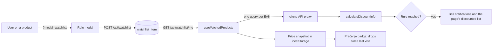

# Disscount: Watchlist and price alerts

A reference for the watchlist (`/watchlist`, "Praćeni proizvodi" in Croatian): how a user follows a product, how the app decides a watched product is cheap, where that shows up, and what the backend does and does not do. Written for someone still learning the codebase.

> **Mental model in one sentence:** the backend stores only the rule ("tell me when this EAN is at least 10 % off"), while the browser fetches today's prices, checks every rule and shows the result, so an alert exists only while the app is open; no server job, email or push sends one.

---

## Table of contents

1. [Quick reference](#1-quick-reference)
2. [How it works end to end](#2-how-it-works-end-to-end)
3. [Storage and API](#3-storage-and-api)
4. [Setting a rule](#4-setting-a-rule)
5. [When a rule fires](#5-when-a-rule-fires)
6. [Where alerts show up](#6-where-alerts-show-up)
7. [The watchlist page](#7-the-watchlist-page)
8. [Offline and caching](#8-offline-and-caching)
9. [What is automatic vs manual](#9-what-is-automatic-vs-manual)
10. [Key files](#10-key-files)
11. [Config, env vars and libraries](#11-config-env-vars-and-libraries)
12. [Tests](#12-tests)
13. [Gotchas and lessons learned](#13-gotchas-and-lessons-learned)
14. [Future improvements and TODOs](#14-future-improvements-and-todos)

---

## 1. Quick reference

| Thing                 | Value                                                                                                            |
| --------------------- | ---------------------------------------------------------------------------------------------------------------- |
| Page                  | `/watchlist`, login required (logged out users see a sign-in prompt, not a redirect)                             |
| Rule modal            | `?modal=watchlist&ean=<ean>` (optional `&type=percentage\|absolute`), opened from a product                      |
| Backend table         | `watchlist_item`, soft deleted                                                                                   |
| Backend endpoints     | `POST /api/watchlist`, `GET /api/watchlist/me`, `GET /api/watchlist/product/{ean}`, `DELETE /api/watchlist/{id}` |
| Where alerts are made | In the browser, every time the watched products' prices load                                                     |
| Where alerts appear   | The header bell, the Praćenje nav badge (header, sidebar, bottom nav), the watchlist page                        |
| Server-side alerts    | None. The notification table was removed in #487; the server inbox is parked in #222                             |
| Copy                  | `frontend/src/i18n/messages/<locale>/watchlist.json`                                                             |

---

## 2. How it works end to end

1. The user opens a product and sets a rule. The modal posts it to Spring, which stores it against their account.
2. Anywhere the app needs alert state, `useWatchedProducts` (`lib/watchlist/use-watched-products.ts`) loads the user's rules, groups them by EAN, and runs one product query per EAN through the shared `productByEanQueryOptions`, so the product page, the modal and the watchlist reuse one cache entry.
3. `calculateDiscountInfo` turns each product's chain prices into a baseline and a best price; the threshold helpers compare them with the rule.
4. Two different signals come out of that data: "this product meets your rule" (the bell and the page) and "this product got cheaper since you last looked" (the nav badge). They are separate on purpose, see [Section 6](#6-where-alerts-show-up).

Product data itself (the proxy, caching, the product page) is covered in [PRODUCTS.md](PRODUCTS.md).

---

## 3. Storage and API

The backend stores the rule and never a price. Entity `WatchlistItem` (`backend/src/main/java/disscount/watchlistItem/domain/WatchlistItem.java`), table `watchlist_item`:

| Column                     | Meaning                                                              |
| -------------------------- | -------------------------------------------------------------------- |
| `id`                       | UUID                                                                 |
| `user_id`                  | The owner (`app_user`)                                               |
| `product_api_id`           | The product's EAN                                                    |
| `watch_type`               | `PERCENTAGE` or `ABSOLUTE` (stored as a string)                      |
| `threshold_value`          | The number the user typed: percent, or euros                         |
| `last_notified_at`         | Never written by anything; always `null` on the wire                 |
| `created_at`, `updated_at` | Stamped with `Timestamps.nowUtc()` in `@PrePersist` and `@PreUpdate` |
| `deleted_at`               | Soft delete marker                                                   |

| Method and path                             | What it does                                                                                                             |
| ------------------------------------------- | ------------------------------------------------------------------------------------------------------------------------ |
| `POST /api/watchlist`                       | Upsert: if the caller already has a live rule of that type for that EAN, only its threshold changes; otherwise a new row |
| `GET /api/watchlist/me`                     | The caller's live rules                                                                                                  |
| `GET /api/watchlist/product/{productApiId}` | The caller's live rules for one EAN (up to two, one per type)                                                            |
| `DELETE /api/watchlist/{id}`                | Soft delete. A repeat delete answers 204; another user's id answers 404 like an unknown one                              |

All four need a signed-in session; the browser reaches them through the backend proxy ([BACKEND-PROXY.md](BACKEND-PROXY.md)). Every query in `WatchlistItemRepository` is scoped by `user.id`, which `WatchlistItemOwnershipTest` pins. The frontend parses every response through `watchlistItemDtoSchema` (`lib/api/schemas/watchlist.ts`), so a changed field fails loudly at the service boundary.

**Account deletion keeps the rows.** `UserService.deleteAccount` anonymises the profile and leaves watchlist rules in place, like shopping lists; `AccountErasureTest` asserts the rule survives. The full erasure flow is in [AUTH.md](AUTH.md#13-gotchas-and-lessons).

---

## 4. Setting a rule

The rule modal (`app/[locale]/products/components/forms/watchlist-item-modal.tsx`, with `watchlist-type-picker.tsx`, `watchlist-threshold-input.tsx` and the hook `use-watchlist-item-form.ts`) offers two kinds of rule:

| Type         | Label idea               | Range enforced in the form | Default when not yet tracked                                       |
| ------------ | ------------------------ | -------------------------- | ------------------------------------------------------------------ |
| `PERCENTAGE` | "discount is at least %" | 1 to 99                    | 10                                                                 |
| `ABSOLUTE`   | "price drops by €"       | 0.1 to 999                 | 10 % of the average price, clamped to the range; 1 € with no price |

- A product can carry one rule of each type, so "10 % off or 0.50 € off" is two rows.
- The ranges and defaults live in `app/[locale]/products/utils/watchlist-thresholds.ts`. The backend checks only that the value is positive (`watchlistItemRequestSchema` on the client, `@Positive` on `WatchlistItemRequest` on the server), so a client other than ours could store 5000 %.
- `parseThreshold` accepts the whole string or nothing, so "10abc" is invalid rather than read as 10.
- The product page's watchlist toggle (`app/[locale]/products/components/watchlist-action-button.tsx`) opens the modal; the watchlist page's own button (`(user)/watchlist/components/watchlist-action-button.tsx`) edits or removes.

---

## 5. When a rule fires

All of this runs in the browser (`lib/watchlist/`).

1. **Scope.** If the user has pinned stores (Postavke, Preference), only those stores' chains count. Otherwise every chain counts. See [SETTINGS.md](SETTINGS.md#5-preference-pinned-stores-places-and-language).
2. **Baseline and best price.** `calculateDiscountInfo` (`watchlist-discount-utils.ts`) takes the mean of the chains' `avg_price` as the baseline and the cheapest chain's `min_price` as today's price, for the scope above.
3. **Compare.** `isWatchThresholdReached` (`watchlist-threshold-utils.ts`) fires when today's price is below the baseline and the saving is at least the threshold, in euros for `ABSOLUTE` or percent for `PERCENTAGE`. `isAnyWatchThresholdReached` treats a product as discounted when any one of its rules fires.

So "discount" here means "cheaper than the average across chains", not a sale price from the shop. Basing it on price history instead is #63.

---

## 6. Where alerts show up

There are two signals, and they answer different questions.

**Rule matches: the bell.** `useWatchlistNotifications` (`context/use-watchlist-notifications.ts`) calls `buildWatchlistNotifications` (`context/build-watchlist-notifications.ts`), which lists every product with a firing rule, the stores where it fires sorted by saving, and a summary (total saving and percent). The header bell (`components/custom/notifications/notifications-dropdown.tsx`) renders it. Every entry is marked new, because nothing stores read state. The landing page can open the bell through `requestOpenMenu` ([LANDING.md](LANDING.md)).

**Price drops since the last visit: the Praćenje badge.** `useWatchlistPriceDropCount` (`lib/watchlist/use-watchlist-price-drop-count.ts`) counts watched products whose best in-scope price is lower than when the user last opened `/watchlist` on this device. It does not look at the rules at all.

- The baseline is a per-user snapshot in localStorage (`watchlistPriceSnapshots` under the shared `Disscount_app` key, helpers in `utils/browser/storage/watchlist.ts`), prices stored in whole cents so float noise never reads as a drop.
- Visiting `/watchlist` with the tab visible resets every baseline to today's price, so the badge clears. A change of pinned stores also resets it, since the prices are no longer comparable.
- A product seen for the first time gets a baseline without counting; a product whose price failed to load keeps its old one; an unwatched product is dropped.
- The snapshot is merged against a fresh localStorage read and listens to `storage` events, so two tabs do not overwrite each other's visit.
- It is not written until the user's pinned stores are known, because an unknown scope would read as "every chain" and rebase away drops not yet seen.
- Signing out or switching accounts deletes the snapshot through `lib/offline/purge.ts`.
- The header, sidebar and bottom nav show the count as a badge. `PriceDropStatus` (`components/custom/watchlist/price-drop-status.tsx`), mounted once in the locale layout, announces later changes in a polite status region; the first settled count after load or sign-in is silent.

The hook's own comment calls it a stand-in until the server inbox (#222) can return an unseen count shared across devices.

---

## 7. The watchlist page

`app/[locale]/(user)/watchlist/page.tsx` is a server component that only sets metadata and reads `?q=`; everything else is `WatchlistClient`.

- **Tabs.** A `SectionTabs` bar with "Praćeni" (the user's products) and, only once there are any, "Prijedlozi" (suggestions), so a loading section never flashes an empty tab.
- **Search.** The search bar filters by product name and brand through the shared matcher ([SEARCH.md](SEARCH.md)); it is disabled while the list is empty.
- **Header.** Item count, a "last synced" time (the newest `dataUpdatedAt` among the product queries), and the "create a list from discounted items" button (`create-discounted-list-button.tsx`). That button makes a dated shopping list and adds each discounted product with its own request; it is not transactional, see [SHOPPING-LISTS.md](SHOPPING-LISTS.md).
- **Order.** `sortWatchlistItemsByDiscount` puts products that meet a rule first, then the biggest saving, using the pinned-store scope when there is one.
- **Suggestions.** `use-watchlist-suggestions.ts` takes every EAN on the user's shopping lists (`GET /api/shopping-lists/items`) that is not watched yet, loads each product, and ranks them by search relevance first, then by how many list rows carry the EAN, then by discount.
- **Failures.** A product whose refetch fails keeps its cached prices on screen; only a product with no data shows an error.

---

## 8. Offline and caching

- The `watchlist` query root is persisted to IndexedDB (`lib/offline/cached-query-keys.ts`), so the list renders offline from the last fetch. Product prices come from the persisted `cijene` cache ([PRODUCTS.md](PRODUCTS.md#11-caching-and-offline)).
- Adding and removing (`watchlistAdd`, `watchlistRemove` in `lib/offline/offline-mutation-keys.ts`) are on the offline mutation allowlist: they pause while offline and replay on reconnect ([PWA.md](PWA.md)).
- Both mutations invalidate the whole `["watchlist"]` root on success, which refreshes `me` and every by-product query.

---

## 9. What is automatic vs manual

| Task                                     | Automatic or manual       | Notes                                                                             |
| ---------------------------------------- | ------------------------- | --------------------------------------------------------------------------------- |
| Checking rules against prices            | Automatic, in the browser | Whenever the watched products load: any page with the bell or the badge           |
| Telling the user while the app is closed | Not built                 | No push, email or server job; see [Section 14](#14-future-improvements-and-todos) |
| Resetting the price-drop badge           | Automatic                 | On a visible visit to `/watchlist`, or a change of pinned stores                  |
| Replaying offline adds and removes       | Automatic                 | Paused mutations                                                                  |
| Purging soft-deleted rows                | Not built                 | Soft-deleted rules stay in the table                                              |
| Changing threshold ranges                | Manual code change        | `watchlist-thresholds.ts`; the backend has no range to update                     |

---

## 10. Key files

| Path                                                                                      | Role                                                                                                           |
| ----------------------------------------------------------------------------------------- | -------------------------------------------------------------------------------------------------------------- |
| `frontend/src/app/[locale]/(user)/watchlist/`                                             | The page: client, list, header, suggestions, sort and display utils                                            |
| `frontend/src/app/[locale]/products/components/forms/watchlist-*.tsx`                     | The rule modal, type picker and threshold input                                                                |
| `frontend/src/app/[locale]/products/utils/watchlist-thresholds.ts`                        | Ranges, defaults, threshold parsing                                                                            |
| `frontend/src/lib/watchlist/`                                                             | Shared logic: watched product queries, discount and threshold maths, price-drop snapshot rules, the badge hook |
| `frontend/src/context/use-watchlist-notifications.ts`, `build-watchlist-notifications.ts` | The bell's notification list and summary                                                                       |
| `frontend/src/components/custom/watchlist/price-drop-status.tsx`                          | Screen reader announcement of badge changes                                                                    |
| `frontend/src/utils/browser/storage/watchlist.ts`                                         | The localStorage snapshot store, cached for `useSyncExternalStore`                                             |
| `frontend/src/lib/api/watchlist/`, `frontend/src/lib/api/schemas/watchlist.ts`            | API client, query keys, zod schemas                                                                            |
| `backend/src/main/java/disscount/watchlistItem/`                                          | Entity, repository, service, controller                                                                        |

---

## 11. Config, env vars and libraries

No environment variables or feature flags. The watchlist uses the app's common stack, versions from `frontend/package.json`, the lockfile and `backend/pom.xml`:

| Library                      | Version                   | Used for                                    |
| ---------------------------- | ------------------------- | ------------------------------------------- |
| `@tanstack/react-query`      | `^5.90.12` (lock 5.105.1) | Rule and product queries, offline mutations |
| `react-hook-form`, `zod`     | `^7.90.0`, `^4.1.13`      | The rule modal and response parsing         |
| `spring-boot-starter-parent` | `4.1.2`                   | The backend                                 |

---

## 12. Tests

| Side     | Tests                                                                                                                                                                                                                                                                                                                                                      |
| -------- | ---------------------------------------------------------------------------------------------------------------------------------------------------------------------------------------------------------------------------------------------------------------------------------------------------------------------------------------------------------- |
| Frontend | `watchlist-discount-utils.test.ts`, `watchlist-price-drop-utils.test.ts`, `use-watchlist-price-drop-count.test.tsx`, `price-drop-status.test.tsx`, `storage/watchlist.test.tsx`, `use-watchlist-data.test.tsx`, `use-watchlist-suggestions.test.tsx`, `watchlist-client.test.tsx`, `lib/api/watchlist/index.test.tsx`, `lib/api/schemas/watchlist.test.ts` |
| Backend  | `WatchlistItemOwnershipTest` (ownership, repeat delete, 401 without a token), `WatchlistWireFormatTest` (every field, null times), `AccountErasureTest` (rules survive deletion)                                                                                                                                                                           |

The threshold modal's ranges and the bell's grouping have no dedicated test beyond what the hooks above exercise (unverified beyond reading the test names).

---

## 13. Gotchas and lessons learned

| Gotcha                                              | Why it bites                                                                                                        | What to do                                                                                               |
| --------------------------------------------------- | ------------------------------------------------------------------------------------------------------------------- | -------------------------------------------------------------------------------------------------------- |
| **The badge and the bell measure different things** | The badge counts drops since the last visit; the bell lists rule matches. A product can be in one and not the other | Debug the right hook: `useWatchlistPriceDropCount` or `useWatchlistNotifications`                        |
| **`last_notified_at` is dead**                      | It is in the entity, the DTO and the zod schema, but nothing writes it                                              | Do not build on it; the inbox in #222 will need its own read state                                       |
| **Ranges are frontend only**                        | The server accepts any positive number                                                                              | A new client must apply `watchlistLimits` itself                                                         |
| **Re-adding after a delete makes a new row**        | The upsert only matches live rows, so the soft-deleted one stays behind                                             | Expected; history is not reused                                                                          |
| **One product query per watched EAN**               | A long watchlist means many parallel upstream calls on every page with the bell                                     | Fine at today's sizes; a batched endpoint upstream would fix it (#45 covers history, not current prices) |
| **The snapshot needs a known scope**                | Writing before pinned stores load would rebase against every chain                                                  | Keep the `isScopeKnown` guard                                                                            |
| **`spring-boot-starter-mail` is unused**            | It is on the classpath, but no watchlist email exists                                                               | Email alerts need the consent work in #216 first                                                         |

---

## 14. Future improvements and TODOs

- [ ] #222: move alerts to a server-side notification inbox with read state, shared by in-app, push and email. This is the planned replacement for both browser-only signals above.
- [ ] #221: deliver alerts as Web Push notifications. #216: fix notification consent and build a compliant email alert path. Both need a backend job that checks prices, which does not exist.
- [ ] #63: base discount detection on price history instead of the cross-chain average. #278: show sale prices.
- [ ] #200: re-check the watchlist ownership report against the current code; `WatchlistItemOwnershipTest` now covers it.
- [ ] #407: announce the search result count to screen readers on the watchlist.
- [ ] Sorting controls on the watchlist are part of the sorting rework noted in [SEARCH.md](SEARCH.md#11-future-improvements--todos).
